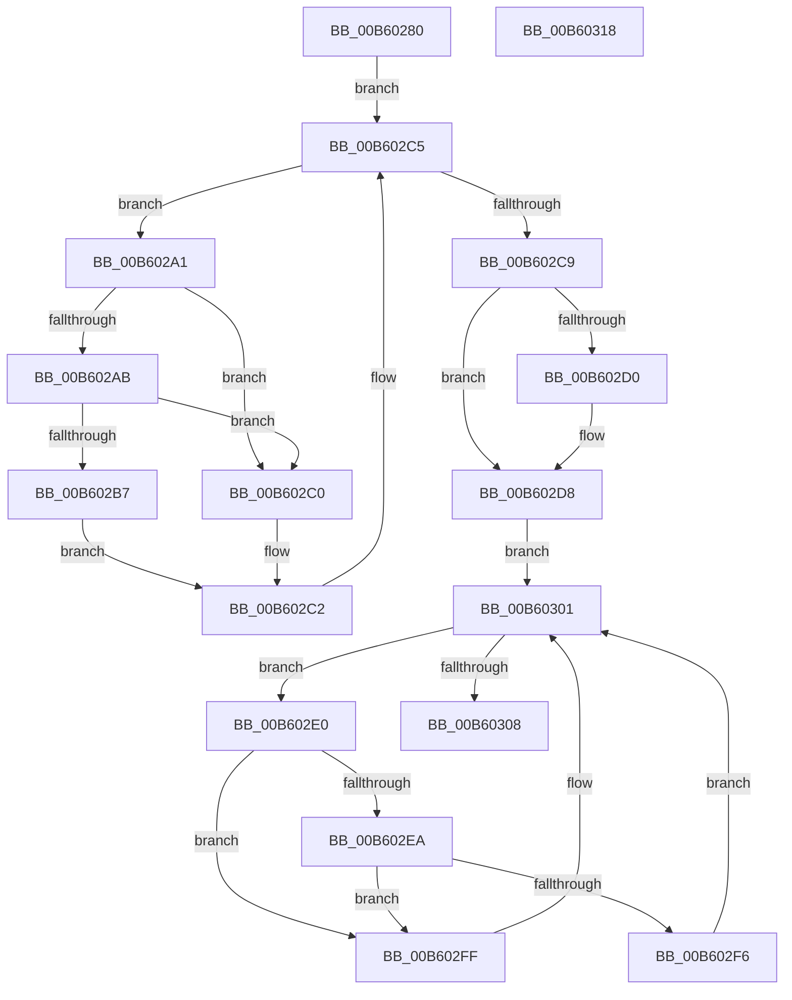

# HalpDpReplaceTarget

- RVA: `0x00B60280`–`0x00B60319` (길이 `153` bytes)
- VA: `0x0000000140B60280`
- 실행 섹션: `PAGELK`
- PDB 이름 있음: `예`; PDB Function 태그: `아니요`
- unwind 정보 RVA: `0x00060BC4`
- 디코드: `51`개 명령, `153/153` bytes 표시
- 미해석 바이트: `0` (있으면 어셈블리에 `.byte`로 보존)

> 이 문서는 커널 이미지의 기계어와 PDB 기호를 분석해 생성했습니다. 4번과 5번은 함수 원형과 자료형을 바이너리 사용 방식에서 추정한 C 해석이며 원본 소스 복구 결과는 아닙니다.

## 1. Dependencies

- 직접 호출 지점: **3**; 고유 호출 대상: **2**
- 직접 호출자로 확인된 함수: **0**
- RIP 상대 이미지 참조: **2**

### Outgoing calls
- `0x00B602B9` → [guard_dispatch_icall](../../text/6B/guard_dispatch_icall_function_006BAAD0.md) (function, `0x006BAAD0`)
- `0x00B602D3` → [HalpDpOfflineProcessorForReplace](../B5/HalpDpOfflineProcessorForReplace_function_00B5FC20.md) (function, `0x00B5FC20`)
- `0x00B602F8` → [guard_dispatch_icall](../../text/6B/guard_dispatch_icall_function_006BAAD0.md) (function, `0x006BAAD0`)

### Direct callers
- 이 함수 시작 RVA로 연결되는 직접 call은 확인되지 않았습니다. 간접 호출은 완전히 역산할 수 없습니다.

### Static image references
- `0x00B602A3` → RVA `0x00FC1C7C` (`.data`; reference)
- `0x00B602AB` → RVA `0x00FC1C80` (`.data`; read)

## 2. Other-region calls and transfers

- 다른 실행 섹션으로 향하는 call: **2**
  - `0x00B602B9` → [guard_dispatch_icall](../../text/6B/guard_dispatch_icall_function_006BAAD0.md) (`PAGELK` → `.text`)
  - `0x00B602F8` → [guard_dispatch_icall](../../text/6B/guard_dispatch_icall_function_006BAAD0.md) (`PAGELK` → `.text`)
- 별도 외부 분기/꼬리 이동을 확인하지 못했습니다.

## 3. Assembly (complete function range)

```asm
00B60280  48 89 5C 24 08                  mov qword ptr [rsp + 8], rbx
00B60285  48 89 74 24 10                  mov qword ptr [rsp + 0x10], rsi
00B6028A  57                              push rdi
00B6028B  48 83 EC 20                     sub rsp, 0x20
00B6028F  8B 31                           mov esi, dword ptr [rcx]
00B60291  48 8B D9                        mov rbx, rcx
00B60294  33 FF                           xor edi, edi
00B60296  F0 FF 41 30                     lock inc dword ptr [rcx + 0x30]
00B6029A  8B 41 30                        mov eax, dword ptr [rcx + 0x30]
00B6029D  FF C6                           inc esi
00B6029F  EB 24                           jmp 0x140b602c5
00B602A1  FF C7                           inc edi
00B602A3  85 3D D3 19 46 00               test dword ptr [rip + 0x4619d3], edi
00B602A9  75 15                           jne 0x140b602c0
00B602AB  48 8B 05 CE 19 46 00            mov rax, qword ptr [rip + 0x4619ce]
00B602B2  48 85 C0                        test rax, rax
00B602B5  74 09                           je 0x140b602c0
00B602B7  8B CF                           mov ecx, edi
00B602B9  E8 12 A8 B5 FF                  call 0x1406baad0
00B602BE  EB 02                           jmp 0x140b602c2
00B602C0  F3 90                           pause
00B602C2  8B 43 30                        mov eax, dword ptr [rbx + 0x30]
00B602C5  3B C6                           cmp eax, esi
00B602C7  7C D8                           jl 0x140b602a1
00B602C9  8A 43 44                        mov al, byte ptr [rbx + 0x44]
00B602CC  84 C0                           test al, al
00B602CE  75 08                           jne 0x140b602d8
00B602D0  48 8B CB                        mov rcx, rbx
00B602D3  E8 48 F9 FF FF                  call 0x140b5fc20
00B602D8  33 FF                           xor edi, edi
00B602DA  F0 FF 43 34                     lock inc dword ptr [rbx + 0x34]
00B602DE  EB 21                           jmp 0x140b60301
00B602E0  FF C7                           inc edi
00B602E2  85 3D 94 19 46 00               test dword ptr [rip + 0x461994], edi
00B602E8  75 15                           jne 0x140b602ff
00B602EA  48 8B 05 8F 19 46 00            mov rax, qword ptr [rip + 0x46198f]
00B602F1  48 85 C0                        test rax, rax
00B602F4  74 09                           je 0x140b602ff
00B602F6  8B CF                           mov ecx, edi
00B602F8  E8 D3 A7 B5 FF                  call 0x1406baad0
00B602FD  EB 02                           jmp 0x140b60301
00B602FF  F3 90                           pause
00B60301  8B 43 34                        mov eax, dword ptr [rbx + 0x34]
00B60304  3B C6                           cmp eax, esi
00B60306  7C D8                           jl 0x140b602e0
00B60308  48 8B 5C 24 30                  mov rbx, qword ptr [rsp + 0x30]
00B6030D  48 8B 74 24 38                  mov rsi, qword ptr [rsp + 0x38]
00B60312  48 83 C4 20                     add rsp, 0x20
00B60316  5F                              pop rdi
00B60317  C3                              ret
00B60318  CC                              int3
```

## 4. C-style interpretation (structured pseudocode)

```c
__int64 __fastcall HalpDpReplaceTarget(__int64 a1)
{
    __int64 result;
    __int64 v_rdi;
    __int64 v_rsi;
    __int64 v_rsp;
    unsigned __int64 v_stack_p10;
    unsigned __int64 v_stack_p8;

    v_stack_p8 = v_rbx;
    v_stack_p10 = v_rsi;
    v_rsp = (v_rsp) - (32);
    v_rdi = 0;
    v_rsi = (unsigned int)(((unsigned int)(*(unsigned int *)(a1))) + 1);
    goto loc_00B602C5;
loc_00B602A1:
    v_rdi = (unsigned int)((v_rdi) + 1);
    if (((*(unsigned int *)(v_rip + 4594131)) & ((unsigned int)(v_rdi))) != 0) goto loc_00B602C0;
    if (*(unsigned __int64 *)(v_rip + 4594126) == 0) goto loc_00B602C0;
    result = guard_dispatch_icall((unsigned int)((unsigned int)(v_rdi)), a2, a3, a4);
    goto loc_00B602C2;
loc_00B602C0:
loc_00B602C2:
loc_00B602C5:
    if (((unsigned int)((unsigned int)(*(unsigned int *)(a1 + 48)))) < ((unsigned int)(v_rsi))) goto loc_00B602A1;
    result = *(unsigned __int8 *)(a1 + 68);
    if ((unsigned __int8)(*(unsigned __int8 *)(a1 + 68)) == 0) {
        a1 = a1;
        result = HalpDpOfflineProcessorForReplace(a1, a2, a3, a4);
    }
    v_rdi = 0;
    goto loc_00B60301;
loc_00B602E0:
    v_rdi = (unsigned int)((v_rdi) + 1);
    if (((*(unsigned int *)(v_rip + 4594068)) & ((unsigned int)(v_rdi))) != 0) goto loc_00B602FF;
    if (*(unsigned __int64 *)(v_rip + 4594063) == 0) goto loc_00B602FF;
    result = guard_dispatch_icall((unsigned int)((unsigned int)(v_rdi)), a2, a3, a4);
    goto loc_00B60301;
loc_00B602FF:
loc_00B60301:
    if (((unsigned int)((unsigned int)(*(unsigned int *)(a1 + 52)))) < ((unsigned int)(v_rsi))) goto loc_00B602E0;
    v_rsp = (v_rsp) + (32);
    return (unsigned int)(*(unsigned int *)(a1 + 52));
}
```

## 5. (Beta) C Style

```c
int64_t HalpDpReplaceTarget(void *Arg1)
{
    uint8_t *arg1 = (uint8_t *)Arg1;

    int64_t result;
    int64_t local_rdi;
    int64_t local_rsi;
    int64_t local_rsp;
    uint64_t v_stack_p10;
    uint64_t v_stack_p8;

    v_stack_p8 = local_rbx;
    v_stack_p10 = local_rsi;
    local_rsp = (local_rsp) - (32);
    local_rdi = 0;
    local_rsi = (uint32_t)(((uint32_t)(*(uint32_t *)(arg1))) + 1);
    goto loc_00B602C5;
loc_00B602A1:
    local_rdi = (uint32_t)((local_rdi) + 1);
    if (((*(uint32_t *)(v_rip + 0x4619D3)) & ((uint32_t)(local_rdi))) != 0) goto loc_00B602C0;
    if (*(uint64_t *)(v_rip + 0x4619CE) == 0) goto loc_00B602C0;
    result = guard_dispatch_icall((uint32_t)((uint32_t)(local_rdi)), a2, a3, a4);
    goto loc_00B602C2;
loc_00B602C0:
loc_00B602C2:
loc_00B602C5:
    if (((uint32_t)((uint32_t)(*(uint32_t *)(arg1 + 0x30)))) < ((uint32_t)(local_rsi))) goto loc_00B602A1;
    result = *(uint8_t *)(arg1 + 0x44);
    if ((uint8_t)(*(uint8_t *)(arg1 + 0x44)) == 0) {
        Arg1 = Arg1;
        result = HalpDpOfflineProcessorForReplace(Arg1, a2, a3, a4);
    }
    local_rdi = 0;
    goto loc_00B60301;
loc_00B602E0:
    local_rdi = (uint32_t)((local_rdi) + 1);
    if (((*(uint32_t *)(v_rip + 0x461994)) & ((uint32_t)(local_rdi))) != 0) goto loc_00B602FF;
    if (*(uint64_t *)(v_rip + 0x46198F) == 0) goto loc_00B602FF;
    result = guard_dispatch_icall((uint32_t)((uint32_t)(local_rdi)), a2, a3, a4);
    goto loc_00B60301;
loc_00B602FF:
loc_00B60301:
    if (((uint32_t)((uint32_t)(*(uint32_t *)(arg1 + 0x34)))) < ((uint32_t)(local_rsi))) goto loc_00B602E0;
    local_rsp = (local_rsp) + (32);
    return (uint32_t)(*(uint32_t *)(arg1 + 0x34));
}
```

### 관측된 메모리 오프셋

구조체 형식이 확인되지 않은 접근은 인자 기준의 오프셋으로만 기록했습니다.

| 기준 인자 | 오프셋 표현 | 폭 (bit) | 접근 |
|---|---:|---:|---|
| `Arg1` | `+ 0x0` | `32` | `R` |
| `Arg1` | `+ 0x30` | `32` | `R` |
| `Arg1` | `+ 0x30` | `32` | `R/W` |
| `Arg1` | `+ 0x34` | `32` | `R` |
| `Arg1` | `+ 0x34` | `32` | `R/W` |
| `Arg1` | `+ 0x44` | `8` | `R` |

## 6. Execution-region graph

[열기: 2D/3D 그래프와 함수 탐색 컨트롤 패널](../../../control-panel.html?section=pagelk&rva=0x00B60280&view=graph)

- 2D 그래프는 위에서 아래로 흐르고, 3D 그래프는 빈 공간을 드래그해 회전합니다. Shift+드래그는 이동, 휠은 확대·축소, 함수 노드 선택은 대상 보고서 이동입니다.

### Static fallback


