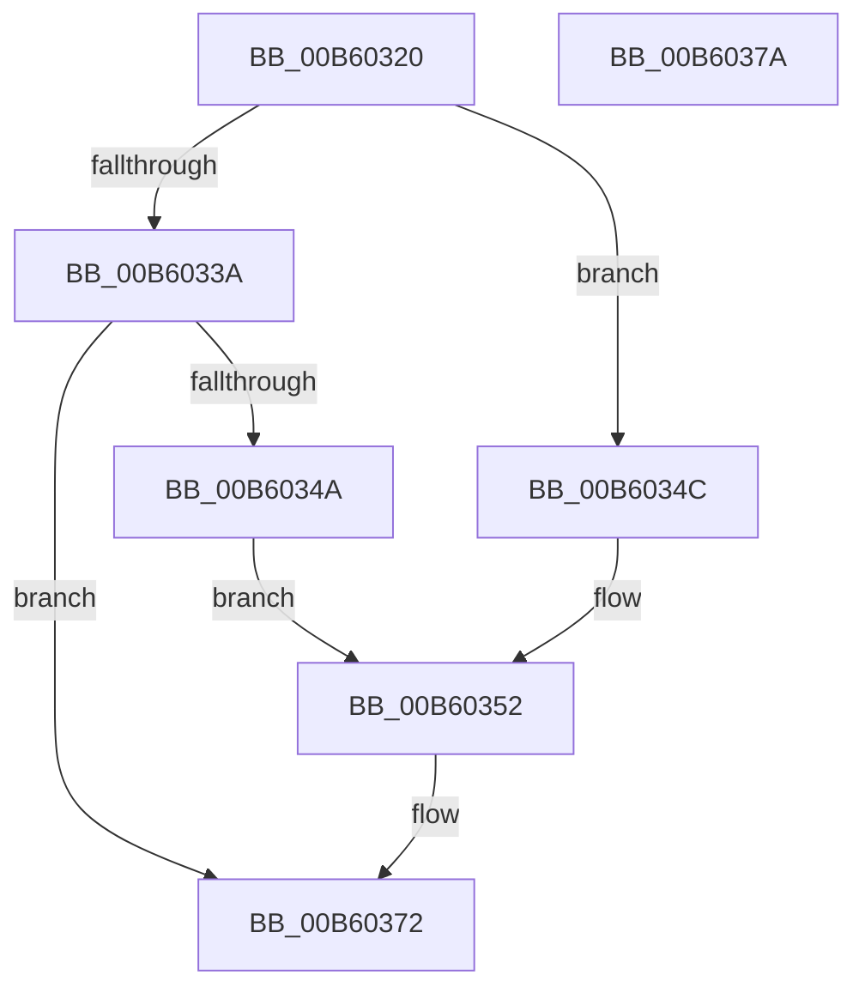

# HalpDpReplayInterrupts

- RVA: `0x00B60320`–`0x00B6037B` (길이 `91` bytes)
- VA: `0x0000000140B60320`
- 실행 섹션: `PAGELK`
- PDB 이름 있음: `예`; PDB Function 태그: `아니요`
- unwind 정보 RVA: `0x0005D2F4`
- 디코드: `22`개 명령, `91/91` bytes 표시
- 미해석 바이트: `0` (있으면 어셈블리에 `.byte`로 보존)

> 이 문서는 커널 이미지의 기계어와 PDB 기호를 분석해 생성했습니다. 4번과 5번은 함수 원형과 자료형을 바이너리 사용 방식에서 추정한 C 해석이며 원본 소스 복구 결과는 아닙니다.

## 1. Dependencies

- 직접 호출 지점: **2**; 고유 호출 대상: **2**
- 직접 호출자로 확인된 함수: **0**
- RIP 상대 이미지 참조: **2**

### Outgoing calls
- `0x00B6033E` → [guard_dispatch_icall](../../text/6B/guard_dispatch_icall_function_006BAAD0.md) (function, `0x006BAAD0`)
- `0x00B6036D` → [HalpInterruptSetProblemEx](../../text/48/HalpInterruptSetProblemEx_function_0048AC8C.md) (function, `0x0048AC8C`)

### Direct callers
- 이 함수 시작 RVA로 연결되는 직접 call은 확인되지 않았습니다. 간접 호출은 완전히 역산할 수 없습니다.

### Static image references
- `0x00B60327` → RVA `0x00E101F0` (`.data`; read)
- `0x00B60359` → RVA `0x00025F20` (`.rdata`; read)

## 2. Other-region calls and transfers

- 다른 실행 섹션으로 향하는 call: **2**
  - `0x00B6033E` → [guard_dispatch_icall](../../text/6B/guard_dispatch_icall_function_006BAAD0.md) (`PAGELK` → `.text`)
  - `0x00B6036D` → [HalpInterruptSetProblemEx](../../text/48/HalpInterruptSetProblemEx_function_0048AC8C.md) (`PAGELK` → `.text`)
- 별도 외부 분기/꼬리 이동을 확인하지 못했습니다.

## 3. Assembly (complete function range)

```asm
00B60320  48 83 EC 38                     sub rsp, 0x38
00B60324  48 8B D1                        mov rdx, rcx
00B60327  48 8B 0D C2 FE 2A 00            mov rcx, qword ptr [rip + 0x2afec2]
00B6032E  48 8B 81 A0 00 00 00            mov rax, qword ptr [rcx + 0xa0]
00B60335  48 85 C0                        test rax, rax
00B60338  74 12                           je 0x140b6034c
00B6033A  48 8B 49 10                     mov rcx, qword ptr [rcx + 0x10]
00B6033E  E8 8D A7 B5 FF                  call 0x1406baad0
00B60343  44 8B C0                        mov r8d, eax
00B60346  85 C0                           test eax, eax
00B60348  79 28                           jns 0x140b60372
00B6034A  EB 06                           jmp 0x140b60352
00B6034C  41 B8 BB 00 00 C0               mov r8d, 0xc00000bb
00B60352  48 8B 0D 97 FE 2A 00            mov rcx, qword ptr [rip + 0x2afe97]
00B60359  4C 8D 0D C0 5B 4C FF            lea r9, [rip - 0xb3a440]
00B60360  BA 1C 00 00 00                  mov edx, 0x1c
00B60365  C7 44 24 20 62 03 00 00         mov dword ptr [rsp + 0x20], 0x362
00B6036D  E8 1A A9 92 FF                  call 0x14048ac8c
00B60372  41 8B C0                        mov eax, r8d
00B60375  48 83 C4 38                     add rsp, 0x38
00B60379  C3                              ret
00B6037A  CC                              int3
```

## 4. C-style interpretation (structured pseudocode)

```c
__int64 __fastcall HalpDpReplayInterrupts(__int64 a1)
{
    __int64 result;
    __int64 v_rsp;
    unsigned int v_stack_m18;

    v_rsp = (v_rsp) - (56);
    if (*(unsigned __int64 *)(*(unsigned __int64 *)(v_rip + 2817730) + 160) == 0) goto loc_00B6034C;
    result = guard_dispatch_icall(*(unsigned __int64 *)(*(unsigned __int64 *)(v_rip + 2817730) + 16), a1, a3, a4);
    if (!sign_flag) goto loc_00B60372;
    goto loc_00B60352;
loc_00B6034C:
loc_00B60352:
    v_stack_m18 = 866;
    result = HalpInterruptSetProblemEx(*(unsigned __int64 *)(v_rip + 2817687), 28, (unsigned int)(0xC00000BBULL), v_rip - 11772992);
loc_00B60372:
    v_rsp = (v_rsp) + (56);
    return (unsigned int)((unsigned int)((unsigned int)(0xC00000BBULL)));
}
```

## 5. (Beta) C Style

```c
int64_t HalpDpReplayInterrupts(int64_t Arg1)
{
    int64_t result;
    int64_t local_rsp;
    uint32_t v_stack_m18;

    local_rsp = (local_rsp) - (56);
    if (*(uint64_t *)(*(uint64_t *)(v_rip + 0x2AFEC2) + 0xA0) == 0) goto loc_00B6034C;
    result = guard_dispatch_icall(*(uint64_t *)(*(uint64_t *)(v_rip + 0x2AFEC2) + 0x10), Arg1, a3, a4);
    if (!sign_flag) goto loc_00B60372;
    goto loc_00B60352;
loc_00B6034C:
loc_00B60352:
    v_stack_m18 = 866;
    result = HalpInterruptSetProblemEx(*(uint64_t *)(v_rip + 0x2AFE97), 28, (uint32_t)(0xC00000BBULL), v_rip - 11772992);
loc_00B60372:
    local_rsp = (local_rsp) + (56);
    return (uint32_t)((uint32_t)((uint32_t)(0xC00000BBULL)));
}
```

## 6. Execution-region graph

[열기: 2D/3D 그래프와 함수 탐색 컨트롤 패널](../../../control-panel.html?section=pagelk&rva=0x00B60320&view=graph)

- 2D 그래프는 위에서 아래로 흐르고, 3D 그래프는 빈 공간을 드래그해 회전합니다. Shift+드래그는 이동, 휠은 확대·축소, 함수 노드 선택은 대상 보고서 이동입니다.

### Static fallback


