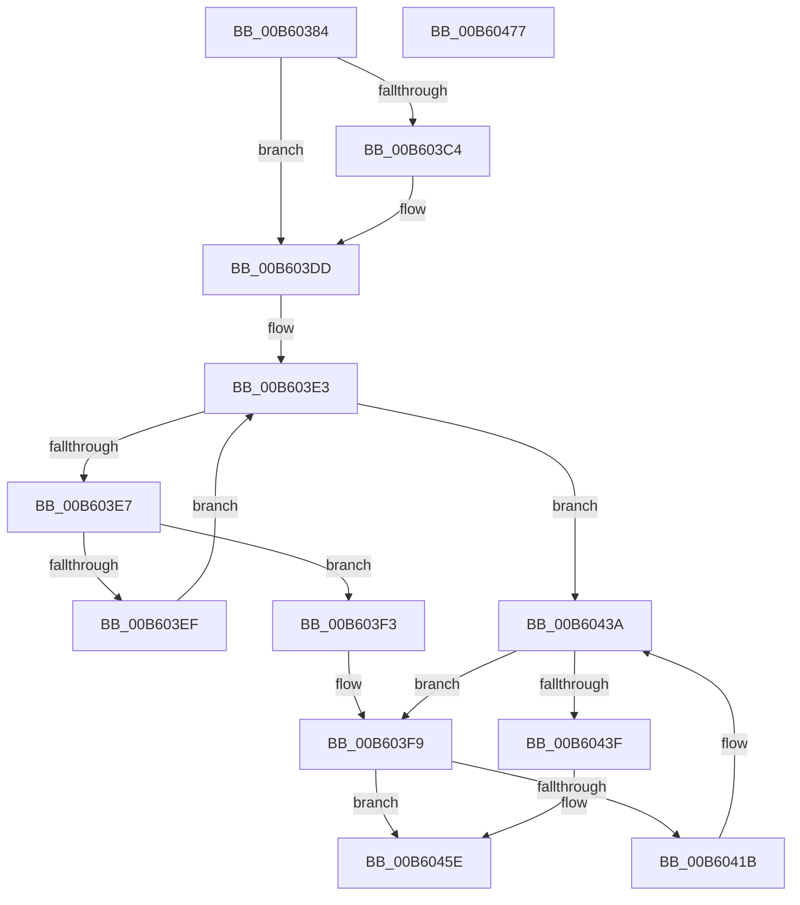

# HalpDpStartProcessor

- RVA: `0x00B60384`–`0x00B60478` (길이 `244` bytes)
- VA: `0x0000000140B60384`
- 실행 섹션: `PAGELK`
- PDB 이름 있음: `예`; PDB Function 태그: `아니요`
- unwind 정보 RVA: `0x00093E28`
- 디코드: `72`개 명령, `244/244` bytes 표시
- 미해석 바이트: `0` (있으면 어셈블리에 `.byte`로 보존)

> 이 문서는 커널 이미지의 기계어와 PDB 기호를 분석해 생성했습니다. 4번과 5번은 함수 원형과 자료형을 바이너리 사용 방식에서 추정한 C 해석이며 원본 소스 복구 결과는 아닙니다.

## 1. Dependencies

- 직접 호출 지점: **6**; 고유 호출 대상: **4**
- 직접 호출자로 확인된 함수: **1**
- RIP 상대 이미지 참조: **1**

### Outgoing calls
- `0x00B603AC` → [HalpQueryMaximumRegisteredProcessorCount](../../text/54/HalpQueryMaximumRegisteredProcessorCount_function_00543BE8.md) (function, `0x00543BE8`)
- `0x00B603BB` → [HalGetProcessorIdByNtNumber](../../text/2D/HalGetProcessorIdByNtNumber_function_002D5560.md) (function, `0x002D5560`)
- `0x00B603D7` → [KeBugCheckEx](../../text/4F/KeBugCheckEx_function_004FD660.md) (function, `0x004FD660`)
- `0x00B60411` → [HalpInterruptStartProcessor](../B5/HalpInterruptStartProcessor_function_00B5BEF0.md) (function, `0x00B5BEF0`)
- `0x00B60434` → [KeBugCheckEx](../../text/4F/KeBugCheckEx_function_004FD660.md) (function, `0x004FD660`)
- `0x00B60458` → [KeBugCheckEx](../../text/4F/KeBugCheckEx_function_004FD660.md) (function, `0x004FD660`)

### Direct callers
- [HalpDpReplaceControl](HalpDpReplaceControl_function_00B600B0.md) at `0x00B601EB`

### Static image references
- `0x00B60408` → RVA `0x00FC1A90` (`.data`; read)

## 2. Other-region calls and transfers

- 다른 실행 섹션으로 향하는 call: **5**
  - `0x00B603AC` → [HalpQueryMaximumRegisteredProcessorCount](../../text/54/HalpQueryMaximumRegisteredProcessorCount_function_00543BE8.md) (`PAGELK` → `.text`)
  - `0x00B603BB` → [HalGetProcessorIdByNtNumber](../../text/2D/HalGetProcessorIdByNtNumber_function_002D5560.md) (`PAGELK` → `.text`)
  - `0x00B603D7` → [KeBugCheckEx](../../text/4F/KeBugCheckEx_function_004FD660.md) (`PAGELK` → `.text`)
  - `0x00B60434` → [KeBugCheckEx](../../text/4F/KeBugCheckEx_function_004FD660.md) (`PAGELK` → `.text`)
  - `0x00B60458` → [KeBugCheckEx](../../text/4F/KeBugCheckEx_function_004FD660.md) (`PAGELK` → `.text`)
- 별도 외부 분기/꼬리 이동을 확인하지 못했습니다.

## 3. Assembly (complete function range)

```asm
00B60384  48 8B C4                        mov rax, rsp
00B60387  48 89 58 08                     mov qword ptr [rax + 8], rbx
00B6038B  48 89 68 10                     mov qword ptr [rax + 0x10], rbp
00B6038F  48 89 70 18                     mov qword ptr [rax + 0x18], rsi
00B60393  57                              push rdi
00B60394  41 56                           push r14
00B60396  41 57                           push r15
00B60398  48 83 EC 40                     sub rsp, 0x40
00B6039C  33 FF                           xor edi, edi
00B6039E  8B F1                           mov esi, ecx
00B603A0  89 78 D8                        mov dword ptr [rax - 0x28], edi
00B603A3  41 8B E9                        mov ebp, r9d
00B603A6  49 8B D8                        mov rbx, r8
00B603A9  4C 8B FA                        mov r15, rdx
00B603AC  E8 37 38 9E FF                  call 0x140543be8
00B603B1  48 8D 54 24 30                  lea rdx, [rsp + 0x30]
00B603B6  44 8B F0                        mov r14d, eax
00B603B9  8B CE                           mov ecx, esi
00B603BB  E8 A0 51 77 FF                  call 0x1402d5560
00B603C0  85 C0                           test eax, eax
00B603C2  79 19                           jns 0x140b603dd
00B603C4  45 8B CE                        mov r9d, r14d
00B603C7  48 89 7C 24 20                  mov qword ptr [rsp + 0x20], rdi
00B603CC  44 8B C6                        mov r8d, esi
00B603CF  8D 4F 5C                        lea ecx, [rdi + 0x5c]
00B603D2  BA 01 20 00 00                  mov edx, 0x2001
00B603D7  E8 84 D2 99 FF                  call 0x1404fd660
00B603DC  CC                              int3
00B603DD  8B 54 24 30                     mov edx, dword ptr [rsp + 0x30]
00B603E1  8B C7                           mov eax, edi
00B603E3  3B C5                           cmp eax, ebp
00B603E5  73 53                           jae 0x140b6043a
00B603E7  8B C8                           mov ecx, eax
00B603E9  41 39 14 8F                     cmp dword ptr [r15 + rcx*4], edx
00B603ED  74 04                           je 0x140b603f3
00B603EF  FF C0                           inc eax
00B603F1  EB F0                           jmp 0x140b603e3
00B603F3  8B 3C 8B                        mov edi, dword ptr [rbx + rcx*4]
00B603F6  48 8B DE                        mov rbx, rsi
00B603F9  4C 69 CB C0 05 00 00            imul r9, rbx, 0x5c0
00B60400  41 B8 03 00 00 00               mov r8d, 3
00B60406  8B D7                           mov edx, edi
00B60408  4C 03 0D 81 16 46 00            add r9, qword ptr [rip + 0x461681]
00B6040F  8B CE                           mov ecx, esi
00B60411  E8 DA BA FF FF                  call 0x140b5bef0
00B60416  83 F8 04                        cmp eax, 4
00B60419  74 43                           je 0x140b6045e
00B6041B  4D 8B CE                        mov r9, r14
00B6041E  48 C7 44 24 20 02 00 00 00      mov qword ptr [rsp + 0x20], 2
00B60427  4C 8B C3                        mov r8, rbx
00B6042A  BA 01 20 00 00                  mov edx, 0x2001
00B6042F  B9 5C 00 00 00                  mov ecx, 0x5c
00B60434  E8 27 D2 99 FF                  call 0x1404fd660
00B60439  CC                              int3
00B6043A  48 8B DE                        mov rbx, rsi
00B6043D  75 BA                           jne 0x140b603f9
00B6043F  4C 8B CA                        mov r9, rdx
00B60442  48 C7 44 24 20 01 00 00 00      mov qword ptr [rsp + 0x20], 1
00B6044B  BA 01 20 00 00                  mov edx, 0x2001
00B60450  4C 8B C3                        mov r8, rbx
00B60453  B9 5C 00 00 00                  mov ecx, 0x5c
00B60458  E8 03 D2 99 FF                  call 0x1404fd660
00B6045D  CC                              int3
00B6045E  48 8B 5C 24 60                  mov rbx, qword ptr [rsp + 0x60]
00B60463  48 8B 6C 24 68                  mov rbp, qword ptr [rsp + 0x68]
00B60468  48 8B 74 24 70                  mov rsi, qword ptr [rsp + 0x70]
00B6046D  48 83 C4 40                     add rsp, 0x40
00B60471  41 5F                           pop r15
00B60473  41 5E                           pop r14
00B60475  5F                              pop rdi
00B60476  C3                              ret
00B60477  CC                              int3
```

## 4. C-style interpretation (structured pseudocode)

```c
__int64 __fastcall HalpDpStartProcessor(int a1, __int64 a2, __int64 a3, int a4)
{
    __int64 result;
    __int64 v_rdi;
    __int64 v_rsp;
    unsigned __int64 v_stack_m28;
    unsigned __int64 v_stack_m38;
    unsigned __int64 v_stack_p10;
    unsigned __int64 v_stack_p18;
    unsigned __int64 v_stack_p8;

    *(unsigned __int64 *)(v_rsp + 8) = v_rbx;
    *(unsigned __int64 *)(v_rsp + 16) = v_rbp;
    *(unsigned __int64 *)(v_rsp + 24) = v_rsi;
    v_rsp = (v_rsp) - (64);
    v_rdi = 0;
    *(unsigned int *)(v_rsp - 40) = 0;
    result = HalpQueryMaximumRegisteredProcessorCount(a1, a2, a3, a4);
    result = HalGetProcessorIdByNtNumber((unsigned int)((unsigned int)((unsigned int)(a1))), v_stack_m28, a3, a4);
    if (sign_flag) {
        a4 = (unsigned int)((unsigned int)((unsigned int)(result)));
        v_stack_m38 = 0;
        a3 = (unsigned int)((unsigned int)(a1));
        a1 = v_rdi + 92;
        a2 = 0x2001ULL;
        result = KeBugCheckEx(a1, a2, a3, a4);
    }
loc_00B603E3:
    if (0 >= ((unsigned int)((unsigned int)(a4)))) goto loc_00B6043A;
    if ((*(unsigned int *)(a2 + 0 * 4)) == ((unsigned int)((unsigned int)(v_stack_m28)))) goto loc_00B603F3;
    result = (unsigned int)((0) + 1);
    goto loc_00B603E3;
loc_00B603F3:
loc_00B603F9:
    a4 = (a4) * ((unsigned int)(a1));
    a4 = (a4) + (*(unsigned __int64 *)(v_rip + 4593281));
    result = HalpInterruptStartProcessor((unsigned int)((unsigned int)((unsigned int)(a1))), (unsigned int)((unsigned int)((unsigned int)(*(unsigned int *)(a3 + 0 * 4)))), 3, a4);
    if (((unsigned int)(result)) == 4) goto loc_00B6045E;
    v_stack_m38 = 2;
    result = KeBugCheckEx(92, (unsigned int)(0x2001ULL), (unsigned int)(a1), (unsigned int)((unsigned int)(result)));
loc_00B6043A:
    if (((unsigned int)(result)) != 4) goto loc_00B603F9;
    v_stack_m38 = 1;
    result = KeBugCheckEx(92, (unsigned int)(0x2001ULL), (unsigned int)(a1), (unsigned int)(0x2001ULL));
loc_00B6045E:
    v_rsp = (v_rsp) + (64);
    return result;
}
```

## 5. (Beta) C Style

```c
int64_t HalpDpStartProcessor(int32_t Arg1, void *Arg2, void *Arg3, int32_t Arg4)
{
    uint8_t *arg2 = (uint8_t *)Arg2;
    uint8_t *arg3 = (uint8_t *)Arg3;

    int64_t result;
    int64_t local_rdi;
    int64_t local_rsp;
    uint64_t v_stack_m28;
    uint64_t v_stack_m38;
    uint64_t v_stack_p10;
    uint64_t v_stack_p18;
    uint64_t v_stack_p8;

    *(uint64_t *)(local_rsp + 0x8) = local_rbx;
    *(uint64_t *)(local_rsp + 0x10) = local_rbp;
    *(uint64_t *)(local_rsp + 0x18) = local_rsi;
    local_rsp = (local_rsp) - (64);
    local_rdi = 0;
    *(uint32_t *)(local_rsp - 0x28) = 0;
    result = HalpQueryMaximumRegisteredProcessorCount(Arg1, Arg2, Arg3, Arg4);
    result = HalGetProcessorIdByNtNumber((uint32_t)((uint32_t)((uint32_t)(Arg1))), v_stack_m28, Arg3, Arg4);
    if (sign_flag) {
        Arg4 = (uint32_t)((uint32_t)((uint32_t)(result)));
        v_stack_m38 = 0;
        Arg3 = (uint32_t)((uint32_t)(Arg1));
        Arg1 = local_rdi + 92;
        Arg2 = 0x2001ULL;
        result = KeBugCheckEx(Arg1, Arg2, Arg3, Arg4);
    }
loc_00B603E3:
    if (0 >= ((uint32_t)((uint32_t)(Arg4)))) goto loc_00B6043A;
    if ((*(uint32_t *)(arg2 + 0x0 * 4)) == ((uint32_t)((uint32_t)(v_stack_m28)))) goto loc_00B603F3;
    result = (uint32_t)((0) + 1);
    goto loc_00B603E3;
loc_00B603F3:
loc_00B603F9:
    Arg4 = (Arg4) * ((uint32_t)(Arg1));
    Arg4 = (Arg4) + (*(uint64_t *)(v_rip + 0x461681));
    result = HalpInterruptStartProcessor((uint32_t)((uint32_t)((uint32_t)(Arg1))), (uint32_t)((uint32_t)((uint32_t)(*(uint32_t *)(arg3 + 0x0 * 4)))), 3, Arg4);
    if (((uint32_t)(result)) == 4) goto loc_00B6045E;
    v_stack_m38 = 2;
    result = KeBugCheckEx(92, (uint32_t)(0x2001ULL), (uint32_t)(Arg1), (uint32_t)((uint32_t)(result)));
loc_00B6043A:
    if (((uint32_t)(result)) != 4) goto loc_00B603F9;
    v_stack_m38 = 1;
    result = KeBugCheckEx(92, (uint32_t)(0x2001ULL), (uint32_t)(Arg1), (uint32_t)(0x2001ULL));
loc_00B6045E:
    local_rsp = (local_rsp) + (64);
    return result;
}
```

### 관측된 메모리 오프셋

구조체 형식이 확인되지 않은 접근은 인자 기준의 오프셋으로만 기록했습니다.

| 기준 인자 | 오프셋 표현 | 폭 (bit) | 접근 |
|---|---:|---:|---|
| `Arg2` | `+ 0x0 + rcx*4` | `32` | `R` |
| `Arg3` | `+ 0x0 + rcx*4` | `32` | `R` |

## 6. Execution-region graph

[열기: 2D/3D 그래프와 함수 탐색 컨트롤 패널](../../../control-panel.html?section=pagelk&rva=0x00B60384&view=graph)

- 2D 그래프는 위에서 아래로 흐르고, 3D 그래프는 빈 공간을 드래그해 회전합니다. Shift+드래그는 이동, 휠은 확대·축소, 함수 노드 선택은 대상 보고서 이동입니다.

### Static fallback


