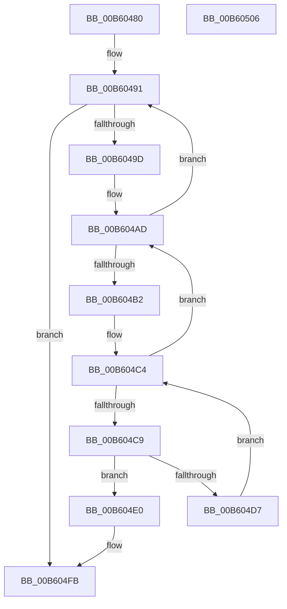

# HalpInterruptEnsureLineSwapComplete

- RVA: `0x00B60480`–`0x00B60507` (길이 `135` bytes)
- VA: `0x0000000140B60480`
- 실행 섹션: `PAGELK`
- PDB 이름 있음: `예`; PDB Function 태그: `아니요`
- unwind 정보 RVA: `0x0006E5F8`
- 디코드: `40`개 명령, `135/135` bytes 표시
- 미해석 바이트: `0` (있으면 어셈블리에 `.byte`로 보존)

> 이 문서는 커널 이미지의 기계어와 PDB 기호를 분석해 생성했습니다. 4번과 5번은 함수 원형과 자료형을 바이너리 사용 방식에서 추정한 C 해석이며 원본 소스 복구 결과는 아닙니다.

## 1. Dependencies

- 직접 호출 지점: **1**; 고유 호출 대상: **1**
- 직접 호출자로 확인된 함수: **1**
- RIP 상대 이미지 참조: **1**

### Outgoing calls
- `0x00B604F5` → [KeBugCheckEx](../../text/4F/KeBugCheckEx_function_004FD660.md) (function, `0x004FD660`)

### Direct callers
- [HalpInterruptSwapProcessorIdentifiers](HalpInterruptSwapProcessorIdentifiers_function_00B60510.md) at `0x00B60620`

### Static image references
- `0x00B6048A` → RVA `0x00FC38F0` (`.data`; read)

## 2. Other-region calls and transfers

- 다른 실행 섹션으로 향하는 call: **1**
  - `0x00B604F5` → [KeBugCheckEx](../../text/4F/KeBugCheckEx_function_004FD660.md) (`PAGELK` → `.text`)
- 별도 외부 분기/꼬리 이동을 확인하지 못했습니다.

## 3. Assembly (complete function range)

```asm
00B60480  48 89 5C 24 08                  mov qword ptr [rsp + 8], rbx
00B60485  57                              push rdi
00B60486  48 83 EC 30                     sub rsp, 0x30
00B6048A  48 8B 0D 5F 34 46 00            mov rcx, qword ptr [rip + 0x46345f]
00B60491  48 8D 05 58 34 46 00            lea rax, [rip + 0x463458]
00B60498  48 3B C8                        cmp rcx, rax
00B6049B  74 5E                           je 0x140b604fb
00B6049D  4C 8B C9                        mov r9, rcx
00B604A0  48 8B 09                        mov rcx, qword ptr [rcx]
00B604A3  49 81 C1 08 01 00 00            add r9, 0x108
00B604AA  49 8B 11                        mov rdx, qword ptr [r9]
00B604AD  49 3B D1                        cmp rdx, r9
00B604B0  74 DF                           je 0x140b60491
00B604B2  48 8B FA                        mov rdi, rdx
00B604B5  45 33 C0                        xor r8d, r8d
00B604B8  48 8B 12                        mov rdx, qword ptr [rdx]
00B604BB  8B 5F 18                        mov ebx, dword ptr [rdi + 0x18]
00B604BE  2B 5F 14                        sub ebx, dword ptr [rdi + 0x14]
00B604C1  45 33 D2                        xor r10d, r10d
00B604C4  44 3B C3                        cmp r8d, ebx
00B604C7  7D E4                           jge 0x140b604ad
00B604C9  4C 8B 5F 30                     mov r11, qword ptr [rdi + 0x30]
00B604CD  4D 03 DA                        add r11, r10
00B604D0  41 80 7B 02 00                  cmp byte ptr [r11 + 2], 0
00B604D5  75 09                           jne 0x140b604e0
00B604D7  41 FF C0                        inc r8d
00B604DA  49 83 C2 10                     add r10, 0x10
00B604DE  EB E4                           jmp 0x140b604c4
00B604E0  48 83 64 24 20 00               and qword ptr [rsp + 0x20], 0
00B604E6  45 33 C9                        xor r9d, r9d
00B604E9  4D 8B C3                        mov r8, r11
00B604EC  BA 00 40 00 00                  mov edx, 0x4000
00B604F1  41 8D 49 5C                     lea ecx, [r9 + 0x5c]
00B604F5  E8 66 D1 99 FF                  call 0x1404fd660
00B604FA  CC                              int3
00B604FB  48 8B 5C 24 40                  mov rbx, qword ptr [rsp + 0x40]
00B60500  48 83 C4 30                     add rsp, 0x30
00B60504  5F                              pop rdi
00B60505  C3                              ret
00B60506  CC                              int3
```

## 4. C-style interpretation (structured pseudocode)

```c
__int64 __fastcall HalpInterruptEnsureLineSwapComplete(__int64 a1, __int64 a2, int a3)
{
    __int64 result;
    __int64 v_r10;
    __int64 v_r11;
    __int64 v_rbx;
    __int64 v_rsp;
    unsigned __int64 v_stack_m18;
    unsigned __int64 v_stack_p8;

    v_stack_p8 = v_rbx;
    v_rsp = (v_rsp) - (48);
loc_00B60491:
    if ((*(unsigned __int64 *)(v_rip + 4600927)) == (v_rip + 4600920)) goto loc_00B604FB;
    a4 = (*(unsigned __int64 *)(v_rip + 4600927)) + (264);
loc_00B604AD:
    if ((*(unsigned __int64 *)(a4)) == a4) goto loc_00B60491;
    a3 = 0;
    v_rbx = (unsigned int)(((unsigned int)(*(unsigned int *)(*(unsigned __int64 *)(a4) + 24))) - (*(unsigned int *)(*(unsigned __int64 *)(a4) + 20)));
    v_r10 = 0;
loc_00B604C4:
    if (0 >= ((unsigned int)(v_rbx))) goto loc_00B604AD;
    v_r11 = (*(unsigned __int64 *)(*(unsigned __int64 *)(a4) + 48)) + (0);
    if ((*(unsigned __int8 *)(v_r11 + 2)) != 0) goto loc_00B604E0;
    a3 = (unsigned int)((a3) + 1);
    v_r10 = (v_r10) + (16);
    goto loc_00B604C4;
loc_00B604E0:
    a4 = 0;
    result = KeBugCheckEx(a4 + 92, (unsigned int)(0x4000ULL), v_r11, a4);
loc_00B604FB:
    v_rsp = (v_rsp) + (48);
    return result;
}
```

## 5. (Beta) C Style

```c
int64_t HalpInterruptEnsureLineSwapComplete(int64_t Arg1, int64_t Arg2, int32_t Arg3)
{
    int64_t result;
    int64_t local_r10;
    int64_t local_r11;
    int64_t local_rbx;
    int64_t local_rsp;
    uint64_t v_stack_m18;
    uint64_t v_stack_p8;

    v_stack_p8 = local_rbx;
    local_rsp = (local_rsp) - (48);
loc_00B60491:
    if ((*(uint64_t *)(v_rip + 0x46345F)) == (v_rip + 4600920)) goto loc_00B604FB;
    a4 = (*(uint64_t *)(v_rip + 0x46345F)) + (264);
loc_00B604AD:
    if ((*(uint64_t *)(a4)) == a4) goto loc_00B60491;
    Arg3 = 0;
    local_rbx = (uint32_t)(((uint32_t)(*(uint32_t *)(*(uint64_t *)(a4) + 0x18))) - (*(uint32_t *)(*(uint64_t *)(a4) + 0x14)));
    local_r10 = 0;
loc_00B604C4:
    if (0 >= ((uint32_t)(local_rbx))) goto loc_00B604AD;
    local_r11 = (*(uint64_t *)(*(uint64_t *)(a4) + 0x30)) + (0);
    if ((*(uint8_t *)(local_r11 + 0x2)) != 0) goto loc_00B604E0;
    Arg3 = (uint32_t)((Arg3) + 1);
    local_r10 = (local_r10) + (16);
    goto loc_00B604C4;
loc_00B604E0:
    a4 = 0;
    result = KeBugCheckEx(a4 + 92, (uint32_t)(0x4000ULL), local_r11, a4);
loc_00B604FB:
    local_rsp = (local_rsp) + (48);
    return result;
}
```

## 6. Execution-region graph

[열기: 2D/3D 그래프와 함수 탐색 컨트롤 패널](../../../control-panel.html?section=pagelk&rva=0x00B60480&view=graph)

- 2D 그래프는 위에서 아래로 흐르고, 3D 그래프는 빈 공간을 드래그해 회전합니다. Shift+드래그는 이동, 휠은 확대·축소, 함수 노드 선택은 대상 보고서 이동입니다.

### Static fallback


