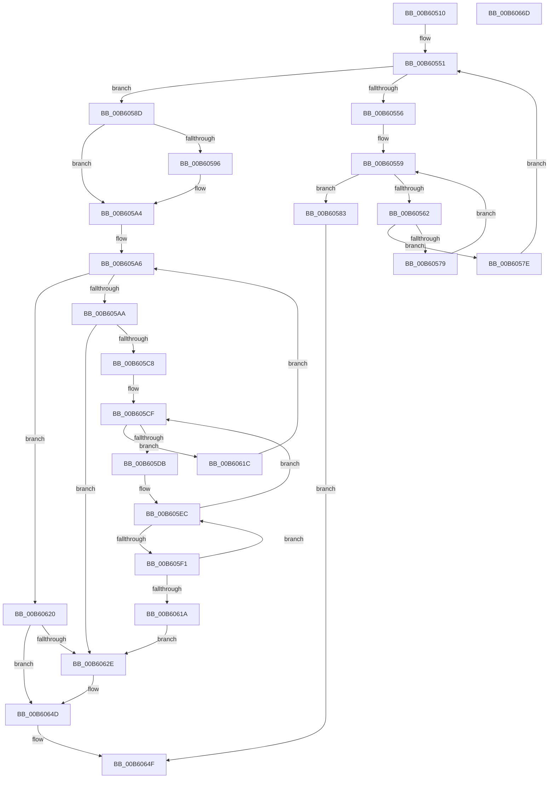

# HalpInterruptSwapProcessorIdentifiers

- RVA: `0x00B60510`–`0x00B6066E` (길이 `350` bytes)
- VA: `0x0000000140B60510`
- 실행 섹션: `PAGELK`
- PDB 이름 있음: `예`; PDB Function 태그: `아니요`
- unwind 정보 RVA: `0x0008C11C`
- 디코드: `103`개 명령, `350/350` bytes 표시
- 미해석 바이트: `0` (있으면 어셈블리에 `.byte`로 보존)

> 이 문서는 커널 이미지의 기계어와 PDB 기호를 분석해 생성했습니다. 4번과 5번은 함수 원형과 자료형을 바이너리 사용 방식에서 추정한 C 해석이며 원본 소스 복구 결과는 아닙니다.

## 1. Dependencies

- 직접 호출 지점: **7**; 고유 호출 대상: **7**
- 직접 호출자로 확인된 함수: **1**
- RIP 상대 이미지 참조: **3**

### Outgoing calls
- `0x00B6058D` → [HalpInterruptIsRemappingRequired](../../text/4B/HalpInterruptIsRemappingRequired_function_004B7AB0.md) (function, `0x004B7AB0`)
- `0x00B6059F` → [HalpUpdateIrtDestinationId](../../text/55/HalpUpdateIrtDestinationId_function_005572EC.md) (function, `0x005572EC`)
- `0x00B605BD` → [HalpInterruptUpdateLocalUnitIdentifier](HalpInterruptUpdateLocalUnitIdentifier_function_00B607DC.md) (function, `0x00B607DC`)
- `0x00B6060F` → [HalpInterruptUpdateLinesPostSwap](HalpInterruptUpdateLinesPostSwap_function_00B60674.md) (function, `0x00B60674`)
- `0x00B60620` → [HalpInterruptEnsureLineSwapComplete](HalpInterruptEnsureLineSwapComplete_function_00B60480.md) (function, `0x00B60480`)
- `0x00B60625` → [HalpInterruptRestoreAllControllerState](../B5/HalpInterruptRestoreAllControllerState_function_00B5C160.md) (function, `0x00B5C160`)
- `0x00B60647` → [KeBugCheckEx](../../text/4F/KeBugCheckEx_function_004FD660.md) (function, `0x004FD660`)

### Direct callers
- [HalpDpReplaceControl](HalpDpReplaceControl_function_00B600B0.md) at `0x00B60214`

### Static image references
- `0x00B60559` → RVA `0x00E10200` (`.data`; read)
- `0x00B60562` → RVA `0x00FC3E30` (`.data`; read)
- `0x00B605C8` → RVA `0x00FC38F0` (`.data`; read)

## 2. Other-region calls and transfers

- 다른 실행 섹션으로 향하는 call: **3**
  - `0x00B6058D` → [HalpInterruptIsRemappingRequired](../../text/4B/HalpInterruptIsRemappingRequired_function_004B7AB0.md) (`PAGELK` → `.text`)
  - `0x00B6059F` → [HalpUpdateIrtDestinationId](../../text/55/HalpUpdateIrtDestinationId_function_005572EC.md) (`PAGELK` → `.text`)
  - `0x00B60647` → [KeBugCheckEx](../../text/4F/KeBugCheckEx_function_004FD660.md) (`PAGELK` → `.text`)
- 별도 외부 분기/꼬리 이동을 확인하지 못했습니다.

## 3. Assembly (complete function range)

```asm
00B60510  48 89 5C 24 08                  mov qword ptr [rsp + 8], rbx
00B60515  48 89 6C 24 10                  mov qword ptr [rsp + 0x10], rbp
00B6051A  48 89 74 24 18                  mov qword ptr [rsp + 0x18], rsi
00B6051F  57                              push rdi
00B60520  41 54                           push r12
00B60522  41 55                           push r13
00B60524  41 56                           push r14
00B60526  41 57                           push r15
00B60528  48 83 EC 60                     sub rsp, 0x60
00B6052C  33 C0                           xor eax, eax
00B6052E  0F 57 C0                        xorps xmm0, xmm0
00B60531  33 F6                           xor esi, esi
00B60533  89 44 24 40                     mov dword ptr [rsp + 0x40], eax
00B60537  0F 11 44 24 30                  movups xmmword ptr [rsp + 0x30], xmm0
00B6053C  89 44 24 58                     mov dword ptr [rsp + 0x58], eax
00B60540  45 33 C9                        xor r9d, r9d
00B60543  0F 11 44 24 48                  movups xmmword ptr [rsp + 0x48], xmm0
00B60548  41 8B E8                        mov ebp, r8d
00B6054B  4C 8B EA                        mov r13, rdx
00B6054E  4C 8B F1                        mov r14, rcx
00B60551  44 3B CD                        cmp r9d, ebp
00B60554  73 37                           jae 0x140b6058d
00B60556  45 33 C0                        xor r8d, r8d
00B60559  44 3B 05 A0 FC 2A 00            cmp r8d, dword ptr [rip + 0x2afca0]
00B60560  73 21                           jae 0x140b60583
00B60562  48 8B 05 C7 38 46 00            mov rax, qword ptr [rip + 0x4638c7]
00B60569  43 8B 0C 8E                     mov ecx, dword ptr [r14 + r9*4]
00B6056D  41 8B D0                        mov edx, r8d
00B60570  48 C1 E2 06                     shl rdx, 6
00B60574  39 0C 02                        cmp dword ptr [rdx + rax], ecx
00B60577  74 05                           je 0x140b6057e
00B60579  41 FF C0                        inc r8d
00B6057C  EB DB                           jmp 0x140b60559
00B6057E  41 FF C1                        inc r9d
00B60581  EB CE                           jmp 0x140b60551
00B60583  B8 25 02 00 C0                  mov eax, 0xc0000225
00B60588  E9 C2 00 00 00                  jmp 0x140b6064f
00B6058D  E8 1E 75 95 FF                  call 0x1404b7ab0
00B60592  84 C0                           test al, al
00B60594  74 0E                           je 0x140b605a4
00B60596  44 8B CD                        mov r9d, ebp
00B60599  4D 8B C5                        mov r8, r13
00B6059C  49 8B D6                        mov rdx, r14
00B6059F  E8 48 6D 9F FF                  call 0x1405572ec
00B605A4  33 DB                           xor ebx, ebx
00B605A6  3B DD                           cmp ebx, ebp
00B605A8  73 76                           jae 0x140b60620
00B605AA  41 8B 54 9D 00                  mov edx, dword ptr [r13 + rbx*4]
00B605AF  4C 8D 4C 24 30                  lea r9, [rsp + 0x30]
00B605B4  41 8B 0C 9E                     mov ecx, dword ptr [r14 + rbx*4]
00B605B8  4C 8D 44 24 48                  lea r8, [rsp + 0x48]
00B605BD  E8 1A 02 00 00                  call 0x140b607dc
00B605C2  8B F0                           mov esi, eax
00B605C4  85 C0                           test eax, eax
00B605C6  78 66                           js 0x140b6062e
00B605C8  48 8B 3D 21 33 46 00            mov rdi, qword ptr [rip + 0x463321]
00B605CF  48 8D 05 1A 33 46 00            lea rax, [rip + 0x46331a]
00B605D6  48 3B F8                        cmp rdi, rax
00B605D9  74 41                           je 0x140b6061c
00B605DB  4C 8B E7                        mov r12, rdi
00B605DE  48 8B 3F                        mov rdi, qword ptr [rdi]
00B605E1  49 81 C4 08 01 00 00            add r12, 0x108
00B605E8  4D 8B 3C 24                     mov r15, qword ptr [r12]
00B605EC  4D 3B FC                        cmp r15, r12
00B605EF  74 DE                           je 0x140b605cf
00B605F1  45 8B 44 9D 00                  mov r8d, dword ptr [r13 + rbx*4]
00B605F6  48 8D 44 24 30                  lea rax, [rsp + 0x30]
00B605FB  41 8B 14 9E                     mov edx, dword ptr [r14 + rbx*4]
00B605FF  4C 8D 4C 24 48                  lea r9, [rsp + 0x48]
00B60604  49 8B CF                        mov rcx, r15
00B60607  48 89 44 24 20                  mov qword ptr [rsp + 0x20], rax
00B6060C  4D 8B 3F                        mov r15, qword ptr [r15]
00B6060F  E8 60 00 00 00                  call 0x140b60674
00B60614  8B F0                           mov esi, eax
00B60616  85 C0                           test eax, eax
00B60618  79 D2                           jns 0x140b605ec
00B6061A  EB 12                           jmp 0x140b6062e
00B6061C  FF C3                           inc ebx
00B6061E  EB 86                           jmp 0x140b605a6
00B60620  E8 5B FE FF FF                  call 0x140b60480
00B60625  E8 36 BB FF FF                  call 0x140b5c160
00B6062A  85 F6                           test esi, esi
00B6062C  79 1F                           jns 0x140b6064d
00B6062E  4C 8B 05 FB 37 46 00            mov r8, qword ptr [rip + 0x4637fb]
00B60635  4D 8B CE                        mov r9, r14
00B60638  BA 00 40 00 00                  mov edx, 0x4000
00B6063D  4C 89 6C 24 20                  mov qword ptr [rsp + 0x20], r13
00B60642  B9 5C 00 00 00                  mov ecx, 0x5c
00B60647  E8 14 D0 99 FF                  call 0x1404fd660
00B6064C  CC                              int3
00B6064D  8B C6                           mov eax, esi
00B6064F  4C 8D 5C 24 60                  lea r11, [rsp + 0x60]
00B60654  49 8B 5B 30                     mov rbx, qword ptr [r11 + 0x30]
00B60658  49 8B 6B 38                     mov rbp, qword ptr [r11 + 0x38]
00B6065C  49 8B 73 40                     mov rsi, qword ptr [r11 + 0x40]
00B60660  49 8B E3                        mov rsp, r11
00B60663  41 5F                           pop r15
00B60665  41 5E                           pop r14
00B60667  41 5D                           pop r13
00B60669  41 5C                           pop r12
00B6066B  5F                              pop rdi
00B6066C  C3                              ret
00B6066D  CC                              int3
```

## 4. C-style interpretation (structured pseudocode)

```c
__int64 __fastcall HalpInterruptSwapProcessorIdentifiers(__int64 a1, __int64 a2, int a3, int a4)
{
    __int64 result;
    __int64 v_r12;
    __int64 v_rbx;
    __int64 v_rsi;
    __int64 v_rsp;
    unsigned __int64 v_stack_m28;
    unsigned int v_stack_m30;
    unsigned __int64 v_stack_m40;
    unsigned int v_stack_m48;
    unsigned __int64 v_stack_m58;
    unsigned __int64 v_stack_m68;
    unsigned __int64 v_stack_p10;
    unsigned __int64 v_stack_p18;
    unsigned __int64 v_stack_p8;

    v_stack_p8 = v_rbx;
    v_stack_p10 = v_rbp;
    v_stack_p18 = v_rsi;
    v_rsp = (v_rsp) - (96);
    result = 0;
    v_rsi = 0;
    v_stack_m48 = 0;
    v_stack_m58 = v_xmm0;
    v_stack_m30 = 0;
    a4 = 0;
    v_stack_m40 = v_xmm0;
loc_00B60551:
    if (0 >= ((unsigned int)((unsigned int)(a3)))) goto loc_00B6058D;
    a3 = 0;
loc_00B60559:
    if (0 >= (*(unsigned int *)(v_rip + 2817184))) goto loc_00B60583;
    a2 = (0) << (6);
    if ((*(unsigned int *)(a2 + *(unsigned __int64 *)(v_rip + 4602055) * 1)) == ((unsigned int)((unsigned int)(*(unsigned int *)(a1 + a4 * 4))))) goto loc_00B6057E;
    a3 = (unsigned int)((a3) + 1);
    goto loc_00B60559;
loc_00B6057E:
    a4 = (unsigned int)((a4) + 1);
    goto loc_00B60551;
loc_00B60583:
    goto loc_00B6064F;
loc_00B6058D:
    result = HalpInterruptIsRemappingRequired((unsigned int)(*(unsigned int *)(a1 + a4 * 4)), a2, a3, a4);
    if ((unsigned __int8)(result) != 0) {
        a4 = (unsigned int)((unsigned int)(a3));
        a3 = a2;
        a2 = a1;
        result = HalpUpdateIrtDestinationId((unsigned int)(*(unsigned int *)(a1 + a4 * 4)), a2, a3, a4);
    }
    v_rbx = 0;
loc_00B605A6:
    if (0 >= ((unsigned int)((unsigned int)(a3)))) goto loc_00B60620;
    result = HalpInterruptUpdateLocalUnitIdentifier((unsigned int)(*(unsigned int *)(a1 + v_rbx * 4)), (unsigned int)(*(unsigned int *)(a2 + v_rbx * 4)), v_stack_m40, v_stack_m58);
    if (sign_flag) goto loc_00B6062E;
loc_00B605CF:
    if ((*(unsigned __int64 *)(v_rip + 4600609)) == (v_rip + 4600602)) goto loc_00B6061C;
    v_r12 = (*(unsigned __int64 *)(v_rip + 4600609)) + (264);
loc_00B605EC:
    if ((*(unsigned __int64 *)(v_r12)) == v_r12) goto loc_00B605CF;
    v_stack_m68 = v_stack_m58;
    result = HalpInterruptUpdateLinesPostSwap(*(unsigned __int64 *)(v_r12), (unsigned int)(*(unsigned int *)(a1 + v_rbx * 4)), (unsigned int)(*(unsigned int *)(a2 + v_rbx * 4)), v_stack_m40);
    if (!sign_flag) goto loc_00B605EC;
    goto loc_00B6062E;
loc_00B6061C:
    v_rbx = (unsigned int)((v_rbx) + 1);
    goto loc_00B605A6;
loc_00B60620:
    result = HalpInterruptEnsureLineSwapComplete(*(unsigned __int64 *)(v_r12), (unsigned int)(*(unsigned int *)(a1 + v_rbx * 4)), (unsigned int)(*(unsigned int *)(a2 + v_rbx * 4)), v_stack_m40);
    result = HalpInterruptRestoreAllControllerState(*(unsigned __int64 *)(v_r12), (unsigned int)(*(unsigned int *)(a1 + v_rbx * 4)), (unsigned int)(*(unsigned int *)(a2 + v_rbx * 4)), v_stack_m40);
    if (sign_flag) {
        a3 = *(unsigned __int64 *)(v_rip + 4601851);
        a4 = a1;
        a2 = 0x4000ULL;
        v_stack_m68 = a2;
        a1 = 92;
        result = KeBugCheckEx(a1, a2, a3, a4);
    }
loc_00B6064F:
    return (unsigned int)((unsigned int)((unsigned int)((unsigned int)(result))));
}
```

## 5. (Beta) C Style

```c
int64_t HalpInterruptSwapProcessorIdentifiers(void *Arg1, void *Arg2, int32_t Arg3, int32_t Arg4)
{
    uint8_t *arg1 = (uint8_t *)Arg1;
    uint8_t *arg2 = (uint8_t *)Arg2;

    int64_t result;
    int64_t local_r12;
    int64_t local_rbx;
    int64_t local_rsi;
    int64_t local_rsp;
    uint64_t v_stack_m28;
    uint32_t v_stack_m30;
    uint64_t v_stack_m40;
    uint32_t v_stack_m48;
    uint64_t v_stack_m58;
    uint64_t v_stack_m68;
    uint64_t v_stack_p10;
    uint64_t v_stack_p18;
    uint64_t v_stack_p8;

    v_stack_p8 = local_rbx;
    v_stack_p10 = local_rbp;
    v_stack_p18 = local_rsi;
    local_rsp = (local_rsp) - (96);
    result = 0;
    local_rsi = 0;
    v_stack_m48 = 0;
    v_stack_m58 = v_xmm0;
    v_stack_m30 = 0;
    Arg4 = 0;
    v_stack_m40 = v_xmm0;
loc_00B60551:
    if (0 >= ((uint32_t)((uint32_t)(Arg3)))) goto loc_00B6058D;
    Arg3 = 0;
loc_00B60559:
    if (0 >= (*(uint32_t *)(v_rip + 0x2AFCA0))) goto loc_00B60583;
    Arg2 = (0) << (6);
    if ((*(uint32_t *)(arg2 + *(uint64_t *)(v_rip + 0x4638C7) * 1)) == ((uint32_t)((uint32_t)(*(uint32_t *)(arg1 + Arg4 * 4))))) goto loc_00B6057E;
    Arg3 = (uint32_t)((Arg3) + 1);
    goto loc_00B60559;
loc_00B6057E:
    Arg4 = (uint32_t)((Arg4) + 1);
    goto loc_00B60551;
loc_00B60583:
    goto loc_00B6064F;
loc_00B6058D:
    result = HalpInterruptIsRemappingRequired((uint32_t)(*(uint32_t *)(arg1 + Arg4 * 4)), Arg2, Arg3, Arg4);
    if ((uint8_t)(result) != 0) {
        Arg4 = (uint32_t)((uint32_t)(Arg3));
        Arg3 = Arg2;
        Arg2 = Arg1;
        result = HalpUpdateIrtDestinationId((uint32_t)(*(uint32_t *)(arg1 + Arg4 * 4)), Arg2, Arg3, Arg4);
    }
    local_rbx = 0;
loc_00B605A6:
    if (0 >= ((uint32_t)((uint32_t)(Arg3)))) goto loc_00B60620;
    result = HalpInterruptUpdateLocalUnitIdentifier((uint32_t)(*(uint32_t *)(arg1 + local_rbx * 4)), (uint32_t)(*(uint32_t *)(arg2 + local_rbx * 4)), v_stack_m40, v_stack_m58);
    if (sign_flag) goto loc_00B6062E;
loc_00B605CF:
    if ((*(uint64_t *)(v_rip + 0x463321)) == (v_rip + 4600602)) goto loc_00B6061C;
    local_r12 = (*(uint64_t *)(v_rip + 0x463321)) + (264);
loc_00B605EC:
    if ((*(uint64_t *)(local_r12)) == local_r12) goto loc_00B605CF;
    v_stack_m68 = v_stack_m58;
    result = HalpInterruptUpdateLinesPostSwap(*(uint64_t *)(local_r12), (uint32_t)(*(uint32_t *)(arg1 + local_rbx * 4)), (uint32_t)(*(uint32_t *)(arg2 + local_rbx * 4)), v_stack_m40);
    if (!sign_flag) goto loc_00B605EC;
    goto loc_00B6062E;
loc_00B6061C:
    local_rbx = (uint32_t)((local_rbx) + 1);
    goto loc_00B605A6;
loc_00B60620:
    result = HalpInterruptEnsureLineSwapComplete(*(uint64_t *)(local_r12), (uint32_t)(*(uint32_t *)(arg1 + local_rbx * 4)), (uint32_t)(*(uint32_t *)(arg2 + local_rbx * 4)), v_stack_m40);
    result = HalpInterruptRestoreAllControllerState(*(uint64_t *)(local_r12), (uint32_t)(*(uint32_t *)(arg1 + local_rbx * 4)), (uint32_t)(*(uint32_t *)(arg2 + local_rbx * 4)), v_stack_m40);
    if (sign_flag) {
        Arg3 = *(uint64_t *)(v_rip + 0x4637FB);
        Arg4 = Arg1;
        Arg2 = 0x4000ULL;
        v_stack_m68 = Arg2;
        Arg1 = 92;
        result = KeBugCheckEx(Arg1, Arg2, Arg3, Arg4);
    }
loc_00B6064F:
    return (uint32_t)((uint32_t)((uint32_t)((uint32_t)(result))));
}
```

### 관측된 메모리 오프셋

구조체 형식이 확인되지 않은 접근은 인자 기준의 오프셋으로만 기록했습니다.

| 기준 인자 | 오프셋 표현 | 폭 (bit) | 접근 |
|---|---:|---:|---|
| `Arg1` | `+ 0x0 + r9*4` | `32` | `R` |
| `Arg1` | `+ 0x0 + rbx*4` | `32` | `R` |
| `Arg2` | `+ 0x0 + rbx*4` | `32` | `R` |

## 6. Execution-region graph

[열기: 2D/3D 그래프와 함수 탐색 컨트롤 패널](../../../control-panel.html?section=pagelk&rva=0x00B60510&view=graph)

- 2D 그래프는 위에서 아래로 흐르고, 3D 그래프는 빈 공간을 드래그해 회전합니다. Shift+드래그는 이동, 휠은 확대·축소, 함수 노드 선택은 대상 보고서 이동입니다.

### Static fallback


