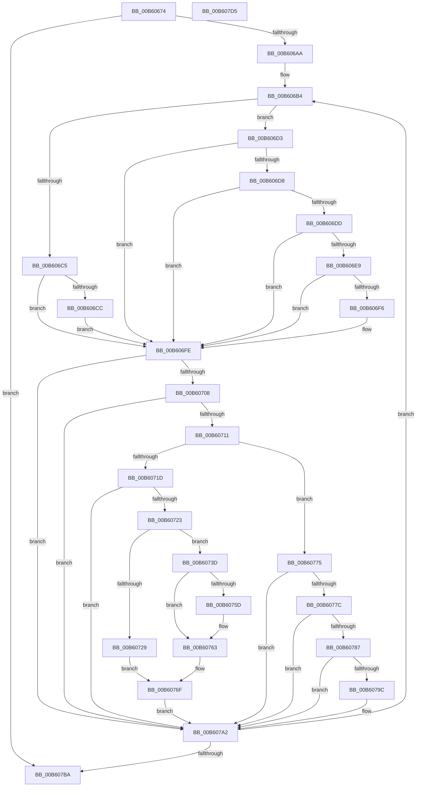

# HalpInterruptUpdateLinesPostSwap

- RVA: `0x00B60674`–`0x00B607D6` (길이 `354` bytes)
- VA: `0x0000000140B60674`
- 실행 섹션: `PAGELK`
- PDB 이름 있음: `예`; PDB Function 태그: `아니요`
- unwind 정보 RVA: `0x000BE9E8`
- 디코드: `102`개 명령, `354/354` bytes 표시
- 미해석 바이트: `0` (있으면 어셈블리에 `.byte`로 보존)

> 이 문서는 커널 이미지의 기계어와 PDB 기호를 분석해 생성했습니다. 4번과 5번은 함수 원형과 자료형을 바이너리 사용 방식에서 추정한 C 해석이며 원본 소스 복구 결과는 아닙니다.

## 1. Dependencies

- 직접 호출 지점: **0**; 고유 호출 대상: **0**
- 직접 호출자로 확인된 함수: **1**
- RIP 상대 이미지 참조: **0**

### Outgoing calls
- 직접 디코드된 call 명령이 없습니다.

### Direct callers
- [HalpInterruptSwapProcessorIdentifiers](HalpInterruptSwapProcessorIdentifiers_function_00B60510.md) at `0x00B6060F`

### Static image references
- 디코드된 RIP-relative 메모리 참조가 없습니다.

## 2. Other-region calls and transfers

- 다른 실행 섹션으로 향하는 call: **0**
- 별도 외부 분기/꼬리 이동을 확인하지 못했습니다.

## 3. Assembly (complete function range)

```asm
00B60674  48 8B C4                        mov rax, rsp
00B60677  48 89 58 08                     mov qword ptr [rax + 8], rbx
00B6067B  48 89 68 10                     mov qword ptr [rax + 0x10], rbp
00B6067F  48 89 70 18                     mov qword ptr [rax + 0x18], rsi
00B60683  48 89 78 20                     mov qword ptr [rax + 0x20], rdi
00B60687  41 56                           push r14
00B60689  41 57                           push r15
00B6068B  44 8B 51 18                     mov r10d, dword ptr [rcx + 0x18]
00B6068F  33 ED                           xor ebp, ebp
00B60691  44 2B 51 14                     sub r10d, dword ptr [rcx + 0x14]
00B60695  4D 8B D9                        mov r11, r9
00B60698  45 8B F0                        mov r14d, r8d
00B6069B  44 8B FA                        mov r15d, edx
00B6069E  48 8B D9                        mov rbx, rcx
00B606A1  45 85 D2                        test r10d, r10d
00B606A4  0F 8E 10 01 00 00               jle 0x140b607ba
00B606AA  4C 8B 54 24 38                  mov r10, qword ptr [rsp + 0x38]
00B606AF  45 33 C0                        xor r8d, r8d
00B606B2  33 D2                           xor edx, edx
00B606B4  48 8B 4B 28                     mov rcx, qword ptr [rbx + 0x28]
00B606B8  4C 8B 4B 30                     mov r9, qword ptr [rbx + 0x30]
00B606BC  8B 7C 0A 18                     mov edi, dword ptr [rdx + rcx + 0x18]
00B606C0  83 FF 04                        cmp edi, 4
00B606C3  75 0E                           jne 0x140b606d3
00B606C5  44 39 7C 0A 20                  cmp dword ptr [rdx + rcx + 0x20], r15d
00B606CA  75 32                           jne 0x140b606fe
00B606CC  44 89 74 0A 20                  mov dword ptr [rdx + rcx + 0x20], r14d
00B606D1  EB 2B                           jmp 0x140b606fe
00B606D3  83 FF 05                        cmp edi, 5
00B606D6  75 26                           jne 0x140b606fe
00B606D8  41 39 3B                        cmp dword ptr [r11], edi
00B606DB  75 21                           jne 0x140b606fe
00B606DD  8B 74 0A 20                     mov esi, dword ptr [rdx + rcx + 0x20]
00B606E1  41 8B 43 08                     mov eax, dword ptr [r11 + 8]
00B606E5  85 C6                           test esi, eax
00B606E7  74 15                           je 0x140b606fe
00B606E9  F7 D0                           not eax
00B606EB  23 C6                           and eax, esi
00B606ED  89 44 0A 20                     mov dword ptr [rdx + rcx + 0x20], eax
00B606F1  41 39 3A                        cmp dword ptr [r10], edi
00B606F4  75 08                           jne 0x140b606fe
00B606F6  41 0B 42 08                     or eax, dword ptr [r10 + 8]
00B606FA  89 44 0A 20                     mov dword ptr [rdx + rcx + 0x20], eax
00B606FE  41 83 3B 06                     cmp dword ptr [r11], 6
00B60702  0F 85 9A 00 00 00               jne 0x140b607a2
00B60708  83 FF 06                        cmp edi, 6
00B6070B  0F 85 91 00 00 00               jne 0x140b607a2
00B60711  43 80 7C 08 02 00               cmp byte ptr [r8 + r9 + 2], 0
00B60717  41 8B 43 08                     mov eax, dword ptr [r11 + 8]
00B6071B  75 58                           jne 0x140b60775
00B6071D  3B 44 0A 20                     cmp eax, dword ptr [rdx + rcx + 0x20]
00B60721  75 7F                           jne 0x140b607a2
00B60723  41 3B 42 08                     cmp eax, dword ptr [r10 + 8]
00B60727  75 14                           jne 0x140b6073d
00B60729  41 8B 43 0C                     mov eax, dword ptr [r11 + 0xc]
00B6072D  F7 D0                           not eax
00B6072F  23 44 0A 24                     and eax, dword ptr [rdx + rcx + 0x24]
00B60733  89 44 0A 24                     mov dword ptr [rdx + rcx + 0x24], eax
00B60737  41 0B 42 0C                     or eax, dword ptr [r10 + 0xc]
00B6073B  EB 32                           jmp 0x140b6076f
00B6073D  43 C6 44 08 02 01               mov byte ptr [r8 + r9 + 2], 1
00B60743  8B 44 0A 20                     mov eax, dword ptr [rdx + rcx + 0x20]
00B60747  43 89 44 08 04                  mov dword ptr [r8 + r9 + 4], eax
00B6074C  41 8B 43 0C                     mov eax, dword ptr [r11 + 0xc]
00B60750  F7 D0                           not eax
00B60752  23 44 0A 24                     and eax, dword ptr [rdx + rcx + 0x24]
00B60756  43 89 44 08 08                  mov dword ptr [r8 + r9 + 8], eax
00B6075B  75 06                           jne 0x140b60763
00B6075D  43 C6 44 08 02 00               mov byte ptr [r8 + r9 + 2], 0
00B60763  41 8B 42 08                     mov eax, dword ptr [r10 + 8]
00B60767  89 44 0A 20                     mov dword ptr [rdx + rcx + 0x20], eax
00B6076B  41 8B 42 0C                     mov eax, dword ptr [r10 + 0xc]
00B6076F  89 44 0A 24                     mov dword ptr [rdx + rcx + 0x24], eax
00B60773  EB 2D                           jmp 0x140b607a2
00B60775  43 39 44 08 04                  cmp dword ptr [r8 + r9 + 4], eax
00B6077A  75 26                           jne 0x140b607a2
00B6077C  43 8B 44 08 08                  mov eax, dword ptr [r8 + r9 + 8]
00B60781  41 85 43 0C                     test dword ptr [r11 + 0xc], eax
00B60785  74 1B                           je 0x140b607a2
00B60787  41 8B 42 0C                     mov eax, dword ptr [r10 + 0xc]
00B6078B  09 44 0A 24                     or dword ptr [rdx + rcx + 0x24], eax
00B6078F  41 8B 43 0C                     mov eax, dword ptr [r11 + 0xc]
00B60793  F7 D0                           not eax
00B60795  43 21 44 08 08                  and dword ptr [r8 + r9 + 8], eax
00B6079A  75 06                           jne 0x140b607a2
00B6079C  43 C6 44 08 02 00               mov byte ptr [r8 + r9 + 2], 0
00B607A2  8B 4B 18                        mov ecx, dword ptr [rbx + 0x18]
00B607A5  FF C5                           inc ebp
00B607A7  2B 4B 14                        sub ecx, dword ptr [rbx + 0x14]
00B607AA  48 83 C2 38                     add rdx, 0x38
00B607AE  49 83 C0 10                     add r8, 0x10
00B607B2  3B E9                           cmp ebp, ecx
00B607B4  0F 8C FA FE FF FF               jl 0x140b606b4
00B607BA  48 8B 5C 24 18                  mov rbx, qword ptr [rsp + 0x18]
00B607BF  33 C0                           xor eax, eax
00B607C1  48 8B 6C 24 20                  mov rbp, qword ptr [rsp + 0x20]
00B607C6  48 8B 74 24 28                  mov rsi, qword ptr [rsp + 0x28]
00B607CB  48 8B 7C 24 30                  mov rdi, qword ptr [rsp + 0x30]
00B607D0  41 5F                           pop r15
00B607D2  41 5E                           pop r14
00B607D4  C3                              ret
00B607D5  CC                              int3
```

## 4. C-style interpretation (structured pseudocode)

```c
__int64 __fastcall HalpInterruptUpdateLinesPostSwap(__int64 a1, int a2, int a3, __int64 a4, __int64 a5)
{
    __int64 result;
    __int64 v_r10;
    __int64 v_rbp;
    unsigned __int64 v_stack_p10;
    unsigned __int64 v_stack_p18;
    unsigned __int64 v_stack_p20;
    unsigned __int64 v_stack_p8;

    *(unsigned __int64 *)(v_rsp + 8) = v_rbx;
    *(unsigned __int64 *)(v_rsp + 16) = v_rbp;
    *(unsigned __int64 *)(v_rsp + 24) = v_rsi;
    *(unsigned __int64 *)(v_rsp + 32) = v_rdi;
    v_rbp = 0;
    v_r10 = (unsigned int)(((unsigned int)(*(unsigned int *)(a1 + 24))) - (*(unsigned int *)(a1 + 20)));
    if (condition_is_less_or_equal) goto loc_00B607BA;
    a3 = 0;
    a2 = 0;
loc_00B606B4:
    if (((unsigned int)((unsigned int)(*(unsigned int *)(a2 + *(unsigned __int64 *)(a1 + 40) * 1 + 24)))) != 4) goto loc_00B606D3;
    if ((*(unsigned int *)(a2 + *(unsigned __int64 *)(a1 + 40) * 1 + 32)) != ((unsigned int)((unsigned int)(a2)))) goto loc_00B606FE;
    *(unsigned int *)(a2 + *(unsigned __int64 *)(a1 + 40) * 1 + 32) = (unsigned int)((unsigned int)(a3));
    goto loc_00B606FE;
loc_00B606D3:
    if (((unsigned int)((unsigned int)(*(unsigned int *)(a2 + *(unsigned __int64 *)(a1 + 40) * 1 + 24)))) != 5) goto loc_00B606FE;
    if ((*(unsigned int *)(a4)) != ((unsigned int)((unsigned int)(*(unsigned int *)(a2 + *(unsigned __int64 *)(a1 + 40) * 1 + 24))))) goto loc_00B606FE;
    if ((((unsigned int)((unsigned int)(*(unsigned int *)(a2 + *(unsigned __int64 *)(a1 + 40) * 1 + 32)))) & ((unsigned int)((unsigned int)(*(unsigned int *)(a4 + 8))))) == 0) goto loc_00B606FE;
    result = (unsigned int)(~((unsigned int)(*(unsigned int *)(a4 + 8))));
    result = (unsigned int)((result) & ((unsigned int)((unsigned int)(*(unsigned int *)(a2 + *(unsigned __int64 *)(a1 + 40) * 1 + 32)))));
    *(unsigned int *)(a2 + *(unsigned __int64 *)(a1 + 40) * 1 + 32) = (unsigned int)(result);
    if ((*(unsigned int *)(a5)) == ((unsigned int)((unsigned int)(*(unsigned int *)(a2 + *(unsigned __int64 *)(a1 + 40) * 1 + 24))))) {
        result = (unsigned int)((result) | (*(unsigned int *)(a5 + 8)));
        *(unsigned int *)(a2 + *(unsigned __int64 *)(a1 + 40) * 1 + 32) = (unsigned int)(result);
    }
    if ((*(unsigned int *)(a4)) != 6) goto loc_00B607A2;
    if (((unsigned int)((unsigned int)(*(unsigned int *)(a2 + *(unsigned __int64 *)(a1 + 40) * 1 + 24)))) != 6) goto loc_00B607A2;
    if ((*(unsigned __int8 *)(a3 + *(unsigned __int64 *)(a1 + 48) * 1 + 2)) != 0) goto loc_00B60775;
    if (((unsigned int)((unsigned int)(*(unsigned int *)(a4 + 8)))) != (*(unsigned int *)(a2 + *(unsigned __int64 *)(a1 + 40) * 1 + 32))) goto loc_00B607A2;
    if (((unsigned int)((unsigned int)(*(unsigned int *)(a4 + 8)))) != (*(unsigned int *)(a5 + 8))) goto loc_00B6073D;
    result = (unsigned int)(~((unsigned int)(*(unsigned int *)(a4 + 12))));
    result = (unsigned int)((result) & (*(unsigned int *)(a2 + *(unsigned __int64 *)(a1 + 40) * 1 + 36)));
    *(unsigned int *)(a2 + *(unsigned __int64 *)(a1 + 40) * 1 + 36) = (unsigned int)(result);
    result = (unsigned int)((result) | (*(unsigned int *)(a5 + 12)));
    goto loc_00B6076F;
loc_00B6073D:
    *(unsigned __int8 *)(a3 + *(unsigned __int64 *)(a1 + 48) * 1 + 2) = 1;
    *(unsigned int *)(a3 + *(unsigned __int64 *)(a1 + 48) * 1 + 4) = (unsigned int)((unsigned int)(*(unsigned int *)(a2 + *(unsigned __int64 *)(a1 + 40) * 1 + 32)));
    result = (unsigned int)(~((unsigned int)(*(unsigned int *)(a4 + 12))));
    result = (unsigned int)((result) & (*(unsigned int *)(a2 + *(unsigned __int64 *)(a1 + 40) * 1 + 36)));
    *(unsigned int *)(a3 + *(unsigned __int64 *)(a1 + 48) * 1 + 8) = (unsigned int)(result);
    if (!(condition_is_not_equal)) {
        *(unsigned __int8 *)(a3 + *(unsigned __int64 *)(a1 + 48) * 1 + 2) = 0;
    }
    *(unsigned int *)(a2 + *(unsigned __int64 *)(a1 + 40) * 1 + 32) = (unsigned int)((unsigned int)(*(unsigned int *)(a5 + 8)));
loc_00B6076F:
    *(unsigned int *)(a2 + *(unsigned __int64 *)(a1 + 40) * 1 + 36) = (unsigned int)((unsigned int)(*(unsigned int *)(a5 + 12)));
    goto loc_00B607A2;
loc_00B60775:
    if ((*(unsigned int *)(a3 + *(unsigned __int64 *)(a1 + 48) * 1 + 4)) != ((unsigned int)((unsigned int)(*(unsigned int *)(a5 + 12))))) goto loc_00B607A2;
    if (((*(unsigned int *)(a4 + 12)) & ((unsigned int)((unsigned int)(*(unsigned int *)(a3 + *(unsigned __int64 *)(a1 + 48) * 1 + 8))))) == 0) goto loc_00B607A2;
    result = (unsigned int)(~((unsigned int)(*(unsigned int *)(a4 + 12))));
    if (((*(unsigned int *)(a4 + 12)) & ((unsigned int)((unsigned int)(*(unsigned int *)(a3 + *(unsigned __int64 *)(a1 + 48) * 1 + 8))))) == 0) {
        *(unsigned __int8 *)(a3 + *(unsigned __int64 *)(a1 + 48) * 1 + 2) = 0;
    }
    v_rbp = (unsigned int)((v_rbp) + 1);
    a1 = (unsigned int)(((unsigned int)(*(unsigned int *)(a1 + 24))) - (*(unsigned int *)(a1 + 20)));
    a2 = (a2) + (56);
    a3 = (a3) + (16);
    if (((unsigned int)(v_rbp)) < ((unsigned int)(a1))) goto loc_00B606B4;
loc_00B607BA:
    result = 0;
    return result;
}
```

## 5. (Beta) C Style

```c
int64_t HalpInterruptUpdateLinesPostSwap(void *Arg1, int32_t Arg2, int32_t Arg3, void *Arg4, void *Arg5)
{
    uint8_t *arg1 = (uint8_t *)Arg1;
    uint8_t *arg4 = (uint8_t *)Arg4;
    uint8_t *arg5 = (uint8_t *)Arg5;

    int64_t result;
    int64_t local_r10;
    int64_t local_rbp;
    uint64_t v_stack_p10;
    uint64_t v_stack_p18;
    uint64_t v_stack_p20;
    uint64_t v_stack_p8;

    *(uint64_t *)(local_rsp + 0x8) = local_rbx;
    *(uint64_t *)(local_rsp + 0x10) = local_rbp;
    *(uint64_t *)(local_rsp + 0x18) = local_rsi;
    *(uint64_t *)(local_rsp + 0x20) = local_rdi;
    local_rbp = 0;
    local_r10 = (uint32_t)(((uint32_t)(*(uint32_t *)(arg1 + 0x18))) - (*(uint32_t *)(arg1 + 0x14)));
    if (condition_is_less_or_equal) goto loc_00B607BA;
    Arg3 = 0;
    Arg2 = 0;
loc_00B606B4:
    if (((uint32_t)((uint32_t)(*(uint32_t *)(Arg2 + *(uint64_t *)(arg1 + 0x28) * 1 + 0x18)))) != 4) goto loc_00B606D3;
    if ((*(uint32_t *)(Arg2 + *(uint64_t *)(arg1 + 0x28) * 1 + 0x20)) != ((uint32_t)((uint32_t)(Arg2)))) goto loc_00B606FE;
    *(uint32_t *)(Arg2 + *(uint64_t *)(arg1 + 0x28) * 1 + 0x20) = (uint32_t)((uint32_t)(Arg3));
    goto loc_00B606FE;
loc_00B606D3:
    if (((uint32_t)((uint32_t)(*(uint32_t *)(Arg2 + *(uint64_t *)(arg1 + 0x28) * 1 + 0x18)))) != 5) goto loc_00B606FE;
    if ((*(uint32_t *)(arg4)) != ((uint32_t)((uint32_t)(*(uint32_t *)(Arg2 + *(uint64_t *)(arg1 + 0x28) * 1 + 0x18))))) goto loc_00B606FE;
    if ((((uint32_t)((uint32_t)(*(uint32_t *)(Arg2 + *(uint64_t *)(arg1 + 0x28) * 1 + 0x20)))) & ((uint32_t)((uint32_t)(*(uint32_t *)(arg4 + 0x8))))) == 0) goto loc_00B606FE;
    result = (uint32_t)(~((uint32_t)(*(uint32_t *)(arg4 + 0x8))));
    result = (uint32_t)((result) & ((uint32_t)((uint32_t)(*(uint32_t *)(Arg2 + *(uint64_t *)(arg1 + 0x28) * 1 + 0x20)))));
    *(uint32_t *)(Arg2 + *(uint64_t *)(arg1 + 0x28) * 1 + 0x20) = (uint32_t)(result);
    if ((*(uint32_t *)(arg5)) == ((uint32_t)((uint32_t)(*(uint32_t *)(Arg2 + *(uint64_t *)(arg1 + 0x28) * 1 + 0x18))))) {
        result = (uint32_t)((result) | (*(uint32_t *)(arg5 + 0x8)));
        *(uint32_t *)(Arg2 + *(uint64_t *)(arg1 + 0x28) * 1 + 0x20) = (uint32_t)(result);
    }
    if ((*(uint32_t *)(arg4)) != 6) goto loc_00B607A2;
    if (((uint32_t)((uint32_t)(*(uint32_t *)(Arg2 + *(uint64_t *)(arg1 + 0x28) * 1 + 0x18)))) != 6) goto loc_00B607A2;
    if ((*(uint8_t *)(Arg3 + *(uint64_t *)(arg1 + 0x30) * 1 + 0x2)) != 0) goto loc_00B60775;
    if (((uint32_t)((uint32_t)(*(uint32_t *)(arg4 + 0x8)))) != (*(uint32_t *)(Arg2 + *(uint64_t *)(arg1 + 0x28) * 1 + 0x20))) goto loc_00B607A2;
    if (((uint32_t)((uint32_t)(*(uint32_t *)(arg4 + 0x8)))) != (*(uint32_t *)(arg5 + 0x8))) goto loc_00B6073D;
    result = (uint32_t)(~((uint32_t)(*(uint32_t *)(arg4 + 0xC))));
    result = (uint32_t)((result) & (*(uint32_t *)(Arg2 + *(uint64_t *)(arg1 + 0x28) * 1 + 0x24)));
    *(uint32_t *)(Arg2 + *(uint64_t *)(arg1 + 0x28) * 1 + 0x24) = (uint32_t)(result);
    result = (uint32_t)((result) | (*(uint32_t *)(arg5 + 0xC)));
    goto loc_00B6076F;
loc_00B6073D:
    *(uint8_t *)(Arg3 + *(uint64_t *)(arg1 + 0x30) * 1 + 0x2) = 1;
    *(uint32_t *)(Arg3 + *(uint64_t *)(arg1 + 0x30) * 1 + 0x4) = (uint32_t)((uint32_t)(*(uint32_t *)(Arg2 + *(uint64_t *)(arg1 + 0x28) * 1 + 0x20)));
    result = (uint32_t)(~((uint32_t)(*(uint32_t *)(arg4 + 0xC))));
    result = (uint32_t)((result) & (*(uint32_t *)(Arg2 + *(uint64_t *)(arg1 + 0x28) * 1 + 0x24)));
    *(uint32_t *)(Arg3 + *(uint64_t *)(arg1 + 0x30) * 1 + 0x8) = (uint32_t)(result);
    if (!(condition_is_not_equal)) {
        *(uint8_t *)(Arg3 + *(uint64_t *)(arg1 + 0x30) * 1 + 0x2) = 0;
    }
    *(uint32_t *)(Arg2 + *(uint64_t *)(arg1 + 0x28) * 1 + 0x20) = (uint32_t)((uint32_t)(*(uint32_t *)(arg5 + 0x8)));
loc_00B6076F:
    *(uint32_t *)(Arg2 + *(uint64_t *)(arg1 + 0x28) * 1 + 0x24) = (uint32_t)((uint32_t)(*(uint32_t *)(arg5 + 0xC)));
    goto loc_00B607A2;
loc_00B60775:
    if ((*(uint32_t *)(Arg3 + *(uint64_t *)(arg1 + 0x30) * 1 + 0x4)) != ((uint32_t)((uint32_t)(*(uint32_t *)(arg5 + 0xC))))) goto loc_00B607A2;
    if (((*(uint32_t *)(arg4 + 0xC)) & ((uint32_t)((uint32_t)(*(uint32_t *)(Arg3 + *(uint64_t *)(arg1 + 0x30) * 1 + 0x8))))) == 0) goto loc_00B607A2;
    result = (uint32_t)(~((uint32_t)(*(uint32_t *)(arg4 + 0xC))));
    if (((*(uint32_t *)(arg4 + 0xC)) & ((uint32_t)((uint32_t)(*(uint32_t *)(Arg3 + *(uint64_t *)(arg1 + 0x30) * 1 + 0x8))))) == 0) {
        *(uint8_t *)(Arg3 + *(uint64_t *)(arg1 + 0x30) * 1 + 0x2) = 0;
    }
    local_rbp = (uint32_t)((local_rbp) + 1);
    Arg1 = (uint32_t)(((uint32_t)(*(uint32_t *)(arg1 + 0x18))) - (*(uint32_t *)(arg1 + 0x14)));
    Arg2 = (Arg2) + (56);
    Arg3 = (Arg3) + (16);
    if (((uint32_t)(local_rbp)) < ((uint32_t)(Arg1))) goto loc_00B606B4;
loc_00B607BA:
    result = 0;
    return result;
}
```

### 관측된 메모리 오프셋

구조체 형식이 확인되지 않은 접근은 인자 기준의 오프셋으로만 기록했습니다.

| 기준 인자 | 오프셋 표현 | 폭 (bit) | 접근 |
|---|---:|---:|---|
| `Arg1` | `+ 0x14` | `32` | `R` |
| `Arg1` | `+ 0x18` | `32` | `R` |
| `Arg1` | `+ 0x28` | `64` | `R` |
| `Arg1` | `+ 0x30` | `64` | `R` |
| `Arg4` | `+ 0x0` | `32` | `R` |
| `Arg4` | `+ 0x8` | `32` | `R` |
| `Arg4` | `+ 0xC` | `32` | `R` |
| `Arg5` | `+ 0x0` | `32` | `R` |
| `Arg5` | `+ 0x8` | `32` | `R` |
| `Arg5` | `+ 0xC` | `32` | `R` |

## 6. Execution-region graph

[열기: 2D/3D 그래프와 함수 탐색 컨트롤 패널](../../../control-panel.html?section=pagelk&rva=0x00B60674&view=graph)

- 2D 그래프는 위에서 아래로 흐르고, 3D 그래프는 빈 공간을 드래그해 회전합니다. Shift+드래그는 이동, 휠은 확대·축소, 함수 노드 선택은 대상 보고서 이동입니다.

### Static fallback


