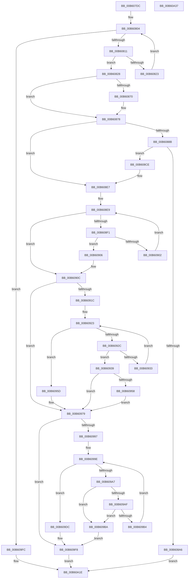

# HalpInterruptUpdateLocalUnitIdentifier

- RVA: `0x00B607DC`–`0x00B60A38` (길이 `604` bytes)
- VA: `0x0000000140B607DC`
- 실행 섹션: `PAGELK`
- PDB 이름 있음: `예`; PDB Function 태그: `아니요`
- unwind 정보 RVA: `0x000C4BA4`
- 디코드: `157`개 명령, `604/604` bytes 표시
- 미해석 바이트: `0` (있으면 어셈블리에 `.byte`로 보존)

> 이 문서는 커널 이미지의 기계어와 PDB 기호를 분석해 생성했습니다. 4번과 5번은 함수 원형과 자료형을 바이너리 사용 방식에서 추정한 C 해석이며 원본 소스 복구 결과는 아닙니다.

## 1. Dependencies

- 직접 호출 지점: **6**; 고유 호출 대상: **3**
- 직접 호출자로 확인된 함수: **1**
- RIP 상대 이미지 참조: **11**

### Outgoing calls
- `0x00B60839` → [KeGetProcessorIndexFromNumber](../../text/2D/KeGetProcessorIndexFromNumber_function_002DD2D0.md) (function, `0x002DD2D0`)
- `0x00B6089A` → [guard_dispatch_icall](../../text/6B/guard_dispatch_icall_function_006BAAD0.md) (function, `0x006BAAD0`)
- `0x00B608C1` → [HalpInterruptSetProblemEx](../../text/48/HalpInterruptSetProblemEx_function_0048AC8C.md) (function, `0x0048AC8C`)
- `0x00B60974` → [HalpInterruptSetProblemEx](../../text/48/HalpInterruptSetProblemEx_function_0048AC8C.md) (function, `0x0048AC8C`)
- `0x00B609F3` → [HalpInterruptSetProblemEx](../../text/48/HalpInterruptSetProblemEx_function_0048AC8C.md) (function, `0x0048AC8C`)
- `0x00B60A14` → [HalpInterruptSetProblemEx](../../text/48/HalpInterruptSetProblemEx_function_0048AC8C.md) (function, `0x0048AC8C`)

### Direct callers
- [HalpInterruptSwapProcessorIdentifiers](HalpInterruptSwapProcessorIdentifiers_function_00B60510.md) at `0x00B605BD`

### Static image references
- `0x00B60804` → RVA `0x00E10200` (`.data`; read)
- `0x00B60818` → RVA `0x00FC3E30` (`.data`; read)
- `0x00B6083E` → RVA `0x00E101F8` (`.data`; read)
- `0x00B60850` → RVA `0x00E101E8` (`.data`; read)
- `0x00B60878` → RVA `0x00E101F0` (`.data`; read)
- `0x00B608AD` → RVA `0x00025F20` (`.rdata`; read)
- `0x00B608E9` → RVA `0x00FC3E4C` (`.data`; read)
- `0x00B608F7` → RVA `0x00FC3E10` (`.data`; read)
- `0x00B6091C` → RVA `0x00E102D0` (`.data`; read)
- `0x00B60923` → RVA `0x00E102E0` (`.data`; read)
- `0x00B60939` → RVA `0x00F231B0` (`.data`; read)

## 2. Other-region calls and transfers

- 다른 실행 섹션으로 향하는 call: **6**
  - `0x00B60839` → [KeGetProcessorIndexFromNumber](../../text/2D/KeGetProcessorIndexFromNumber_function_002DD2D0.md) (`PAGELK` → `.text`)
  - `0x00B6089A` → [guard_dispatch_icall](../../text/6B/guard_dispatch_icall_function_006BAAD0.md) (`PAGELK` → `.text`)
  - `0x00B608C1` → [HalpInterruptSetProblemEx](../../text/48/HalpInterruptSetProblemEx_function_0048AC8C.md) (`PAGELK` → `.text`)
  - `0x00B60974` → [HalpInterruptSetProblemEx](../../text/48/HalpInterruptSetProblemEx_function_0048AC8C.md) (`PAGELK` → `.text`)
  - `0x00B609F3` → [HalpInterruptSetProblemEx](../../text/48/HalpInterruptSetProblemEx_function_0048AC8C.md) (`PAGELK` → `.text`)
  - `0x00B60A14` → [HalpInterruptSetProblemEx](../../text/48/HalpInterruptSetProblemEx_function_0048AC8C.md) (`PAGELK` → `.text`)
- 별도 외부 분기/꼬리 이동을 확인하지 못했습니다.

## 3. Assembly (complete function range)

```asm
00B607DC  48 8B C4                        mov rax, rsp
00B607DF  48 89 58 08                     mov qword ptr [rax + 8], rbx
00B607E3  48 89 68 18                     mov qword ptr [rax + 0x18], rbp
00B607E7  48 89 70 20                     mov qword ptr [rax + 0x20], rsi
00B607EB  89 50 10                        mov dword ptr [rax + 0x10], edx
00B607EE  57                              push rdi
00B607EF  41 56                           push r14
00B607F1  41 57                           push r15
00B607F3  48 83 EC 30                     sub rsp, 0x30
00B607F7  49 8B D9                        mov rbx, r9
00B607FA  49 8B E8                        mov rbp, r8
00B607FD  45 33 C9                        xor r9d, r9d
00B60800  8B FA                           mov edi, edx
00B60802  8B F1                           mov esi, ecx
00B60804  44 3B 0D F5 F9 2A 00            cmp r9d, dword ptr [rip + 0x2af9f5]
00B6080B  0F 83 EB 01 00 00               jae 0x140b609fc
00B60811  41 8B C1                        mov eax, r9d
00B60814  48 C1 E0 06                     shl rax, 6
00B60818  48 03 05 11 36 46 00            add rax, qword ptr [rip + 0x463611]
00B6081F  39 30                           cmp dword ptr [rax], esi
00B60821  74 05                           je 0x140b60828
00B60823  41 FF C1                        inc r9d
00B60826  EB DC                           jmp 0x140b60804
00B60828  8A 48 0D                        mov cl, byte ptr [rax + 0xd]
00B6082B  89 38                           mov dword ptr [rax], edi
00B6082D  48 83 C0 10                     add rax, 0x10
00B60831  F6 D9                           neg cl
00B60833  48 1B C9                        sbb rcx, rcx
00B60836  48 23 C8                        and rcx, rax
00B60839  E8 92 CA 77 FF                  call 0x1402dd2d0
00B6083E  48 8B 0D B3 F9 2A 00            mov rcx, qword ptr [rip + 0x2af9b3]
00B60845  44 8B F8                        mov r15d, eax
00B60848  42 89 3C B9                     mov dword ptr [rcx + r15*4], edi
00B6084C  4B 8D 3C 7F                     lea rdi, [r15 + r15*2]
00B60850  48 8B 0D 91 F9 2A 00            mov rcx, qword ptr [rip + 0x2af991]
00B60857  0F 10 04 F9                     movups xmm0, xmmword ptr [rcx + rdi*8]
00B6085B  0F 11 45 00                     movups xmmword ptr [rbp], xmm0
00B6085F  F2 0F 10 4C F9 10               movsd xmm1, qword ptr [rcx + rdi*8 + 0x10]
00B60865  F2 0F 11 4D 10                  movsd qword ptr [rbp + 0x10], xmm1
00B6086A  83 3C F9 04                     cmp dword ptr [rcx + rdi*8], 4
00B6086E  75 08                           jne 0x140b60878
00B60870  8B 44 24 58                     mov eax, dword ptr [rsp + 0x58]
00B60874  89 44 F9 08                     mov dword ptr [rcx + rdi*8 + 8], eax
00B60878  48 8B 0D 71 F9 2A 00            mov rcx, qword ptr [rip + 0x2af971]
00B6087F  48 8B 81 90 00 00 00            mov rax, qword ptr [rcx + 0x90]
00B60886  48 85 C0                        test rax, rax
00B60889  74 5C                           je 0x140b608e7
00B6088B  48 8B 49 10                     mov rcx, qword ptr [rcx + 0x10]
00B6088F  48 8D 54 24 58                  lea rdx, [rsp + 0x58]
00B60894  41 B1 01                        mov r9b, 1
00B60897  4C 8B C3                        mov r8, rbx
00B6089A  E8 31 A2 B5 FF                  call 0x1406baad0
00B6089F  44 8B C0                        mov r8d, eax
00B608A2  85 C0                           test eax, eax
00B608A4  79 28                           jns 0x140b608ce
00B608A6  48 8B 0D 43 F9 2A 00            mov rcx, qword ptr [rip + 0x2af943]
00B608AD  4C 8D 0D 6C 56 4C FF            lea r9, [rip - 0xb3a994]
00B608B4  BA 09 00 00 00                  mov edx, 9
00B608B9  C7 44 24 20 15 04 00 00         mov dword ptr [rsp + 0x20], 0x415
00B608C1  E8 C6 A3 92 FF                  call 0x14048ac8c
00B608C6  41 8B C0                        mov eax, r8d
00B608C9  E9 50 01 00 00                  jmp 0x140b60a1e
00B608CE  48 8B 0D 13 F9 2A 00            mov rcx, qword ptr [rip + 0x2af913]
00B608D5  0F 10 03                        movups xmm0, xmmword ptr [rbx]
00B608D8  0F 11 04 F9                     movups xmmword ptr [rcx + rdi*8], xmm0
00B608DC  F2 0F 10 4B 10                  movsd xmm1, qword ptr [rbx + 0x10]
00B608E1  F2 0F 11 4C F9 10               movsd qword ptr [rcx + rdi*8 + 0x10], xmm1
00B608E7  33 C0                           xor eax, eax
00B608E9  3B 05 5D 35 46 00               cmp eax, dword ptr [rip + 0x46355d]
00B608EF  73 1B                           jae 0x140b6090c
00B608F1  8B C8                           mov ecx, eax
00B608F3  48 C1 E1 06                     shl rcx, 6
00B608F7  48 03 0D 12 35 46 00            add rcx, qword ptr [rip + 0x463512]
00B608FE  39 31                           cmp dword ptr [rcx], esi
00B60900  74 04                           je 0x140b60906
00B60902  FF C0                           inc eax
00B60904  EB E3                           jmp 0x140b608e9
00B60906  8B 44 24 58                     mov eax, dword ptr [rsp + 0x58]
00B6090A  89 01                           mov dword ptr [rcx], eax
00B6090C  41 83 CB FF                     or r11d, 0xffffffff
00B60910  41 BA 1D 00 00 00               mov r10d, 0x1d
00B60916  83 7D 00 06                     cmp dword ptr [rbp], 6
00B6091A  75 5D                           jne 0x140b60979
00B6091C  48 8B 15 AD F9 2A 00            mov rdx, qword ptr [rip + 0x2af9ad]
00B60923  48 3B 15 B6 F9 2A 00            cmp rdx, qword ptr [rip + 0x2af9b6]
00B6092A  73 31                           jae 0x140b6095d
00B6092C  8B 45 08                        mov eax, dword ptr [rbp + 8]
00B6092F  39 02                           cmp dword ptr [rdx], eax
00B60931  74 06                           je 0x140b60939
00B60933  48 83 C2 18                     add rdx, 0x18
00B60937  EB EA                           jmp 0x140b60923
00B60939  48 8B 05 70 28 3C 00            mov rax, qword ptr [rip + 0x3c2870]
00B60940  42 8B 0C B8                     mov ecx, dword ptr [rax + r15*4]
00B60944  48 8B 42 08                     mov rax, qword ptr [rdx + 8]
00B60948  83 E1 3F                        and ecx, 0x3f
00B6094B  48 0F B3 C8                     btr rax, rcx
00B6094F  48 89 42 08                     mov qword ptr [rdx + 8], rax
00B60953  48 85 C0                        test rax, rax
00B60956  75 21                           jne 0x140b60979
00B60958  44 89 1A                        mov dword ptr [rdx], r11d
00B6095B  EB 1C                           jmp 0x140b60979
00B6095D  4C 8D 0D BC 55 4C FF            lea r9, [rip - 0xb3aa44]
00B60964  C7 44 24 20 4C 04 00 00         mov dword ptr [rsp + 0x20], 0x44c
00B6096C  45 33 C0                        xor r8d, r8d
00B6096F  41 8B D2                        mov edx, r10d
00B60972  33 C9                           xor ecx, ecx
00B60974  E8 13 A3 92 FF                  call 0x14048ac8c
00B60979  48 8B 05 68 F8 2A 00            mov rax, qword ptr [rip + 0x2af868]
00B60980  0F 10 04 F8                     movups xmm0, xmmword ptr [rax + rdi*8]
00B60984  0F 11 03                        movups xmmword ptr [rbx], xmm0
00B60987  F2 0F 10 4C F8 10               movsd xmm1, qword ptr [rax + rdi*8 + 0x10]
00B6098D  F2 0F 11 4B 10                  movsd qword ptr [rbx + 0x10], xmm1
00B60992  83 3B 06                        cmp dword ptr [rbx], 6
00B60995  75 61                           jne 0x140b609f8
00B60997  4C 8B 05 32 F9 2A 00            mov r8, qword ptr [rip + 0x2af932]
00B6099E  4C 3B 05 3B F9 2A 00            cmp r8, qword ptr [rip + 0x2af93b]
00B609A5  73 35                           jae 0x140b609dc
00B609A7  41 8B 00                        mov eax, dword ptr [r8]
00B609AA  41 3B C3                        cmp eax, r11d
00B609AD  74 0B                           je 0x140b609ba
00B609AF  3B 43 08                        cmp eax, dword ptr [rbx + 8]
00B609B2  74 06                           je 0x140b609ba
00B609B4  49 83 C0 18                     add r8, 0x18
00B609B8  EB E4                           jmp 0x140b6099e
00B609BA  8B 43 08                        mov eax, dword ptr [rbx + 8]
00B609BD  41 89 00                        mov dword ptr [r8], eax
00B609C0  48 8B 05 E9 27 3C 00            mov rax, qword ptr [rip + 0x3c27e9]
00B609C7  42 8B 14 B8                     mov edx, dword ptr [rax + r15*4]
00B609CB  49 8B 40 08                     mov rax, qword ptr [r8 + 8]
00B609CF  83 E2 3F                        and edx, 0x3f
00B609D2  48 0F AB D0                     bts rax, rdx
00B609D6  49 89 40 08                     mov qword ptr [r8 + 8], rax
00B609DA  EB 1C                           jmp 0x140b609f8
00B609DC  4C 8D 0D 3D 55 4C FF            lea r9, [rip - 0xb3aac3]
00B609E3  C7 44 24 20 6F 04 00 00         mov dword ptr [rsp + 0x20], 0x46f
00B609EB  45 33 C0                        xor r8d, r8d
00B609EE  41 8B D2                        mov edx, r10d
00B609F1  33 C9                           xor ecx, ecx
00B609F3  E8 94 A2 92 FF                  call 0x14048ac8c
00B609F8  33 C0                           xor eax, eax
00B609FA  EB 22                           jmp 0x140b60a1e
00B609FC  45 33 C0                        xor r8d, r8d
00B609FF  C7 44 24 20 F1 03 00 00         mov dword ptr [rsp + 0x20], 0x3f1
00B60A07  4C 8D 0D 12 55 4C FF            lea r9, [rip - 0xb3aaee]
00B60A0E  33 C9                           xor ecx, ecx
00B60A10  41 8D 50 15                     lea edx, [r8 + 0x15]
00B60A14  E8 73 A2 92 FF                  call 0x14048ac8c
00B60A19  B8 25 02 00 C0                  mov eax, 0xc0000225
00B60A1E  48 8B 5C 24 50                  mov rbx, qword ptr [rsp + 0x50]
00B60A23  48 8B 6C 24 60                  mov rbp, qword ptr [rsp + 0x60]
00B60A28  48 8B 74 24 68                  mov rsi, qword ptr [rsp + 0x68]
00B60A2D  48 83 C4 30                     add rsp, 0x30
00B60A31  41 5F                           pop r15
00B60A33  41 5E                           pop r14
00B60A35  5F                              pop rdi
00B60A36  C3                              ret
00B60A37  CC                              int3
```

## 4. C-style interpretation (structured pseudocode)

```c
__int64 __fastcall HalpInterruptUpdateLocalUnitIdentifier(int a1, int a2, __int64 a3, __int64 a4)
{
    __int64 result;
    __int64 v_r11;
    __int64 v_rsp;
    unsigned int v_stack_m28;
    unsigned int v_stack_p10;
    unsigned __int64 v_stack_p18;
    unsigned __int64 v_stack_p20;
    unsigned __int64 v_stack_p8;

    *(unsigned __int64 *)(v_rsp + 8) = v_rbx;
    *(unsigned __int64 *)(v_rsp + 24) = v_rbp;
    *(unsigned __int64 *)(v_rsp + 32) = v_rsi;
    *(unsigned int *)(v_rsp + 16) = a2;
    v_rsp = (v_rsp) - (48);
    a4 = 0;
loc_00B60804:
    if (0 >= (*(unsigned int *)(v_rip + 2816501))) goto loc_00B609FC;
    result = (0) << (6);
    result = (result) + (*(unsigned __int64 *)(v_rip + 4601361));
    if ((*(unsigned int *)(result)) == ((unsigned int)((unsigned int)(a1)))) goto loc_00B60828;
    a4 = (unsigned int)((a4) + 1);
    goto loc_00B60804;
loc_00B60828:
    *(unsigned int *)(result) = (unsigned int)((unsigned int)(a2));
    result = (result) + (16);
    a1 = (unsigned __int8)(-(*(unsigned __int8 *)(result + 13)));
    a1 = (a1) & (result);
    result = KeGetProcessorIndexFromNumber(a1, a2, a3, a4);
    *(unsigned int *)(*(unsigned __int64 *)(v_rip + 2816435) + (unsigned int)((unsigned int)(result)) * 4) = (unsigned int)((unsigned int)(a2));
    *(unsigned __int64 *)(a3) = v_xmm0;
    *(unsigned __int64 *)(a3 + 16) = v_xmm1;
    if ((*(unsigned int *)(*(unsigned __int64 *)(v_rip + 2816401) + (unsigned int)((unsigned int)(result)) + (unsigned int)((unsigned int)(result)) * 2 * 8)) == 4) {
        result = v_stack_p10;
        *(unsigned int *)(*(unsigned __int64 *)(v_rip + 2816401) + (unsigned int)((unsigned int)(result)) + (unsigned int)((unsigned int)(result)) * 2 * 8 + 8) = (unsigned int)(result);
    }
    if (*(unsigned __int64 *)(*(unsigned __int64 *)(v_rip + 2816369) + 144) == 0) goto loc_00B608E7;
    result = guard_dispatch_icall(*(unsigned __int64 *)(*(unsigned __int64 *)(v_rip + 2816369) + 16), v_stack_p10, a4, 1);
    if (!sign_flag) goto loc_00B608CE;
    v_stack_m28 = 0x415ULL;
    result = HalpInterruptSetProblemEx(*(unsigned __int64 *)(v_rip + 2816323), 9, (unsigned int)((unsigned int)(result)), v_rip - 11774356);
    goto loc_00B60A1E;
loc_00B608CE:
    *(unsigned __int64 *)(*(unsigned __int64 *)(v_rip + 2816275) + (unsigned int)((unsigned int)(result)) + (unsigned int)((unsigned int)(result)) * 2 * 8) = v_xmm0;
    *(unsigned __int64 *)(*(unsigned __int64 *)(v_rip + 2816275) + (unsigned int)((unsigned int)(result)) + (unsigned int)((unsigned int)(result)) * 2 * 8 + 16) = v_xmm1;
loc_00B608E7:
    result = 0;
loc_00B608E9:
    if (0 >= (*(unsigned int *)(v_rip + 4601181))) goto loc_00B6090C;
    a1 = (0) << (6);
    a1 = (a1) + (*(unsigned __int64 *)(v_rip + 4601106));
    if ((*(unsigned int *)(a1)) == ((unsigned int)((unsigned int)(a1)))) goto loc_00B60906;
    result = (unsigned int)((result) + 1);
    goto loc_00B608E9;
loc_00B60906:
    *(unsigned int *)(a1) = (unsigned int)((unsigned int)(v_stack_p10));
loc_00B6090C:
    v_r11 = (unsigned int)((v_r11) | (0xFFFFFFFFULL));
    if ((*(unsigned int *)(a3)) != 6) goto loc_00B60979;
loc_00B60923:
    if ((*(unsigned __int64 *)(v_rip + 2816429)) >= (*(unsigned __int64 *)(v_rip + 2816438))) goto loc_00B6095D;
    if ((*(unsigned int *)(*(unsigned __int64 *)(v_rip + 2816429))) == ((unsigned int)((unsigned int)(*(unsigned int *)(a3 + 8))))) goto loc_00B60939;
    a2 = (*(unsigned __int64 *)(v_rip + 2816429)) + (24);
    goto loc_00B60923;
loc_00B60939:
    a1 = (unsigned int)(((unsigned int)(*(unsigned int *)(*(unsigned __int64 *)(v_rip + 3942512) + (unsigned int)((unsigned int)(result)) * 4))) & (63));
    *(unsigned __int64 *)(a2 + 8) = *(unsigned __int64 *)(a2 + 8);
    if (*(unsigned __int64 *)(a2 + 8) != 0) goto loc_00B60979;
    *(unsigned int *)(a2) = (unsigned int)(v_r11);
    goto loc_00B60979;
loc_00B6095D:
    v_stack_m28 = 0x44CULL;
    a3 = 0;
    a1 = 0;
    result = HalpInterruptSetProblemEx(a1, 29, a3, v_rip - 11774532);
loc_00B60979:
    *(unsigned __int64 *)(a4) = v_xmm0;
    *(unsigned __int64 *)(a4 + 16) = v_xmm1;
    if ((*(unsigned int *)(a4)) != 6) goto loc_00B609F8;
loc_00B6099E:
    if ((*(unsigned __int64 *)(v_rip + 2816306)) >= (*(unsigned __int64 *)(v_rip + 2816315))) goto loc_00B609DC;
    if (((unsigned int)((unsigned int)(*(unsigned int *)(*(unsigned __int64 *)(v_rip + 2816306))))) == ((unsigned int)(v_r11))) goto loc_00B609BA;
    if (((unsigned int)((unsigned int)(*(unsigned int *)(*(unsigned __int64 *)(v_rip + 2816306))))) == (*(unsigned int *)(a4 + 8))) goto loc_00B609BA;
    a3 = (*(unsigned __int64 *)(v_rip + 2816306)) + (24);
    goto loc_00B6099E;
loc_00B609BA:
    *(unsigned int *)(a3) = (unsigned int)((unsigned int)(*(unsigned int *)(a4 + 8)));
    a2 = (unsigned int)(((unsigned int)(*(unsigned int *)(*(unsigned __int64 *)(v_rip + 3942377) + (unsigned int)((unsigned int)(result)) * 4))) & (63));
    *(unsigned __int64 *)(a3 + 8) = *(unsigned __int64 *)(a3 + 8);
    goto loc_00B609F8;
loc_00B609DC:
    v_stack_m28 = 0x46FULL;
    a3 = 0;
    a1 = 0;
    result = HalpInterruptSetProblemEx(a1, 29, a3, v_rip - 11774659);
loc_00B609F8:
    result = 0;
    goto loc_00B60A1E;
loc_00B609FC:
    a3 = 0;
    v_stack_m28 = 0x3F1ULL;
    a1 = 0;
    result = HalpInterruptSetProblemEx(a1, a3 + 21, a3, v_rip - 11774702);
loc_00B60A1E:
    v_rsp = (v_rsp) + (48);
    return (unsigned int)(0xC0000225ULL);
}
```

## 5. (Beta) C Style

```c
int64_t HalpInterruptUpdateLocalUnitIdentifier(int32_t Arg1, int32_t Arg2, void *Arg3, void *Arg4)
{
    uint8_t *arg3 = (uint8_t *)Arg3;
    uint8_t *arg4 = (uint8_t *)Arg4;

    int64_t result;
    int64_t local_r11;
    int64_t local_rsp;
    uint32_t v_stack_m28;
    uint32_t v_stack_p10;
    uint64_t v_stack_p18;
    uint64_t v_stack_p20;
    uint64_t v_stack_p8;

    *(uint64_t *)(local_rsp + 0x8) = local_rbx;
    *(uint64_t *)(local_rsp + 0x18) = local_rbp;
    *(uint64_t *)(local_rsp + 0x20) = local_rsi;
    *(uint32_t *)(local_rsp + 0x10) = Arg2;
    local_rsp = (local_rsp) - (48);
    Arg4 = 0;
loc_00B60804:
    if (0 >= (*(uint32_t *)(v_rip + 0x2AF9F5))) goto loc_00B609FC;
    result = (0) << (6);
    result = (result) + (*(uint64_t *)(v_rip + 0x463611));
    if ((*(uint32_t *)(result)) == ((uint32_t)((uint32_t)(Arg1)))) goto loc_00B60828;
    Arg4 = (uint32_t)((Arg4) + 1);
    goto loc_00B60804;
loc_00B60828:
    *(uint32_t *)(result) = (uint32_t)((uint32_t)(Arg2));
    result = (result) + (16);
    Arg1 = (uint8_t)(-(*(uint8_t *)(result + 0xD)));
    Arg1 = (Arg1) & (result);
    result = KeGetProcessorIndexFromNumber(Arg1, Arg2, Arg3, Arg4);
    *(uint32_t *)(*(uint64_t *)(v_rip + 0x2AF9B3) + (uint32_t)((uint32_t)(result)) * 4) = (uint32_t)((uint32_t)(Arg2));
    *(uint64_t *)(arg3) = v_xmm0;
    *(uint64_t *)(arg3 + 0x10) = v_xmm1;
    if ((*(uint32_t *)(*(uint64_t *)(v_rip + 0x2AF991) + (uint32_t)((uint32_t)(result)) + (uint32_t)((uint32_t)(result)) * 2 * 8)) == 4) {
        result = v_stack_p10;
        *(uint32_t *)(*(uint64_t *)(v_rip + 0x2AF991) + (uint32_t)((uint32_t)(result)) + (uint32_t)((uint32_t)(result)) * 2 * 8 + 0x8) = (uint32_t)(result);
    }
    if (*(uint64_t *)(*(uint64_t *)(v_rip + 0x2AF971) + 0x90) == 0) goto loc_00B608E7;
    result = guard_dispatch_icall(*(uint64_t *)(*(uint64_t *)(v_rip + 0x2AF971) + 0x10), v_stack_p10, Arg4, 1);
    if (!sign_flag) goto loc_00B608CE;
    v_stack_m28 = 0x415ULL;
    result = HalpInterruptSetProblemEx(*(uint64_t *)(v_rip + 0x2AF943), 9, (uint32_t)((uint32_t)(result)), v_rip - 11774356);
    goto loc_00B60A1E;
loc_00B608CE:
    *(uint64_t *)(*(uint64_t *)(v_rip + 0x2AF913) + (uint32_t)((uint32_t)(result)) + (uint32_t)((uint32_t)(result)) * 2 * 8) = v_xmm0;
    *(uint64_t *)(*(uint64_t *)(v_rip + 0x2AF913) + (uint32_t)((uint32_t)(result)) + (uint32_t)((uint32_t)(result)) * 2 * 8 + 0x10) = v_xmm1;
loc_00B608E7:
    result = 0;
loc_00B608E9:
    if (0 >= (*(uint32_t *)(v_rip + 0x46355D))) goto loc_00B6090C;
    Arg1 = (0) << (6);
    Arg1 = (Arg1) + (*(uint64_t *)(v_rip + 0x463512));
    if ((*(uint32_t *)(Arg1)) == ((uint32_t)((uint32_t)(Arg1)))) goto loc_00B60906;
    result = (uint32_t)((result) + 1);
    goto loc_00B608E9;
loc_00B60906:
    *(uint32_t *)(Arg1) = (uint32_t)((uint32_t)(v_stack_p10));
loc_00B6090C:
    local_r11 = (uint32_t)((local_r11) | (0xFFFFFFFFULL));
    if ((*(uint32_t *)(arg3)) != 6) goto loc_00B60979;
loc_00B60923:
    if ((*(uint64_t *)(v_rip + 0x2AF9AD)) >= (*(uint64_t *)(v_rip + 0x2AF9B6))) goto loc_00B6095D;
    if ((*(uint32_t *)(*(uint64_t *)(v_rip + 0x2AF9AD))) == ((uint32_t)((uint32_t)(*(uint32_t *)(arg3 + 0x8))))) goto loc_00B60939;
    Arg2 = (*(uint64_t *)(v_rip + 0x2AF9AD)) + (24);
    goto loc_00B60923;
loc_00B60939:
    Arg1 = (uint32_t)(((uint32_t)(*(uint32_t *)(*(uint64_t *)(v_rip + 0x3C2870) + (uint32_t)((uint32_t)(result)) * 4))) & (63));
    *(uint64_t *)(Arg2 + 0x8) = *(uint64_t *)(Arg2 + 0x8);
    if (*(uint64_t *)(Arg2 + 0x8) != 0) goto loc_00B60979;
    *(uint32_t *)(Arg2) = (uint32_t)(local_r11);
    goto loc_00B60979;
loc_00B6095D:
    v_stack_m28 = 0x44CULL;
    Arg3 = 0;
    Arg1 = 0;
    result = HalpInterruptSetProblemEx(Arg1, 29, Arg3, v_rip - 11774532);
loc_00B60979:
    *(uint64_t *)(arg4) = v_xmm0;
    *(uint64_t *)(arg4 + 0x10) = v_xmm1;
    if ((*(uint32_t *)(arg4)) != 6) goto loc_00B609F8;
loc_00B6099E:
    if ((*(uint64_t *)(v_rip + 0x2AF932)) >= (*(uint64_t *)(v_rip + 0x2AF93B))) goto loc_00B609DC;
    if (((uint32_t)((uint32_t)(*(uint32_t *)(*(uint64_t *)(v_rip + 0x2AF932))))) == ((uint32_t)(local_r11))) goto loc_00B609BA;
    if (((uint32_t)((uint32_t)(*(uint32_t *)(*(uint64_t *)(v_rip + 0x2AF932))))) == (*(uint32_t *)(arg4 + 0x8))) goto loc_00B609BA;
    Arg3 = (*(uint64_t *)(v_rip + 0x2AF932)) + (24);
    goto loc_00B6099E;
loc_00B609BA:
    *(uint32_t *)(arg3) = (uint32_t)((uint32_t)(*(uint32_t *)(arg4 + 0x8)));
    Arg2 = (uint32_t)(((uint32_t)(*(uint32_t *)(*(uint64_t *)(v_rip + 0x3C27E9) + (uint32_t)((uint32_t)(result)) * 4))) & (63));
    *(uint64_t *)(arg3 + 0x8) = *(uint64_t *)(arg3 + 0x8);
    goto loc_00B609F8;
loc_00B609DC:
    v_stack_m28 = 0x46FULL;
    Arg3 = 0;
    Arg1 = 0;
    result = HalpInterruptSetProblemEx(Arg1, 29, Arg3, v_rip - 11774659);
loc_00B609F8:
    result = 0;
    goto loc_00B60A1E;
loc_00B609FC:
    Arg3 = 0;
    v_stack_m28 = 0x3F1ULL;
    Arg1 = 0;
    result = HalpInterruptSetProblemEx(Arg1, Arg3 + 21, Arg3, v_rip - 11774702);
loc_00B60A1E:
    local_rsp = (local_rsp) + (48);
    return (uint32_t)(0xC0000225ULL);
}
```

### 관측된 메모리 오프셋

구조체 형식이 확인되지 않은 접근은 인자 기준의 오프셋으로만 기록했습니다.

| 기준 인자 | 오프셋 표현 | 폭 (bit) | 접근 |
|---|---:|---:|---|
| `Arg3` | `+ 0x0` | `32` | `R` |
| `Arg3` | `+ 0x0` | `128` | `R` |
| `Arg3` | `+ 0x8` | `32` | `R` |
| `Arg3` | `+ 0x10` | `64` | `W` |
| `Arg4` | `+ 0x0` | `32` | `R` |
| `Arg4` | `+ 0x0` | `128` | `R` |
| `Arg4` | `+ 0x8` | `32` | `R` |
| `Arg4` | `+ 0x10` | `64` | `R` |
| `Arg4` | `+ 0x10` | `64` | `W` |

## 6. Execution-region graph

[열기: 2D/3D 그래프와 함수 탐색 컨트롤 패널](../../../control-panel.html?section=pagelk&rva=0x00B607DC&view=graph)

- 2D 그래프는 위에서 아래로 흐르고, 3D 그래프는 빈 공간을 드래그해 회전합니다. Shift+드래그는 이동, 휠은 확대·축소, 함수 노드 선택은 대상 보고서 이동입니다.

### Static fallback


