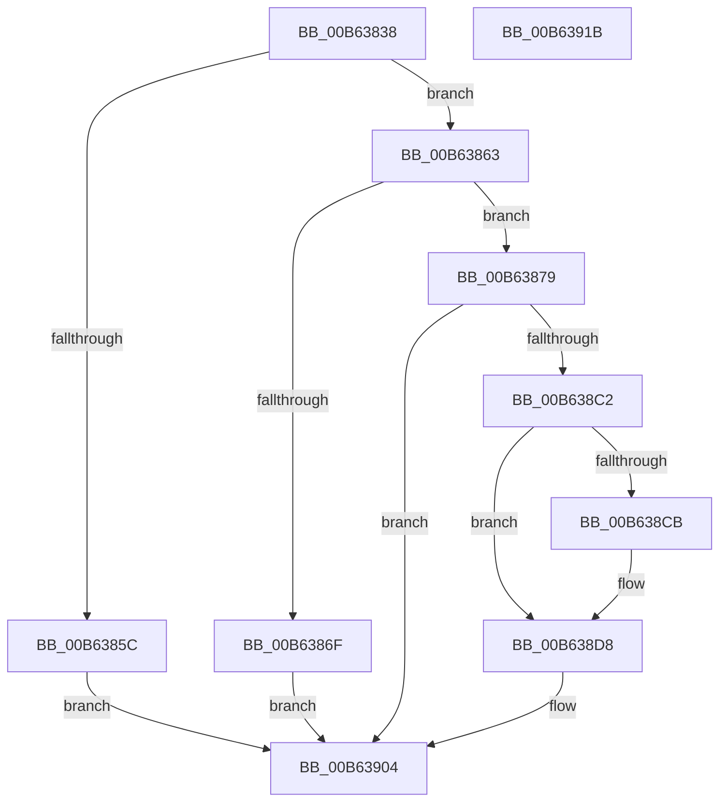

# HalpIvtpInitializeReservedDomain

- RVA: `0x00B63838`–`0x00B6391C` (길이 `228` bytes)
- VA: `0x0000000140B63838`
- 실행 섹션: `PAGELK`
- PDB 이름 있음: `예`; PDB Function 태그: `아니요`
- unwind 정보 RVA: `0x000C55B8`
- 디코드: `56`개 명령, `228/228` bytes 표시
- 미해석 바이트: `0` (있으면 어셈블리에 `.byte`로 보존)

> 이 문서는 커널 이미지의 기계어와 PDB 기호를 분석해 생성했습니다. 4번과 5번은 함수 원형과 자료형을 바이너리 사용 방식에서 추정한 C 해석이며 원본 소스 복구 결과는 아닙니다.

## 1. Dependencies

- 직접 호출 지점: **3**; 고유 호출 대상: **3**
- 직접 호출자로 확인된 함수: **1**
- RIP 상대 이미지 참조: **0**

### Outgoing calls
- `0x00B63884` → [memset](../../text/6C/memset_function_006C6C40.md) (function, `0x006C6C40`)
- `0x00B638B7` → [IvtAllocateTranslationStructures](../../text/56/IvtAllocateTranslationStructures_function_0056EC58.md) (function, `0x0056EC58`)
- `0x00B638FF` → [IvtUpdateTranslationStructures](../../text/4F/IvtUpdateTranslationStructures_function_004F913C.md) (function, `0x004F913C`)

### Direct callers
- [IvtInitializeReservedDomains](IvtInitializeReservedDomains_function_00B63A08.md) at `0x00B63A49`

### Static image references
- 디코드된 RIP-relative 메모리 참조가 없습니다.

## 2. Other-region calls and transfers

- 다른 실행 섹션으로 향하는 call: **3**
  - `0x00B63884` → [memset](../../text/6C/memset_function_006C6C40.md) (`PAGELK` → `.text`)
  - `0x00B638B7` → [IvtAllocateTranslationStructures](../../text/56/IvtAllocateTranslationStructures_function_0056EC58.md) (`PAGELK` → `.text`)
  - `0x00B638FF` → [IvtUpdateTranslationStructures](../../text/4F/IvtUpdateTranslationStructures_function_004F913C.md) (`PAGELK` → `.text`)
- 별도 외부 분기/꼬리 이동을 확인하지 못했습니다.

## 3. Assembly (complete function range)

```asm
00B63838  48 89 5C 24 08                  mov qword ptr [rsp + 8], rbx
00B6383D  48 89 74 24 10                  mov qword ptr [rsp + 0x10], rsi
00B63842  57                              push rdi
00B63843  48 81 EC B0 00 00 00            sub rsp, 0xb0
00B6384A  48 8B 7A 08                     mov rdi, qword ptr [rdx + 8]
00B6384E  48 8B DA                        mov rbx, rdx
00B63851  48 8B F1                        mov rsi, rcx
00B63854  48 8B 07                        mov rax, qword ptr [rdi]
00B63857  83 38 01                        cmp dword ptr [rax], 1
00B6385A  74 07                           je 0x140b63863
00B6385C  33 DB                           xor ebx, ebx
00B6385E  E9 A1 00 00 00                  jmp 0x140b63904
00B63863  0F B7 40 08                     movzx eax, word ptr [rax + 8]
00B63867  3B 81 FC 00 00 00               cmp eax, dword ptr [rcx + 0xfc]
00B6386D  74 0A                           je 0x140b63879
00B6386F  BB 0D 00 00 C0                  mov ebx, 0xc000000d
00B63874  E9 8B 00 00 00                  jmp 0x140b63904
00B63879  33 D2                           xor edx, edx
00B6387B  48 8D 4C 24 40                  lea rcx, [rsp + 0x40]
00B63880  44 8D 42 70                     lea r8d, [rdx + 0x70]
00B63884  E8 B7 33 B6 FF                  call 0x1406c6c40
00B63889  8B 03                           mov eax, dword ptr [rbx]
00B6388B  4C 8D 44 24 40                  lea r8, [rsp + 0x40]
00B63890  89 44 24 70                     mov dword ptr [rsp + 0x70], eax
00B63894  48 8B CE                        mov rcx, rsi
00B63897  48 8B 47 10                     mov rax, qword ptr [rdi + 0x10]
00B6389B  48 8B 7F 18                     mov rdi, qword ptr [rdi + 0x18]
00B6389F  48 8B D7                        mov rdx, rdi
00B638A2  C7 44 24 40 01 00 00 00         mov dword ptr [rsp + 0x40], 1
00B638AA  C7 44 24 44 02 00 00 00         mov dword ptr [rsp + 0x44], 2
00B638B2  48 89 44 24 68                  mov qword ptr [rsp + 0x68], rax
00B638B7  E8 9C B3 A0 FF                  call 0x14056ec58
00B638BC  8B D8                           mov ebx, eax
00B638BE  85 C0                           test eax, eax
00B638C0  78 42                           js 0x140b63904
00B638C2  80 BE 40 01 00 00 00            cmp byte ptr [rsi + 0x140], 0
00B638C9  74 0D                           je 0x140b638d8
00B638CB  48 8B 4F 48                     mov rcx, qword ptr [rdi + 0x48]
00B638CF  48 83 67 48 00                  and qword ptr [rdi + 0x48], 0
00B638D4  48 89 4F 40                     mov qword ptr [rdi + 0x40], rcx
00B638D8  48 C7 44 24 38 00 00 01 00      mov qword ptr [rsp + 0x38], 0x10000
00B638E1  48 8D 44 24 40                  lea rax, [rsp + 0x40]
00B638E6  C7 44 24 30 01 00 00 00         mov dword ptr [rsp + 0x30], 1
00B638EE  41 B9 04 00 00 00               mov r9d, 4
00B638F4  48 8B D7                        mov rdx, rdi
00B638F7  48 89 44 24 28                  mov qword ptr [rsp + 0x28], rax
00B638FC  48 8B CE                        mov rcx, rsi
00B638FF  E8 38 58 99 FF                  call 0x1404f913c
00B63904  4C 8D 9C 24 B0 00 00 00         lea r11, [rsp + 0xb0]
00B6390C  8B C3                           mov eax, ebx
00B6390E  49 8B 5B 10                     mov rbx, qword ptr [r11 + 0x10]
00B63912  49 8B 73 18                     mov rsi, qword ptr [r11 + 0x18]
00B63916  49 8B E3                        mov rsp, r11
00B63919  5F                              pop rdi
00B6391A  C3                              ret
00B6391B  CC                              int3
```

## 4. C-style interpretation (structured pseudocode)

```c
__int64 __fastcall HalpIvtpInitializeReservedDomain(__int64 a1, __int64 a2)
{
    __int64 result;
    __int64 v_rbx;
    __int64 v_rsp;
    unsigned int v_stack_m48;
    unsigned __int64 v_stack_m50;
    unsigned int v_stack_m74;
    unsigned __int64 v_stack_m78;
    unsigned __int64 v_stack_m8;
    unsigned __int64 v_stack_m80;
    unsigned int v_stack_m88;
    unsigned __int64 v_stack_m90;
    unsigned __int64 v_stack_p10;
    unsigned __int64 v_stack_p8;

    v_stack_p8 = v_rbx;
    v_stack_p10 = v_rsi;
    v_rsp = (v_rsp) - (176);
    if ((*(unsigned int *)(*(unsigned __int64 *)(*(unsigned __int64 *)(a2 + 8)))) == 1) goto loc_00B63863;
    v_rbx = 0;
    goto loc_00B63904;
loc_00B63863:
    if (((unsigned int)(*(unsigned __int16 *)(*(unsigned __int64 *)(*(unsigned __int64 *)(a2 + 8)) + 8))) == (*(unsigned int *)(a1 + 252))) goto loc_00B63879;
    goto loc_00B63904;
loc_00B63879:
    a2 = 0;
    result = memset(v_stack_m78, a2, a2 + 112, a4);
    v_stack_m48 = (unsigned int)((unsigned int)(*(unsigned int *)((unsigned int)(0xC000000DULL))));
    v_stack_m78 = 1;
    v_stack_m74 = 2;
    v_stack_m50 = *(unsigned __int64 *)(*(unsigned __int64 *)(a2 + 8) + 16);
    result = IvtAllocateTranslationStructures(a1, *(unsigned __int64 *)(*(unsigned __int64 *)(a2 + 8) + 24), v_stack_m78, a4);
    if (sign_flag) goto loc_00B63904;
    if ((*(unsigned __int8 *)(a1 + 320)) != 0) {
        a1 = *(unsigned __int64 *)(*(unsigned __int64 *)(*(unsigned __int64 *)(a2 + 8) + 24) + 72);
        *(unsigned __int64 *)(*(unsigned __int64 *)(*(unsigned __int64 *)(a2 + 8) + 24) + 64) = a1;
    }
    v_stack_m80 = 0x10000ULL;
    v_stack_m88 = 1;
    v_stack_m90 = v_stack_m78;
    result = IvtUpdateTranslationStructures(a1, *(unsigned __int64 *)(*(unsigned __int64 *)(a2 + 8) + 24), v_stack_m78, 4);
loc_00B63904:
    return (unsigned int)((unsigned int)((unsigned int)((unsigned int)(result))));
}
```

## 5. (Beta) C Style

```c
int64_t HalpIvtpInitializeReservedDomain(void *Arg1, void *Arg2)
{
    uint8_t *arg1 = (uint8_t *)Arg1;
    uint8_t *arg2 = (uint8_t *)Arg2;

    int64_t result;
    int64_t local_rbx;
    int64_t local_rsp;
    uint32_t v_stack_m48;
    uint64_t v_stack_m50;
    uint32_t v_stack_m74;
    uint64_t v_stack_m78;
    uint64_t v_stack_m8;
    uint64_t v_stack_m80;
    uint32_t v_stack_m88;
    uint64_t v_stack_m90;
    uint64_t v_stack_p10;
    uint64_t v_stack_p8;

    v_stack_p8 = local_rbx;
    v_stack_p10 = local_rsi;
    local_rsp = (local_rsp) - (176);
    if ((*(uint32_t *)(*(uint64_t *)(*(uint64_t *)(arg2 + 0x8)))) == 1) goto loc_00B63863;
    local_rbx = 0;
    goto loc_00B63904;
loc_00B63863:
    if (((uint32_t)(*(uint16_t *)(*(uint64_t *)(*(uint64_t *)(arg2 + 0x8)) + 0x8))) == (*(uint32_t *)(arg1 + 0xFC))) goto loc_00B63879;
    goto loc_00B63904;
loc_00B63879:
    Arg2 = 0;
    result = memset(v_stack_m78, Arg2, Arg2 + 112, a4);
    v_stack_m48 = (uint32_t)((uint32_t)(*(uint32_t *)((uint32_t)(0xC000000DULL))));
    v_stack_m78 = 1;
    v_stack_m74 = 2;
    v_stack_m50 = *(uint64_t *)(*(uint64_t *)(arg2 + 0x8) + 0x10);
    result = IvtAllocateTranslationStructures(Arg1, *(uint64_t *)(*(uint64_t *)(arg2 + 0x8) + 0x18), v_stack_m78, a4);
    if (sign_flag) goto loc_00B63904;
    if ((*(uint8_t *)(arg1 + 0x140)) != 0) {
        Arg1 = *(uint64_t *)(*(uint64_t *)(*(uint64_t *)(arg2 + 0x8) + 0x18) + 0x48);
        *(void **)(*(uint64_t *)(*(uint64_t *)(arg2 + 0x8) + 0x18) + 0x40) = Arg1;
    }
    v_stack_m80 = 0x10000ULL;
    v_stack_m88 = 1;
    v_stack_m90 = v_stack_m78;
    result = IvtUpdateTranslationStructures(Arg1, *(uint64_t *)(*(uint64_t *)(arg2 + 0x8) + 0x18), v_stack_m78, 4);
loc_00B63904:
    return (uint32_t)((uint32_t)((uint32_t)((uint32_t)(result))));
}
```

### 관측된 메모리 오프셋

구조체 형식이 확인되지 않은 접근은 인자 기준의 오프셋으로만 기록했습니다.

| 기준 인자 | 오프셋 표현 | 폭 (bit) | 접근 |
|---|---:|---:|---|
| `Arg1` | `+ 0xFC` | `32` | `R` |
| `Arg1` | `+ 0x140` | `8` | `R` |
| `Arg2` | `+ 0x0` | `32` | `R` |
| `Arg2` | `+ 0x8` | `64` | `R` |

## 6. Execution-region graph

[열기: 2D/3D 그래프와 함수 탐색 컨트롤 패널](../../../control-panel.html?section=pagelk&rva=0x00B63838&view=graph)

- 2D 그래프는 위에서 아래로 흐르고, 3D 그래프는 빈 공간을 드래그해 회전합니다. Shift+드래그는 이동, 휠은 확대·축소, 함수 노드 선택은 대상 보고서 이동입니다.

### Static fallback


