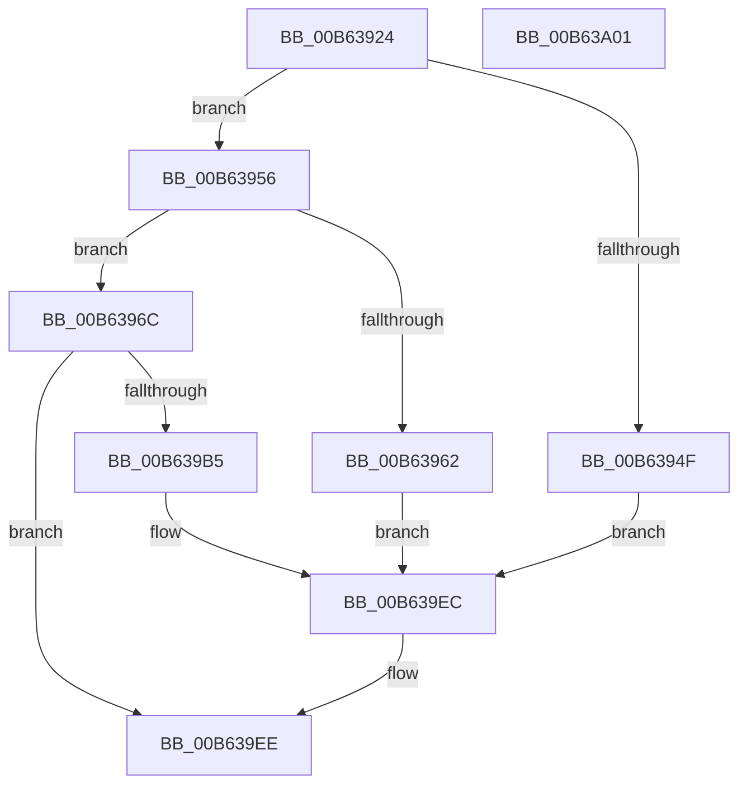

# HalpIvtpLegacyInitializeReservedDomain

- RVA: `0x00B63924`–`0x00B63A02` (길이 `222` bytes)
- VA: `0x0000000140B63924`
- 실행 섹션: `PAGELK`
- PDB 이름 있음: `예`; PDB Function 태그: `아니요`
- unwind 정보 RVA: `0x000C55D0`
- 디코드: `59`개 명령, `222/222` bytes 표시
- 미해석 바이트: `0` (있으면 어셈블리에 `.byte`로 보존)

> 이 문서는 커널 이미지의 기계어와 PDB 기호를 분석해 생성했습니다. 4번과 5번은 함수 원형과 자료형을 바이너리 사용 방식에서 추정한 C 해석이며 원본 소스 복구 결과는 아닙니다.

## 1. Dependencies

- 직접 호출 지점: **3**; 고유 호출 대상: **3**
- 직접 호출자로 확인된 함수: **1**
- RIP 상대 이미지 참조: **0**

### Outgoing calls
- `0x00B63976` → [memset](../../text/6C/memset_function_006C6C40.md) (function, `0x006C6C40`)
- `0x00B639AA` → [IvtLegacyAllocateTranslationStructures](../../text/57/IvtLegacyAllocateTranslationStructures_function_00570E28.md) (function, `0x00570E28`)
- `0x00B639E7` → [IvtLegacyUpdateTranslationStructures](../../text/57/IvtLegacyUpdateTranslationStructures_function_0057247C.md) (function, `0x0057247C`)

### Direct callers
- [IvtInitializeReservedDomains](IvtInitializeReservedDomains_function_00B63A08.md) at `0x00B63A42`

### Static image references
- 디코드된 RIP-relative 메모리 참조가 없습니다.

## 2. Other-region calls and transfers

- 다른 실행 섹션으로 향하는 call: **3**
  - `0x00B63976` → [memset](../../text/6C/memset_function_006C6C40.md) (`PAGELK` → `.text`)
  - `0x00B639AA` → [IvtLegacyAllocateTranslationStructures](../../text/57/IvtLegacyAllocateTranslationStructures_function_00570E28.md) (`PAGELK` → `.text`)
  - `0x00B639E7` → [IvtLegacyUpdateTranslationStructures](../../text/57/IvtLegacyUpdateTranslationStructures_function_0057247C.md) (`PAGELK` → `.text`)
- 별도 외부 분기/꼬리 이동을 확인하지 못했습니다.

## 3. Assembly (complete function range)

```asm
00B63924  48 89 5C 24 08                  mov qword ptr [rsp + 8], rbx
00B63929  55                              push rbp
00B6392A  56                              push rsi
00B6392B  57                              push rdi
00B6392C  48 8D 6C 24 B9                  lea rbp, [rsp - 0x47]
00B63931  48 81 EC C0 00 00 00            sub rsp, 0xc0
00B63938  48 8B 7A 08                     mov rdi, qword ptr [rdx + 8]
00B6393C  48 8B DA                        mov rbx, rdx
00B6393F  48 83 65 6F 00                  and qword ptr [rbp + 0x6f], 0
00B63944  48 8B F1                        mov rsi, rcx
00B63947  48 8B 07                        mov rax, qword ptr [rdi]
00B6394A  83 38 01                        cmp dword ptr [rax], 1
00B6394D  74 07                           je 0x140b63956
00B6394F  33 DB                           xor ebx, ebx
00B63951  E9 96 00 00 00                  jmp 0x140b639ec
00B63956  0F B7 40 08                     movzx eax, word ptr [rax + 8]
00B6395A  3B 81 FC 00 00 00               cmp eax, dword ptr [rcx + 0xfc]
00B63960  74 0A                           je 0x140b6396c
00B63962  BB 0D 00 00 C0                  mov ebx, 0xc000000d
00B63967  E9 80 00 00 00                  jmp 0x140b639ec
00B6396C  33 D2                           xor edx, edx
00B6396E  48 8D 4D D7                     lea rcx, [rbp - 0x29]
00B63972  44 8D 42 70                     lea r8d, [rdx + 0x70]
00B63976  E8 C5 32 B6 FF                  call 0x1406c6c40
00B6397B  8B 03                           mov eax, dword ptr [rbx]
00B6397D  4C 8D 45 D7                     lea r8, [rbp - 0x29]
00B63981  48 8B 57 18                     mov rdx, qword ptr [rdi + 0x18]
00B63985  48 8B CE                        mov rcx, rsi
00B63988  89 45 07                        mov dword ptr [rbp + 7], eax
00B6398B  48 8B 47 10                     mov rax, qword ptr [rdi + 0x10]
00B6398F  48 89 45 FF                     mov qword ptr [rbp - 1], rax
00B63993  48 8D 45 6F                     lea rax, [rbp + 0x6f]
00B63997  48 89 44 24 28                  mov qword ptr [rsp + 0x28], rax
00B6399C  C7 45 D7 01 00 00 00            mov dword ptr [rbp - 0x29], 1
00B639A3  C7 45 DB 02 00 00 00            mov dword ptr [rbp - 0x25], 2
00B639AA  E8 79 D4 A0 FF                  call 0x140570e28
00B639AF  8B D8                           mov ebx, eax
00B639B1  85 C0                           test eax, eax
00B639B3  78 39                           js 0x140b639ee
00B639B5  48 8B 07                        mov rax, qword ptr [rdi]
00B639B8  48 8D 55 77                     lea rdx, [rbp + 0x77]
00B639BC  83 65 7B 00                     and dword ptr [rbp + 0x7b], 0
00B639C0  4C 8B 4D 6F                     mov r9, qword ptr [rbp + 0x6f]
00B639C4  C7 44 24 40 01 00 00 00         mov dword ptr [rsp + 0x40], 1
00B639CC  0F B7 48 0C                     movzx ecx, word ptr [rax + 0xc]
00B639D0  48 8D 45 D7                     lea rax, [rbp - 0x29]
00B639D4  89 4D 77                        mov dword ptr [rbp + 0x77], ecx
00B639D7  48 8B CE                        mov rcx, rsi
00B639DA  48 89 44 24 30                  mov qword ptr [rsp + 0x30], rax
00B639DF  C7 44 24 20 04 00 00 00         mov dword ptr [rsp + 0x20], 4
00B639E7  E8 90 EA A0 FF                  call 0x14057247c
00B639EC  8B C3                           mov eax, ebx
00B639EE  48 8B 9C 24 E0 00 00 00         mov rbx, qword ptr [rsp + 0xe0]
00B639F6  48 81 C4 C0 00 00 00            add rsp, 0xc0
00B639FD  5F                              pop rdi
00B639FE  5E                              pop rsi
00B639FF  5D                              pop rbp
00B63A00  C3                              ret
00B63A01  CC                              int3
```

## 4. C-style interpretation (structured pseudocode)

```c
__int64 __fastcall HalpIvtpLegacyInitializeReservedDomain(__int64 a1, __int64 a2)
{
    __int64 result;
    __int64 v_rbx;
    __int64 v_rsp;
    unsigned int v_stack_m58;
    unsigned __int64 v_stack_m5F;
    unsigned __int64 v_stack_m60;
    unsigned int v_stack_m84;
    unsigned __int64 v_stack_m88;
    unsigned int v_stack_m98;
    unsigned __int64 v_stack_mA8;
    unsigned __int64 v_stack_mB0;
    unsigned int v_stack_mB8;
    unsigned __int64 v_stack_p10;
    unsigned __int64 v_stack_p18;
    unsigned int v_stack_p1C;
    unsigned __int64 v_stack_p8;

    v_stack_p8 = v_rbx;
    v_rsp = (v_rsp) - (192);
    if ((*(unsigned int *)(*(unsigned __int64 *)(*(unsigned __int64 *)(a2 + 8)))) == 1) goto loc_00B63956;
    v_rbx = 0;
    goto loc_00B639EC;
loc_00B63956:
    if (((unsigned int)(*(unsigned __int16 *)(*(unsigned __int64 *)(*(unsigned __int64 *)(a2 + 8)) + 8))) == (*(unsigned int *)(a1 + 252))) goto loc_00B6396C;
    goto loc_00B639EC;
loc_00B6396C:
    a2 = 0;
    result = memset(v_stack_m88, a2, a2 + 112, a4);
    v_stack_m58 = (unsigned int)((unsigned int)(*(unsigned int *)((unsigned int)(0xC000000DULL))));
    v_stack_m60 = *(unsigned __int64 *)(*(unsigned __int64 *)(a2 + 8) + 16);
    v_stack_mB0 = v_stack_p10;
    v_stack_m88 = 1;
    v_stack_m84 = 2;
    result = IvtLegacyAllocateTranslationStructures(a1, *(unsigned __int64 *)(*(unsigned __int64 *)(a2 + 8) + 24), v_stack_m88, a4);
    if (sign_flag) goto loc_00B639EE;
    v_stack_m98 = 1;
    v_stack_p18 = (unsigned int)(*(unsigned __int16 *)(*(unsigned __int64 *)(*(unsigned __int64 *)(a2 + 8)) + 12));
    v_stack_mA8 = v_stack_m88;
    v_stack_mB8 = 4;
    result = IvtLegacyUpdateTranslationStructures(a1, v_stack_p18, v_stack_m88, v_stack_p10);
loc_00B639EC:
loc_00B639EE:
    v_rsp = (v_rsp) + (192);
    return (unsigned int)((unsigned int)((unsigned int)((unsigned int)(result))));
}
```

## 5. (Beta) C Style

```c
int64_t HalpIvtpLegacyInitializeReservedDomain(void *Arg1, void *Arg2)
{
    uint8_t *arg1 = (uint8_t *)Arg1;
    uint8_t *arg2 = (uint8_t *)Arg2;

    int64_t result;
    int64_t local_rbx;
    int64_t local_rsp;
    uint32_t v_stack_m58;
    uint64_t v_stack_m5F;
    uint64_t v_stack_m60;
    uint32_t v_stack_m84;
    uint64_t v_stack_m88;
    uint32_t v_stack_m98;
    uint64_t v_stack_mA8;
    uint64_t v_stack_mB0;
    uint32_t v_stack_mB8;
    uint64_t v_stack_p10;
    uint64_t v_stack_p18;
    uint32_t v_stack_p1C;
    uint64_t v_stack_p8;

    v_stack_p8 = local_rbx;
    local_rsp = (local_rsp) - (192);
    if ((*(uint32_t *)(*(uint64_t *)(*(uint64_t *)(arg2 + 0x8)))) == 1) goto loc_00B63956;
    local_rbx = 0;
    goto loc_00B639EC;
loc_00B63956:
    if (((uint32_t)(*(uint16_t *)(*(uint64_t *)(*(uint64_t *)(arg2 + 0x8)) + 0x8))) == (*(uint32_t *)(arg1 + 0xFC))) goto loc_00B6396C;
    goto loc_00B639EC;
loc_00B6396C:
    Arg2 = 0;
    result = memset(v_stack_m88, Arg2, Arg2 + 112, a4);
    v_stack_m58 = (uint32_t)((uint32_t)(*(uint32_t *)((uint32_t)(0xC000000DULL))));
    v_stack_m60 = *(uint64_t *)(*(uint64_t *)(arg2 + 0x8) + 0x10);
    v_stack_mB0 = v_stack_p10;
    v_stack_m88 = 1;
    v_stack_m84 = 2;
    result = IvtLegacyAllocateTranslationStructures(Arg1, *(uint64_t *)(*(uint64_t *)(arg2 + 0x8) + 0x18), v_stack_m88, a4);
    if (sign_flag) goto loc_00B639EE;
    v_stack_m98 = 1;
    v_stack_p18 = (uint32_t)(*(uint16_t *)(*(uint64_t *)(*(uint64_t *)(arg2 + 0x8)) + 0xC));
    v_stack_mA8 = v_stack_m88;
    v_stack_mB8 = 4;
    result = IvtLegacyUpdateTranslationStructures(Arg1, v_stack_p18, v_stack_m88, v_stack_p10);
loc_00B639EC:
loc_00B639EE:
    local_rsp = (local_rsp) + (192);
    return (uint32_t)((uint32_t)((uint32_t)((uint32_t)(result))));
}
```

### 관측된 메모리 오프셋

구조체 형식이 확인되지 않은 접근은 인자 기준의 오프셋으로만 기록했습니다.

| 기준 인자 | 오프셋 표현 | 폭 (bit) | 접근 |
|---|---:|---:|---|
| `Arg1` | `+ 0xFC` | `32` | `R` |
| `Arg2` | `+ 0x0` | `32` | `R` |
| `Arg2` | `+ 0x8` | `64` | `R` |

## 6. Execution-region graph

[열기: 2D/3D 그래프와 함수 탐색 컨트롤 패널](../../../control-panel.html?section=pagelk&rva=0x00B63924&view=graph)

- 2D 그래프는 위에서 아래로 흐르고, 3D 그래프는 빈 공간을 드래그해 회전합니다. Shift+드래그는 이동, 휠은 확대·축소, 함수 노드 선택은 대상 보고서 이동입니다.

### Static fallback


