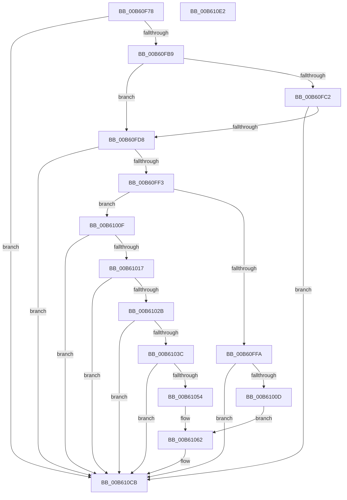

# HalpLbrInitialize

- RVA: `0x00B60F78`–`0x00B610E3` (길이 `363` bytes)
- VA: `0x0000000140B60F78`
- 실행 섹션: `PAGELK`
- PDB 이름 있음: `예`; PDB Function 태그: `아니요`
- unwind 정보 RVA: `0x000C412C`
- 디코드: `82`개 명령, `363/363` bytes 표시
- 미해석 바이트: `0` (있으면 어셈블리에 `.byte`로 보존)

> 이 문서는 커널 이미지의 기계어와 PDB 기호를 분석해 생성했습니다. 4번과 5번은 함수 원형과 자료형을 바이너리 사용 방식에서 추정한 C 해석이며 원본 소스 복구 결과는 아닙니다.

## 1. Dependencies

- 직접 호출 지점: **5**; 고유 호출 대상: **5**
- 직접 호출자로 확인된 함수: **1**
- RIP 상대 이미지 참조: **21**

### Outgoing calls
- `0x00B60FB9` → [HalpIsHvPresent](../../text/4A/HalpIsHvPresent_function_004AFA10.md) (function, `0x004AFA10`)
- `0x00B60FC6` → [HviGetHypervisorFeatures](../../text/66/HviGetHypervisorFeatures_function_00666630.md) (function, `0x00666630`)
- `0x00B60FE6` → [HalpGetCpuInfo](../../text/49/HalpGetCpuInfo_function_00498A70.md) (function, `0x00498A70`)
- `0x00B61000` → [HalpLbrInitializeIntel](HalpLbrInitializeIntel_function_00B610EC.md) (function, `0x00B610EC`)
- `0x00B610D2` → [_security_check_cookie](../../text/6A/_security_check_cookie_function_006AC640.md) (function, `0x006AC640`)

### Direct callers
- [HalpInitializeProfiling](../B5/HalpInitializeProfiling_function_00B5EF00.md) at `0x00B5F06F`

### Static image references
- `0x00B60F85` → RVA `0x00E0A740` (`.data`; read)
- `0x00B60F93` → RVA `0x00FC1C44` (`.data`; read)
- `0x00B60FA7` → RVA `0x00F8F980` (`.data`; write)
- `0x00B61042` → RVA `0x00F8F9A0` (`.data`; write)
- `0x00B6104C` → RVA `0x00F8F998` (`.data`; write)
- `0x00B61054` → RVA `0x00E0A841` (`.data`; write)
- `0x00B6105B` → RVA `0x00E0A843` (`.data`; write)
- `0x00B61062` → RVA `0x003FDB90` (`HalpLbrCaptureStack`; read)
- `0x00B61070` → RVA `0x00E00BE8` (`.data`; write)
- `0x00B61077` → RVA `0x00410390` (`HalpLbrClearStack`; read)
- `0x00B6107E` → RVA `0x00E00BF0` (`.data`; write)
- `0x00B61085` → RVA `0x0070DB80` (`HalpLbrConfigureRecording`; read)
- `0x00B6108C` → RVA `0x00E00BF8` (`.data`; write)
- `0x00B61093` → RVA `0x0056B6A0` (`HalpLbrGetInformation`; read)
- `0x00B6109A` → RVA `0x00E00C00` (`.data`; write)
- `0x00B610A1` → RVA `0x00459350` (`HalpLbrResumeRecording`; read)
- `0x00B610A8` → RVA `0x00E00C08` (`.data`; write)
- `0x00B610AF` → RVA `0x0070DBC0` (`HalpLbrStartRecording`; read)
- `0x00B610B6` → RVA `0x00E00C10` (`.data`; write)
- `0x00B610BD` → RVA `0x0070DCD0` (`HalpLbrStopRecording`; read)
- `0x00B610C4` → RVA `0x00E00C18` (`.data`; write)

## 2. Other-region calls and transfers

- 다른 실행 섹션으로 향하는 call: **4**
  - `0x00B60FB9` → [HalpIsHvPresent](../../text/4A/HalpIsHvPresent_function_004AFA10.md) (`PAGELK` → `.text`)
  - `0x00B60FC6` → [HviGetHypervisorFeatures](../../text/66/HviGetHypervisorFeatures_function_00666630.md) (`PAGELK` → `.text`)
  - `0x00B60FE6` → [HalpGetCpuInfo](../../text/49/HalpGetCpuInfo_function_00498A70.md) (`PAGELK` → `.text`)
  - `0x00B610D2` → [_security_check_cookie](../../text/6A/_security_check_cookie_function_006AC640.md) (`PAGELK` → `.text`)
- 별도 외부 분기/꼬리 이동을 확인하지 못했습니다.

## 3. Assembly (complete function range)

```asm
00B60F78  48 89 5C 24 08                  mov qword ptr [rsp + 8], rbx
00B60F7D  55                              push rbp
00B60F7E  48 8B EC                        mov rbp, rsp
00B60F81  48 83 EC 40                     sub rsp, 0x40
00B60F85  48 8B 05 B4 97 2A 00            mov rax, qword ptr [rip + 0x2a97b4]
00B60F8C  48 33 C4                        xor rax, rsp
00B60F8F  48 89 45 F8                     mov qword ptr [rbp - 8], rax
00B60F93  8B 05 AB 0C 46 00               mov eax, dword ptr [rip + 0x460cab]
00B60F99  33 DB                           xor ebx, ebx
00B60F9B  88 5D E2                        mov byte ptr [rbp - 0x1e], bl
00B60F9E  0F 57 C0                        xorps xmm0, xmm0
00B60FA1  88 5D E1                        mov byte ptr [rbp - 0x1f], bl
00B60FA4  88 5D E0                        mov byte ptr [rbp - 0x20], bl
00B60FA7  88 1D D3 E9 42 00               mov byte ptr [rip + 0x42e9d3], bl
00B60FAD  0F 11 45 E8                     movups xmmword ptr [rbp - 0x18], xmm0
00B60FB1  A8 01                           test al, 1
00B60FB3  0F 84 12 01 00 00               je 0x140b610cb
00B60FB9  E8 52 EA 94 FF                  call 0x1404afa10
00B60FBE  84 C0                           test al, al
00B60FC0  74 16                           je 0x140b60fd8
00B60FC2  48 8D 4D E8                     lea rcx, [rbp - 0x18]
00B60FC6  E8 65 56 B0 FF                  call 0x140666630
00B60FCB  F7 45 F4 00 00 00 04            test dword ptr [rbp - 0xc], 0x4000000
00B60FD2  0F 84 F3 00 00 00               je 0x140b610cb
00B60FD8  4C 8D 4D E0                     lea r9, [rbp - 0x20]
00B60FDC  33 D2                           xor edx, edx
00B60FDE  4C 8D 45 E1                     lea r8, [rbp - 0x1f]
00B60FE2  48 8D 4D E2                     lea rcx, [rbp - 0x1e]
00B60FE6  E8 85 7A 93 FF                  call 0x140498a70
00B60FEB  84 C0                           test al, al
00B60FED  0F 84 D8 00 00 00               je 0x140b610cb
00B60FF3  8A 45 E0                        mov al, byte ptr [rbp - 0x20]
00B60FF6  3C 02                           cmp al, 2
00B60FF8  75 15                           jne 0x140b6100f
00B60FFA  8A 55 E1                        mov dl, byte ptr [rbp - 0x1f]
00B60FFD  8A 4D E2                        mov cl, byte ptr [rbp - 0x1e]
00B61000  E8 E7 00 00 00                  call 0x140b610ec
00B61005  84 C0                           test al, al
00B61007  0F 84 BE 00 00 00               je 0x140b610cb
00B6100D  EB 53                           jmp 0x140b61062
00B6100F  3C 01                           cmp al, 1
00B61011  0F 85 B4 00 00 00               jne 0x140b610cb
00B61017  33 C9                           xor ecx, ecx
00B61019  B8 00 00 00 80                  mov eax, 0x80000000
00B6101E  0F A2                           cpuid
00B61020  3D 22 00 00 80                  cmp eax, 0x80000022
00B61025  0F 82 A0 00 00 00               jb 0x140b610cb
00B6102B  33 C9                           xor ecx, ecx
00B6102D  B8 22 00 00 80                  mov eax, 0x80000022
00B61032  0F A2                           cpuid
00B61034  A8 02                           test al, 2
00B61036  0F 84 8F 00 00 00               je 0x140b610cb
00B6103C  C1 EB 04                        shr ebx, 4
00B6103F  83 E3 3F                        and ebx, 0x3f
00B61042  C7 05 54 E9 42 00 03 00 00 00   mov dword ptr [rip + 0x42e954], 3
00B6104C  89 1D 46 E9 42 00               mov dword ptr [rip + 0x42e946], ebx
00B61052  74 77                           je 0x140b610cb
00B61054  C6 05 E6 97 2A 00 3E            mov byte ptr [rip + 0x2a97e6], 0x3e
00B6105B  C6 05 E1 97 2A 00 3C            mov byte ptr [rip + 0x2a97e1], 0x3c
00B61062  48 8D 05 27 CB 89 FF            lea rax, [rip - 0x7634d9]
00B61069  C6 05 10 E9 42 00 01            mov byte ptr [rip + 0x42e910], 1
00B61070  48 89 05 71 FB 29 00            mov qword ptr [rip + 0x29fb71], rax
00B61077  48 8D 05 12 F3 8A FF            lea rax, [rip - 0x750cee]
00B6107E  48 89 05 6B FB 29 00            mov qword ptr [rip + 0x29fb6b], rax
00B61085  48 8D 05 F4 CA BA FF            lea rax, [rip - 0x45350c]
00B6108C  48 89 05 65 FB 29 00            mov qword ptr [rip + 0x29fb65], rax
00B61093  48 8D 05 06 A6 A0 FF            lea rax, [rip - 0x5f59fa]
00B6109A  48 89 05 5F FB 29 00            mov qword ptr [rip + 0x29fb5f], rax
00B610A1  48 8D 05 A8 82 8F FF            lea rax, [rip - 0x707d58]
00B610A8  48 89 05 59 FB 29 00            mov qword ptr [rip + 0x29fb59], rax
00B610AF  48 8D 05 0A CB BA FF            lea rax, [rip - 0x4534f6]
00B610B6  48 89 05 53 FB 29 00            mov qword ptr [rip + 0x29fb53], rax
00B610BD  48 8D 05 0C CC BA FF            lea rax, [rip - 0x4533f4]
00B610C4  48 89 05 4D FB 29 00            mov qword ptr [rip + 0x29fb4d], rax
00B610CB  48 8B 4D F8                     mov rcx, qword ptr [rbp - 8]
00B610CF  48 33 CC                        xor rcx, rsp
00B610D2  E8 69 B5 B4 FF                  call 0x1406ac640
00B610D7  48 8B 5C 24 50                  mov rbx, qword ptr [rsp + 0x50]
00B610DC  48 83 C4 40                     add rsp, 0x40
00B610E0  5D                              pop rbp
00B610E1  C3                              ret
00B610E2  CC                              int3
```

## 4. C-style interpretation (structured pseudocode)

```c
__int64 __fastcall HalpLbrInitialize(__int64 a1, int a2)
{
    __int64 result;
    __int64 v_rbx;
    __int64 v_rsp;
    unsigned __int64 v_stack_m10;
    unsigned int v_stack_m14;
    unsigned __int64 v_stack_m20;
    unsigned __int8 v_stack_m26;
    unsigned __int8 v_stack_m27;
    unsigned __int8 v_stack_m28;
    unsigned __int64 v_stack_p8;

    v_stack_p8 = v_rbx;
    v_rsp = (v_rsp) - (64);
    result = (*(unsigned __int64 *)(v_rip + 2791348)) ^ (v_rsp);
    v_stack_m10 = result;
    v_rbx = 0;
    v_stack_m26 = 0;
    v_stack_m27 = 0;
    v_stack_m28 = 0;
    *(unsigned __int8 *)(v_rip + 4385235) = 0;
    v_stack_m20 = v_xmm0;
    if ((((unsigned __int8)((unsigned int)(*(unsigned int *)(v_rip + 4590763)))) & (1)) == 0) goto loc_00B610CB;
    result = HalpIsHvPresent(a1, a2, a3, a4);
    if ((unsigned __int8)(result) == 0) goto loc_00B60FD8;
    result = HviGetHypervisorFeatures(v_stack_m20, a2, a3, a4);
    if (((v_stack_m14) & (0x4000000ULL)) == 0) goto loc_00B610CB;
loc_00B60FD8:
    a2 = 0;
    result = HalpGetCpuInfo(v_stack_m26, a2, v_stack_m27, v_stack_m28);
    if ((unsigned __int8)(result) == 0) goto loc_00B610CB;
    if (((unsigned __int8)(v_stack_m28)) != 2) goto loc_00B6100F;
    result = HalpLbrInitializeIntel(v_stack_m26, v_stack_m27, v_stack_m27, v_stack_m28);
    if ((unsigned __int8)(result) == 0) goto loc_00B610CB;
    goto loc_00B61062;
loc_00B6100F:
    if (((unsigned __int8)(result)) != 1) goto loc_00B610CB;
    a1 = 0;
    if (((unsigned int)((unsigned int)(0x80000000ULL))) < 0x80000022ULL) goto loc_00B610CB;
    a1 = 0;
    if ((((unsigned __int8)((unsigned int)(0x80000022ULL))) & (2)) == 0) goto loc_00B610CB;
    v_rbx = (unsigned int)((v_rbx) >> (4));
    v_rbx = (unsigned int)((v_rbx) & (63));
    *(unsigned int *)(v_rip + 4385108) = 3;
    *(unsigned int *)(v_rip + 4385094) = (unsigned int)(v_rbx);
    if (condition_is_equal) goto loc_00B610CB;
    *(unsigned __int8 *)(v_rip + 2791398) = 62;
    *(unsigned __int8 *)(v_rip + 2791393) = 60;
loc_00B61062:
    *(unsigned __int8 *)(v_rip + 4385040) = 1;
    *(unsigned __int64 *)(v_rip + 2751345) = v_rip - 7746777;
    *(unsigned __int64 *)(v_rip + 2751339) = v_rip - 7671022;
    *(unsigned __int64 *)(v_rip + 2751333) = v_rip - 4535564;
    *(unsigned __int64 *)(v_rip + 2751327) = v_rip - 6248954;
    *(unsigned __int64 *)(v_rip + 2751321) = v_rip - 7372120;
    *(unsigned __int64 *)(v_rip + 2751315) = v_rip - 4535542;
    *(unsigned __int64 *)(v_rip + 2751309) = v_rip - 4535284;
loc_00B610CB:
    a1 = (v_stack_m10) ^ (v_rsp);
    result = _security_check_cookie(a1, v_stack_m27, v_stack_m27, v_stack_m28);
    v_rsp = (v_rsp) + (64);
    return result;
}
```

## 5. (Beta) C Style

```c
int64_t HalpLbrInitialize(int64_t Arg1, int32_t Arg2)
{
    int64_t result;
    int64_t local_rbx;
    int64_t local_rsp;
    uint64_t v_stack_m10;
    uint32_t v_stack_m14;
    uint64_t v_stack_m20;
    uint8_t v_stack_m26;
    uint8_t v_stack_m27;
    uint8_t v_stack_m28;
    uint64_t v_stack_p8;

    v_stack_p8 = local_rbx;
    local_rsp = (local_rsp) - (64);
    result = (*(uint64_t *)(v_rip + 0x2A97B4)) ^ (local_rsp);
    v_stack_m10 = result;
    local_rbx = 0;
    v_stack_m26 = 0;
    v_stack_m27 = 0;
    v_stack_m28 = 0;
    *(uint8_t *)(v_rip + 0x42E9D3) = 0;
    v_stack_m20 = v_xmm0;
    if ((((uint8_t)((uint32_t)(*(uint32_t *)(v_rip + 0x460CAB)))) & (1)) == 0) goto loc_00B610CB;
    result = HalpIsHvPresent(Arg1, Arg2, a3, a4);
    if ((uint8_t)(result) == 0) goto loc_00B60FD8;
    result = HviGetHypervisorFeatures(v_stack_m20, Arg2, a3, a4);
    if (((v_stack_m14) & (0x4000000ULL)) == 0) goto loc_00B610CB;
loc_00B60FD8:
    Arg2 = 0;
    result = HalpGetCpuInfo(v_stack_m26, Arg2, v_stack_m27, v_stack_m28);
    if ((uint8_t)(result) == 0) goto loc_00B610CB;
    if (((uint8_t)(v_stack_m28)) != 2) goto loc_00B6100F;
    result = HalpLbrInitializeIntel(v_stack_m26, v_stack_m27, v_stack_m27, v_stack_m28);
    if ((uint8_t)(result) == 0) goto loc_00B610CB;
    goto loc_00B61062;
loc_00B6100F:
    if (((uint8_t)(result)) != 1) goto loc_00B610CB;
    Arg1 = 0;
    if (((uint32_t)((uint32_t)(0x80000000ULL))) < 0x80000022ULL) goto loc_00B610CB;
    Arg1 = 0;
    if ((((uint8_t)((uint32_t)(0x80000022ULL))) & (2)) == 0) goto loc_00B610CB;
    local_rbx = (uint32_t)((local_rbx) >> (4));
    local_rbx = (uint32_t)((local_rbx) & (63));
    *(uint32_t *)(v_rip + 0x42E954) = 3;
    *(uint32_t *)(v_rip + 0x42E946) = (uint32_t)(local_rbx);
    if (condition_is_equal) goto loc_00B610CB;
    *(uint8_t *)(v_rip + 0x2A97E6) = 62;
    *(uint8_t *)(v_rip + 0x2A97E1) = 60;
loc_00B61062:
    *(uint8_t *)(v_rip + 0x42E910) = 1;
    *(uint64_t *)(v_rip + 0x29FB71) = v_rip - 7746777;
    *(uint64_t *)(v_rip + 0x29FB6B) = v_rip - 7671022;
    *(uint64_t *)(v_rip + 0x29FB65) = v_rip - 4535564;
    *(uint64_t *)(v_rip + 0x29FB5F) = v_rip - 6248954;
    *(uint64_t *)(v_rip + 0x29FB59) = v_rip - 7372120;
    *(uint64_t *)(v_rip + 0x29FB53) = v_rip - 4535542;
    *(uint64_t *)(v_rip + 0x29FB4D) = v_rip - 4535284;
loc_00B610CB:
    Arg1 = (v_stack_m10) ^ (local_rsp);
    result = _security_check_cookie(Arg1, v_stack_m27, v_stack_m27, v_stack_m28);
    local_rsp = (local_rsp) + (64);
    return result;
}
```

## 6. Execution-region graph

[열기: 2D/3D 그래프와 함수 탐색 컨트롤 패널](../../../control-panel.html?section=pagelk&rva=0x00B60F78&view=graph)

- 2D 그래프는 위에서 아래로 흐르고, 3D 그래프는 빈 공간을 드래그해 회전합니다. Shift+드래그는 이동, 휠은 확대·축소, 함수 노드 선택은 대상 보고서 이동입니다.

### Static fallback


