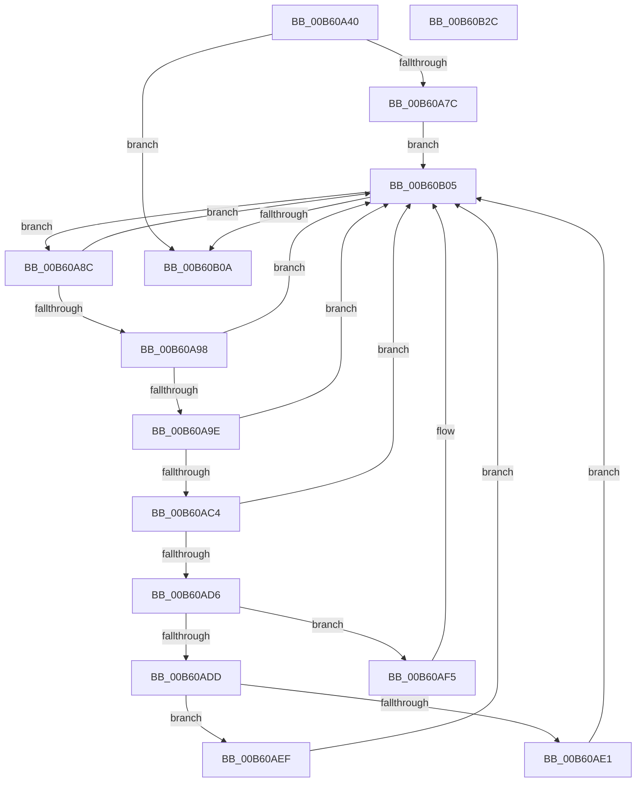

# HalpStopLegacyUsbInterruptsInternal

- RVA: `0x00B60A40`–`0x00B60B2D` (길이 `237` bytes)
- VA: `0x0000000140B60A40`
- 실행 섹션: `PAGELK`
- PDB 이름 있음: `예`; PDB Function 태그: `아니요`
- unwind 정보 RVA: `0x000C4C04`
- 디코드: `64`개 명령, `237/237` bytes 표시
- 미해석 바이트: `0` (있으면 어셈블리에 `.byte`로 보존)

> 이 문서는 커널 이미지의 기계어와 PDB 기호를 분석해 생성했습니다. 4번과 5번은 함수 원형과 자료형을 바이너리 사용 방식에서 추정한 C 해석이며 원본 소스 복구 결과는 아닙니다.

## 1. Dependencies

- 직접 호출 지점: **5**; 고유 호출 대상: **5**
- 직접 호출자로 확인된 함수: **1**
- RIP 상대 이미지 참조: **3**

### Outgoing calls
- `0x00B60A6E` → [memset](../../text/6C/memset_function_006C6C40.md) (function, `0x006C6C40`)
- `0x00B60ABB` → [guard_dispatch_icall](../../text/6B/guard_dispatch_icall_function_006BAAD0.md) (function, `0x006BAAD0`)
- `0x00B60AE8` → [HalpUsbLegacyStopOhciInterrupt](../../text/56/HalpUsbLegacyStopOhciInterrupt_function_00563AA0.md) (function, `0x00563AA0`)
- `0x00B60B00` → [HalpUsbLegacyStopUhciInterrupt](../../text/56/HalpUsbLegacyStopUhciInterrupt_function_00563BD4.md) (function, `0x00563BD4`)
- `0x00B60B12` → [_security_check_cookie](../../text/6A/_security_check_cookie_function_006AC640.md) (function, `0x006AC640`)

### Direct callers
- [HalpStopLegacyUsbInterrupts](../B5/HalpStopLegacyUsbInterrupts_function_00B5B230.md) at `0x00B5B239`

### Static image references
- `0x00B60A52` → RVA `0x00E0A740` (`.data`; read)
- `0x00B60A7C` → RVA `0x00F8FB80` (`.data`; read)
- `0x00B60A9E` → RVA `0x00E00890` (`.data`; read)

## 2. Other-region calls and transfers

- 다른 실행 섹션으로 향하는 call: **5**
  - `0x00B60A6E` → [memset](../../text/6C/memset_function_006C6C40.md) (`PAGELK` → `.text`)
  - `0x00B60ABB` → [guard_dispatch_icall](../../text/6B/guard_dispatch_icall_function_006BAAD0.md) (`PAGELK` → `.text`)
  - `0x00B60AE8` → [HalpUsbLegacyStopOhciInterrupt](../../text/56/HalpUsbLegacyStopOhciInterrupt_function_00563AA0.md) (`PAGELK` → `.text`)
  - `0x00B60B00` → [HalpUsbLegacyStopUhciInterrupt](../../text/56/HalpUsbLegacyStopUhciInterrupt_function_00563BD4.md) (`PAGELK` → `.text`)
  - `0x00B60B12` → [_security_check_cookie](../../text/6A/_security_check_cookie_function_006AC640.md) (`PAGELK` → `.text`)
- 별도 외부 분기/꼬리 이동을 확인하지 못했습니다.

## 3. Assembly (complete function range)

```asm
00B60A40  48 89 5C 24 08                  mov qword ptr [rsp + 8], rbx
00B60A45  48 89 74 24 10                  mov qword ptr [rsp + 0x10], rsi
00B60A4A  57                              push rdi
00B60A4B  48 81 EC 80 00 00 00            sub rsp, 0x80
00B60A52  48 8B 05 E7 9C 2A 00            mov rax, qword ptr [rip + 0x2a9ce7]
00B60A59  48 33 C4                        xor rax, rsp
00B60A5C  48 89 44 24 70                  mov qword ptr [rsp + 0x70], rax
00B60A61  33 D2                           xor edx, edx
00B60A63  8B D9                           mov ebx, ecx
00B60A65  48 8D 4C 24 30                  lea rcx, [rsp + 0x30]
00B60A6A  44 8D 42 40                     lea r8d, [rdx + 0x40]
00B60A6E  E8 CD 61 B6 FF                  call 0x1406c6c40
00B60A73  83 FB 05                        cmp ebx, 5
00B60A76  0F 8D 8E 00 00 00               jge 0x140b60b0a
00B60A7C  48 8B 3D FD F0 42 00            mov rdi, qword ptr [rip + 0x42f0fd]
00B60A83  48 8D 35 F6 F0 42 00            lea rsi, [rip + 0x42f0f6]
00B60A8A  EB 79                           jmp 0x140b60b05
00B60A8C  48 8D 1F                        lea rbx, [rdi]
00B60A8F  48 8B 3F                        mov rdi, qword ptr [rdi]
00B60A92  80 7B 18 00                     cmp byte ptr [rbx + 0x18], 0
00B60A96  75 6D                           jne 0x140b60b05
00B60A98  80 7B 1A 20                     cmp byte ptr [rbx + 0x1a], 0x20
00B60A9C  73 67                           jae 0x140b60b05
00B60A9E  48 8B 05 EB FD 29 00            mov rax, qword ptr [rip + 0x29fdeb]
00B60AA5  4C 8D 44 24 30                  lea r8, [rsp + 0x30]
00B60AAA  8B 53 14                        mov edx, dword ptr [rbx + 0x14]
00B60AAD  45 33 C9                        xor r9d, r9d
00B60AB0  8B 4B 10                        mov ecx, dword ptr [rbx + 0x10]
00B60AB3  C7 44 24 20 02 00 00 00         mov dword ptr [rsp + 0x20], 2
00B60ABB  E8 10 A0 B5 FF                  call 0x1406baad0
00B60AC0  85 C0                           test eax, eax
00B60AC2  74 41                           je 0x140b60b05
00B60AC4  0F B7 44 24 30                  movzx eax, word ptr [rsp + 0x30]
00B60AC9  B9 FD FF 00 00                  mov ecx, 0xfffd
00B60ACE  66 FF C8                        dec ax
00B60AD1  66 3B C1                        cmp ax, cx
00B60AD4  77 2F                           ja 0x140b60b05
00B60AD6  8A 43 1A                        mov al, byte ptr [rbx + 0x1a]
00B60AD9  84 C0                           test al, al
00B60ADB  74 18                           je 0x140b60af5
00B60ADD  3C 10                           cmp al, 0x10
00B60ADF  75 0E                           jne 0x140b60aef
00B60AE1  44 8B 43 14                     mov r8d, dword ptr [rbx + 0x14]
00B60AE5  8B 53 10                        mov edx, dword ptr [rbx + 0x10]
00B60AE8  E8 B3 2F A0 FF                  call 0x140563aa0
00B60AED  EB 16                           jmp 0x140b60b05
00B60AEF  C6 43 18 01                     mov byte ptr [rbx + 0x18], 1
00B60AF3  EB 10                           jmp 0x140b60b05
00B60AF5  44 8A 4B 19                     mov r9b, byte ptr [rbx + 0x19]
00B60AF9  44 8B 43 14                     mov r8d, dword ptr [rbx + 0x14]
00B60AFD  8B 53 10                        mov edx, dword ptr [rbx + 0x10]
00B60B00  E8 CF 30 A0 FF                  call 0x140563bd4
00B60B05  48 3B FE                        cmp rdi, rsi
00B60B08  75 82                           jne 0x140b60a8c
00B60B0A  48 8B 4C 24 70                  mov rcx, qword ptr [rsp + 0x70]
00B60B0F  48 33 CC                        xor rcx, rsp
00B60B12  E8 29 BB B4 FF                  call 0x1406ac640
00B60B17  4C 8D 9C 24 80 00 00 00         lea r11, [rsp + 0x80]
00B60B1F  49 8B 5B 10                     mov rbx, qword ptr [r11 + 0x10]
00B60B23  49 8B 73 18                     mov rsi, qword ptr [r11 + 0x18]
00B60B27  49 8B E3                        mov rsp, r11
00B60B2A  5F                              pop rdi
00B60B2B  C3                              ret
00B60B2C  CC                              int3
```

## 4. C-style interpretation (structured pseudocode)

```c
__int64 __fastcall HalpStopLegacyUsbInterruptsInternal(int a1, int a2, __int64 a3, int a4)
{
    __int64 result;
    __int64 v_rsp;
    unsigned __int64 v_stack_m18;
    unsigned __int64 v_stack_m58;
    unsigned int v_stack_m68;
    unsigned __int64 v_stack_m8;
    unsigned __int64 v_stack_p10;
    unsigned __int64 v_stack_p8;

    v_stack_p8 = v_rbx;
    v_stack_p10 = v_rsi;
    v_rsp = (v_rsp) - (128);
    result = (*(unsigned __int64 *)(v_rip + 2792679)) ^ (v_rsp);
    v_stack_m18 = result;
    a2 = 0;
    result = memset(v_stack_m58, a2, a2 + 64, a4);
    if (((unsigned int)((unsigned int)(a1))) >= 5) goto loc_00B60B0A;
    goto loc_00B60B05;
loc_00B60A8C:
    if ((*(unsigned __int8 *)(*(unsigned __int64 *)(v_rip + 4387069) + 24)) != 0) goto loc_00B60B05;
    if ((*(unsigned __int8 *)(*(unsigned __int64 *)(v_rip + 4387069) + 26)) >= 32) goto loc_00B60B05;
    a4 = 0;
    v_stack_m68 = 2;
    result = guard_dispatch_icall((unsigned int)(*(unsigned int *)(*(unsigned __int64 *)(v_rip + 4387069) + 16)), (unsigned int)(*(unsigned int *)(*(unsigned __int64 *)(v_rip + 4387069) + 20)), v_stack_m58, a4);
    if ((unsigned int)(result) == 0) goto loc_00B60B05;
    result = (unsigned __int16)((v_stack_m58) - 1);
    if (((unsigned __int16)(result)) > ((unsigned __int16)((unsigned int)(0xFFFDULL)))) goto loc_00B60B05;
    if ((unsigned __int8)(*(unsigned __int8 *)(*(unsigned __int64 *)(v_rip + 4387069) + 26)) == 0) goto loc_00B60AF5;
    if (((unsigned __int8)(*(unsigned __int8 *)(*(unsigned __int64 *)(v_rip + 4387069) + 26))) != 16) goto loc_00B60AEF;
    result = HalpUsbLegacyStopOhciInterrupt((unsigned int)(0xFFFDULL), (unsigned int)(*(unsigned int *)(*(unsigned __int64 *)(v_rip + 4387069) + 16)), (unsigned int)(*(unsigned int *)(*(unsigned __int64 *)(v_rip + 4387069) + 20)), a4);
    goto loc_00B60B05;
loc_00B60AEF:
    *(unsigned __int8 *)(*(unsigned __int64 *)(v_rip + 4387069) + 24) = 1;
    goto loc_00B60B05;
loc_00B60AF5:
    result = HalpUsbLegacyStopUhciInterrupt((unsigned int)(0xFFFDULL), (unsigned int)(*(unsigned int *)(*(unsigned __int64 *)(v_rip + 4387069) + 16)), (unsigned int)(*(unsigned int *)(*(unsigned __int64 *)(v_rip + 4387069) + 20)), *(unsigned __int8 *)(*(unsigned __int64 *)(v_rip + 4387069) + 25));
loc_00B60B05:
    if ((*(unsigned __int64 *)(*(unsigned __int64 *)(v_rip + 4387069))) != (v_rip + 4387062)) goto loc_00B60A8C;
loc_00B60B0A:
    a1 = (v_stack_m18) ^ (v_rsp);
    result = _security_check_cookie(a1, (unsigned int)(*(unsigned int *)(*(unsigned __int64 *)(v_rip + 4387069) + 16)), (unsigned int)(*(unsigned int *)(*(unsigned __int64 *)(v_rip + 4387069) + 20)), *(unsigned __int8 *)(*(unsigned __int64 *)(v_rip + 4387069) + 25));
    return result;
}
```

## 5. (Beta) C Style

```c
int64_t HalpStopLegacyUsbInterruptsInternal(int32_t Arg1, int32_t Arg2, int64_t Arg3, int32_t Arg4)
{
    int64_t result;
    int64_t local_rsp;
    uint64_t v_stack_m18;
    uint64_t v_stack_m58;
    uint32_t v_stack_m68;
    uint64_t v_stack_m8;
    uint64_t v_stack_p10;
    uint64_t v_stack_p8;

    v_stack_p8 = local_rbx;
    v_stack_p10 = local_rsi;
    local_rsp = (local_rsp) - (128);
    result = (*(uint64_t *)(v_rip + 0x2A9CE7)) ^ (local_rsp);
    v_stack_m18 = result;
    Arg2 = 0;
    result = memset(v_stack_m58, Arg2, Arg2 + 64, Arg4);
    if (((uint32_t)((uint32_t)(Arg1))) >= 5) goto loc_00B60B0A;
    goto loc_00B60B05;
loc_00B60A8C:
    if ((*(uint8_t *)(*(uint64_t *)(v_rip + 0x42F0FD) + 0x18)) != 0) goto loc_00B60B05;
    if ((*(uint8_t *)(*(uint64_t *)(v_rip + 0x42F0FD) + 0x1A)) >= 32) goto loc_00B60B05;
    Arg4 = 0;
    v_stack_m68 = 2;
    result = guard_dispatch_icall((uint32_t)(*(uint32_t *)(*(uint64_t *)(v_rip + 0x42F0FD) + 0x10)), (uint32_t)(*(uint32_t *)(*(uint64_t *)(v_rip + 0x42F0FD) + 0x14)), v_stack_m58, Arg4);
    if ((uint32_t)(result) == 0) goto loc_00B60B05;
    result = (uint16_t)((v_stack_m58) - 1);
    if (((uint16_t)(result)) > ((uint16_t)((uint32_t)(0xFFFDULL)))) goto loc_00B60B05;
    if ((uint8_t)(*(uint8_t *)(*(uint64_t *)(v_rip + 0x42F0FD) + 0x1A)) == 0) goto loc_00B60AF5;
    if (((uint8_t)(*(uint8_t *)(*(uint64_t *)(v_rip + 0x42F0FD) + 0x1A))) != 16) goto loc_00B60AEF;
    result = HalpUsbLegacyStopOhciInterrupt((uint32_t)(0xFFFDULL), (uint32_t)(*(uint32_t *)(*(uint64_t *)(v_rip + 0x42F0FD) + 0x10)), (uint32_t)(*(uint32_t *)(*(uint64_t *)(v_rip + 0x42F0FD) + 0x14)), Arg4);
    goto loc_00B60B05;
loc_00B60AEF:
    *(uint8_t *)(*(uint64_t *)(v_rip + 0x42F0FD) + 0x18) = 1;
    goto loc_00B60B05;
loc_00B60AF5:
    result = HalpUsbLegacyStopUhciInterrupt((uint32_t)(0xFFFDULL), (uint32_t)(*(uint32_t *)(*(uint64_t *)(v_rip + 0x42F0FD) + 0x10)), (uint32_t)(*(uint32_t *)(*(uint64_t *)(v_rip + 0x42F0FD) + 0x14)), *(uint8_t *)(*(uint64_t *)(v_rip + 0x42F0FD) + 0x19));
loc_00B60B05:
    if ((*(uint64_t *)(*(uint64_t *)(v_rip + 0x42F0FD))) != (v_rip + 4387062)) goto loc_00B60A8C;
loc_00B60B0A:
    Arg1 = (v_stack_m18) ^ (local_rsp);
    result = _security_check_cookie(Arg1, (uint32_t)(*(uint32_t *)(*(uint64_t *)(v_rip + 0x42F0FD) + 0x10)), (uint32_t)(*(uint32_t *)(*(uint64_t *)(v_rip + 0x42F0FD) + 0x14)), *(uint8_t *)(*(uint64_t *)(v_rip + 0x42F0FD) + 0x19));
    return result;
}
```

## 6. Execution-region graph

[열기: 2D/3D 그래프와 함수 탐색 컨트롤 패널](../../../control-panel.html?section=pagelk&rva=0x00B60A40&view=graph)

- 2D 그래프는 위에서 아래로 흐르고, 3D 그래프는 빈 공간을 드래그해 회전합니다. Shift+드래그는 이동, 휠은 확대·축소, 함수 노드 선택은 대상 보고서 이동입니다.

### Static fallback


