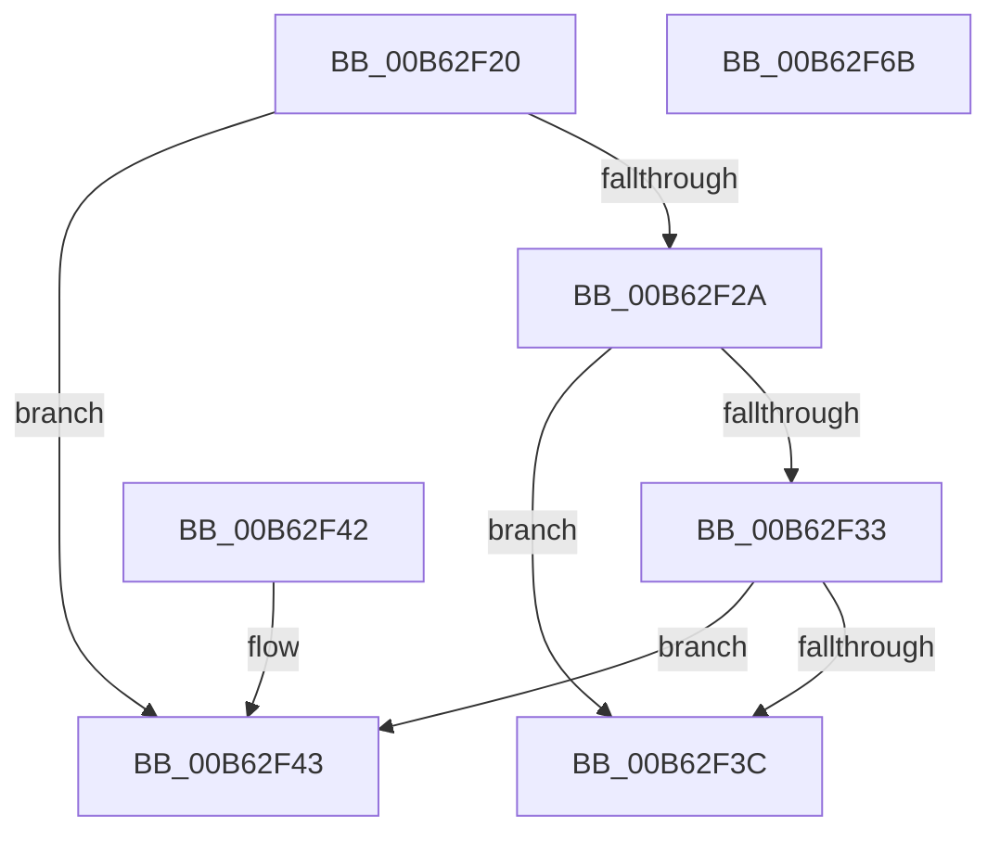

# HsaConfigureSettings

- RVA: `0x00B62F20`–`0x00B62F6C` (길이 `76` bytes)
- VA: `0x0000000140B62F20`
- 실행 섹션: `PAGELK`
- PDB 이름 있음: `예`; PDB Function 태그: `아니요`
- unwind 정보 RVA: `0x000DB714`
- 디코드: `24`개 명령, `76/76` bytes 표시
- 미해석 바이트: `0` (있으면 어셈블리에 `.byte`로 보존)

> 이 문서는 커널 이미지의 기계어와 PDB 기호를 분석해 생성했습니다. 4번과 5번은 함수 원형과 자료형을 바이너리 사용 방식에서 추정한 C 해석이며 원본 소스 복구 결과는 아닙니다.

## 1. Dependencies

- 직접 호출 지점: **0**; 고유 호출 대상: **0**
- 직접 호출자로 확인된 함수: **0**
- RIP 상대 이미지 참조: **0**

### Outgoing calls
- 직접 디코드된 call 명령이 없습니다.

### Direct callers
- 이 함수 시작 RVA로 연결되는 직접 call은 확인되지 않았습니다. 간접 호출은 완전히 역산할 수 없습니다.

### Static image references
- 디코드된 RIP-relative 메모리 참조가 없습니다.

## 2. Other-region calls and transfers

- 다른 실행 섹션으로 향하는 call: **0**
- 별도 외부 분기/꼬리 이동을 확인하지 못했습니다.

## 3. Assembly (complete function range)

```asm
00B62F20  4C 8B D1                        mov r10, rcx
00B62F23  8B 4A 0C                        mov ecx, dword ptr [rdx + 0xc]
00B62F26  85 C9                           test ecx, ecx
00B62F28  74 19                           je 0x140b62f43
00B62F2A  44 8B 4A 10                     mov r9d, dword ptr [rdx + 0x10]
00B62F2E  45 85 C9                        test r9d, r9d
00B62F31  74 09                           je 0x140b62f3c
00B62F33  41 8D 41 FF                     lea eax, [r9 - 1]
00B62F37  41 85 C1                        test r9d, eax
00B62F3A  74 07                           je 0x140b62f43
00B62F3C  B8 0D 00 00 C0                  mov eax, 0xc000000d
00B62F41  C3                              ret
00B62F42  CC                              int3
00B62F43  41 89 8A B0 00 00 00            mov dword ptr [r10 + 0xb0], ecx
00B62F4A  B9 00 02 00 00                  mov ecx, 0x200
00B62F4F  8B 42 08                        mov eax, dword ptr [rdx + 8]
00B62F52  41 89 82 AC 00 00 00            mov dword ptr [r10 + 0xac], eax
00B62F59  8B 42 10                        mov eax, dword ptr [rdx + 0x10]
00B62F5C  3B C1                           cmp eax, ecx
00B62F5E  0F 42 C8                        cmovb ecx, eax
00B62F61  33 C0                           xor eax, eax
00B62F63  41 89 8A B4 00 00 00            mov dword ptr [r10 + 0xb4], ecx
00B62F6A  C3                              ret
00B62F6B  CC                              int3
```

## 4. C-style interpretation (structured pseudocode)

```c
__int64 __fastcall HsaConfigureSettings(__int64 a1, __int64 a2)
{
    __int64 result;

    if ((unsigned int)((unsigned int)(*(unsigned int *)(a2 + 12))) == 0) goto loc_00B62F43;
    if ((unsigned int)((unsigned int)(*(unsigned int *)(a2 + 16))) == 0) goto loc_00B62F3C;
    if ((((unsigned int)((unsigned int)(*(unsigned int *)(a2 + 16)))) & ((unsigned int)((unsigned int)(*(unsigned int *)(a2 + 16)) - 1))) == 0) goto loc_00B62F43;
loc_00B62F3C:
    return (unsigned int)(0xC000000DULL);
loc_00B62F43:
    *(unsigned int *)(a1 + 176) = (unsigned int)((unsigned int)(*(unsigned int *)(a2 + 12)));
    *(unsigned int *)(a1 + 172) = (unsigned int)((unsigned int)(*(unsigned int *)(a2 + 8)));
    a1 = 512;
    if (((unsigned int)((unsigned int)(*(unsigned int *)(a2 + 16)))) < 512) { a1 = (unsigned int)((unsigned int)(*(unsigned int *)(a2 + 16))); }
    result = 0;
    *(unsigned int *)(a1 + 180) = (unsigned int)(a1);
    return result;
}
```

## 5. (Beta) C Style

```c
int64_t HsaConfigureSettings(void *Arg1, void *Arg2)
{
    uint8_t *arg1 = (uint8_t *)Arg1;
    uint8_t *arg2 = (uint8_t *)Arg2;

    int64_t result;

    if ((uint32_t)((uint32_t)(*(uint32_t *)(arg2 + 0xC))) == 0) goto loc_00B62F43;
    if ((uint32_t)((uint32_t)(*(uint32_t *)(arg2 + 0x10))) == 0) goto loc_00B62F3C;
    if ((((uint32_t)((uint32_t)(*(uint32_t *)(arg2 + 0x10)))) & ((uint32_t)((uint32_t)(*(uint32_t *)(arg2 + 0x10)) - 1))) == 0) goto loc_00B62F43;
loc_00B62F3C:
    return (uint32_t)(0xC000000DULL);
loc_00B62F43:
    *(uint32_t *)(arg1 + 0xB0) = (uint32_t)((uint32_t)(*(uint32_t *)(arg2 + 0xC)));
    *(uint32_t *)(arg1 + 0xAC) = (uint32_t)((uint32_t)(*(uint32_t *)(arg2 + 0x8)));
    Arg1 = 512;
    if (((uint32_t)((uint32_t)(*(uint32_t *)(arg2 + 0x10)))) < 512) { Arg1 = (uint32_t)((uint32_t)(*(uint32_t *)(arg2 + 0x10))); }
    result = 0;
    *(uint32_t *)(arg1 + 0xB4) = (uint32_t)(Arg1);
    return result;
}
```

### 관측된 메모리 오프셋

구조체 형식이 확인되지 않은 접근은 인자 기준의 오프셋으로만 기록했습니다.

| 기준 인자 | 오프셋 표현 | 폭 (bit) | 접근 |
|---|---:|---:|---|
| `Arg1` | `+ 0xAC` | `32` | `W` |
| `Arg1` | `+ 0xB0` | `32` | `W` |
| `Arg1` | `+ 0xB4` | `32` | `W` |
| `Arg2` | `+ 0x8` | `32` | `R` |
| `Arg2` | `+ 0xC` | `32` | `R` |
| `Arg2` | `+ 0x10` | `32` | `R` |

## 6. Execution-region graph

[열기: 2D/3D 그래프와 함수 탐색 컨트롤 패널](../../../control-panel.html?section=pagelk&rva=0x00B62F20&view=graph)

- 2D 그래프는 위에서 아래로 흐르고, 3D 그래프는 빈 공간을 드래그해 회전합니다. Shift+드래그는 이동, 휠은 확대·축소, 함수 노드 선택은 대상 보고서 이동입니다.

### Static fallback


