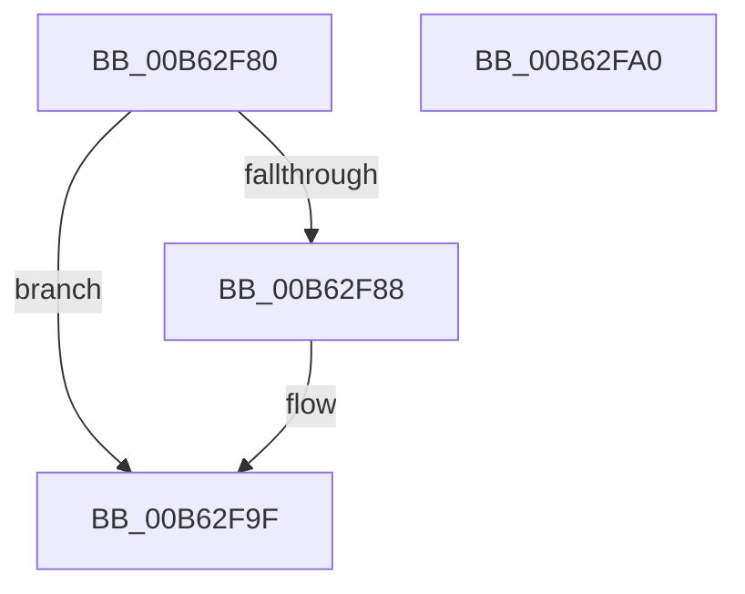

# HsaEnableInterrupt

- RVA: `0x00B62F80`–`0x00B62FA1` (길이 `33` bytes)
- VA: `0x0000000140B62F80`
- 실행 섹션: `PAGELK`
- PDB 이름 있음: `예`; PDB Function 태그: `아니요`
- unwind 정보 RVA: `0x000DB714`
- 디코드: `12`개 명령, `33/33` bytes 표시
- 미해석 바이트: `0` (있으면 어셈블리에 `.byte`로 보존)

> 이 문서는 커널 이미지의 기계어와 PDB 기호를 분석해 생성했습니다. 4번과 5번은 함수 원형과 자료형을 바이너리 사용 방식에서 추정한 C 해석이며 원본 소스 복구 결과는 아닙니다.

## 1. Dependencies

- 직접 호출 지점: **0**; 고유 호출 대상: **0**
- 직접 호출자로 확인된 함수: **0**
- RIP 상대 이미지 참조: **0**

### Outgoing calls
- 직접 디코드된 call 명령이 없습니다.

### Direct callers
- 이 함수 시작 RVA로 연결되는 직접 call은 확인되지 않았습니다. 간접 호출은 완전히 역산할 수 없습니다.

### Static image references
- 디코드된 RIP-relative 메모리 참조가 없습니다.

## 2. Other-region calls and transfers

- 다른 실행 섹션으로 향하는 call: **0**
- 별도 외부 분기/꼬리 이동을 확인하지 못했습니다.

## 3. Assembly (complete function range)

```asm
00B62F80  48 8B 01                        mov rax, qword ptr [rcx]
00B62F83  48 85 C0                        test rax, rax
00B62F86  74 17                           je 0x140b62f9f
00B62F88  90                              nop
00B62F89  48 8B 40 18                     mov rax, qword ptr [rax + 0x18]
00B62F8D  90                              nop
00B62F8E  48 0F BA E8 0E                  bts rax, 0xe
00B62F93  48 8B 09                        mov rcx, qword ptr [rcx]
00B62F96  48 89 41 18                     mov qword ptr [rcx + 0x18], rax
00B62F9A  F0 83 0C 24 00                  lock or dword ptr [rsp], 0
00B62F9F  C3                              ret
00B62FA0  CC                              int3
```

## 4. C-style interpretation (structured pseudocode)

```c
__int64 __fastcall HsaEnableInterrupt(__int64 a1)
{
    __int64 result;
    unsigned int v_stack_p0;

    result = *(unsigned __int64 *)(a1);
    if (*(unsigned __int64 *)(a1) != 0) {
        result = *(unsigned __int64 *)(*(unsigned __int64 *)(a1) + 24);
        a1 = *(unsigned __int64 *)(a1);
        *(unsigned __int64 *)(a1 + 24) = result;
    }
    return result;
}
```

## 5. (Beta) C Style

```c
int64_t HsaEnableInterrupt(void *Arg1)
{
    uint8_t *arg1 = (uint8_t *)Arg1;

    int64_t result;
    uint32_t v_stack_p0;

    result = *(uint64_t *)(arg1);
    if (*(uint64_t *)(arg1) != 0) {
        result = *(uint64_t *)(*(uint64_t *)(arg1) + 0x18);
        Arg1 = *(uint64_t *)(arg1);
        *(uint64_t *)(arg1 + 0x18) = result;
    }
    return result;
}
```

### 관측된 메모리 오프셋

구조체 형식이 확인되지 않은 접근은 인자 기준의 오프셋으로만 기록했습니다.

| 기준 인자 | 오프셋 표현 | 폭 (bit) | 접근 |
|---|---:|---:|---|
| `Arg1` | `+ 0x0` | `64` | `R` |

## 6. Execution-region graph

[열기: 2D/3D 그래프와 함수 탐색 컨트롤 패널](../../../control-panel.html?section=pagelk&rva=0x00B62F80&view=graph)

- 2D 그래프는 위에서 아래로 흐르고, 3D 그래프는 빈 공간을 드래그해 회전합니다. Shift+드래그는 이동, 휠은 확대·축소, 함수 노드 선택은 대상 보고서 이동입니다.

### Static fallback


