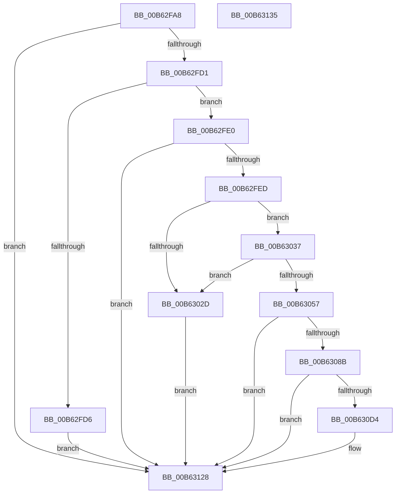

# HsaInitializeInterruptRemapping

- RVA: `0x00B62FA8`–`0x00B63136` (길이 `398` bytes)
- VA: `0x0000000140B62FA8`
- 실행 섹션: `PAGELK`
- PDB 이름 있음: `예`; PDB Function 태그: `아니요`
- unwind 정보 RVA: `0x00068D5C`
- 디코드: `87`개 명령, `398/398` bytes 표시
- 미해석 바이트: `0` (있으면 어셈블리에 `.byte`로 보존)

> 이 문서는 커널 이미지의 기계어와 PDB 기호를 분석해 생성했습니다. 4번과 5번은 함수 원형과 자료형을 바이너리 사용 방식에서 추정한 C 해석이며 원본 소스 복구 결과는 아닙니다.

## 1. Dependencies

- 직접 호출 지점: **9**; 고유 호출 대상: **8**
- 직접 호출자로 확인된 함수: **1**
- RIP 상대 이미지 참조: **14**

### Outgoing calls
- `0x00B6301C` → [guard_dispatch_icall](../../text/6B/guard_dispatch_icall_function_006BAAD0.md) (function, `0x006BAAD0`)
- `0x00B63046` → [HalMapIoSpace](../../text/4F/HalMapIoSpace_function_004FCD40.md) (function, `0x004FCD40`)
- `0x00B63063` → [memset](../../text/6C/memset_function_006C6C40.md) (function, `0x006C6C40`)
- `0x00B6307C` → [ExtEnvAllocateMemory](../../text/56/ExtEnvAllocateMemory_function_005610B0.md) (function, `0x005610B0`)
- `0x00B6309E` → [ExtEnvInitializeBitMap](../../text/46/ExtEnvInitializeBitMap_function_00469B30.md) (function, `0x00469B30`)
- `0x00B630AC` → [ExtEnvClearBits](../../text/56/ExtEnvClearBits_function_005612E8.md) (function, `0x005612E8`)
- `0x00B630B1` → [HalpGetIrtEntryCount](../../text/55/HalpGetIrtEntryCount_function_005572DC.md) (function, `0x005572DC`)
- `0x00B630C9` → [ExtEnvAllocateMemory](../../text/56/ExtEnvAllocateMemory_function_005610B0.md) (function, `0x005610B0`)
- `0x00B630DB` → [ExtEnvInitializeSpinLock](../../text/56/ExtEnvInitializeSpinLock_function_00561434.md) (function, `0x00561434`)

### Direct callers
- [HsaInitializeIommu](HsaInitializeIommu_function_00B63140.md) at `0x00B6324B`

### Static image references
- `0x00B62FE0` → RVA `0x00F8F668` (`.data`; read)
- `0x00B62FF7` → RVA `0x00F8F7B0` (`.data`; read)
- `0x00B62FFE` → RVA `0x00F8F674` (`.data`; write)
- `0x00B63013` → RVA `0x00F8F670` (`.data`; write)
- `0x00B63021` → RVA `0x00F8F660` (`.data`; write)
- `0x00B63037` → RVA `0x00F8F670` (`.data`; read)
- `0x00B6304B` → RVA `0x00F8F668` (`.data`; write)
- `0x00B63090` → RVA `0x00F8F678` (`.data`; read)
- `0x00B630C3` → RVA `0x00F8F688` (`.data`; write)
- `0x00B630D4` → RVA `0x00F8F620` (`.data`; read)
- `0x00B630E5` → RVA `0x00F8F660` (`.data`; read)
- `0x00B630EC` → RVA `0x00F8F644` (`.data`; write)
- `0x00B630F6` → RVA `0x00F8F6A0` (`.data`; write)
- `0x00B6310C` → RVA `0x00F8F680` (`.data`; read)

## 2. Other-region calls and transfers

- 다른 실행 섹션으로 향하는 call: **9**
  - `0x00B6301C` → [guard_dispatch_icall](../../text/6B/guard_dispatch_icall_function_006BAAD0.md) (`PAGELK` → `.text`)
  - `0x00B63046` → [HalMapIoSpace](../../text/4F/HalMapIoSpace_function_004FCD40.md) (`PAGELK` → `.text`)
  - `0x00B63063` → [memset](../../text/6C/memset_function_006C6C40.md) (`PAGELK` → `.text`)
  - `0x00B6307C` → [ExtEnvAllocateMemory](../../text/56/ExtEnvAllocateMemory_function_005610B0.md) (`PAGELK` → `.text`)
  - `0x00B6309E` → [ExtEnvInitializeBitMap](../../text/46/ExtEnvInitializeBitMap_function_00469B30.md) (`PAGELK` → `.text`)
  - `0x00B630AC` → [ExtEnvClearBits](../../text/56/ExtEnvClearBits_function_005612E8.md) (`PAGELK` → `.text`)
  - `0x00B630B1` → [HalpGetIrtEntryCount](../../text/55/HalpGetIrtEntryCount_function_005572DC.md) (`PAGELK` → `.text`)
  - `0x00B630C9` → [ExtEnvAllocateMemory](../../text/56/ExtEnvAllocateMemory_function_005610B0.md) (`PAGELK` → `.text`)
  - `0x00B630DB` → [ExtEnvInitializeSpinLock](../../text/56/ExtEnvInitializeSpinLock_function_00561434.md) (`PAGELK` → `.text`)
- 별도 외부 분기/꼬리 이동을 확인하지 못했습니다.

## 3. Assembly (complete function range)

```asm
00B62FA8  48 89 5C 24 10                  mov qword ptr [rsp + 0x10], rbx
00B62FAD  57                              push rdi
00B62FAE  48 83 EC 20                     sub rsp, 0x20
00B62FB2  48 83 64 24 48 00               and qword ptr [rsp + 0x48], 0
00B62FB8  33 DB                           xor ebx, ebx
00B62FBA  48 83 64 24 30 00               and qword ptr [rsp + 0x30], 0
00B62FC0  48 8B F9                        mov rdi, rcx
00B62FC3  8B 81 B0 00 00 00               mov eax, dword ptr [rcx + 0xb0]
00B62FC9  85 C0                           test eax, eax
00B62FCB  0F 84 57 01 00 00               je 0x140b63128
00B62FD1  83 F8 01                        cmp eax, 1
00B62FD4  74 0A                           je 0x140b62fe0
00B62FD6  BB BB 00 00 C0                  mov ebx, 0xc00000bb
00B62FDB  E9 48 01 00 00                  jmp 0x140b63128
00B62FE0  48 39 1D 81 C6 42 00            cmp qword ptr [rip + 0x42c681], rbx
00B62FE7  0F 85 3B 01 00 00               jne 0x140b63128
00B62FED  8B 91 B4 00 00 00               mov edx, dword ptr [rcx + 0xb4]
00B62FF3  48 83 C9 FF                     or rcx, 0xffffffffffffffff
00B62FF7  48 8B 05 B2 C7 42 00            mov rax, qword ptr [rip + 0x42c7b2]
00B62FFE  89 15 70 C6 42 00               mov dword ptr [rip + 0x42c670], edx
00B63004  C1 E2 04                        shl edx, 4
00B63007  81 C2 FF 0F 00 00               add edx, 0xfff
00B6300D  81 E2 00 F0 FF FF               and edx, 0xfffff000
00B63013  89 15 57 C6 42 00               mov dword ptr [rip + 0x42c657], edx
00B63019  C1 EA 0C                        shr edx, 0xc
00B6301C  E8 AF 7A B5 FF                  call 0x1406baad0
00B63021  48 89 05 38 C6 42 00            mov qword ptr [rip + 0x42c638], rax
00B63028  48 85 C0                        test rax, rax
00B6302B  75 0A                           jne 0x140b63037
00B6302D  BB 9A 00 00 C0                  mov ebx, 0xc000009a
00B63032  E9 F1 00 00 00                  jmp 0x140b63128
00B63037  8B 15 33 C6 42 00               mov edx, dword ptr [rip + 0x42c633]
00B6303D  41 B8 01 00 00 00               mov r8d, 1
00B63043  48 8B C8                        mov rcx, rax
00B63046  E8 F5 9C 99 FF                  call 0x1404fcd40
00B6304B  48 89 05 16 C6 42 00            mov qword ptr [rip + 0x42c616], rax
00B63052  48 85 C0                        test rax, rax
00B63055  74 D6                           je 0x140b6302d
00B63057  44 8B 05 12 C6 42 00            mov r8d, dword ptr [rip + 0x42c612]
00B6305E  33 D2                           xor edx, edx
00B63060  48 8B C8                        mov rcx, rax
00B63063  E8 D8 3B B6 FF                  call 0x1406c6c40
00B63068  8B 97 B4 00 00 00               mov edx, dword ptr [rdi + 0xb4]
00B6306E  4C 8D 44 24 30                  lea r8, [rsp + 0x30]
00B63073  83 C2 1F                        add edx, 0x1f
00B63076  C1 EA 05                        shr edx, 5
00B63079  C1 E2 02                        shl edx, 2
00B6307C  E8 2F E0 9F FF                  call 0x1405610b0
00B63081  8B D8                           mov ebx, eax
00B63083  85 C0                           test eax, eax
00B63085  0F 88 9D 00 00 00               js 0x140b63128
00B6308B  48 8B 54 24 30                  mov rdx, qword ptr [rsp + 0x30]
00B63090  48 8D 0D E1 C5 42 00            lea rcx, [rip + 0x42c5e1]
00B63097  44 8B 87 B4 00 00 00            mov r8d, dword ptr [rdi + 0xb4]
00B6309E  E8 8D 6A 90 FF                  call 0x140469b30
00B630A3  44 8B 87 B4 00 00 00            mov r8d, dword ptr [rdi + 0xb4]
00B630AA  33 D2                           xor edx, edx
00B630AC  E8 37 E2 9F FF                  call 0x1405612e8
00B630B1  E8 26 42 9F FF                  call 0x1405572dc
00B630B6  C1 E8 09                        shr eax, 9
00B630B9  4C 8D 44 24 48                  lea r8, [rsp + 0x48]
00B630BE  BA 00 20 00 00                  mov edx, 0x2000
00B630C3  89 05 BF C5 42 00               mov dword ptr [rip + 0x42c5bf], eax
00B630C9  E8 E2 DF 9F FF                  call 0x1405610b0
00B630CE  8B D8                           mov ebx, eax
00B630D0  85 C0                           test eax, eax
00B630D2  78 54                           js 0x140b63128
00B630D4  48 8D 0D 45 C5 42 00            lea rcx, [rip + 0x42c545]
00B630DB  E8 54 E3 9F FF                  call 0x140561434
00B630E0  48 8B 44 24 48                  mov rax, qword ptr [rsp + 0x48]
00B630E5  0F 10 05 74 C5 42 00            movups xmm0, xmmword ptr [rip + 0x42c574]
00B630EC  C7 05 4E C5 42 00 80 00 00 00   mov dword ptr [rip + 0x42c54e], 0x80
00B630F6  48 89 05 A3 C5 42 00            mov qword ptr [rip + 0x42c5a3], rax
00B630FD  0F 11 40 08                     movups xmmword ptr [rax + 8], xmm0
00B63101  0F 10 0D 68 C5 42 00            movups xmm1, xmmword ptr [rip + 0x42c568]
00B63108  0F 11 48 18                     movups xmmword ptr [rax + 0x18], xmm1
00B6310C  F2 0F 10 05 6C C5 42 00         movsd xmm0, qword ptr [rip + 0x42c56c]
00B63114  F2 0F 11 40 28                  movsd qword ptr [rax + 0x28], xmm0
00B63119  C7 40 30 01 00 00 00            mov dword ptr [rax + 0x30], 1
00B63120  83 48 34 FF                     or dword ptr [rax + 0x34], 0xffffffff
00B63124  83 60 38 00                     and dword ptr [rax + 0x38], 0
00B63128  8B C3                           mov eax, ebx
00B6312A  48 8B 5C 24 38                  mov rbx, qword ptr [rsp + 0x38]
00B6312F  48 83 C4 20                     add rsp, 0x20
00B63133  5F                              pop rdi
00B63134  C3                              ret
00B63135  CC                              int3
```

## 4. C-style interpretation (structured pseudocode)

```c
__int64 __fastcall HsaInitializeInterruptRemapping(__int64 a1)
{
    __int64 result;
    __int64 v_rbx;
    __int64 v_rsp;
    unsigned __int64 v_stack_p10;
    unsigned __int64 v_stack_p20;
    unsigned __int64 v_stack_p8;

    v_stack_p10 = v_rbx;
    v_rsp = (v_rsp) - (32);
    v_rbx = 0;
    if ((unsigned int)((unsigned int)(*(unsigned int *)(a1 + 176))) == 0) goto loc_00B63128;
    if (((unsigned int)((unsigned int)(*(unsigned int *)(a1 + 176)))) == 1) goto loc_00B62FE0;
    goto loc_00B63128;
loc_00B62FE0:
    if ((*(unsigned __int64 *)(v_rip + 4376193)) != ((unsigned int)(0xC00000BBULL))) goto loc_00B63128;
    a1 = (a1) | (-1);
    *(unsigned int *)(v_rip + 4376176) = (unsigned int)((unsigned int)(*(unsigned int *)(a1 + 180)));
    a2 = (unsigned int)(((unsigned int)(*(unsigned int *)(a1 + 180))) << (4));
    a2 = (unsigned int)((a2) + (0xFFFULL));
    a2 = (unsigned int)((a2) & (0xFFFFF000ULL));
    *(unsigned int *)(v_rip + 4376151) = (unsigned int)(a2);
    a2 = (unsigned int)((a2) >> (12));
    result = guard_dispatch_icall(a1, a2, a3, a4);
    *(unsigned __int64 *)(v_rip + 4376120) = result;
    if (result != 0) goto loc_00B63037;
loc_00B6302D:
    goto loc_00B63128;
loc_00B63037:
    result = HalMapIoSpace(result, (unsigned int)(*(unsigned int *)(v_rip + 4376115)), 1, a4);
    *(unsigned __int64 *)(v_rip + 4376086) = result;
    if (result == 0) goto loc_00B6302D;
    a2 = 0;
    result = memset(result, a2, (unsigned int)(*(unsigned int *)(v_rip + 4376082)), a4);
    a2 = (unsigned int)(((unsigned int)(*(unsigned int *)(a1 + 180))) + (31));
    a2 = (unsigned int)((a2) >> (5));
    a2 = (unsigned int)((a2) << (2));
    result = ExtEnvAllocateMemory(result, a2, v_stack_p8, a4);
    if (sign_flag) goto loc_00B63128;
    result = ExtEnvInitializeBitMap(v_rip + 4376033, v_stack_p8, (unsigned int)(*(unsigned int *)(a1 + 180)), a4);
    a2 = 0;
    result = ExtEnvClearBits(v_rip + 4376033, a2, (unsigned int)(*(unsigned int *)(a1 + 180)), a4);
    result = HalpGetIrtEntryCount(v_rip + 4376033, a2, (unsigned int)(*(unsigned int *)(a1 + 180)), a4);
    result = (unsigned int)((result) >> (9));
    *(unsigned int *)(v_rip + 4375999) = (unsigned int)(result);
    result = ExtEnvAllocateMemory(v_rip + 4376033, (unsigned int)(0x2000ULL), v_stack_p20, a4);
    if (!(sign_flag)) {
        a1 = v_rip + 4375877;
        result = ExtEnvInitializeSpinLock(a1, (unsigned int)(0x2000ULL), v_stack_p20, a4);
        result = v_stack_p20;
        *(unsigned int *)(v_rip + 4375886) = 128;
        *(unsigned __int64 *)(v_rip + 4375971) = result;
        *(unsigned __int64 *)(result + 8) = v_xmm0;
        *(unsigned __int64 *)(result + 24) = v_xmm1;
        *(unsigned __int64 *)(result + 40) = v_xmm0;
        *(unsigned int *)(result + 48) = 1;
    }
    v_rsp = (v_rsp) + (32);
    return (unsigned int)((unsigned int)((unsigned int)((unsigned int)(result))));
}
```

## 5. (Beta) C Style

```c
int64_t HsaInitializeInterruptRemapping(void *Arg1)
{
    uint8_t *arg1 = (uint8_t *)Arg1;

    int64_t result;
    int64_t local_rbx;
    int64_t local_rsp;
    uint64_t v_stack_p10;
    uint64_t v_stack_p20;
    uint64_t v_stack_p8;

    v_stack_p10 = local_rbx;
    local_rsp = (local_rsp) - (32);
    local_rbx = 0;
    if ((uint32_t)((uint32_t)(*(uint32_t *)(arg1 + 0xB0))) == 0) goto loc_00B63128;
    if (((uint32_t)((uint32_t)(*(uint32_t *)(arg1 + 0xB0)))) == 1) goto loc_00B62FE0;
    goto loc_00B63128;
loc_00B62FE0:
    if ((*(uint64_t *)(v_rip + 0x42C681)) != ((uint32_t)(0xC00000BBULL))) goto loc_00B63128;
    Arg1 = (Arg1) | (-1);
    *(uint32_t *)(v_rip + 0x42C670) = (uint32_t)((uint32_t)(*(uint32_t *)(arg1 + 0xB4)));
    a2 = (uint32_t)(((uint32_t)(*(uint32_t *)(arg1 + 0xB4))) << (4));
    a2 = (uint32_t)((a2) + (0xFFFULL));
    a2 = (uint32_t)((a2) & (0xFFFFF000ULL));
    *(uint32_t *)(v_rip + 0x42C657) = (uint32_t)(a2);
    a2 = (uint32_t)((a2) >> (12));
    result = guard_dispatch_icall(Arg1, a2, a3, a4);
    *(uint64_t *)(v_rip + 0x42C638) = result;
    if (result != 0) goto loc_00B63037;
loc_00B6302D:
    goto loc_00B63128;
loc_00B63037:
    result = HalMapIoSpace(result, (uint32_t)(*(uint32_t *)(v_rip + 0x42C633)), 1, a4);
    *(uint64_t *)(v_rip + 0x42C616) = result;
    if (result == 0) goto loc_00B6302D;
    a2 = 0;
    result = memset(result, a2, (uint32_t)(*(uint32_t *)(v_rip + 0x42C612)), a4);
    a2 = (uint32_t)(((uint32_t)(*(uint32_t *)(arg1 + 0xB4))) + (31));
    a2 = (uint32_t)((a2) >> (5));
    a2 = (uint32_t)((a2) << (2));
    result = ExtEnvAllocateMemory(result, a2, v_stack_p8, a4);
    if (sign_flag) goto loc_00B63128;
    result = ExtEnvInitializeBitMap(v_rip + 4376033, v_stack_p8, (uint32_t)(*(uint32_t *)(arg1 + 0xB4)), a4);
    a2 = 0;
    result = ExtEnvClearBits(v_rip + 4376033, a2, (uint32_t)(*(uint32_t *)(arg1 + 0xB4)), a4);
    result = HalpGetIrtEntryCount(v_rip + 4376033, a2, (uint32_t)(*(uint32_t *)(arg1 + 0xB4)), a4);
    result = (uint32_t)((result) >> (9));
    *(uint32_t *)(v_rip + 0x42C5BF) = (uint32_t)(result);
    result = ExtEnvAllocateMemory(v_rip + 4376033, (uint32_t)(0x2000ULL), v_stack_p20, a4);
    if (!(sign_flag)) {
        Arg1 = v_rip + 4375877;
        result = ExtEnvInitializeSpinLock(Arg1, (uint32_t)(0x2000ULL), v_stack_p20, a4);
        result = v_stack_p20;
        *(uint32_t *)(v_rip + 0x42C54E) = 128;
        *(uint64_t *)(v_rip + 0x42C5A3) = result;
        *(uint64_t *)(result + 0x8) = v_xmm0;
        *(uint64_t *)(result + 0x18) = v_xmm1;
        *(uint64_t *)(result + 0x28) = v_xmm0;
        *(uint32_t *)(result + 0x30) = 1;
    }
    local_rsp = (local_rsp) + (32);
    return (uint32_t)((uint32_t)((uint32_t)((uint32_t)(result))));
}
```

### 관측된 메모리 오프셋

구조체 형식이 확인되지 않은 접근은 인자 기준의 오프셋으로만 기록했습니다.

| 기준 인자 | 오프셋 표현 | 폭 (bit) | 접근 |
|---|---:|---:|---|
| `Arg1` | `+ 0xB0` | `32` | `R` |
| `Arg1` | `+ 0xB4` | `32` | `R` |

## 6. Execution-region graph

[열기: 2D/3D 그래프와 함수 탐색 컨트롤 패널](../../../control-panel.html?section=pagelk&rva=0x00B62FA8&view=graph)

- 2D 그래프는 위에서 아래로 흐르고, 3D 그래프는 빈 공간을 드래그해 회전합니다. Shift+드래그는 이동, 휠은 확대·축소, 함수 노드 선택은 대상 보고서 이동입니다.

### Static fallback


