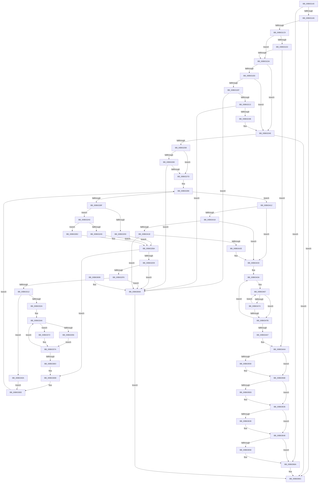

# HsaInitializeIommu

- RVA: `0x00B63140`–`0x00B636A1` (길이 `1,377` bytes)
- VA: `0x0000000140B63140`
- 실행 섹션: `PAGELK`
- PDB 이름 있음: `예`; PDB Function 태그: `아니요`
- unwind 정보 RVA: `0x000C549C`
- 디코드: `340`개 명령, `1,377/1,377` bytes 표시
- 미해석 바이트: `0` (있으면 어셈블리에 `.byte`로 보존)

> 이 문서는 커널 이미지의 기계어와 PDB 기호를 분석해 생성했습니다. 4번과 5번은 함수 원형과 자료형을 바이너리 사용 방식에서 추정한 C 해석이며 원본 소스 복구 결과는 아닙니다.

## 1. Dependencies

- 직접 호출 지점: **14**; 고유 호출 대상: **10**
- 직접 호출자로 확인된 함수: **0**
- RIP 상대 이미지 참조: **6**

### Outgoing calls
- `0x00B631BC` → [HalSocRequestApi](../../text/4B/HalSocRequestApi_function_004B848C.md) (function, `0x004B848C`)
- `0x00B631FE` → [guard_dispatch_icall](../../text/6B/guard_dispatch_icall_function_006BAAD0.md) (function, `0x006BAAD0`)
- `0x00B63226` → [HalMapIoSpace](../../text/4F/HalMapIoSpace_function_004FCD40.md) (function, `0x004FCD40`)
- `0x00B63243` → [memset](../../text/6C/memset_function_006C6C40.md) (function, `0x006C6C40`)
- `0x00B6324B` → [HsaInitializeInterruptRemapping](HsaInitializeInterruptRemapping_function_00B62FA8.md) (function, `0x00B62FA8`)
- `0x00B6326C` → [HalMapIoSpace](../../text/4F/HalMapIoSpace_function_004FCD40.md) (function, `0x004FCD40`)
- `0x00B632E3` → [guard_dispatch_icall](../../text/6B/guard_dispatch_icall_function_006BAAD0.md) (function, `0x006BAAD0`)
- `0x00B632FF` → [HalMapIoSpace](../../text/4F/HalMapIoSpace_function_004FCD40.md) (function, `0x004FCD40`)
- `0x00B6331A` → [memset](../../text/6C/memset_function_006C6C40.md) (function, `0x006C6C40`)
- `0x00B63361` → [HsaGetBlockedDomain](../../text/4F/HsaGetBlockedDomain_function_004FBCD4.md) (function, `0x004FBCD4`)
- `0x00B633BD` → [HsaBuildDeviceTableEntry](../../text/44/HsaBuildDeviceTableEntry_function_0044E6B4.md) (function, `0x0044E6B4`)
- `0x00B63421` → [HsaProcessDeviceExceptions](../../text/57/HsaProcessDeviceExceptions_function_005747DC.md) (function, `0x005747DC`)
- `0x00B635EA` → [MmGetPhysicalAddress](../../text/23/MmGetPhysicalAddress_function_0023A500.md) (function, `0x0023A500`)
- `0x00B63673` → [_security_check_cookie](../../text/6A/_security_check_cookie_function_006AC640.md) (function, `0x006AC640`)

### Direct callers
- 이 함수 시작 RVA로 연결되는 직접 call은 확인되지 않았습니다. 간접 호출은 완전히 역산할 수 없습니다.

### Static image references
- `0x00B63163` → RVA `0x00E0A740` (`.data`; read)
- `0x00B631A6` → RVA `0x00F8F7B0` (`.data`; read)
- `0x00B631E6` → RVA `0x00E65AC8` (`.data`; read)
- `0x00B63203` → RVA `0x00F8F690` (`.data`; write)
- `0x00B6322B` → RVA `0x00E65AC8` (`.data`; write)
- `0x00B6338F` → RVA `0x00F8F660` (`.data`; read)

## 2. Other-region calls and transfers

- 다른 실행 섹션으로 향하는 call: **13**
  - `0x00B631BC` → [HalSocRequestApi](../../text/4B/HalSocRequestApi_function_004B848C.md) (`PAGELK` → `.text`)
  - `0x00B631FE` → [guard_dispatch_icall](../../text/6B/guard_dispatch_icall_function_006BAAD0.md) (`PAGELK` → `.text`)
  - `0x00B63226` → [HalMapIoSpace](../../text/4F/HalMapIoSpace_function_004FCD40.md) (`PAGELK` → `.text`)
  - `0x00B63243` → [memset](../../text/6C/memset_function_006C6C40.md) (`PAGELK` → `.text`)
  - `0x00B6326C` → [HalMapIoSpace](../../text/4F/HalMapIoSpace_function_004FCD40.md) (`PAGELK` → `.text`)
  - `0x00B632E3` → [guard_dispatch_icall](../../text/6B/guard_dispatch_icall_function_006BAAD0.md) (`PAGELK` → `.text`)
  - `0x00B632FF` → [HalMapIoSpace](../../text/4F/HalMapIoSpace_function_004FCD40.md) (`PAGELK` → `.text`)
  - `0x00B6331A` → [memset](../../text/6C/memset_function_006C6C40.md) (`PAGELK` → `.text`)
  - `0x00B63361` → [HsaGetBlockedDomain](../../text/4F/HsaGetBlockedDomain_function_004FBCD4.md) (`PAGELK` → `.text`)
  - `0x00B633BD` → [HsaBuildDeviceTableEntry](../../text/44/HsaBuildDeviceTableEntry_function_0044E6B4.md) (`PAGELK` → `.text`)
  - `0x00B63421` → [HsaProcessDeviceExceptions](../../text/57/HsaProcessDeviceExceptions_function_005747DC.md) (`PAGELK` → `.text`)
  - `0x00B635EA` → [MmGetPhysicalAddress](../../text/23/MmGetPhysicalAddress_function_0023A500.md) (`PAGELK` → `.text`)
  - `0x00B63673` → [_security_check_cookie](../../text/6A/_security_check_cookie_function_006AC640.md) (`PAGELK` → `.text`)
- 별도 외부 분기/꼬리 이동을 확인하지 못했습니다.

## 3. Assembly (complete function range)

```asm
00B63140  48 8B C4                        mov rax, rsp
00B63143  48 89 58 10                     mov qword ptr [rax + 0x10], rbx
00B63147  48 89 70 18                     mov qword ptr [rax + 0x18], rsi
00B6314B  48 89 78 20                     mov qword ptr [rax + 0x20], rdi
00B6314F  55                              push rbp
00B63150  41 54                           push r12
00B63152  41 55                           push r13
00B63154  41 56                           push r14
00B63156  41 57                           push r15
00B63158  48 8D 68 A1                     lea rbp, [rax - 0x5f]
00B6315C  48 81 EC D0 00 00 00            sub rsp, 0xd0
00B63163  48 8B 05 D6 75 2A 00            mov rax, qword ptr [rip + 0x2a75d6]
00B6316A  48 33 C4                        xor rax, rsp
00B6316D  48 89 45 27                     mov qword ptr [rbp + 0x27], rax
00B63171  8B B1 B0 00 00 00               mov esi, dword ptr [rcx + 0xb0]
00B63177  45 33 F6                        xor r14d, r14d
00B6317A  44 8B A1 AC 00 00 00            mov r12d, dword ptr [rcx + 0xac]
00B63181  0F 57 C0                        xorps xmm0, xmm0
00B63184  44 88 45 C7                     mov byte ptr [rbp - 0x39], r8b
00B63188  48 8B F9                        mov rdi, rcx
00B6318B  44 89 75 CB                     mov dword ptr [rbp - 0x35], r14d
00B6318F  4C 89 75 CF                     mov qword ptr [rbp - 0x31], r14
00B63193  89 75 D7                        mov dword ptr [rbp - 0x29], esi
00B63196  0F 11 45 E7                     movups xmmword ptr [rbp - 0x19], xmm0
00B6319A  0F 11 45 F7                     movups xmmword ptr [rbp - 9], xmm0
00B6319E  85 D2                           test edx, edx
00B631A0  0F 85 C4 04 00 00               jne 0x140b6366a
00B631A6  48 8D 05 03 C6 42 00            lea rax, [rip + 0x42c603]
00B631AD  33 D2                           xor edx, edx
00B631AF  45 8D 4E 08                     lea r9d, [r14 + 8]
00B631B3  48 89 44 24 20                  mov qword ptr [rsp + 0x20], rax
00B631B8  45 8D 46 04                     lea r8d, [r14 + 4]
00B631BC  E8 CB 52 95 FF                  call 0x1404b848c
00B631C1  85 C0                           test eax, eax
00B631C3  0F 88 A3 04 00 00               js 0x140b6366c
00B631C9  48 83 CB FF                     or rbx, 0xffffffffffffffff
00B631CD  45 85 E4                        test r12d, r12d
00B631D0  75 08                           jne 0x140b631da
00B631D2  85 F6                           test esi, esi
00B631D4  0F 84 D0 02 00 00               je 0x140b634aa
00B631DA  41 BF 00 10 00 00               mov r15d, 0x1000
00B631E0  41 83 FC 02                     cmp r12d, 2
00B631E4  75 62                           jne 0x140b63248
00B631E6  4C 39 35 DB 28 30 00            cmp qword ptr [rip + 0x3028db], r14
00B631ED  75 59                           jne 0x140b63248
00B631EF  48 8B 05 BA C5 42 00            mov rax, qword ptr [rip + 0x42c5ba]
00B631F6  41 8D 54 24 FF                  lea edx, [r12 - 1]
00B631FB  48 8B CB                        mov rcx, rbx
00B631FE  E8 CD 78 B5 FF                  call 0x1406baad0
00B63203  48 89 05 86 C4 42 00            mov qword ptr [rip + 0x42c486], rax
00B6320A  48 85 C0                        test rax, rax
00B6320D  0F 84 87 04 00 00               je 0x140b6369a
00B63213  44 0F B6 47 10                  movzx r8d, byte ptr [rdi + 0x10]
00B63218  41 8B D7                        mov edx, r15d
00B6321B  41 C1 E8 05                     shr r8d, 5
00B6321F  48 8B C8                        mov rcx, rax
00B63222  41 83 E0 01                     and r8d, 1
00B63226  E8 15 9B 99 FF                  call 0x1404fcd40
00B6322B  48 89 05 96 28 30 00            mov qword ptr [rip + 0x302896], rax
00B63232  48 85 C0                        test rax, rax
00B63235  0F 84 5F 04 00 00               je 0x140b6369a
00B6323B  45 8B C7                        mov r8d, r15d
00B6323E  33 D2                           xor edx, edx
00B63240  48 8B C8                        mov rcx, rax
00B63243  E8 F8 39 B6 FF                  call 0x1406c6c40
00B63248  48 8B CF                        mov rcx, rdi
00B6324B  E8 58 FD FF FF                  call 0x140b62fa8
00B63250  85 C0                           test eax, eax
00B63252  0F 88 14 04 00 00               js 0x140b6366c
00B63258  48 8B 07                        mov rax, qword ptr [rdi]
00B6325B  48 85 C0                        test rax, rax
00B6325E  75 1D                           jne 0x140b6327d
00B63260  48 8B 4F 08                     mov rcx, qword ptr [rdi + 8]
00B63264  45 33 C0                        xor r8d, r8d
00B63267  BA 40 20 00 00                  mov edx, 0x2040
00B6326C  E8 CF 9A 99 FF                  call 0x1404fcd40
00B63271  48 89 07                        mov qword ptr [rdi], rax
00B63274  48 85 C0                        test rax, rax
00B63277  0F 84 1D 04 00 00               je 0x140b6369a
00B6327D  41 8B F6                        mov esi, r14d
00B63280  41 BB 03 00 00 00               mov r11d, 3
00B63286  83 FE 04                        cmp esi, 4
00B63289  0F 83 83 01 00 00               jae 0x140b63412
00B6328F  85 F6                           test esi, esi
00B63291  75 0D                           jne 0x140b632a0
00B63293  BA 00 02 00 00                  mov edx, 0x200
00B63298  41 BE 00 00 20 00               mov r14d, 0x200000
00B6329E  EB 1A                           jmp 0x140b632ba
00B632A0  41 3B F3                        cmp esi, r11d
00B632A3  75 0D                           jne 0x140b632b2
00B632A5  BA 02 00 00 00                  mov edx, 2
00B632AA  41 BE 00 20 00 00               mov r14d, 0x2000
00B632B0  EB 08                           jmp 0x140b632ba
00B632B2  BA 01 00 00 00                  mov edx, 1
00B632B7  4D 8B F7                        mov r14, r15
00B632BA  44 8B EE                        mov r13d, esi
00B632BD  4E 8D 3C 6D 00 00 00 00         lea r15, [r13*2]
00B632C5  4D 03 FD                        add r15, r13
00B632C8  4A 83 7C FF 18 00               cmp qword ptr [rdi + r15*8 + 0x18], 0
00B632CE  4E 89 74 FF 28                  mov qword ptr [rdi + r15*8 + 0x28], r14
00B632D3  0F 85 12 01 00 00               jne 0x140b633eb
00B632D9  48 8B 05 D0 C4 42 00            mov rax, qword ptr [rip + 0x42c4d0]
00B632E0  48 8B CB                        mov rcx, rbx
00B632E3  E8 E8 77 B5 FF                  call 0x1406baad0
00B632E8  4A 89 44 FF 20                  mov qword ptr [rdi + r15*8 + 0x20], rax
00B632ED  48 85 C0                        test rax, rax
00B632F0  0F 84 A4 03 00 00               je 0x140b6369a
00B632F6  45 33 C0                        xor r8d, r8d
00B632F9  49 8B D6                        mov rdx, r14
00B632FC  48 8B C8                        mov rcx, rax
00B632FF  E8 3C 9A 99 FF                  call 0x1404fcd40
00B63304  4A 89 44 FF 18                  mov qword ptr [rdi + r15*8 + 0x18], rax
00B63309  48 85 C0                        test rax, rax
00B6330C  0F 84 88 03 00 00               je 0x140b6369a
00B63312  4D 8B C6                        mov r8, r14
00B63315  33 D2                           xor edx, edx
00B63317  48 8B C8                        mov rcx, rax
00B6331A  E8 21 39 B6 FF                  call 0x1406c6c40
00B6331F  45 33 F6                        xor r14d, r14d
00B63322  85 F6                           test esi, esi
00B63324  0F 85 E0 00 00 00               jne 0x140b6340a
00B6332A  48 8B 47 18                     mov rax, qword ptr [rdi + 0x18]
00B6332E  48 89 45 DF                     mov qword ptr [rbp - 0x21], rax
00B63332  33 C0                           xor eax, eax
00B63334  21 45 CF                        and dword ptr [rbp - 0x31], eax
00B63337  8B 5D CF                        mov ebx, dword ptr [rbp - 0x31]
00B6333A  33 C9                           xor ecx, ecx
00B6333C  4C 8B 6D DF                     mov r13, qword ptr [rbp - 0x21]
00B63340  44 89 75 CB                     mov dword ptr [rbp - 0x35], r14d
00B63344  33 D2                           xor edx, edx
00B63346  41 B9 00 00 01 00               mov r9d, 0x10000
00B6334C  48 89 55 CF                     mov qword ptr [rbp - 0x31], rdx
00B63350  41 83 FC 02                     cmp r12d, 2
00B63354  75 1C                           jne 0x140b63372
00B63356  4C 8D 45 CF                     lea r8, [rbp - 0x31]
00B6335A  48 8B CF                        mov rcx, rdi
00B6335D  48 8D 55 CB                     lea rdx, [rbp - 0x35]
00B63361  E8 6E 89 99 FF                  call 0x1404fbcd4
00B63366  48 8B 55 CF                     mov rdx, qword ptr [rbp - 0x31]
00B6336A  4C 8B C8                        mov r9, rax
00B6336D  45 8B C4                        mov r8d, r12d
00B63370  EB 08                           jmp 0x140b6337a
00B63372  45 33 C0                        xor r8d, r8d
00B63375  44 8B F0                        mov r14d, eax
00B63378  8B D9                           mov ebx, ecx
00B6337A  41 8B C9                        mov ecx, r9d
00B6337D  45 33 C9                        xor r9d, r9d
00B63380  41 8B C6                        mov eax, r14d
00B63383  48 C1 E0 05                     shl rax, 5
00B63387  49 03 C5                        add rax, r13
00B6338A  48 89 44 24 50                  mov qword ptr [rsp + 0x50], rax
00B6338F  48 8D 05 CA C2 42 00            lea rax, [rip + 0x42c2ca]
00B63396  48 89 44 24 48                  mov qword ptr [rsp + 0x48], rax
00B6339B  48 83 64 24 40 00               and qword ptr [rsp + 0x40], 0
00B633A1  48 89 54 24 38                  mov qword ptr [rsp + 0x38], rdx
00B633A6  33 D2                           xor edx, edx
00B633A8  44 89 44 24 30                  mov dword ptr [rsp + 0x30], r8d
00B633AD  45 33 C0                        xor r8d, r8d
00B633B0  48 89 4C 24 28                  mov qword ptr [rsp + 0x28], rcx
00B633B5  48 8B CF                        mov rcx, rdi
00B633B8  C6 44 24 20 00                  mov byte ptr [rsp + 0x20], 0
00B633BD  E8 F2 B2 8E FF                  call 0x14044e6b4
00B633C2  44 8D 73 01                     lea r14d, [rbx + 1]
00B633C6  44 89 75 CB                     mov dword ptr [rbp - 0x35], r14d
00B633CA  41 8B C6                        mov eax, r14d
00B633CD  41 8B DE                        mov ebx, r14d
00B633D0  41 8B CE                        mov ecx, r14d
00B633D3  41 81 FE 00 00 01 00            cmp r14d, 0x10000
00B633DA  0F 82 64 FF FF FF               jb 0x140b63344
00B633E0  48 83 CB FF                     or rbx, 0xffffffffffffffff
00B633E4  44 8B EE                        mov r13d, esi
00B633E7  44 8D 5B 04                     lea r11d, [rbx + 4]
00B633EB  45 33 F6                        xor r14d, r14d
00B633EE  4A 8B 44 FF 20                  mov rax, qword ptr [rdi + r15*8 + 0x20]
00B633F3  41 BF 00 10 00 00               mov r15d, 0x1000
00B633F9  48 99                           cqo
00B633FB  49 F7 FF                        idiv r15
00B633FE  FF C6                           inc esi
00B63400  4A 89 44 ED 07                  mov qword ptr [rbp + r13*8 + 7], rax
00B63405  E9 7C FE FF FF                  jmp 0x140b63286
00B6340A  41 BB 03 00 00 00               mov r11d, 3
00B63410  EB DC                           jmp 0x140b633ee
00B63412  41 83 FC 02                     cmp r12d, 2
00B63416  75 1B                           jne 0x140b63433
00B63418  44 38 75 C7                     cmp byte ptr [rbp - 0x39], r14b
00B6341C  75 15                           jne 0x140b63433
00B6341E  48 8B CF                        mov rcx, rdi
00B63421  E8 B6 13 A1 FF                  call 0x1405747dc
00B63426  85 C0                           test eax, eax
00B63428  0F 88 6C 02 00 00               js 0x140b6369a
00B6342E  45 8D 5C 24 01                  lea r11d, [r12 + 1]
00B63433  4C 8D 4F 40                     lea r9, [rdi + 0x40]
00B63437  4D 8B C6                        mov r8, r14
00B6343A  4A 8B 44 05 0F                  mov rax, qword ptr [rbp + r8 + 0xf]
00B6343F  48 B9 FF 0F 00 00 00 00 F0 FF   movabs rcx, 0xfff0000000000fff
00B63449  4D 8B 11                        mov r10, qword ptr [r9]
00B6344C  48 C1 E0 0C                     shl rax, 0xc
00B63450  48 8B D0                        mov rdx, rax
00B63453  4A 33 54 05 EF                  xor rdx, qword ptr [rbp + r8 - 0x11]
00B63458  48 23 D1                        and rdx, rcx
00B6345B  B9 0F 00 00 00                  mov ecx, 0xf
00B63460  48 33 D0                        xor rdx, rax
00B63463  49 C1 EA 04                     shr r10, 4
00B63467  B8 01 00 00 00                  mov eax, 1
00B6346C  48 D3 E0                        shl rax, cl
00B6346F  49 3B C2                        cmp rax, r10
00B63472  76 07                           jbe 0x140b6347b
00B63474  FF C9                           dec ecx
00B63476  83 F9 08                        cmp ecx, 8
00B63479  77 EC                           ja 0x140b63467
00B6347B  8B C1                           mov eax, ecx
00B6347D  49 83 C1 18                     add r9, 0x18
00B63481  48 C1 E0 38                     shl rax, 0x38
00B63485  48 B9 FF FF FF FF FF FF FF F0   movabs rcx, 0xf0ffffffffffffff
00B6348F  48 33 D0                        xor rdx, rax
00B63492  48 23 D1                        and rdx, rcx
00B63495  48 33 D0                        xor rdx, rax
00B63498  4A 89 54 05 EF                  mov qword ptr [rbp + r8 - 0x11], rdx
00B6349D  49 83 C0 08                     add r8, 8
00B634A1  49 83 EB 01                     sub r11, 1
00B634A5  75 93                           jne 0x140b6343a
00B634A7  8B 75 D7                        mov esi, dword ptr [rbp - 0x29]
00B634AA  48 8B 4F 28                     mov rcx, qword ptr [rdi + 0x28]
00B634AE  48 8B C1                        mov rax, rcx
00B634B1  25 FF 0F 00 00                  and eax, 0xfff
00B634B6  48 F7 D8                        neg rax
00B634B9  48 8B 45 07                     mov rax, qword ptr [rbp + 7]
00B634BD  48 1B D2                        sbb rdx, rdx
00B634C0  48 C1 E9 0C                     shr rcx, 0xc
00B634C4  48 F7 DA                        neg rdx
00B634C7  48 FF CA                        dec rdx
00B634CA  48 03 D1                        add rdx, rcx
00B634CD  48 B9 FF FF FF FF FF 00 00 00   movabs rcx, 0xffffffffff
00B634D7  48 23 C1                        and rax, rcx
00B634DA  81 E2 FF 01 00 00               and edx, 0x1ff
00B634E0  48 C1 E0 0C                     shl rax, 0xc
00B634E4  48 0B D0                        or rdx, rax
00B634E7  48 8B 07                        mov rax, qword ptr [rdi]
00B634EA  48 89 10                        mov qword ptr [rax], rdx
00B634ED  F0 44 09 34 24                  lock or dword ptr [rsp], r14d
00B634F2  48 8B 0F                        mov rcx, qword ptr [rdi]
00B634F5  48 8B 45 EF                     mov rax, qword ptr [rbp - 0x11]
00B634F9  48 89 41 08                     mov qword ptr [rcx + 8], rax
00B634FD  F0 44 09 34 24                  lock or dword ptr [rsp], r14d
00B63502  48 8B 0F                        mov rcx, qword ptr [rdi]
00B63505  48 8B 45 F7                     mov rax, qword ptr [rbp - 9]
00B63509  48 89 41 10                     mov qword ptr [rcx + 0x10], rax
00B6350D  F0 44 09 34 24                  lock or dword ptr [rsp], r14d
00B63512  48 8B 07                        mov rax, qword ptr [rdi]
00B63515  4C 89 B0 00 20 00 00            mov qword ptr [rax + 0x2000], r14
00B6351C  F0 44 09 34 24                  lock or dword ptr [rsp], r14d
00B63521  48 8B 07                        mov rax, qword ptr [rdi]
00B63524  4C 89 B0 08 20 00 00            mov qword ptr [rax + 0x2008], r14
00B6352B  F0 44 09 34 24                  lock or dword ptr [rsp], r14d
00B63530  48 8B 07                        mov rax, qword ptr [rdi]
00B63533  4C 89 B0 10 20 00 00            mov qword ptr [rax + 0x2010], r14
00B6353A  F0 44 09 34 24                  lock or dword ptr [rsp], r14d
00B6353F  48 8B 07                        mov rax, qword ptr [rdi]
00B63542  4C 89 B0 18 20 00 00            mov qword ptr [rax + 0x2018], r14
00B63549  F0 44 09 34 24                  lock or dword ptr [rsp], r14d
00B6354E  44 0F B7 4F 12                  movzx r9d, word ptr [rdi + 0x12]
00B63553  41 F6 C1 08                     test r9b, 8
00B63557  74 15                           je 0x140b6356e
00B63559  48 8B 0F                        mov rcx, qword ptr [rdi]
00B6355C  48 8B 45 FF                     mov rax, qword ptr [rbp - 1]
00B63560  48 89 41 38                     mov qword ptr [rcx + 0x38], rax
00B63564  F0 44 09 34 24                  lock or dword ptr [rsp], r14d
00B63569  44 0F B7 4F 12                  movzx r9d, word ptr [rdi + 0x12]
00B6356E  44 0F B6 47 10                  movzx r8d, byte ptr [rdi + 0x10]
00B63573  41 8B C0                        mov eax, r8d
00B63576  83 E0 01                        and eax, 1
00B63579  48 8D 0C 45 05 10 01 00         lea rcx, [rax*2 + 0x11005]
00B63581  48 8B D1                        mov rdx, rcx
00B63584  48 0F BA EA 08                  bts rdx, 8
00B63589  41 F6 C0 02                     test r8b, 2
00B6358D  48 0F 44 D1                     cmove rdx, rcx
00B63591  48 8B CA                        mov rcx, rdx
00B63594  48 0F BA E9 09                  bts rcx, 9
00B63599  41 F6 C0 04                     test r8b, 4
00B6359D  48 0F 44 CA                     cmove rcx, rdx
00B635A1  48 8B D1                        mov rdx, rcx
00B635A4  48 0F BA EA 0A                  bts rdx, 0xa
00B635A9  41 F6 C0 20                     test r8b, 0x20
00B635AD  48 0F 44 D1                     cmove rdx, rcx
00B635B1  48 B9 00 A0 00 00 A0 00 00 00   movabs rcx, 0xa00000a000
00B635BB  48 8B C2                        mov rax, rdx
00B635BE  48 0F BA E8 0B                  bts rax, 0xb
00B635C3  41 F6 C0 08                     test r8b, 8
00B635C7  48 0F 44 C2                     cmove rax, rdx
00B635CB  48 8B D8                        mov rbx, rax
00B635CE  48 0B D9                        or rbx, rcx
00B635D1  41 F6 C1 04                     test r9b, 4
00B635D5  48 0F 44 D8                     cmove rbx, rax
00B635D9  48 83 CB 60                     or rbx, 0x60
00B635DD  4C 39 B7 80 00 00 00            cmp qword ptr [rdi + 0x80], r14
00B635E4  75 4F                           jne 0x140b63635
00B635E6  48 8D 4F 78                     lea rcx, [rdi + 0x78]
00B635EA  E8 11 6F 6D FF                  call 0x14023a500
00B635EF  48 89 87 80 00 00 00            mov qword ptr [rdi + 0x80], rax
00B635F6  48 BA 07 00 00 00 00 00 F0 FF   movabs rdx, 0xfff0000000000007
00B63600  48 83 E0 F8                     and rax, 0xfffffffffffffff8
00B63604  48 8B C8                        mov rcx, rax
00B63607  48 33 8F 88 00 00 00            xor rcx, qword ptr [rdi + 0x88]
00B6360E  48 23 CA                        and rcx, rdx
00B63611  48 33 C8                        xor rcx, rax
00B63614  48 B8 FA FF FF FF FF FF FF 0F   movabs rax, 0xffffffffffffffa
00B6361E  48 23 C8                        and rcx, rax
00B63621  48 B8 05 00 00 00 00 00 00 10   movabs rax, 0x1000000000000005
00B6362B  48 0B C8                        or rcx, rax
00B6362E  48 89 8F 88 00 00 00            mov qword ptr [rdi + 0x88], rcx
00B63635  85 F6                           test esi, esi
00B63637  74 0D                           je 0x140b63646
00B63639  48 B8 00 00 02 00 00 00 0C 00   movabs rax, 0xc000000020000
00B63643  48 0B D8                        or rbx, rax
00B63646  48 8B 07                        mov rax, qword ptr [rdi]
00B63649  48 89 58 18                     mov qword ptr [rax + 0x18], rbx
00B6364D  F0 44 09 34 24                  lock or dword ptr [rsp], r14d
00B63652  F6 47 12 10                     test byte ptr [rdi + 0x12], 0x10
00B63656  74 12                           je 0x140b6366a
00B63658  48 8B 07                        mov rax, qword ptr [rdi]
00B6365B  C7 80 6C 01 00 00 00 20 00 00   mov dword ptr [rax + 0x16c], 0x2000
00B63665  F0 44 09 34 24                  lock or dword ptr [rsp], r14d
00B6366A  33 C0                           xor eax, eax
00B6366C  48 8B 4D 27                     mov rcx, qword ptr [rbp + 0x27]
00B63670  48 33 CC                        xor rcx, rsp
00B63673  E8 C8 8F B4 FF                  call 0x1406ac640
00B63678  4C 8D 9C 24 D0 00 00 00         lea r11, [rsp + 0xd0]
00B63680  49 8B 5B 38                     mov rbx, qword ptr [r11 + 0x38]
00B63684  49 8B 73 40                     mov rsi, qword ptr [r11 + 0x40]
00B63688  49 8B 7B 48                     mov rdi, qword ptr [r11 + 0x48]
00B6368C  49 8B E3                        mov rsp, r11
00B6368F  41 5F                           pop r15
00B63691  41 5E                           pop r14
00B63693  41 5D                           pop r13
00B63695  41 5C                           pop r12
00B63697  5D                              pop rbp
00B63698  C3                              ret
00B63699  CC                              int3
00B6369A  B8 01 00 00 C0                  mov eax, 0xc0000001
00B6369F  EB CB                           jmp 0x140b6366c
```

## 4. C-style interpretation (structured pseudocode)

```c
__int64 __fastcall HsaInitializeIommu(__int64 a1, int a2, unsigned __int8 a3)
{
    __int64 result;
    __int64 v_r10;
    __int64 v_r11;
    __int64 v_r14;
    __int64 v_r15;
    __int64 v_rbx;
    __int64 v_rsi;
    __int64 v_rsp;
    unsigned __int64 v_stack_m28;
    unsigned __int64 v_stack_mA8;
    unsigned __int64 v_stack_mB0;
    unsigned __int64 v_stack_mB8;
    unsigned __int64 v_stack_mC0;
    unsigned int v_stack_mC8;
    unsigned __int64 v_stack_mD0;
    unsigned __int64 v_stack_mD8;
    unsigned int v_stack_mF8;

    *(unsigned __int64 *)(v_rsp + 16) = v_rbx;
    *(unsigned __int64 *)(v_rsp + 24) = v_rsi;
    *(unsigned __int64 *)(v_rsp + 32) = v_rdi;
    v_rsp = (v_rsp) - (208);
    result = (*(unsigned __int64 *)(v_rip + 2782678)) ^ (v_rsp);
    *(unsigned __int64 *)(v_rsp - 95 + 39) = result;
    v_r14 = 0;
    *(unsigned __int8 *)(v_rsp - 95 - 57) = a3;
    *(unsigned int *)(v_rsp - 95 - 53) = 0;
    *(unsigned __int64 *)(v_rsp - 95 - 49) = 0;
    *(unsigned int *)(v_rsp - 95 - 41) = (unsigned int)((unsigned int)(*(unsigned int *)(a1 + 176)));
    *(unsigned __int64 *)(v_rsp - 95 - 25) = v_xmm0;
    *(unsigned __int64 *)(v_rsp - 95 - 9) = v_xmm0;
    if (a2 != 0) goto loc_00B6366A;
    a2 = 0;
    v_stack_mD8 = v_rip + 4376067;
    result = HalSocRequestApi(a1, a2, v_r14 + 4, v_r14 + 8);
    if (sign_flag) goto loc_00B6366C;
    v_rbx = (v_rbx) | (-1);
    if ((unsigned int)((unsigned int)(*(unsigned int *)(a1 + 172))) != 0) goto loc_00B631DA;
    if ((unsigned int)((unsigned int)(*(unsigned int *)(a1 + 176))) == 0) goto loc_00B634AA;
loc_00B631DA:
    if (((unsigned int)((unsigned int)(*(unsigned int *)(a1 + 172)))) != 2) goto loc_00B63248;
    if ((*(unsigned __int64 *)(v_rip + 3156187)) != 0) goto loc_00B63248;
    result = guard_dispatch_icall(v_rbx, (unsigned int)(*(unsigned int *)(a1 + 172)) - 1, v_r14 + 4, v_r14 + 8);
    *(unsigned __int64 *)(v_rip + 4375686) = result;
    if (result == 0) goto loc_00B6369A;
    a3 = (unsigned int)((*(unsigned __int8 *)(a1 + 16)) >> (5));
    a3 = (unsigned int)((a3) & (1));
    result = HalMapIoSpace(result, (unsigned int)((unsigned int)((unsigned int)(0x1000ULL))), a3, v_r14 + 8);
    *(unsigned __int64 *)(v_rip + 3156118) = result;
    if (result == 0) goto loc_00B6369A;
    a2 = 0;
    result = memset(result, a2, (unsigned int)((unsigned int)((unsigned int)(0x1000ULL))), v_r14 + 8);
loc_00B63248:
    result = HsaInitializeInterruptRemapping(a1, a2, (unsigned int)((unsigned int)((unsigned int)(0x1000ULL))), v_r14 + 8);
    if (sign_flag) goto loc_00B6366C;
    if (*(unsigned __int64 *)(a1) != 0) goto loc_00B6327D;
    a3 = 0;
    result = HalMapIoSpace(*(unsigned __int64 *)(a1 + 8), (unsigned int)(0x2040ULL), a3, v_r14 + 8);
    *(unsigned __int64 *)(a1) = result;
    if (result == 0) goto loc_00B6369A;
loc_00B6327D:
loc_00B63286:
    if (0 >= 4) goto loc_00B63412;
    if (0 != 0) goto loc_00B632A0;
    goto loc_00B632BA;
loc_00B632A0:
    if (0 != 3) goto loc_00B632B2;
    goto loc_00B632BA;
loc_00B632B2:
loc_00B632BA:
    v_r15 = (0 * 2) + (0);
    *(unsigned __int64 *)(a1 + v_r15 * 8 + 40) = (unsigned int)(0x1000ULL);
    if ((*(unsigned __int64 *)(a1 + v_r15 * 8 + 24)) != 0) goto loc_00B633EB;
    result = guard_dispatch_icall(v_rbx, 1, a3, v_r14 + 8);
    *(unsigned __int64 *)(a1 + v_r15 * 8 + 32) = result;
    if (result == 0) goto loc_00B6369A;
    a3 = 0;
    result = HalMapIoSpace(result, (unsigned int)(0x1000ULL), a3, v_r14 + 8);
    *(unsigned __int64 *)(a1 + v_r15 * 8 + 24) = result;
    if (result == 0) goto loc_00B6369A;
    a2 = 0;
    result = memset(result, a2, (unsigned int)(0x1000ULL), v_r14 + 8);
    v_r14 = 0;
    if (0 != 0) goto loc_00B6340A;
    *(unsigned __int64 *)(v_rsp - 95 - 33) = *(unsigned __int64 *)(a1 + 24);
    result = 0;
    a1 = 0;
    *(unsigned int *)(v_rsp - 95 - 53) = 0;
loc_00B63344:
    a2 = 0;
    *(unsigned __int64 *)(v_rsp - 95 - 49) = 0;
    if (((unsigned int)((unsigned int)(*(unsigned int *)(a1 + 172)))) != 2) goto loc_00B63372;
    result = HsaGetBlockedDomain(0, v_rsp - 95 - 53, v_rsp - 95 - 49, (unsigned int)(0x10000ULL));
    goto loc_00B6337A;
loc_00B63372:
    a3 = 0;
loc_00B6337A:
    a4 = 0;
    result = ((unsigned int)((unsigned int)((unsigned int)((unsigned int)(result))))) << (5);
    result = (result) + (*(unsigned __int64 *)(v_rsp - 95 - 33));
    v_stack_mA8 = result;
    v_stack_mB0 = v_rip + 4375242;
    v_stack_mC0 = *(unsigned __int64 *)(v_rsp - 95 - 49);
    a2 = 0;
    v_stack_mC8 = 0;
    a3 = 0;
    v_stack_mD0 = (unsigned int)((unsigned int)(result));
    v_stack_mD8 = 0;
    result = HsaBuildDeviceTableEntry(0, a2, a3, a4);
    *(unsigned int *)(v_rsp - 95 - 53) = (unsigned int)(0 + 1);
    if (((unsigned int)(0 + 1)) < 0x10000ULL) goto loc_00B63344;
    v_rbx = ((unsigned int)((unsigned int)(0 + 1))) | (-1);
loc_00B633EB:
    v_r14 = 0;
loc_00B633EE:
    v_rsi = (unsigned int)((0) + 1);
    *(unsigned __int64 *)(v_rsp - 95 + 0 * 8 + 7) = *(unsigned __int64 *)(a1 + v_r15 * 8 + 32);
    goto loc_00B63286;
loc_00B6340A:
    goto loc_00B633EE;
loc_00B63412:
    if (((unsigned int)((unsigned int)(*(unsigned int *)(a1 + 172)))) != 2) goto loc_00B63433;
    if ((*(unsigned __int8 *)(v_rsp - 95 - 57)) != 0) goto loc_00B63433;
    result = HsaProcessDeviceExceptions(0, a2, a3, a4);
    if (sign_flag) goto loc_00B6369A;
loc_00B63433:
loc_00B6343A:
    result = (*(unsigned __int64 *)(v_rsp - 95 + 0 * 1 + 15)) << (12);
    a2 = (result) ^ (*(unsigned __int64 *)(v_rsp - 95 + 0 * 1 - 17));
    a2 = (a2) & (0);
    a2 = (a2) ^ (result);
    v_r10 = (*(unsigned __int64 *)(a1 + 64)) >> (4);
loc_00B63467:
    result = (1) << (15);
    if (result <= v_r10) goto loc_00B6347B;
    a1 = (unsigned int)((15) - 1);
    if (((unsigned int)(a1)) > 8) goto loc_00B63467;
loc_00B6347B:
    a4 = (a1 + 64) + (24);
    result = ((unsigned int)((unsigned int)(a1))) << (56);
    a2 = (a2) ^ (result);
    a2 = (a2) & (a1);
    a2 = (a2) ^ (result);
    *(unsigned __int64 *)(v_rsp - 95 + 0 * 1 - 17) = a2;
    a3 = (0) + (8);
    v_r11 = ((unsigned int)(*(unsigned int *)(a1 + 172)) + 1) - (1);
    if (condition_is_not_equal) goto loc_00B6343A;
loc_00B634AA:
    result = (unsigned int)((*(unsigned __int64 *)(a1 + 40)) & (0xFFFULL));
    result = -(result);
    a1 = (*(unsigned __int64 *)(a1 + 40)) >> (12);
    a2 = -(a2);
    a2 = (a2) - 1;
    a2 = (a2) + (a1);
    result = (*(unsigned __int64 *)(v_rsp - 95 + 7)) & (a1);
    a2 = (unsigned int)((a2) & (511));
    result = (result) << (12);
    a2 = (a2) | (result);
    *(unsigned __int64 *)(*(unsigned __int64 *)(a1)) = a2;
    *(unsigned __int64 *)(*(unsigned __int64 *)(a1) + 8) = *(unsigned __int64 *)(v_rsp - 95 - 17);
    *(unsigned __int64 *)(*(unsigned __int64 *)(a1) + 16) = *(unsigned __int64 *)(v_rsp - 95 - 9);
    *(unsigned __int64 *)(*(unsigned __int64 *)(a1) + 8192) = 0;
    *(unsigned __int64 *)(*(unsigned __int64 *)(a1) + 8200) = 0;
    *(unsigned __int64 *)(*(unsigned __int64 *)(a1) + 8208) = 0;
    *(unsigned __int64 *)(*(unsigned __int64 *)(a1) + 8216) = 0;
    result = *(unsigned __int64 *)(a1);
    if ((((unsigned __int8)(*(unsigned __int16 *)(a1 + 18))) & (8)) != 0) {
        a1 = *(unsigned __int64 *)(a1);
        result = *(unsigned __int64 *)(v_rsp - 95 - 1);
        *(unsigned __int64 *)(a1 + 56) = result;
        a4 = *(unsigned __int16 *)(a1 + 18);
    }
    result = (unsigned int)(((unsigned int)((unsigned int)(*(unsigned __int8 *)(a1 + 16)))) & (1));
    a2 = result * 2 + 69637;
    if ((((unsigned __int8)(*(unsigned __int8 *)(a1 + 16))) & (2)) == 0) { a2 = result * 2 + 69637; }
    if ((((unsigned __int8)(*(unsigned __int8 *)(a1 + 16))) & (4)) == 0) { a2 = a2; }
    if ((((unsigned __int8)(*(unsigned __int8 *)(a1 + 16))) & (32)) == 0) { a2 = a2; }
    if ((((unsigned __int8)(*(unsigned __int8 *)(a1 + 16))) & (8)) == 0) { a2 = a2; }
    v_rbx = (a2) | (a2);
    if ((((unsigned __int8)(a4)) & (4)) == 0) { v_rbx = a2; }
    v_rbx = (v_rbx) | (96);
    result = a2;
    if ((*(unsigned __int64 *)(a1 + 128)) == 0) {
        a1 = a1 + 120;
        result = MmGetPhysicalAddress(a1, a2, *(unsigned __int8 *)(a1 + 16), a4);
        *(unsigned __int64 *)(a1 + 128) = result;
        result = (result) & (-8);
        a1 = result;
        a1 = (a1) ^ (*(unsigned __int64 *)(a1 + 136));
        a1 = (a1) & (a2);
        a1 = (a1) ^ (result);
        a1 = (a1) & (result);
        a1 = (a1) | (result);
        *(unsigned __int64 *)(a1 + 136) = a1;
    }
    if ((unsigned int)((unsigned int)(*(unsigned int *)(v_rsp - 95 - 41))) != 0) {
        v_rbx = (v_rbx) | (result);
    }
    *(unsigned __int64 *)(*(unsigned __int64 *)(a1) + 24) = v_rbx;
    result = *(unsigned __int64 *)(a1);
    if (((*(unsigned __int8 *)(a1 + 18)) & (16)) != 0) {
        result = *(unsigned __int64 *)(a1);
        *(unsigned int *)(result + 364) = 0x2000ULL;
    }
    result = 0;
loc_00B6366C:
    a1 = (*(unsigned __int64 *)(v_rsp - 95 + 39)) ^ (v_rsp);
    result = _security_check_cookie(a1, a2, *(unsigned __int8 *)(a1 + 16), a4);
    return result;
loc_00B6369A:
    goto loc_00B6366C;
}
```

## 5. (Beta) C Style

```c
int64_t HsaInitializeIommu(void *Arg1, int32_t Arg2, uint8_t Arg3)
{
    uint8_t *arg1 = (uint8_t *)Arg1;

    int64_t result;
    int64_t local_r10;
    int64_t local_r11;
    int64_t local_r14;
    int64_t local_r15;
    int64_t local_rbx;
    int64_t local_rsi;
    int64_t local_rsp;
    uint64_t v_stack_m28;
    uint64_t v_stack_mA8;
    uint64_t v_stack_mB0;
    uint64_t v_stack_mB8;
    uint64_t v_stack_mC0;
    uint32_t v_stack_mC8;
    uint64_t v_stack_mD0;
    uint64_t v_stack_mD8;
    uint32_t v_stack_mF8;

    *(uint64_t *)(local_rsp + 0x10) = local_rbx;
    *(uint64_t *)(local_rsp + 0x18) = local_rsi;
    *(uint64_t *)(local_rsp + 0x20) = local_rdi;
    local_rsp = (local_rsp) - (208);
    result = (*(uint64_t *)(v_rip + 0x2A75D6)) ^ (local_rsp);
    *(uint64_t *)(local_rsp - 0x5F + 0x27) = result;
    local_r14 = 0;
    *(uint8_t *)(local_rsp - 0x5F - 0x39) = Arg3;
    *(uint32_t *)(local_rsp - 0x5F - 0x35) = 0;
    *(uint64_t *)(local_rsp - 0x5F - 0x31) = 0;
    *(uint32_t *)(local_rsp - 0x5F - 0x29) = (uint32_t)((uint32_t)(*(uint32_t *)(arg1 + 0xB0)));
    *(uint64_t *)(local_rsp - 0x5F - 0x19) = v_xmm0;
    *(uint64_t *)(local_rsp - 0x5F - 0x9) = v_xmm0;
    if (Arg2 != 0) goto loc_00B6366A;
    Arg2 = 0;
    v_stack_mD8 = v_rip + 4376067;
    result = HalSocRequestApi(Arg1, Arg2, local_r14 + 4, local_r14 + 8);
    if (sign_flag) goto loc_00B6366C;
    local_rbx = (local_rbx) | (-1);
    if ((uint32_t)((uint32_t)(*(uint32_t *)(arg1 + 0xAC))) != 0) goto loc_00B631DA;
    if ((uint32_t)((uint32_t)(*(uint32_t *)(arg1 + 0xB0))) == 0) goto loc_00B634AA;
loc_00B631DA:
    if (((uint32_t)((uint32_t)(*(uint32_t *)(arg1 + 0xAC)))) != 2) goto loc_00B63248;
    if ((*(uint64_t *)(v_rip + 0x3028DB)) != 0) goto loc_00B63248;
    result = guard_dispatch_icall(local_rbx, (uint32_t)(*(uint32_t *)(arg1 + 0xAC)) - 1, local_r14 + 4, local_r14 + 8);
    *(uint64_t *)(v_rip + 0x42C486) = result;
    if (result == 0) goto loc_00B6369A;
    Arg3 = (uint32_t)((*(uint8_t *)(arg1 + 0x10)) >> (5));
    Arg3 = (uint32_t)((Arg3) & (1));
    result = HalMapIoSpace(result, (uint32_t)((uint32_t)((uint32_t)(0x1000ULL))), Arg3, local_r14 + 8);
    *(uint64_t *)(v_rip + 0x302896) = result;
    if (result == 0) goto loc_00B6369A;
    Arg2 = 0;
    result = memset(result, Arg2, (uint32_t)((uint32_t)((uint32_t)(0x1000ULL))), local_r14 + 8);
loc_00B63248:
    result = HsaInitializeInterruptRemapping(Arg1, Arg2, (uint32_t)((uint32_t)((uint32_t)(0x1000ULL))), local_r14 + 8);
    if (sign_flag) goto loc_00B6366C;
    if (*(uint64_t *)(arg1) != 0) goto loc_00B6327D;
    Arg3 = 0;
    result = HalMapIoSpace(*(uint64_t *)(arg1 + 0x8), (uint32_t)(0x2040ULL), Arg3, local_r14 + 8);
    *(uint64_t *)(arg1) = result;
    if (result == 0) goto loc_00B6369A;
loc_00B6327D:
loc_00B63286:
    if (0 >= 4) goto loc_00B63412;
    if (0 != 0) goto loc_00B632A0;
    goto loc_00B632BA;
loc_00B632A0:
    if (0 != 3) goto loc_00B632B2;
    goto loc_00B632BA;
loc_00B632B2:
loc_00B632BA:
    local_r15 = (0 * 2) + (0);
    *(uint64_t *)(arg1 + local_r15 * 8 + 0x28) = (uint32_t)(0x1000ULL);
    if ((*(uint64_t *)(arg1 + local_r15 * 8 + 0x18)) != 0) goto loc_00B633EB;
    result = guard_dispatch_icall(local_rbx, 1, Arg3, local_r14 + 8);
    *(uint64_t *)(arg1 + local_r15 * 8 + 0x20) = result;
    if (result == 0) goto loc_00B6369A;
    Arg3 = 0;
    result = HalMapIoSpace(result, (uint32_t)(0x1000ULL), Arg3, local_r14 + 8);
    *(uint64_t *)(arg1 + local_r15 * 8 + 0x18) = result;
    if (result == 0) goto loc_00B6369A;
    Arg2 = 0;
    result = memset(result, Arg2, (uint32_t)(0x1000ULL), local_r14 + 8);
    local_r14 = 0;
    if (0 != 0) goto loc_00B6340A;
    *(uint64_t *)(local_rsp - 0x5F - 0x21) = *(uint64_t *)(arg1 + 0x18);
    result = 0;
    Arg1 = 0;
    *(uint32_t *)(local_rsp - 0x5F - 0x35) = 0;
loc_00B63344:
    Arg2 = 0;
    *(uint64_t *)(local_rsp - 0x5F - 0x31) = 0;
    if (((uint32_t)((uint32_t)(*(uint32_t *)(arg1 + 0xAC)))) != 2) goto loc_00B63372;
    result = HsaGetBlockedDomain(0, local_rsp - 95 - 53, local_rsp - 95 - 49, (uint32_t)(0x10000ULL));
    goto loc_00B6337A;
loc_00B63372:
    Arg3 = 0;
loc_00B6337A:
    a4 = 0;
    result = ((uint32_t)((uint32_t)((uint32_t)((uint32_t)(result))))) << (5);
    result = (result) + (*(uint64_t *)(local_rsp - 0x5F - 0x21));
    v_stack_mA8 = result;
    v_stack_mB0 = v_rip + 4375242;
    v_stack_mC0 = *(uint64_t *)(local_rsp - 0x5F - 0x31);
    Arg2 = 0;
    v_stack_mC8 = 0;
    Arg3 = 0;
    v_stack_mD0 = (uint32_t)((uint32_t)(result));
    v_stack_mD8 = 0;
    result = HsaBuildDeviceTableEntry(0, Arg2, Arg3, a4);
    *(uint32_t *)(local_rsp - 0x5F - 0x35) = (uint32_t)(0 + 1);
    if (((uint32_t)(0 + 1)) < 0x10000ULL) goto loc_00B63344;
    local_rbx = ((uint32_t)((uint32_t)(0 + 1))) | (-1);
loc_00B633EB:
    local_r14 = 0;
loc_00B633EE:
    local_rsi = (uint32_t)((0) + 1);
    *(uint64_t *)(local_rsp - 0x5F + 0x0 * 8 + 0x7) = *(uint64_t *)(arg1 + local_r15 * 8 + 0x20);
    goto loc_00B63286;
loc_00B6340A:
    goto loc_00B633EE;
loc_00B63412:
    if (((uint32_t)((uint32_t)(*(uint32_t *)(arg1 + 0xAC)))) != 2) goto loc_00B63433;
    if ((*(uint8_t *)(local_rsp - 0x5F - 0x39)) != 0) goto loc_00B63433;
    result = HsaProcessDeviceExceptions(0, Arg2, Arg3, a4);
    if (sign_flag) goto loc_00B6369A;
loc_00B63433:
loc_00B6343A:
    result = (*(uint64_t *)(local_rsp - 0x5F + 0x0 * 1 + 0xF)) << (12);
    Arg2 = (result) ^ (*(uint64_t *)(local_rsp - 0x5F + 0x0 * 1 - 0x11));
    Arg2 = (Arg2) & (0);
    Arg2 = (Arg2) ^ (result);
    local_r10 = (*(uint64_t *)(arg1 + 0x40)) >> (4);
loc_00B63467:
    result = (1) << (15);
    if (result <= local_r10) goto loc_00B6347B;
    Arg1 = (uint32_t)((15) - 1);
    if (((uint32_t)(Arg1)) > 8) goto loc_00B63467;
loc_00B6347B:
    a4 = (Arg1 + 64) + (24);
    result = ((uint32_t)((uint32_t)(Arg1))) << (56);
    Arg2 = (Arg2) ^ (result);
    Arg2 = (Arg2) & (Arg1);
    Arg2 = (Arg2) ^ (result);
    *(uint64_t *)(local_rsp - 0x5F + 0x0 * 1 - 0x11) = Arg2;
    Arg3 = (0) + (8);
    local_r11 = ((uint32_t)(*(uint32_t *)(arg1 + 0xAC)) + 1) - (1);
    if (condition_is_not_equal) goto loc_00B6343A;
loc_00B634AA:
    result = (uint32_t)((*(uint64_t *)(arg1 + 0x28)) & (0xFFFULL));
    result = -(result);
    Arg1 = (*(uint64_t *)(arg1 + 0x28)) >> (12);
    Arg2 = -(Arg2);
    Arg2 = (Arg2) - 1;
    Arg2 = (Arg2) + (Arg1);
    result = (*(uint64_t *)(local_rsp - 0x5F + 0x7)) & (Arg1);
    Arg2 = (uint32_t)((Arg2) & (511));
    result = (result) << (12);
    Arg2 = (Arg2) | (result);
    *(uint64_t *)(*(uint64_t *)(arg1)) = Arg2;
    *(uint64_t *)(*(uint64_t *)(arg1) + 0x8) = *(uint64_t *)(local_rsp - 0x5F - 0x11);
    *(uint64_t *)(*(uint64_t *)(arg1) + 0x10) = *(uint64_t *)(local_rsp - 0x5F - 0x9);
    *(uint64_t *)(*(uint64_t *)(arg1) + 0x2000) = 0;
    *(uint64_t *)(*(uint64_t *)(arg1) + 0x2008) = 0;
    *(uint64_t *)(*(uint64_t *)(arg1) + 0x2010) = 0;
    *(uint64_t *)(*(uint64_t *)(arg1) + 0x2018) = 0;
    result = *(uint64_t *)(arg1);
    if ((((uint8_t)(*(uint16_t *)(arg1 + 0x12))) & (8)) != 0) {
        Arg1 = *(uint64_t *)(arg1);
        result = *(uint64_t *)(local_rsp - 0x5F - 0x1);
        *(uint64_t *)(arg1 + 0x38) = result;
        a4 = *(uint16_t *)(arg1 + 0x12);
    }
    result = (uint32_t)(((uint32_t)((uint32_t)(*(uint8_t *)(arg1 + 0x10)))) & (1));
    Arg2 = result * 2 + 69637;
    if ((((uint8_t)(*(uint8_t *)(arg1 + 0x10))) & (2)) == 0) { Arg2 = result * 2 + 69637; }
    if ((((uint8_t)(*(uint8_t *)(arg1 + 0x10))) & (4)) == 0) { Arg2 = Arg2; }
    if ((((uint8_t)(*(uint8_t *)(arg1 + 0x10))) & (32)) == 0) { Arg2 = Arg2; }
    if ((((uint8_t)(*(uint8_t *)(arg1 + 0x10))) & (8)) == 0) { Arg2 = Arg2; }
    local_rbx = (Arg2) | (Arg2);
    if ((((uint8_t)(a4)) & (4)) == 0) { local_rbx = Arg2; }
    local_rbx = (local_rbx) | (96);
    result = Arg2;
    if ((*(uint64_t *)(arg1 + 0x80)) == 0) {
        Arg1 = Arg1 + 120;
        result = MmGetPhysicalAddress(Arg1, Arg2, *(uint8_t *)(arg1 + 0x10), a4);
        *(uint64_t *)(arg1 + 0x80) = result;
        result = (result) & (-8);
        Arg1 = result;
        Arg1 = (Arg1) ^ (*(uint64_t *)(arg1 + 0x88));
        Arg1 = (Arg1) & (Arg2);
        Arg1 = (Arg1) ^ (result);
        Arg1 = (Arg1) & (result);
        Arg1 = (Arg1) | (result);
        *(void **)(arg1 + 0x88) = Arg1;
    }
    if ((uint32_t)((uint32_t)(*(uint32_t *)(local_rsp - 0x5F - 0x29))) != 0) {
        local_rbx = (local_rbx) | (result);
    }
    *(uint64_t *)(*(uint64_t *)(arg1) + 0x18) = local_rbx;
    result = *(uint64_t *)(arg1);
    if (((*(uint8_t *)(arg1 + 0x12)) & (16)) != 0) {
        result = *(uint64_t *)(arg1);
        *(uint32_t *)(result + 0x16C) = 0x2000ULL;
    }
    result = 0;
loc_00B6366C:
    Arg1 = (*(uint64_t *)(local_rsp - 0x5F + 0x27)) ^ (local_rsp);
    result = _security_check_cookie(Arg1, Arg2, *(uint8_t *)(arg1 + 0x10), a4);
    return result;
loc_00B6369A:
    goto loc_00B6366C;
}
```

### 관측된 메모리 오프셋

구조체 형식이 확인되지 않은 접근은 인자 기준의 오프셋으로만 기록했습니다.

| 기준 인자 | 오프셋 표현 | 폭 (bit) | 접근 |
|---|---:|---:|---|
| `Arg1` | `+ 0x0` | `64` | `R` |
| `Arg1` | `+ 0x0` | `64` | `W` |
| `Arg1` | `+ 0x8` | `64` | `R` |
| `Arg1` | `+ 0x10` | `8` | `R` |
| `Arg1` | `+ 0x12` | `8` | `R` |
| `Arg1` | `+ 0x12` | `16` | `R` |
| `Arg1` | `+ 0x18` | `64` | `R` |
| `Arg1` | `+ 0x18 + r15*8` | `64` | `R` |
| `Arg1` | `+ 0x18 + r15*8` | `64` | `W` |
| `Arg1` | `+ 0x20 + r15*8` | `64` | `R` |
| `Arg1` | `+ 0x20 + r15*8` | `64` | `W` |
| `Arg1` | `+ 0x28` | `64` | `R` |
| `Arg1` | `+ 0x28 + r15*8` | `64` | `W` |
| `Arg1` | `+ 0x40` | `64` | `R` |
| `Arg1` | `+ 0x78` | `64` | `R` |
| `Arg1` | `+ 0x80` | `64` | `R` |
| `Arg1` | `+ 0x80` | `64` | `W` |
| `Arg1` | `+ 0x88` | `64` | `R` |
| `Arg1` | `+ 0x88` | `64` | `W` |
| `Arg1` | `+ 0xAC` | `32` | `R` |
| `Arg1` | `+ 0xB0` | `32` | `R` |

## 6. Execution-region graph

[열기: 2D/3D 그래프와 함수 탐색 컨트롤 패널](../../../control-panel.html?section=pagelk&rva=0x00B63140&view=graph)

- 2D 그래프는 위에서 아래로 흐르고, 3D 그래프는 빈 공간을 드래그해 회전합니다. Shift+드래그는 이동, 휠은 확대·축소, 함수 노드 선택은 대상 보고서 이동입니다.

### Static fallback


