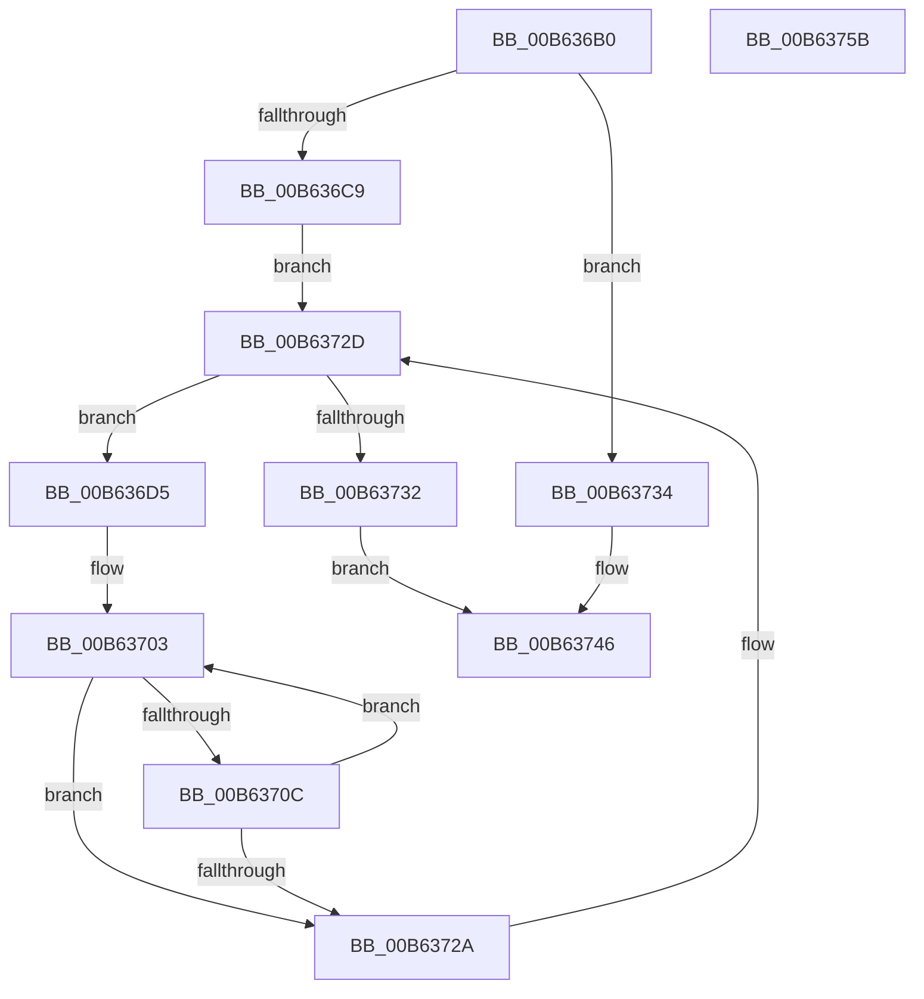

# HsaMarkHiberRegions

- RVA: `0x00B636B0`–`0x00B6375C` (길이 `172` bytes)
- VA: `0x0000000140B636B0`
- 실행 섹션: `PAGELK`
- PDB 이름 있음: `예`; PDB Function 태그: `아니요`
- unwind 정보 RVA: `0x0005C954`
- 디코드: `45`개 명령, `172/172` bytes 표시
- 미해석 바이트: `0` (있으면 어셈블리에 `.byte`로 보존)

> 이 문서는 커널 이미지의 기계어와 PDB 기호를 분석해 생성했습니다. 4번과 5번은 함수 원형과 자료형을 바이너리 사용 방식에서 추정한 C 해석이며 원본 소스 복구 결과는 아닙니다.

## 1. Dependencies

- 직접 호출 지점: **4**; 고유 호출 대상: **1**
- 직접 호출자로 확인된 함수: **0**
- RIP 상대 이미지 참조: **0**

### Outgoing calls
- `0x00B636E0` → [HalpIommuExtMarkHiberMemory](../../text/55/HalpIommuExtMarkHiberMemory_function_00553604.md) (function, `0x00553604`)
- `0x00B636F1` → [HalpIommuExtMarkHiberMemory](../../text/55/HalpIommuExtMarkHiberMemory_function_00553604.md) (function, `0x00553604`)
- `0x00B63717` → [HalpIommuExtMarkHiberMemory](../../text/55/HalpIommuExtMarkHiberMemory_function_00553604.md) (function, `0x00553604`)
- `0x00B63741` → [HalpIommuExtMarkHiberMemory](../../text/55/HalpIommuExtMarkHiberMemory_function_00553604.md) (function, `0x00553604`)

### Direct callers
- 이 함수 시작 RVA로 연결되는 직접 call은 확인되지 않았습니다. 간접 호출은 완전히 역산할 수 없습니다.

### Static image references
- 디코드된 RIP-relative 메모리 참조가 없습니다.

## 2. Other-region calls and transfers

- 다른 실행 섹션으로 향하는 call: **4**
  - `0x00B636E0` → [HalpIommuExtMarkHiberMemory](../../text/55/HalpIommuExtMarkHiberMemory_function_00553604.md) (`PAGELK` → `.text`)
  - `0x00B636F1` → [HalpIommuExtMarkHiberMemory](../../text/55/HalpIommuExtMarkHiberMemory_function_00553604.md) (`PAGELK` → `.text`)
  - `0x00B63717` → [HalpIommuExtMarkHiberMemory](../../text/55/HalpIommuExtMarkHiberMemory_function_00553604.md) (`PAGELK` → `.text`)
  - `0x00B63741` → [HalpIommuExtMarkHiberMemory](../../text/55/HalpIommuExtMarkHiberMemory_function_00553604.md) (`PAGELK` → `.text`)
- 별도 외부 분기/꼬리 이동을 확인하지 못했습니다.

## 3. Assembly (complete function range)

```asm
00B636B0  48 89 5C 24 08                  mov qword ptr [rsp + 8], rbx
00B636B5  48 89 6C 24 10                  mov qword ptr [rsp + 0x10], rbp
00B636BA  48 89 74 24 18                  mov qword ptr [rsp + 0x18], rsi
00B636BF  57                              push rdi
00B636C0  48 83 EC 20                     sub rsp, 0x20
00B636C4  48 85 C9                        test rcx, rcx
00B636C7  75 6B                           jne 0x140b63734
00B636C9  48 8D BA F0 00 00 00            lea rdi, [rdx + 0xf0]
00B636D0  48 8B 1F                        mov rbx, qword ptr [rdi]
00B636D3  EB 58                           jmp 0x140b6372d
00B636D5  41 B8 38 00 00 00               mov r8d, 0x38
00B636DB  48 8B D3                        mov rdx, rbx
00B636DE  33 C9                           xor ecx, ecx
00B636E0  E8 1F FF 9E FF                  call 0x140553604
00B636E5  48 8B 53 30                     mov rdx, qword ptr [rbx + 0x30]
00B636E9  41 B8 00 20 00 00               mov r8d, 0x2000
00B636EF  33 C9                           xor ecx, ecx
00B636F1  E8 0E FF 9E FF                  call 0x140553604
00B636F6  48 8B 73 30                     mov rsi, qword ptr [rbx + 0x30]
00B636FA  48 81 C6 00 10 00 00            add rsi, 0x1000
00B63701  33 ED                           xor ebp, ebp
00B63703  F6 86 00 F0 FF FF 01            test byte ptr [rsi - 0x1000], 1
00B6370A  74 1E                           je 0x140b6372a
00B6370C  48 8B 16                        mov rdx, qword ptr [rsi]
00B6370F  41 B8 00 10 00 00               mov r8d, 0x1000
00B63715  33 C9                           xor ecx, ecx
00B63717  E8 E8 FE 9E FF                  call 0x140553604
00B6371C  FF C5                           inc ebp
00B6371E  48 83 C6 08                     add rsi, 8
00B63722  81 FD 00 02 00 00               cmp ebp, 0x200
00B63728  72 D9                           jb 0x140b63703
00B6372A  48 8B 1B                        mov rbx, qword ptr [rbx]
00B6372D  48 3B DF                        cmp rbx, rdi
00B63730  75 A3                           jne 0x140b636d5
00B63732  EB 12                           jmp 0x140b63746
00B63734  48 81 C2 98 00 00 00            add rdx, 0x98
00B6373B  41 B8 08 00 00 00               mov r8d, 8
00B63741  E8 BE FE 9E FF                  call 0x140553604
00B63746  48 8B 5C 24 30                  mov rbx, qword ptr [rsp + 0x30]
00B6374B  48 8B 6C 24 38                  mov rbp, qword ptr [rsp + 0x38]
00B63750  48 8B 74 24 40                  mov rsi, qword ptr [rsp + 0x40]
00B63755  48 83 C4 20                     add rsp, 0x20
00B63759  5F                              pop rdi
00B6375A  C3                              ret
00B6375B  CC                              int3
```

## 4. C-style interpretation (structured pseudocode)

```c
__int64 __fastcall HsaMarkHiberRegions(__int64 a1, __int64 a2)
{
    __int64 result;
    __int64 v_rbp;
    __int64 v_rsi;
    __int64 v_rsp;
    unsigned __int64 v_stack_p10;
    unsigned __int64 v_stack_p18;
    unsigned __int64 v_stack_p8;

    v_stack_p8 = v_rbx;
    v_stack_p10 = v_rbp;
    v_stack_p18 = v_rsi;
    v_rsp = (v_rsp) - (32);
    if (a1 != 0) goto loc_00B63734;
    goto loc_00B6372D;
loc_00B636D5:
    a1 = 0;
    result = HalpIommuExtMarkHiberMemory(a1, *(unsigned __int64 *)(a2 + 240), 56, a4);
    a1 = 0;
    result = HalpIommuExtMarkHiberMemory(a1, *(unsigned __int64 *)(*(unsigned __int64 *)(a2 + 240) + 48), (unsigned int)(0x2000ULL), a4);
    v_rsi = (*(unsigned __int64 *)(*(unsigned __int64 *)(a2 + 240) + 48)) + (0x1000ULL);
    v_rbp = 0;
loc_00B63703:
    if (((*(unsigned __int8 *)(v_rsi - 4096)) & (1)) == 0) goto loc_00B6372A;
    a1 = 0;
    result = HalpIommuExtMarkHiberMemory(a1, *(unsigned __int64 *)(v_rsi), (unsigned int)(0x1000ULL), a4);
    v_rbp = (unsigned int)((v_rbp) + 1);
    v_rsi = (v_rsi) + (8);
    if (((unsigned int)(v_rbp)) < 512) goto loc_00B63703;
loc_00B6372A:
loc_00B6372D:
    if ((*(unsigned __int64 *)(*(unsigned __int64 *)(a2 + 240))) != (a2 + 240)) goto loc_00B636D5;
    goto loc_00B63746;
loc_00B63734:
    a2 = (*(unsigned __int64 *)(v_rsi)) + (152);
    result = HalpIommuExtMarkHiberMemory(a1, a2, 8, a4);
loc_00B63746:
    v_rsp = (v_rsp) + (32);
    return result;
}
```

## 5. (Beta) C Style

```c
int64_t HsaMarkHiberRegions(int64_t Arg1, void *Arg2)
{
    uint8_t *arg2 = (uint8_t *)Arg2;

    int64_t result;
    int64_t local_rbp;
    int64_t local_rsi;
    int64_t local_rsp;
    uint64_t v_stack_p10;
    uint64_t v_stack_p18;
    uint64_t v_stack_p8;

    v_stack_p8 = local_rbx;
    v_stack_p10 = local_rbp;
    v_stack_p18 = local_rsi;
    local_rsp = (local_rsp) - (32);
    if (Arg1 != 0) goto loc_00B63734;
    goto loc_00B6372D;
loc_00B636D5:
    Arg1 = 0;
    result = HalpIommuExtMarkHiberMemory(Arg1, *(uint64_t *)(arg2 + 0xF0), 56, a4);
    Arg1 = 0;
    result = HalpIommuExtMarkHiberMemory(Arg1, *(uint64_t *)(*(uint64_t *)(arg2 + 0xF0) + 0x30), (uint32_t)(0x2000ULL), a4);
    local_rsi = (*(uint64_t *)(*(uint64_t *)(arg2 + 0xF0) + 0x30)) + (0x1000ULL);
    local_rbp = 0;
loc_00B63703:
    if (((*(uint8_t *)(local_rsi - 0x1000)) & (1)) == 0) goto loc_00B6372A;
    Arg1 = 0;
    result = HalpIommuExtMarkHiberMemory(Arg1, *(uint64_t *)(local_rsi), (uint32_t)(0x1000ULL), a4);
    local_rbp = (uint32_t)((local_rbp) + 1);
    local_rsi = (local_rsi) + (8);
    if (((uint32_t)(local_rbp)) < 512) goto loc_00B63703;
loc_00B6372A:
loc_00B6372D:
    if ((*(uint64_t *)(*(uint64_t *)(arg2 + 0xF0))) != (Arg2 + 240)) goto loc_00B636D5;
    goto loc_00B63746;
loc_00B63734:
    Arg2 = (*(uint64_t *)(local_rsi)) + (152);
    result = HalpIommuExtMarkHiberMemory(Arg1, Arg2, 8, a4);
loc_00B63746:
    local_rsp = (local_rsp) + (32);
    return result;
}
```

### 관측된 메모리 오프셋

구조체 형식이 확인되지 않은 접근은 인자 기준의 오프셋으로만 기록했습니다.

| 기준 인자 | 오프셋 표현 | 폭 (bit) | 접근 |
|---|---:|---:|---|
| `Arg2` | `+ 0x0` | `64` | `R` |
| `Arg2` | `+ 0xF0` | `64` | `R` |

## 6. Execution-region graph

[열기: 2D/3D 그래프와 함수 탐색 컨트롤 패널](../../../control-panel.html?section=pagelk&rva=0x00B636B0&view=graph)

- 2D 그래프는 위에서 아래로 흐르고, 3D 그래프는 빈 공간을 드래그해 회전합니다. Shift+드래그는 이동, 휠은 확대·축소, 함수 노드 선택은 대상 보고서 이동입니다.

### Static fallback


