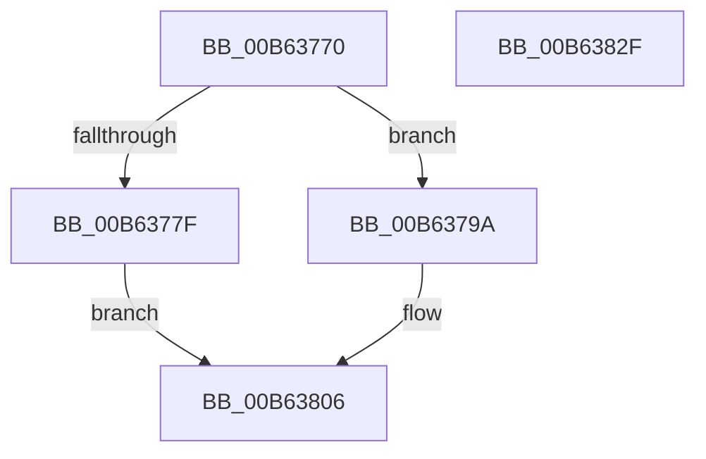

# HsaSetMessageInterruptRouting

- RVA: `0x00B63770`–`0x00B63830` (길이 `192` bytes)
- VA: `0x0000000140B63770`
- 실행 섹션: `PAGELK`
- PDB 이름 있음: `예`; PDB Function 태그: `아니요`
- unwind 정보 RVA: `0x000DB714`
- 디코드: `47`개 명령, `192/192` bytes 표시
- 미해석 바이트: `0` (있으면 어셈블리에 `.byte`로 보존)

> 이 문서는 커널 이미지의 기계어와 PDB 기호를 분석해 생성했습니다. 4번과 5번은 함수 원형과 자료형을 바이너리 사용 방식에서 추정한 C 해석이며 원본 소스 복구 결과는 아닙니다.

## 1. Dependencies

- 직접 호출 지점: **0**; 고유 호출 대상: **0**
- 직접 호출자로 확인된 함수: **0**
- RIP 상대 이미지 참조: **1**

### Outgoing calls
- 직접 디코드된 call 명령이 없습니다.

### Direct callers
- 이 함수 시작 RVA로 연결되는 직접 call은 확인되지 않았습니다. 간접 호출은 완전히 역산할 수 없습니다.

### Static image references
- `0x00B637A1` → RVA `0x00F8F668` (`.data`; read)

## 2. Other-region calls and transfers

- 다른 실행 섹션으로 향하는 call: **0**
- 별도 외부 분기/꼬리 이동을 확인하지 못했습니다.

## 3. Assembly (complete function range)

```asm
00B63770  45 33 DB                        xor r11d, r11d
00B63773  4C 8B D1                        mov r10, rcx
00B63776  44 39 99 B0 00 00 00            cmp dword ptr [rcx + 0xb0], r11d
00B6377D  75 1B                           jne 0x140b6379a
00B6377F  48 8B 01                        mov rax, qword ptr [rcx]
00B63782  4C 89 80 5C 01 00 00            mov qword ptr [rax + 0x15c], r8
00B63789  F0 44 09 1C 24                  lock or dword ptr [rsp], r11d
00B6378E  48 8B 01                        mov rax, qword ptr [rcx]
00B63791  44 89 88 64 01 00 00            mov dword ptr [rax + 0x164], r9d
00B63798  EB 6C                           jmp 0x140b63806
00B6379A  41 8B C1                        mov eax, r9d
00B6379D  48 C1 E0 04                     shl rax, 4
00B637A1  48 03 05 C0 BE 42 00            add rax, qword ptr [rip + 0x42bec0]
00B637A8  4C 8B 00                        mov r8, qword ptr [rax]
00B637AB  48 8B 50 08                     mov rdx, qword ptr [rax + 8]
00B637AF  49 8B C8                        mov rcx, r8
00B637B2  48 C1 E9 04                     shr rcx, 4
00B637B6  83 E1 04                        and ecx, 4
00B637B9  0F B6 C2                        movzx eax, dl
00B637BC  48 C1 E0 20                     shl rax, 0x20
00B637C0  48 0B C1                        or rax, rcx
00B637C3  48 B9 00 00 00 00 00 00 00 FF   movabs rcx, 0xff00000000000000
00B637CD  48 23 D1                        and rdx, rcx
00B637D0  B9 00 FF FF FF                  mov ecx, 0xffffff00
00B637D5  4C 23 C1                        and r8, rcx
00B637D8  48 0B C2                        or rax, rdx
00B637DB  49 8B 0A                        mov rcx, qword ptr [r10]
00B637DE  49 0B C0                        or rax, r8
00B637E1  48 89 81 70 01 00 00            mov qword ptr [rcx + 0x170], rax
00B637E8  F0 44 09 1C 24                  lock or dword ptr [rsp], r11d
00B637ED  49 8B 0A                        mov rcx, qword ptr [r10]
00B637F0  48 89 81 78 01 00 00            mov qword ptr [rcx + 0x178], rax
00B637F7  F0 44 09 1C 24                  lock or dword ptr [rsp], r11d
00B637FC  49 8B 0A                        mov rcx, qword ptr [r10]
00B637FF  48 89 81 80 01 00 00            mov qword ptr [rcx + 0x180], rax
00B63806  F0 44 09 1C 24                  lock or dword ptr [rsp], r11d
00B6380B  49 8B 02                        mov rax, qword ptr [r10]
00B6380E  90                              nop
00B6380F  8B 80 58 01 00 00               mov eax, dword ptr [rax + 0x158]
00B63815  49 8B 0A                        mov rcx, qword ptr [r10]
00B63818  25 FF FF 8F FF                  and eax, 0xff8fffff
00B6381D  0F BA E8 10                     bts eax, 0x10
00B63821  89 81 58 01 00 00               mov dword ptr [rcx + 0x158], eax
00B63827  F0 44 09 1C 24                  lock or dword ptr [rsp], r11d
00B6382C  33 C0                           xor eax, eax
00B6382E  C3                              ret
00B6382F  CC                              int3
```

## 4. C-style interpretation (structured pseudocode)

```c
__int64 __fastcall HsaSetMessageInterruptRouting(__int64 a1, __int64 a2, __int64 a3, int a4)
{
    __int64 result;
    __int64 v_r11;
    unsigned int v_stack_p0;

    v_r11 = 0;
    if ((*(unsigned int *)(a1 + 176)) != 0) goto loc_00B6379A;
    *(unsigned __int64 *)(*(unsigned __int64 *)(a1) + 348) = a3;
    *(unsigned int *)(*(unsigned __int64 *)(a1) + 356) = a4;
    goto loc_00B63806;
loc_00B6379A:
    result = ((unsigned int)(a4)) << (4);
    result = (result) + (*(unsigned __int64 *)(v_rip + 4374208));
    a1 = (*(unsigned __int64 *)(result)) >> (4);
    a1 = (unsigned int)((a1) & (4));
    result = ((unsigned __int8)(*(unsigned __int64 *)(result + 8))) << (32);
    result = (result) | (a1);
    a2 = (*(unsigned __int64 *)(result + 8)) & (a1);
    a3 = (*(unsigned __int64 *)(result)) & ((unsigned int)(0xFFFFFF00ULL));
    result = (result) | (a2);
    result = (result) | (a3);
    *(unsigned __int64 *)(*(unsigned __int64 *)(a1) + 368) = result;
    *(unsigned __int64 *)(*(unsigned __int64 *)(a1) + 376) = result;
    *(unsigned __int64 *)(*(unsigned __int64 *)(a1) + 384) = result;
loc_00B63806:
    result = (unsigned int)(((unsigned int)(*(unsigned int *)(*(unsigned __int64 *)(a1) + 344))) & (0xFF8FFFFFULL));
    *(unsigned int *)(*(unsigned __int64 *)(a1) + 344) = (unsigned int)(result);
    result = 0;
    return result;
}
```

## 5. (Beta) C Style

```c
int64_t HsaSetMessageInterruptRouting(void *Arg1, int64_t Arg2, int64_t Arg3, int32_t Arg4)
{
    uint8_t *arg1 = (uint8_t *)Arg1;

    int64_t result;
    int64_t local_r11;
    uint32_t v_stack_p0;

    local_r11 = 0;
    if ((*(uint32_t *)(arg1 + 0xB0)) != 0) goto loc_00B6379A;
    *(uint64_t *)(*(uint64_t *)(arg1) + 0x15C) = Arg3;
    *(uint32_t *)(*(uint64_t *)(arg1) + 0x164) = Arg4;
    goto loc_00B63806;
loc_00B6379A:
    result = ((uint32_t)(Arg4)) << (4);
    result = (result) + (*(uint64_t *)(v_rip + 0x42BEC0));
    Arg1 = (*(uint64_t *)(result)) >> (4);
    Arg1 = (uint32_t)((Arg1) & (4));
    result = ((uint8_t)(*(uint64_t *)(result + 0x8))) << (32);
    result = (result) | (Arg1);
    Arg2 = (*(uint64_t *)(result + 0x8)) & (Arg1);
    Arg3 = (*(uint64_t *)(result)) & ((uint32_t)(0xFFFFFF00ULL));
    result = (result) | (Arg2);
    result = (result) | (Arg3);
    *(uint64_t *)(*(uint64_t *)(arg1) + 0x170) = result;
    *(uint64_t *)(*(uint64_t *)(arg1) + 0x178) = result;
    *(uint64_t *)(*(uint64_t *)(arg1) + 0x180) = result;
loc_00B63806:
    result = (uint32_t)(((uint32_t)(*(uint32_t *)(*(uint64_t *)(arg1) + 0x158))) & (0xFF8FFFFFULL));
    *(uint32_t *)(*(uint64_t *)(arg1) + 0x158) = (uint32_t)(result);
    result = 0;
    return result;
}
```

### 관측된 메모리 오프셋

구조체 형식이 확인되지 않은 접근은 인자 기준의 오프셋으로만 기록했습니다.

| 기준 인자 | 오프셋 표현 | 폭 (bit) | 접근 |
|---|---:|---:|---|
| `Arg1` | `+ 0x0` | `64` | `R` |
| `Arg1` | `+ 0xB0` | `32` | `R` |

## 6. Execution-region graph

[열기: 2D/3D 그래프와 함수 탐색 컨트롤 패널](../../../control-panel.html?section=pagelk&rva=0x00B63770&view=graph)

- 2D 그래프는 위에서 아래로 흐르고, 3D 그래프는 빈 공간을 드래그해 회전합니다. Shift+드래그는 이동, 휠은 확대·축소, 함수 노드 선택은 대상 보고서 이동입니다.

### Static fallback


