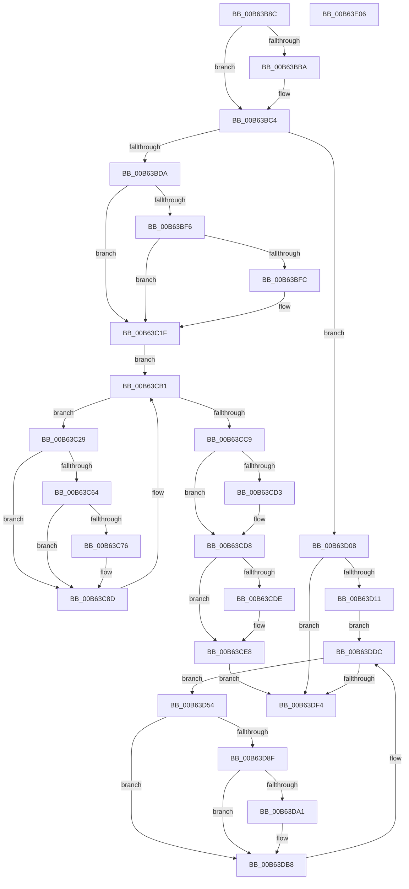

# IoShutdownSystem

- RVA: `0x00B63B8C`–`0x00B63E07` (길이 `635` bytes)
- VA: `0x0000000140B63B8C`
- 실행 섹션: `PAGELK`
- PDB 이름 있음: `예`; PDB Function 태그: `아니요`
- unwind 정보 RVA: `0x000C62DC`
- 디코드: `157`개 명령, `635/635` bytes 표시
- 미해석 바이트: `0` (있으면 어셈블리에 `.byte`로 보존)

> 이 문서는 커널 이미지의 기계어와 PDB 기호를 분석해 생성했습니다. 4번과 5번은 함수 원형과 자료형을 바이너리 사용 방식에서 추정한 C 해석이며 원본 소스 복구 결과는 아닙니다.

## 1. Dependencies

- 직접 호출 지점: **33**; 고유 호출 대상: **20**
- 직접 호출자로 확인된 함수: **1**
- RIP 상대 이미지 참조: **9**

### Outgoing calls
- `0x00B63BB1` → [VfIsVerifierEnabled](../../text/4C/VfIsVerifierEnabled_function_004C72F0.md) (function, `0x004C72F0`)
- `0x00B63BBF` → [VfNotifyVerifierOfEvent](../../pagevrfy/B9/VfNotifyVerifierOfEvent_function_00B92E90.md) (function, `0x00B92E90`)
- `0x00B63BCD` → [KeInitializeEvent](../../text/40/KeInitializeEvent_function_0040DD10.md) (function, `0x0040DD10`)
- `0x00B63BED` → [ZwQuerySystemInformation](../../text/6A/ZwQuerySystemInformation_function_006AD790.md) (function, `0x006AD790`)
- `0x00B63C05` → [guard_dispatch_icall](../../text/6B/guard_dispatch_icall_function_006BAAD0.md) (function, `0x006BAAD0`)
- `0x00B63C1A` → [ZwSetSystemInformation](../../text/6B/ZwSetSystemInformation_function_006B0870.md) (function, `0x006B0870`)
- `0x00B63C1F` → [PnpShutdownDevices](../../page/72/PnpShutdownDevices_function_00723F20.md) (function, `0x00723F20`)
- `0x00B63C2D` → [IoGetAttachedDeviceReference](../../text/41/IoGetAttachedDeviceReference_function_0041D940.md) (function, `0x0041D940`)
- `0x00B63C5A` → [IoBuildSynchronousFsdRequest](../../page/A4/IoBuildSynchronousFsdRequest_function_00A49880.md) (function, `0x00A49880`)
- `0x00B63C6A` → [IofCallDriver](../../text/29/IofCallDriver_function_0029B4B0.md) (function, `0x0029B4B0`)
- `0x00B63C88` → [KeWaitForSingleObject](../../text/20/KeWaitForSingleObject_function_0020E6B0.md) (function, `0x0020E6B0`)
- `0x00B63C90` → [ObfDereferenceObject](../../text/2F/ObfDereferenceObject_function_002F9350.md) (function, `0x002F9350`)
- `0x00B63C99` → [ObfDereferenceObject](../../text/2F/ObfDereferenceObject_function_002F9350.md) (function, `0x002F9350`)
- `0x00B63CA3` → [ExFreePoolWithTag](../../poolcode/B8/ExFreePoolWithTag_function_00B82870.md) (function, `0x00B82870`)
- `0x00B63CAC` → [KeResetEvent](../../text/24/KeResetEvent_function_00248350.md) (function, `0x00248350`)
- `0x00B63CB8` → [IopInterlockedRemoveHeadList](../../text/4B/IopInterlockedRemoveHeadList_function_004B4FB0.md) (function, `0x004B4FB0`)
- `0x00B63CD3` → [IovUnloadDrivers](../../pagevrfy/B9/IovUnloadDrivers_function_00B9277C.md) (function, `0x00B9277C`)
- `0x00B63CE3` → [IoNotifyDump](../../text/59/IoNotifyDump_function_00592B60.md) (function, `0x00592B60`)
- `0x00B63CFE` → [ZwSetSystemInformation](../../text/6B/ZwSetSystemInformation_function_006B0870.md) (function, `0x006B0870`)
- `0x00B63D18` → [ExWaitForRundownProtectionRelease](../../text/2A/ExWaitForRundownProtectionRelease_function_002A4CB0.md) (function, `0x002A4CB0`)
- `0x00B63D26` → [ExAcquireResourceExclusiveLite](../../text/21/ExAcquireResourceExclusiveLite_function_00214E20.md) (function, `0x00214E20`)
- `0x00B63D32` → [IopShutdownBaseFileSystems](IopShutdownBaseFileSystems_function_00B63E10.md) (function, `0x00B63E10`)
- `0x00B63D3E` → [IopShutdownBaseFileSystems](IopShutdownBaseFileSystems_function_00B63E10.md) (function, `0x00B63E10`)
- `0x00B63D4A` → [IopShutdownBaseFileSystems](IopShutdownBaseFileSystems_function_00B63E10.md) (function, `0x00B63E10`)
- `0x00B63D58` → [IoGetAttachedDeviceReference](../../text/41/IoGetAttachedDeviceReference_function_0041D940.md) (function, `0x0041D940`)
- `0x00B63D85` → [IoBuildSynchronousFsdRequest](../../page/A4/IoBuildSynchronousFsdRequest_function_00A49880.md) (function, `0x00A49880`)
- `0x00B63D95` → [IofCallDriver](../../text/29/IofCallDriver_function_0029B4B0.md) (function, `0x0029B4B0`)
- `0x00B63DB3` → [KeWaitForSingleObject](../../text/20/KeWaitForSingleObject_function_0020E6B0.md) (function, `0x0020E6B0`)
- `0x00B63DBB` → [ObfDereferenceObject](../../text/2F/ObfDereferenceObject_function_002F9350.md) (function, `0x002F9350`)
- `0x00B63DC4` → [ObfDereferenceObject](../../text/2F/ObfDereferenceObject_function_002F9350.md) (function, `0x002F9350`)
- `0x00B63DCE` → [ExFreePoolWithTag](../../poolcode/B8/ExFreePoolWithTag_function_00B82870.md) (function, `0x00B82870`)
- `0x00B63DD7` → [KeResetEvent](../../text/24/KeResetEvent_function_00248350.md) (function, `0x00248350`)
- `0x00B63DE3` → [IopInterlockedRemoveHeadList](../../text/4B/IopInterlockedRemoveHeadList_function_004B4FB0.md) (function, `0x004B4FB0`)

### Direct callers
- [PopGracefulShutdown](PopGracefulShutdown_function_00B6BEC8.md) at `0x00B6C025`
- [PopGracefulShutdown](PopGracefulShutdown_function_00B6BEC8.md) at `0x00B6C10B`

### Static image references
- `0x00B63BFC` → RVA `0x00E00B08` (`.data`; read)
- `0x00B63CB1` → RVA `0x00F8D220` (`.data`; read)
- `0x00B63CC9` → RVA `0x00F04A20` (`.data`; read)
- `0x00B63D11` → RVA `0x00F8D290` (`.data`; read)
- `0x00B63D1F` → RVA `0x00F8D320` (`.data`; read)
- `0x00B63D2B` → RVA `0x00F8D280` (`.data`; read)
- `0x00B63D37` → RVA `0x00F8D270` (`.data`; read)
- `0x00B63D43` → RVA `0x00F8D260` (`.data`; read)
- `0x00B63DDC` → RVA `0x00F8D460` (`.data`; read)

## 2. Other-region calls and transfers

- 다른 실행 섹션으로 향하는 call: **30**
  - `0x00B63BB1` → [VfIsVerifierEnabled](../../text/4C/VfIsVerifierEnabled_function_004C72F0.md) (`PAGELK` → `.text`)
  - `0x00B63BBF` → [VfNotifyVerifierOfEvent](../../pagevrfy/B9/VfNotifyVerifierOfEvent_function_00B92E90.md) (`PAGELK` → `PAGEVRFY`)
  - `0x00B63BCD` → [KeInitializeEvent](../../text/40/KeInitializeEvent_function_0040DD10.md) (`PAGELK` → `.text`)
  - `0x00B63BED` → [ZwQuerySystemInformation](../../text/6A/ZwQuerySystemInformation_function_006AD790.md) (`PAGELK` → `.text`)
  - `0x00B63C05` → [guard_dispatch_icall](../../text/6B/guard_dispatch_icall_function_006BAAD0.md) (`PAGELK` → `.text`)
  - `0x00B63C1A` → [ZwSetSystemInformation](../../text/6B/ZwSetSystemInformation_function_006B0870.md) (`PAGELK` → `.text`)
  - `0x00B63C1F` → [PnpShutdownDevices](../../page/72/PnpShutdownDevices_function_00723F20.md) (`PAGELK` → `PAGE`)
  - `0x00B63C2D` → [IoGetAttachedDeviceReference](../../text/41/IoGetAttachedDeviceReference_function_0041D940.md) (`PAGELK` → `.text`)
  - `0x00B63C5A` → [IoBuildSynchronousFsdRequest](../../page/A4/IoBuildSynchronousFsdRequest_function_00A49880.md) (`PAGELK` → `PAGE`)
  - `0x00B63C6A` → [IofCallDriver](../../text/29/IofCallDriver_function_0029B4B0.md) (`PAGELK` → `.text`)
  - `0x00B63C88` → [KeWaitForSingleObject](../../text/20/KeWaitForSingleObject_function_0020E6B0.md) (`PAGELK` → `.text`)
  - `0x00B63C90` → [ObfDereferenceObject](../../text/2F/ObfDereferenceObject_function_002F9350.md) (`PAGELK` → `.text`)
  - `0x00B63C99` → [ObfDereferenceObject](../../text/2F/ObfDereferenceObject_function_002F9350.md) (`PAGELK` → `.text`)
  - `0x00B63CA3` → [ExFreePoolWithTag](../../poolcode/B8/ExFreePoolWithTag_function_00B82870.md) (`PAGELK` → `POOLCODE`)
  - `0x00B63CAC` → [KeResetEvent](../../text/24/KeResetEvent_function_00248350.md) (`PAGELK` → `.text`)
  - `0x00B63CB8` → [IopInterlockedRemoveHeadList](../../text/4B/IopInterlockedRemoveHeadList_function_004B4FB0.md) (`PAGELK` → `.text`)
  - `0x00B63CD3` → [IovUnloadDrivers](../../pagevrfy/B9/IovUnloadDrivers_function_00B9277C.md) (`PAGELK` → `PAGEVRFY`)
  - `0x00B63CE3` → [IoNotifyDump](../../text/59/IoNotifyDump_function_00592B60.md) (`PAGELK` → `.text`)
  - `0x00B63CFE` → [ZwSetSystemInformation](../../text/6B/ZwSetSystemInformation_function_006B0870.md) (`PAGELK` → `.text`)
  - `0x00B63D18` → [ExWaitForRundownProtectionRelease](../../text/2A/ExWaitForRundownProtectionRelease_function_002A4CB0.md) (`PAGELK` → `.text`)
  - `0x00B63D26` → [ExAcquireResourceExclusiveLite](../../text/21/ExAcquireResourceExclusiveLite_function_00214E20.md) (`PAGELK` → `.text`)
  - `0x00B63D58` → [IoGetAttachedDeviceReference](../../text/41/IoGetAttachedDeviceReference_function_0041D940.md) (`PAGELK` → `.text`)
  - `0x00B63D85` → [IoBuildSynchronousFsdRequest](../../page/A4/IoBuildSynchronousFsdRequest_function_00A49880.md) (`PAGELK` → `PAGE`)
  - `0x00B63D95` → [IofCallDriver](../../text/29/IofCallDriver_function_0029B4B0.md) (`PAGELK` → `.text`)
  - `0x00B63DB3` → [KeWaitForSingleObject](../../text/20/KeWaitForSingleObject_function_0020E6B0.md) (`PAGELK` → `.text`)
  - `0x00B63DBB` → [ObfDereferenceObject](../../text/2F/ObfDereferenceObject_function_002F9350.md) (`PAGELK` → `.text`)
  - `0x00B63DC4` → [ObfDereferenceObject](../../text/2F/ObfDereferenceObject_function_002F9350.md) (`PAGELK` → `.text`)
  - `0x00B63DCE` → [ExFreePoolWithTag](../../poolcode/B8/ExFreePoolWithTag_function_00B82870.md) (`PAGELK` → `POOLCODE`)
  - `0x00B63DD7` → [KeResetEvent](../../text/24/KeResetEvent_function_00248350.md) (`PAGELK` → `.text`)
  - `0x00B63DE3` → [IopInterlockedRemoveHeadList](../../text/4B/IopInterlockedRemoveHeadList_function_004B4FB0.md) (`PAGELK` → `.text`)
- 별도 외부 분기/꼬리 이동을 확인하지 못했습니다.

## 3. Assembly (complete function range)

```asm
00B63B8C  48 89 5C 24 10                  mov qword ptr [rsp + 0x10], rbx
00B63B91  48 89 7C 24 18                  mov qword ptr [rsp + 0x18], rdi
00B63B96  55                              push rbp
00B63B97  48 8B EC                        mov rbp, rsp
00B63B9A  48 83 EC 70                     sub rsp, 0x70
00B63B9E  0F 57 C0                        xorps xmm0, xmm0
00B63BA1  33 C0                           xor eax, eax
00B63BA3  0F 11 45 E0                     movups xmmword ptr [rbp - 0x20], xmm0
00B63BA7  48 89 45 F0                     mov qword ptr [rbp - 0x10], rax
00B63BAB  8B D9                           mov ebx, ecx
00B63BAD  0F 11 45 D0                     movups xmmword ptr [rbp - 0x30], xmm0
00B63BB1  E8 3A 37 96 FF                  call 0x1404c72f0
00B63BB6  85 C0                           test eax, eax
00B63BB8  74 0A                           je 0x140b63bc4
00B63BBA  B9 01 00 00 00                  mov ecx, 1
00B63BBF  E8 CC F2 02 00                  call 0x140b92e90
00B63BC4  45 33 C0                        xor r8d, r8d
00B63BC7  48 8D 4D E0                     lea rcx, [rbp - 0x20]
00B63BCB  33 D2                           xor edx, edx
00B63BCD  E8 3E A1 8A FF                  call 0x14040dd10
00B63BD2  85 DB                           test ebx, ebx
00B63BD4  0F 85 2E 01 00 00               jne 0x140b63d08
00B63BDA  21 5D 10                        and dword ptr [rbp + 0x10], ebx
00B63BDD  44 8D 43 04                     lea r8d, [rbx + 4]
00B63BE1  45 33 C9                        xor r9d, r9d
00B63BE4  48 8D 55 10                     lea rdx, [rbp + 0x10]
00B63BE8  B9 97 00 00 00                  mov ecx, 0x97
00B63BED  E8 9E 9B B4 FF                  call 0x1406ad790
00B63BF2  85 C0                           test eax, eax
00B63BF4  78 29                           js 0x140b63c1f
00B63BF6  F6 45 10 20                     test byte ptr [rbp + 0x10], 0x20
00B63BFA  74 23                           je 0x140b63c1f
00B63BFC  48 8B 05 05 CF 29 00            mov rax, qword ptr [rip + 0x29cf05]
00B63C03  33 C9                           xor ecx, ecx
00B63C05  E8 C6 6E B5 FF                  call 0x1406baad0
00B63C0A  21 5D 10                        and dword ptr [rbp + 0x10], ebx
00B63C0D  44 8D 43 04                     lea r8d, [rbx + 4]
00B63C11  48 8D 55 10                     lea rdx, [rbp + 0x10]
00B63C15  B9 97 00 00 00                  mov ecx, 0x97
00B63C1A  E8 51 CC B4 FF                  call 0x1406b0870
00B63C1F  E8 FC 02 BC FF                  call 0x140723f20
00B63C24  E9 88 00 00 00                  jmp 0x140b63cb1
00B63C29  48 8B 4B 10                     mov rcx, qword ptr [rbx + 0x10]
00B63C2D  E8 0E 9D 8B FF                  call 0x14041d940
00B63C32  48 8B F8                        mov rdi, rax
00B63C35  45 33 C9                        xor r9d, r9d
00B63C38  48 8D 45 D0                     lea rax, [rbp - 0x30]
00B63C3C  45 33 C0                        xor r8d, r8d
00B63C3F  48 89 44 24 30                  mov qword ptr [rsp + 0x30], rax
00B63C44  48 8B D7                        mov rdx, rdi
00B63C47  48 8D 45 E0                     lea rax, [rbp - 0x20]
00B63C4B  48 89 44 24 28                  mov qword ptr [rsp + 0x28], rax
00B63C50  41 8D 49 10                     lea ecx, [r9 + 0x10]
00B63C54  48 83 64 24 20 00               and qword ptr [rsp + 0x20], 0
00B63C5A  E8 21 5C EE FF                  call 0x140a49880
00B63C5F  48 85 C0                        test rax, rax
00B63C62  74 29                           je 0x140b63c8d
00B63C64  48 8B D0                        mov rdx, rax
00B63C67  48 8B CF                        mov rcx, rdi
00B63C6A  E8 41 78 73 FF                  call 0x14029b4b0
00B63C6F  3D 03 01 00 00                  cmp eax, 0x103
00B63C74  75 17                           jne 0x140b63c8d
00B63C76  48 83 64 24 20 00               and qword ptr [rsp + 0x20], 0
00B63C7C  48 8D 4D E0                     lea rcx, [rbp - 0x20]
00B63C80  45 33 C9                        xor r9d, r9d
00B63C83  45 33 C0                        xor r8d, r8d
00B63C86  33 D2                           xor edx, edx
00B63C88  E8 23 AA 6A FF                  call 0x14020e6b0
00B63C8D  48 8B CF                        mov rcx, rdi
00B63C90  E8 BB 56 79 FF                  call 0x1402f9350
00B63C95  48 8B 4B 10                     mov rcx, qword ptr [rbx + 0x10]
00B63C99  E8 B2 56 79 FF                  call 0x1402f9350
00B63C9E  33 D2                           xor edx, edx
00B63CA0  48 8B CB                        mov rcx, rbx
00B63CA3  E8 C8 EB 01 00                  call 0x140b82870
00B63CA8  48 8D 4D E0                     lea rcx, [rbp - 0x20]
00B63CAC  E8 9F 46 6E FF                  call 0x140248350
00B63CB1  48 8D 0D 68 95 42 00            lea rcx, [rip + 0x429568]
00B63CB8  E8 F3 12 95 FF                  call 0x1404b4fb0
00B63CBD  48 8B D8                        mov rbx, rax
00B63CC0  48 85 C0                        test rax, rax
00B63CC3  0F 85 60 FF FF FF               jne 0x140b63c29
00B63CC9  8B 05 51 0D 3A 00               mov eax, dword ptr [rip + 0x3a0d51]
00B63CCF  A8 10                           test al, 0x10
00B63CD1  74 05                           je 0x140b63cd8
00B63CD3  E8 A4 EA 02 00                  call 0x140b9277c
00B63CD8  F6 45 10 10                     test byte ptr [rbp + 0x10], 0x10
00B63CDC  74 0A                           je 0x140b63ce8
00B63CDE  B9 05 00 00 00                  mov ecx, 5
00B63CE3  E8 78 EE A2 FF                  call 0x140592b60
00B63CE8  41 B8 04 00 00 00               mov r8d, 4
00B63CEE  C7 45 10 02 00 00 00            mov dword ptr [rbp + 0x10], 2
00B63CF5  48 8D 55 10                     lea rdx, [rbp + 0x10]
00B63CF9  B9 97 00 00 00                  mov ecx, 0x97
00B63CFE  E8 6D CB B4 FF                  call 0x1406b0870
00B63D03  E9 EC 00 00 00                  jmp 0x140b63df4
00B63D08  83 FB 01                        cmp ebx, 1
00B63D0B  0F 85 E3 00 00 00               jne 0x140b63df4
00B63D11  48 8D 0D 78 95 42 00            lea rcx, [rip + 0x429578]
00B63D18  E8 93 0F 74 FF                  call 0x1402a4cb0
00B63D1D  8A D3                           mov dl, bl
00B63D1F  48 8D 0D FA 95 42 00            lea rcx, [rip + 0x4295fa]
00B63D26  E8 F5 10 6B FF                  call 0x140214e20
00B63D2B  48 8D 0D 4E 95 42 00            lea rcx, [rip + 0x42954e]
00B63D32  E8 D9 00 00 00                  call 0x140b63e10
00B63D37  48 8D 0D 32 95 42 00            lea rcx, [rip + 0x429532]
00B63D3E  E8 CD 00 00 00                  call 0x140b63e10
00B63D43  48 8D 0D 16 95 42 00            lea rcx, [rip + 0x429516]
00B63D4A  E8 C1 00 00 00                  call 0x140b63e10
00B63D4F  E9 88 00 00 00                  jmp 0x140b63ddc
00B63D54  48 8B 4B 10                     mov rcx, qword ptr [rbx + 0x10]
00B63D58  E8 E3 9B 8B FF                  call 0x14041d940
00B63D5D  48 8B F8                        mov rdi, rax
00B63D60  45 33 C9                        xor r9d, r9d
00B63D63  48 8D 45 D0                     lea rax, [rbp - 0x30]
00B63D67  45 33 C0                        xor r8d, r8d
00B63D6A  48 89 44 24 30                  mov qword ptr [rsp + 0x30], rax
00B63D6F  48 8B D7                        mov rdx, rdi
00B63D72  48 8D 45 E0                     lea rax, [rbp - 0x20]
00B63D76  48 89 44 24 28                  mov qword ptr [rsp + 0x28], rax
00B63D7B  41 8D 49 10                     lea ecx, [r9 + 0x10]
00B63D7F  48 83 64 24 20 00               and qword ptr [rsp + 0x20], 0
00B63D85  E8 F6 5A EE FF                  call 0x140a49880
00B63D8A  48 85 C0                        test rax, rax
00B63D8D  74 29                           je 0x140b63db8
00B63D8F  48 8B D0                        mov rdx, rax
00B63D92  48 8B CF                        mov rcx, rdi
00B63D95  E8 16 77 73 FF                  call 0x14029b4b0
00B63D9A  3D 03 01 00 00                  cmp eax, 0x103
00B63D9F  75 17                           jne 0x140b63db8
00B63DA1  48 83 64 24 20 00               and qword ptr [rsp + 0x20], 0
00B63DA7  48 8D 4D E0                     lea rcx, [rbp - 0x20]
00B63DAB  45 33 C9                        xor r9d, r9d
00B63DAE  45 33 C0                        xor r8d, r8d
00B63DB1  33 D2                           xor edx, edx
00B63DB3  E8 F8 A8 6A FF                  call 0x14020e6b0
00B63DB8  48 8B CF                        mov rcx, rdi
00B63DBB  E8 90 55 79 FF                  call 0x1402f9350
00B63DC0  48 8B 4B 10                     mov rcx, qword ptr [rbx + 0x10]
00B63DC4  E8 87 55 79 FF                  call 0x1402f9350
00B63DC9  33 D2                           xor edx, edx
00B63DCB  48 8B CB                        mov rcx, rbx
00B63DCE  E8 9D EA 01 00                  call 0x140b82870
00B63DD3  48 8D 4D E0                     lea rcx, [rbp - 0x20]
00B63DD7  E8 74 45 6E FF                  call 0x140248350
00B63DDC  48 8D 0D 7D 96 42 00            lea rcx, [rip + 0x42967d]
00B63DE3  E8 C8 11 95 FF                  call 0x1404b4fb0
00B63DE8  48 8B D8                        mov rbx, rax
00B63DEB  48 85 C0                        test rax, rax
00B63DEE  0F 85 60 FF FF FF               jne 0x140b63d54
00B63DF4  4C 8D 5C 24 70                  lea r11, [rsp + 0x70]
00B63DF9  49 8B 5B 18                     mov rbx, qword ptr [r11 + 0x18]
00B63DFD  49 8B 7B 20                     mov rdi, qword ptr [r11 + 0x20]
00B63E01  49 8B E3                        mov rsp, r11
00B63E04  5D                              pop rbp
00B63E05  C3                              ret
00B63E06  CC                              int3
```

## 4. C-style interpretation (structured pseudocode)

```c
__int64 __fastcall IoShutdownSystem(int a1, int a2, int a3, int a4)
{
    __int64 result;
    __int64 v_rsp;
    unsigned __int64 v_stack_m18;
    unsigned __int64 v_stack_m28;
    unsigned __int64 v_stack_m38;
    unsigned __int64 v_stack_m48;
    unsigned __int64 v_stack_m50;
    unsigned __int64 v_stack_m58;
    unsigned __int64 v_stack_m8;
    unsigned __int64 v_stack_p10;
    unsigned __int64 v_stack_p18;
    unsigned int v_stack_p8;

    v_stack_p10 = v_rbx;
    v_stack_p18 = v_rdi;
    v_rsp = (v_rsp) - (112);
    result = 0;
    v_stack_m28 = v_xmm0;
    v_stack_m18 = 0;
    v_stack_m38 = v_xmm0;
    result = VfIsVerifierEnabled(a1, a2, a3, a4);
    if ((unsigned int)(result) != 0) {
        a1 = 1;
        result = VfNotifyVerifierOfEvent(a1, a2, a3, a4);
    }
    a3 = 0;
    a2 = 0;
    result = KeInitializeEvent(v_stack_m28, a2, a3, a4);
    if ((unsigned int)((unsigned int)(a1)) != 0) goto loc_00B63D08;
    a4 = 0;
    result = ZwQuerySystemInformation(151, v_stack_p8, (unsigned int)(a1) + 4, a4);
    if (sign_flag) goto loc_00B63C1F;
    if (((v_stack_p8) & (32)) != 0) {
        result = *(unsigned __int64 *)(v_rip + 2739973);
        a1 = 0;
        result = guard_dispatch_icall(a1, v_stack_p8, (unsigned int)(a1) + 4, a4);
        a3 = (unsigned int)(a1) + 4;
        a2 = v_stack_p8;
        a1 = 151;
        result = ZwSetSystemInformation(a1, a2, a3, a4);
    }
    result = PnpShutdownDevices(a1, a2, a3, a4);
    goto loc_00B63CB1;
loc_00B63C29:
    result = IoGetAttachedDeviceReference(*(unsigned __int64 *)((unsigned int)(a1) + 16), a2, a3, a4);
    a4 = 0;
    a3 = 0;
    v_stack_m48 = v_stack_m38;
    v_stack_m50 = v_stack_m28;
    result = IoBuildSynchronousFsdRequest(a4 + 16, result, a3, a4);
    if (result == 0) goto loc_00B63C8D;
    result = IofCallDriver(result, result, a3, a4);
    if (((unsigned int)(result)) == 259) {
        a1 = v_stack_m28;
        a4 = 0;
        a3 = 0;
        a2 = 0;
        result = KeWaitForSingleObject(a1, a2, a3, a4);
    }
    result = ObfDereferenceObject(result, a2, a3, a4);
    result = ObfDereferenceObject(*(unsigned __int64 *)((unsigned int)(a1) + 16), a2, a3, a4);
    a2 = 0;
    result = ExFreePoolWithTag((unsigned int)(a1), a2, a3, a4);
    result = KeResetEvent(v_stack_m28, a2, a3, a4);
loc_00B63CB1:
    result = IopInterlockedRemoveHeadList(v_rip + 4363624, a2, a3, a4);
    if (result != 0) goto loc_00B63C29;
    result = (unsigned int)(*(unsigned int *)(v_rip + 3804497));
    if ((((unsigned __int8)((unsigned int)(*(unsigned int *)(v_rip + 3804497)))) & (16)) != 0) {
        result = IovUnloadDrivers(v_rip + 4363624, a2, a3, a4);
    }
    if (((v_stack_p8) & (16)) != 0) {
        a1 = 5;
        result = IoNotifyDump(a1, a2, a3, a4);
    }
    v_stack_p8 = 2;
    result = ZwSetSystemInformation(151, v_stack_p8, 4, a4);
    goto loc_00B63DF4;
loc_00B63D08:
    if (((unsigned int)(result)) != 1) goto loc_00B63DF4;
    result = ExWaitForRundownProtectionRelease(v_rip + 4363640, v_stack_p8, 4, a4);
    result = ExAcquireResourceExclusiveLite(v_rip + 4363770, (unsigned __int8)(result), 4, a4);
    result = IopShutdownBaseFileSystems(v_rip + 4363598, (unsigned __int8)(result), 4, a4);
    result = IopShutdownBaseFileSystems(v_rip + 4363570, (unsigned __int8)(result), 4, a4);
    result = IopShutdownBaseFileSystems(v_rip + 4363542, (unsigned __int8)(result), 4, a4);
    goto loc_00B63DDC;
loc_00B63D54:
    result = IoGetAttachedDeviceReference(*(unsigned __int64 *)(result + 16), (unsigned __int8)(result), 4, a4);
    a4 = 0;
    a3 = 0;
    v_stack_m48 = v_stack_m38;
    v_stack_m50 = v_stack_m28;
    result = IoBuildSynchronousFsdRequest(a4 + 16, result, a3, a4);
    if (result == 0) goto loc_00B63DB8;
    result = IofCallDriver(result, result, a3, a4);
    if (((unsigned int)(result)) == 259) {
        a1 = v_stack_m28;
        a4 = 0;
        a3 = 0;
        a2 = 0;
        result = KeWaitForSingleObject(a1, a2, a3, a4);
    }
    result = ObfDereferenceObject(result, a2, a3, a4);
    result = ObfDereferenceObject(*(unsigned __int64 *)(result + 16), a2, a3, a4);
    a2 = 0;
    result = ExFreePoolWithTag(result, a2, a3, a4);
    result = KeResetEvent(v_stack_m28, a2, a3, a4);
loc_00B63DDC:
    result = IopInterlockedRemoveHeadList(v_rip + 4363901, a2, a3, a4);
    if (result != 0) goto loc_00B63D54;
loc_00B63DF4:
    return result;
}
```

## 5. (Beta) C Style

```c
int64_t IoShutdownSystem(int32_t Arg1, int32_t Arg2, int32_t Arg3, int32_t Arg4)
{
    int64_t result;
    int64_t local_rsp;
    uint64_t v_stack_m18;
    uint64_t v_stack_m28;
    uint64_t v_stack_m38;
    uint64_t v_stack_m48;
    uint64_t v_stack_m50;
    uint64_t v_stack_m58;
    uint64_t v_stack_m8;
    uint64_t v_stack_p10;
    uint64_t v_stack_p18;
    uint32_t v_stack_p8;

    v_stack_p10 = local_rbx;
    v_stack_p18 = local_rdi;
    local_rsp = (local_rsp) - (112);
    result = 0;
    v_stack_m28 = v_xmm0;
    v_stack_m18 = 0;
    v_stack_m38 = v_xmm0;
    result = VfIsVerifierEnabled(Arg1, Arg2, Arg3, Arg4);
    if ((uint32_t)(result) != 0) {
        Arg1 = 1;
        result = VfNotifyVerifierOfEvent(Arg1, Arg2, Arg3, Arg4);
    }
    Arg3 = 0;
    Arg2 = 0;
    result = KeInitializeEvent(v_stack_m28, Arg2, Arg3, Arg4);
    if ((uint32_t)((uint32_t)(Arg1)) != 0) goto loc_00B63D08;
    Arg4 = 0;
    result = ZwQuerySystemInformation(151, v_stack_p8, (uint32_t)(Arg1) + 4, Arg4);
    if (sign_flag) goto loc_00B63C1F;
    if (((v_stack_p8) & (32)) != 0) {
        result = *(uint64_t *)(v_rip + 0x29CF05);
        Arg1 = 0;
        result = guard_dispatch_icall(Arg1, v_stack_p8, (uint32_t)(Arg1) + 4, Arg4);
        Arg3 = (uint32_t)(Arg1) + 4;
        Arg2 = v_stack_p8;
        Arg1 = 151;
        result = ZwSetSystemInformation(Arg1, Arg2, Arg3, Arg4);
    }
    result = PnpShutdownDevices(Arg1, Arg2, Arg3, Arg4);
    goto loc_00B63CB1;
loc_00B63C29:
    result = IoGetAttachedDeviceReference(*(uint64_t *)((uint32_t)(Arg1) + 0x10), Arg2, Arg3, Arg4);
    Arg4 = 0;
    Arg3 = 0;
    v_stack_m48 = v_stack_m38;
    v_stack_m50 = v_stack_m28;
    result = IoBuildSynchronousFsdRequest(Arg4 + 16, result, Arg3, Arg4);
    if (result == 0) goto loc_00B63C8D;
    result = IofCallDriver(result, result, Arg3, Arg4);
    if (((uint32_t)(result)) == 259) {
        Arg1 = v_stack_m28;
        Arg4 = 0;
        Arg3 = 0;
        Arg2 = 0;
        result = KeWaitForSingleObject(Arg1, Arg2, Arg3, Arg4);
    }
    result = ObfDereferenceObject(result, Arg2, Arg3, Arg4);
    result = ObfDereferenceObject(*(uint64_t *)((uint32_t)(Arg1) + 0x10), Arg2, Arg3, Arg4);
    Arg2 = 0;
    result = ExFreePoolWithTag((uint32_t)(Arg1), Arg2, Arg3, Arg4);
    result = KeResetEvent(v_stack_m28, Arg2, Arg3, Arg4);
loc_00B63CB1:
    result = IopInterlockedRemoveHeadList(v_rip + 4363624, Arg2, Arg3, Arg4);
    if (result != 0) goto loc_00B63C29;
    result = (uint32_t)(*(uint32_t *)(v_rip + 0x3A0D51));
    if ((((uint8_t)((uint32_t)(*(uint32_t *)(v_rip + 0x3A0D51)))) & (16)) != 0) {
        result = IovUnloadDrivers(v_rip + 4363624, Arg2, Arg3, Arg4);
    }
    if (((v_stack_p8) & (16)) != 0) {
        Arg1 = 5;
        result = IoNotifyDump(Arg1, Arg2, Arg3, Arg4);
    }
    v_stack_p8 = 2;
    result = ZwSetSystemInformation(151, v_stack_p8, 4, Arg4);
    goto loc_00B63DF4;
loc_00B63D08:
    if (((uint32_t)(result)) != 1) goto loc_00B63DF4;
    result = ExWaitForRundownProtectionRelease(v_rip + 4363640, v_stack_p8, 4, Arg4);
    result = ExAcquireResourceExclusiveLite(v_rip + 4363770, (uint8_t)(result), 4, Arg4);
    result = IopShutdownBaseFileSystems(v_rip + 4363598, (uint8_t)(result), 4, Arg4);
    result = IopShutdownBaseFileSystems(v_rip + 4363570, (uint8_t)(result), 4, Arg4);
    result = IopShutdownBaseFileSystems(v_rip + 4363542, (uint8_t)(result), 4, Arg4);
    goto loc_00B63DDC;
loc_00B63D54:
    result = IoGetAttachedDeviceReference(*(uint64_t *)(result + 0x10), (uint8_t)(result), 4, Arg4);
    Arg4 = 0;
    Arg3 = 0;
    v_stack_m48 = v_stack_m38;
    v_stack_m50 = v_stack_m28;
    result = IoBuildSynchronousFsdRequest(Arg4 + 16, result, Arg3, Arg4);
    if (result == 0) goto loc_00B63DB8;
    result = IofCallDriver(result, result, Arg3, Arg4);
    if (((uint32_t)(result)) == 259) {
        Arg1 = v_stack_m28;
        Arg4 = 0;
        Arg3 = 0;
        Arg2 = 0;
        result = KeWaitForSingleObject(Arg1, Arg2, Arg3, Arg4);
    }
    result = ObfDereferenceObject(result, Arg2, Arg3, Arg4);
    result = ObfDereferenceObject(*(uint64_t *)(result + 0x10), Arg2, Arg3, Arg4);
    Arg2 = 0;
    result = ExFreePoolWithTag(result, Arg2, Arg3, Arg4);
    result = KeResetEvent(v_stack_m28, Arg2, Arg3, Arg4);
loc_00B63DDC:
    result = IopInterlockedRemoveHeadList(v_rip + 4363901, Arg2, Arg3, Arg4);
    if (result != 0) goto loc_00B63D54;
loc_00B63DF4:
    return result;
}
```

## 6. Execution-region graph

[열기: 2D/3D 그래프와 함수 탐색 컨트롤 패널](../../../control-panel.html?section=pagelk&rva=0x00B63B8C&view=graph)

- 2D 그래프는 위에서 아래로 흐르고, 3D 그래프는 빈 공간을 드래그해 회전합니다. Shift+드래그는 이동, 휠은 확대·축소, 함수 노드 선택은 대상 보고서 이동입니다.

### Static fallback


