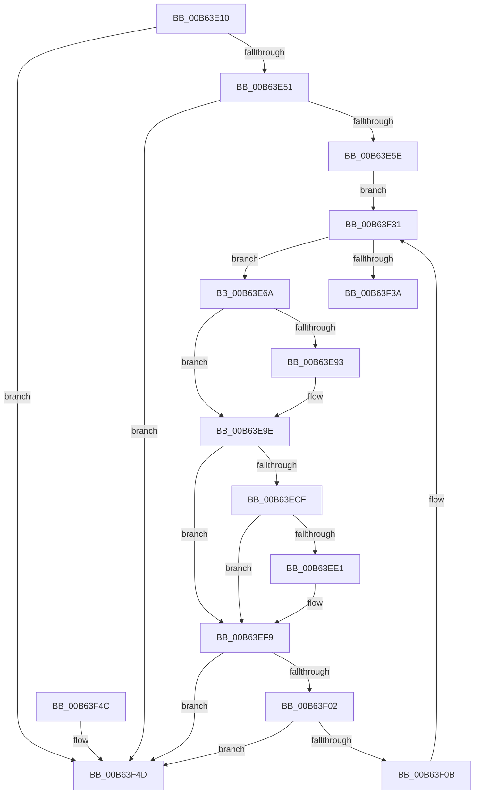

# IopShutdownBaseFileSystems

- RVA: `0x00B63E10`–`0x00B63F54` (길이 `324` bytes)
- VA: `0x0000000140B63E10`
- 실행 섹션: `PAGELK`
- PDB 이름 있음: `예`; PDB Function 태그: `아니요`
- unwind 정보 RVA: `0x000C75F0`
- 디코드: `88`개 명령, `324/324` bytes 표시
- 미해석 바이트: `0` (있으면 어셈블리에 `.byte`로 보존)

> 이 문서는 커널 이미지의 기계어와 PDB 기호를 분석해 생성했습니다. 4번과 5번은 함수 원형과 자료형을 바이너리 사용 방식에서 추정한 C 해석이며 원본 소스 복구 결과는 아닙니다.

## 1. Dependencies

- 직접 호출 지점: **10**; 고유 호출 대상: **10**
- 직접 호출자로 확인된 함수: **1**
- RIP 상대 이미지 참조: **0**

### Outgoing calls
- `0x00B63E3F` → [KeInitializeEvent](../../text/40/KeInitializeEvent_function_0040DD10.md) (function, `0x0040DD10`)
- `0x00B63E7A` → [ObfReferenceObject](../../text/20/ObfReferenceObject_function_0020FA20.md) (function, `0x0020FA20`)
- `0x00B63E84` → [IopIncrementDeviceObjectRefCount](../../text/41/IopIncrementDeviceObjectRefCount_function_0041B1D0.md) (function, `0x0041B1D0`)
- `0x00B63E96` → [IoGetAttachedDevice](../../text/41/IoGetAttachedDevice_function_00410810.md) (function, `0x00410810`)
- `0x00B63EC5` → [IoBuildSynchronousFsdRequest](../../page/A4/IoBuildSynchronousFsdRequest_function_00A49880.md) (function, `0x00A49880`)
- `0x00B63ED5` → [IofCallDriver](../../text/29/IofCallDriver_function_0029B4B0.md) (function, `0x0029B4B0`)
- `0x00B63EF4` → [KeWaitForSingleObject](../../text/20/KeWaitForSingleObject_function_0020E6B0.md) (function, `0x0020E6B0`)
- `0x00B63F17` → [KeResetEvent](../../text/24/KeResetEvent_function_00248350.md) (function, `0x00248350`)
- `0x00B63F24` → [IopDecrementDeviceObjectRef](../../text/27/IopDecrementDeviceObjectRef_function_00270970.md) (function, `0x00270970`)
- `0x00B63F2C` → [ObfDereferenceObject](../../text/2F/ObfDereferenceObject_function_002F9350.md) (function, `0x002F9350`)

### Direct callers
- [IoShutdownSystem](IoShutdownSystem_function_00B63B8C.md) at `0x00B63D32`
- [IoShutdownSystem](IoShutdownSystem_function_00B63B8C.md) at `0x00B63D3E`
- [IoShutdownSystem](IoShutdownSystem_function_00B63B8C.md) at `0x00B63D4A`

### Static image references
- 디코드된 RIP-relative 메모리 참조가 없습니다.

## 2. Other-region calls and transfers

- 다른 실행 섹션으로 향하는 call: **10**
  - `0x00B63E3F` → [KeInitializeEvent](../../text/40/KeInitializeEvent_function_0040DD10.md) (`PAGELK` → `.text`)
  - `0x00B63E7A` → [ObfReferenceObject](../../text/20/ObfReferenceObject_function_0020FA20.md) (`PAGELK` → `.text`)
  - `0x00B63E84` → [IopIncrementDeviceObjectRefCount](../../text/41/IopIncrementDeviceObjectRefCount_function_0041B1D0.md) (`PAGELK` → `.text`)
  - `0x00B63E96` → [IoGetAttachedDevice](../../text/41/IoGetAttachedDevice_function_00410810.md) (`PAGELK` → `.text`)
  - `0x00B63EC5` → [IoBuildSynchronousFsdRequest](../../page/A4/IoBuildSynchronousFsdRequest_function_00A49880.md) (`PAGELK` → `PAGE`)
  - `0x00B63ED5` → [IofCallDriver](../../text/29/IofCallDriver_function_0029B4B0.md) (`PAGELK` → `.text`)
  - `0x00B63EF4` → [KeWaitForSingleObject](../../text/20/KeWaitForSingleObject_function_0020E6B0.md) (`PAGELK` → `.text`)
  - `0x00B63F17` → [KeResetEvent](../../text/24/KeResetEvent_function_00248350.md) (`PAGELK` → `.text`)
  - `0x00B63F24` → [IopDecrementDeviceObjectRef](../../text/27/IopDecrementDeviceObjectRef_function_00270970.md) (`PAGELK` → `.text`)
  - `0x00B63F2C` → [ObfDereferenceObject](../../text/2F/ObfDereferenceObject_function_002F9350.md) (`PAGELK` → `.text`)
- 별도 외부 분기/꼬리 이동을 확인하지 못했습니다.

## 3. Assembly (complete function range)

```asm
00B63E10  4C 8B DC                        mov r11, rsp
00B63E13  49 89 5B 08                     mov qword ptr [r11 + 8], rbx
00B63E17  49 89 73 10                     mov qword ptr [r11 + 0x10], rsi
00B63E1B  57                              push rdi
00B63E1C  48 83 EC 70                     sub rsp, 0x70
00B63E20  0F 57 C0                        xorps xmm0, xmm0
00B63E23  48 8B F9                        mov rdi, rcx
00B63E26  33 C0                           xor eax, eax
00B63E28  49 8D 4B D8                     lea rcx, [r11 - 0x28]
00B63E2C  0F 11 44 24 50                  movups xmmword ptr [rsp + 0x50], xmm0
00B63E31  45 33 C0                        xor r8d, r8d
00B63E34  49 89 43 E8                     mov qword ptr [r11 - 0x18], rax
00B63E38  33 D2                           xor edx, edx
00B63E3A  0F 11 44 24 40                  movups xmmword ptr [rsp + 0x40], xmm0
00B63E3F  E8 CC 9E 8A FF                  call 0x14040dd10
00B63E44  48 8B 1F                        mov rbx, qword ptr [rdi]
00B63E47  48 39 7B 08                     cmp qword ptr [rbx + 8], rdi
00B63E4B  0F 85 FC 00 00 00               jne 0x140b63f4d
00B63E51  48 8B 03                        mov rax, qword ptr [rbx]
00B63E54  48 39 58 08                     cmp qword ptr [rax + 8], rbx
00B63E58  0F 85 EF 00 00 00               jne 0x140b63f4d
00B63E5E  48 89 07                        mov qword ptr [rdi], rax
00B63E61  48 89 78 08                     mov qword ptr [rax + 8], rdi
00B63E65  E9 C7 00 00 00                  jmp 0x140b63f31
00B63E6A  48 83 23 00                     and qword ptr [rbx], 0
00B63E6E  48 8D 73 B0                     lea rsi, [rbx - 0x50]
00B63E72  48 83 66 58 00                  and qword ptr [rsi + 0x58], 0
00B63E77  48 8B CE                        mov rcx, rsi
00B63E7A  E8 A1 BB 6A FF                  call 0x14020fa20
00B63E7F  B2 01                           mov dl, 1
00B63E81  48 8B CE                        mov rcx, rsi
00B63E84  E8 47 73 8B FF                  call 0x14041b1d0
00B63E89  48 83 7E 18 00                  cmp qword ptr [rsi + 0x18], 0
00B63E8E  48 8B DE                        mov rbx, rsi
00B63E91  74 0B                           je 0x140b63e9e
00B63E93  48 8B CE                        mov rcx, rsi
00B63E96  E8 75 C9 8A FF                  call 0x140410810
00B63E9B  48 8B D8                        mov rbx, rax
00B63E9E  48 8D 44 24 40                  lea rax, [rsp + 0x40]
00B63EA3  45 33 C9                        xor r9d, r9d
00B63EA6  48 89 44 24 30                  mov qword ptr [rsp + 0x30], rax
00B63EAB  45 33 C0                        xor r8d, r8d
00B63EAE  48 8D 44 24 50                  lea rax, [rsp + 0x50]
00B63EB3  48 8B D3                        mov rdx, rbx
00B63EB6  48 89 44 24 28                  mov qword ptr [rsp + 0x28], rax
00B63EBB  48 83 64 24 20 00               and qword ptr [rsp + 0x20], 0
00B63EC1  41 8D 49 10                     lea ecx, [r9 + 0x10]
00B63EC5  E8 B6 59 EE FF                  call 0x140a49880
00B63ECA  48 85 C0                        test rax, rax
00B63ECD  74 2A                           je 0x140b63ef9
00B63ECF  48 8B D0                        mov rdx, rax
00B63ED2  48 8B CB                        mov rcx, rbx
00B63ED5  E8 D6 75 73 FF                  call 0x14029b4b0
00B63EDA  3D 03 01 00 00                  cmp eax, 0x103
00B63EDF  75 18                           jne 0x140b63ef9
00B63EE1  48 83 64 24 20 00               and qword ptr [rsp + 0x20], 0
00B63EE7  48 8D 4C 24 50                  lea rcx, [rsp + 0x50]
00B63EEC  45 33 C9                        xor r9d, r9d
00B63EEF  45 33 C0                        xor r8d, r8d
00B63EF2  33 D2                           xor edx, edx
00B63EF4  E8 B7 A7 6A FF                  call 0x14020e6b0
00B63EF9  48 8B 1F                        mov rbx, qword ptr [rdi]
00B63EFC  48 39 7B 08                     cmp qword ptr [rbx + 8], rdi
00B63F00  75 4B                           jne 0x140b63f4d
00B63F02  48 8B 03                        mov rax, qword ptr [rbx]
00B63F05  48 39 58 08                     cmp qword ptr [rax + 8], rbx
00B63F09  75 42                           jne 0x140b63f4d
00B63F0B  48 89 07                        mov qword ptr [rdi], rax
00B63F0E  48 8D 4C 24 50                  lea rcx, [rsp + 0x50]
00B63F13  48 89 78 08                     mov qword ptr [rax + 8], rdi
00B63F17  E8 34 44 6E FF                  call 0x140248350
00B63F1C  41 B0 01                        mov r8b, 1
00B63F1F  33 D2                           xor edx, edx
00B63F21  48 8B CE                        mov rcx, rsi
00B63F24  E8 47 CA 70 FF                  call 0x140270970
00B63F29  48 8B CE                        mov rcx, rsi
00B63F2C  E8 1F 54 79 FF                  call 0x1402f9350
00B63F31  48 3B DF                        cmp rbx, rdi
00B63F34  0F 85 30 FF FF FF               jne 0x140b63e6a
00B63F3A  4C 8D 5C 24 70                  lea r11, [rsp + 0x70]
00B63F3F  49 8B 5B 10                     mov rbx, qword ptr [r11 + 0x10]
00B63F43  49 8B 73 18                     mov rsi, qword ptr [r11 + 0x18]
00B63F47  49 8B E3                        mov rsp, r11
00B63F4A  5F                              pop rdi
00B63F4B  C3                              ret
00B63F4C  CC                              int3
00B63F4D  B9 03 00 00 00                  mov ecx, 3
00B63F52  CD 29                           int 0x29
```

## 4. C-style interpretation (structured pseudocode)

```c
__int64 __fastcall IopShutdownBaseFileSystems(__int64 a1, int a2, int a3, int a4)
{
    __int64 result;
    __int64 v_rbx;
    __int64 v_rsp;
    unsigned __int64 v_stack_m28;
    unsigned __int64 v_stack_m38;
    unsigned __int64 v_stack_m48;
    unsigned __int64 v_stack_m50;
    unsigned __int64 v_stack_m58;
    unsigned __int64 v_stack_m8;

    *(unsigned __int64 *)(v_rsp + 8) = v_rbx;
    *(unsigned __int64 *)(v_rsp + 16) = v_rsi;
    v_rsp = (v_rsp) - (112);
    result = 0;
    v_stack_m28 = v_xmm0;
    a3 = 0;
    *(unsigned __int64 *)(v_rsp - 24) = 0;
    a2 = 0;
    v_stack_m38 = v_xmm0;
    result = KeInitializeEvent(v_rsp - 40, a2, a3, a4);
    if ((*(unsigned __int64 *)(*(unsigned __int64 *)(a1) + 8)) != a1) goto loc_00B63F4D;
    if ((*(unsigned __int64 *)(*(unsigned __int64 *)(*(unsigned __int64 *)(a1)) + 8)) != (*(unsigned __int64 *)(a1))) goto loc_00B63F4D;
    *(unsigned __int64 *)(a1) = *(unsigned __int64 *)(*(unsigned __int64 *)(a1));
    *(unsigned __int64 *)(*(unsigned __int64 *)(*(unsigned __int64 *)(a1)) + 8) = a1;
    goto loc_00B63F31;
loc_00B63E6A:
    result = ObfReferenceObject(*(unsigned __int64 *)(a1) - 80, a2, a3, a4);
    result = IopIncrementDeviceObjectRefCount(*(unsigned __int64 *)(a1) - 80, 1, a3, a4);
    v_rbx = *(unsigned __int64 *)(a1) - 80;
    if ((*(unsigned __int64 *)(*(unsigned __int64 *)(a1) - 80 + 24)) != 0) {
        a1 = *(unsigned __int64 *)(a1) - 80;
        result = IoGetAttachedDevice(a1, 1, a3, a4);
        v_rbx = result;
    }
    a4 = 0;
    v_stack_m48 = v_stack_m38;
    a3 = 0;
    v_stack_m50 = v_stack_m28;
    result = IoBuildSynchronousFsdRequest(a4 + 16, v_rbx, a3, a4);
    if (result == 0) goto loc_00B63EF9;
    result = IofCallDriver(v_rbx, result, a3, a4);
    if (((unsigned int)(result)) == 259) {
        a1 = v_stack_m28;
        a4 = 0;
        a3 = 0;
        a2 = 0;
        result = KeWaitForSingleObject(a1, a2, a3, a4);
    }
    if ((*(unsigned __int64 *)(*(unsigned __int64 *)(a1) + 8)) != a1) goto loc_00B63F4D;
    if ((*(unsigned __int64 *)(*(unsigned __int64 *)(*(unsigned __int64 *)(a1)) + 8)) != (*(unsigned __int64 *)(a1))) goto loc_00B63F4D;
    *(unsigned __int64 *)(a1) = *(unsigned __int64 *)(*(unsigned __int64 *)(a1));
    *(unsigned __int64 *)(*(unsigned __int64 *)(*(unsigned __int64 *)(a1)) + 8) = a1;
    result = KeResetEvent(v_stack_m28, a2, a3, a4);
    a2 = 0;
    result = IopDecrementDeviceObjectRef(*(unsigned __int64 *)(a1) - 80, a2, 1, a4);
    result = ObfDereferenceObject(*(unsigned __int64 *)(a1) - 80, a2, 1, a4);
loc_00B63F31:
    if ((*(unsigned __int64 *)(a1)) != a1) goto loc_00B63E6A;
    return result;
loc_00B63F4D:
    return result;
}
```

## 5. (Beta) C Style

```c
int64_t IopShutdownBaseFileSystems(void *Arg1, int32_t Arg2, int32_t Arg3, int32_t Arg4)
{
    uint8_t *arg1 = (uint8_t *)Arg1;

    int64_t result;
    int64_t local_rbx;
    int64_t local_rsp;
    uint64_t v_stack_m28;
    uint64_t v_stack_m38;
    uint64_t v_stack_m48;
    uint64_t v_stack_m50;
    uint64_t v_stack_m58;
    uint64_t v_stack_m8;

    *(uint64_t *)(local_rsp + 0x8) = local_rbx;
    *(uint64_t *)(local_rsp + 0x10) = local_rsi;
    local_rsp = (local_rsp) - (112);
    result = 0;
    v_stack_m28 = v_xmm0;
    Arg3 = 0;
    *(uint64_t *)(local_rsp - 0x18) = 0;
    Arg2 = 0;
    v_stack_m38 = v_xmm0;
    result = KeInitializeEvent(local_rsp - 40, Arg2, Arg3, Arg4);
    if ((*(uint64_t *)(*(uint64_t *)(arg1) + 0x8)) != Arg1) goto loc_00B63F4D;
    if ((*(uint64_t *)(*(uint64_t *)(*(uint64_t *)(arg1)) + 0x8)) != (*(uint64_t *)(arg1))) goto loc_00B63F4D;
    *(uint64_t *)(arg1) = *(uint64_t *)(*(uint64_t *)(arg1));
    *(void **)(*(uint64_t *)(*(uint64_t *)(arg1)) + 0x8) = Arg1;
    goto loc_00B63F31;
loc_00B63E6A:
    result = ObfReferenceObject(*(uint64_t *)(arg1) - 80, Arg2, Arg3, Arg4);
    result = IopIncrementDeviceObjectRefCount(*(uint64_t *)(arg1) - 80, 1, Arg3, Arg4);
    local_rbx = *(uint64_t *)(arg1) - 80;
    if ((*(uint64_t *)(*(uint64_t *)(arg1) - 0x50 + 0x18)) != 0) {
        Arg1 = *(uint64_t *)(arg1) - 80;
        result = IoGetAttachedDevice(Arg1, 1, Arg3, Arg4);
        local_rbx = result;
    }
    Arg4 = 0;
    v_stack_m48 = v_stack_m38;
    Arg3 = 0;
    v_stack_m50 = v_stack_m28;
    result = IoBuildSynchronousFsdRequest(Arg4 + 16, local_rbx, Arg3, Arg4);
    if (result == 0) goto loc_00B63EF9;
    result = IofCallDriver(local_rbx, result, Arg3, Arg4);
    if (((uint32_t)(result)) == 259) {
        Arg1 = v_stack_m28;
        Arg4 = 0;
        Arg3 = 0;
        Arg2 = 0;
        result = KeWaitForSingleObject(Arg1, Arg2, Arg3, Arg4);
    }
    if ((*(uint64_t *)(*(uint64_t *)(arg1) + 0x8)) != Arg1) goto loc_00B63F4D;
    if ((*(uint64_t *)(*(uint64_t *)(*(uint64_t *)(arg1)) + 0x8)) != (*(uint64_t *)(arg1))) goto loc_00B63F4D;
    *(uint64_t *)(arg1) = *(uint64_t *)(*(uint64_t *)(arg1));
    *(void **)(*(uint64_t *)(*(uint64_t *)(arg1)) + 0x8) = Arg1;
    result = KeResetEvent(v_stack_m28, Arg2, Arg3, Arg4);
    Arg2 = 0;
    result = IopDecrementDeviceObjectRef(*(uint64_t *)(arg1) - 80, Arg2, 1, Arg4);
    result = ObfDereferenceObject(*(uint64_t *)(arg1) - 80, Arg2, 1, Arg4);
loc_00B63F31:
    if ((*(uint64_t *)(arg1)) != Arg1) goto loc_00B63E6A;
    return result;
loc_00B63F4D:
    return result;
}
```

### 관측된 메모리 오프셋

구조체 형식이 확인되지 않은 접근은 인자 기준의 오프셋으로만 기록했습니다.

| 기준 인자 | 오프셋 표현 | 폭 (bit) | 접근 |
|---|---:|---:|---|
| `Arg1` | `+ 0x0` | `64` | `R` |
| `Arg1` | `+ 0x0` | `64` | `W` |

## 6. Execution-region graph

[열기: 2D/3D 그래프와 함수 탐색 컨트롤 패널](../../../control-panel.html?section=pagelk&rva=0x00B63E10&view=graph)

- 2D 그래프는 위에서 아래로 흐르고, 3D 그래프는 빈 공간을 드래그해 회전합니다. Shift+드래그는 이동, 휠은 확대·축소, 함수 노드 선택은 대상 보고서 이동입니다.

### Static fallback


