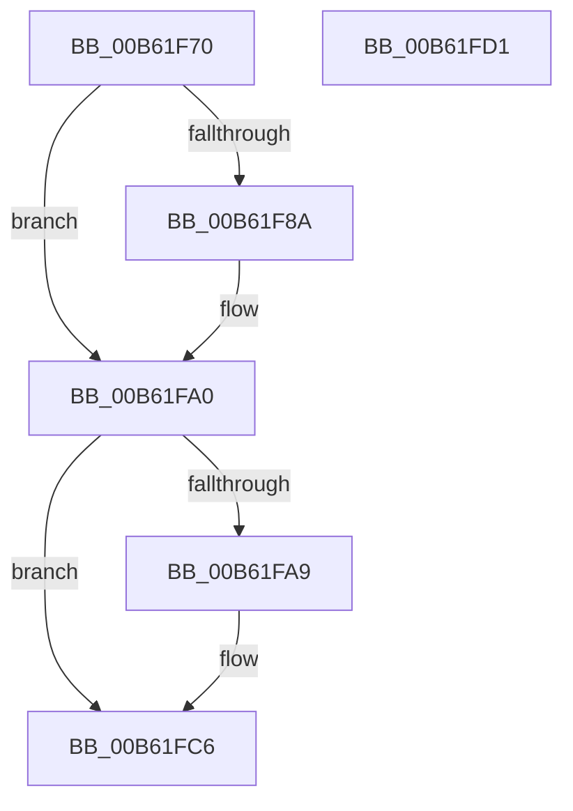

# IvtEnableInterrupt

- RVA: `0x00B61F70`–`0x00B61FD2` (길이 `98` bytes)
- VA: `0x0000000140B61F70`
- 실행 섹션: `PAGELK`
- PDB 이름 있음: `예`; PDB Function 태그: `아니요`
- unwind 정보 RVA: `0x0005CAAC`
- 디코드: `27`개 명령, `98/98` bytes 표시
- 미해석 바이트: `0` (있으면 어셈블리에 `.byte`로 보존)

> 이 문서는 커널 이미지의 기계어와 PDB 기호를 분석해 생성했습니다. 4번과 5번은 함수 원형과 자료형을 바이너리 사용 방식에서 추정한 C 해석이며 원본 소스 복구 결과는 아닙니다.

## 1. Dependencies

- 직접 호출 지점: **2**; 고유 호출 대상: **1**
- 직접 호출자로 확인된 함수: **0**
- RIP 상대 이미지 참조: **0**

### Outgoing calls
- `0x00B61FA9` → [IvtClearPendingFaults](../../text/56/IvtClearPendingFaults_function_0056F14C.md) (function, `0x0056F14C`)
- `0x00B61FC1` → [IvtClearPendingFaults](../../text/56/IvtClearPendingFaults_function_0056F14C.md) (function, `0x0056F14C`)

### Direct callers
- 이 함수 시작 RVA로 연결되는 직접 call은 확인되지 않았습니다. 간접 호출은 완전히 역산할 수 없습니다.

### Static image references
- 디코드된 RIP-relative 메모리 참조가 없습니다.

## 2. Other-region calls and transfers

- 다른 실행 섹션으로 향하는 call: **2**
  - `0x00B61FA9` → [IvtClearPendingFaults](../../text/56/IvtClearPendingFaults_function_0056F14C.md) (`PAGELK` → `.text`)
  - `0x00B61FC1` → [IvtClearPendingFaults](../../text/56/IvtClearPendingFaults_function_0056F14C.md) (`PAGELK` → `.text`)
- 별도 외부 분기/꼬리 이동을 확인하지 못했습니다.

## 3. Assembly (complete function range)

```asm
00B61F70  48 89 5C 24 08                  mov qword ptr [rsp + 8], rbx
00B61F75  57                              push rdi
00B61F76  48 83 EC 20                     sub rsp, 0x20
00B61F7A  80 B9 3C 01 00 00 00            cmp byte ptr [rcx + 0x13c], 0
00B61F81  48 8B D9                        mov rbx, rcx
00B61F84  48 8B 79 08                     mov rdi, qword ptr [rcx + 8]
00B61F88  74 16                           je 0x140b61fa0
00B61F8A  90                              nop
00B61F8B  8B 87 E0 00 00 00               mov eax, dword ptr [rdi + 0xe0]
00B61F91  0F BA F0 1F                     btr eax, 0x1f
00B61F95  89 87 E0 00 00 00               mov dword ptr [rdi + 0xe0], eax
00B61F9B  F0 83 0C 24 00                  lock or dword ptr [rsp], 0
00B61FA0  80 B9 3E 01 00 00 00            cmp byte ptr [rcx + 0x13e], 0
00B61FA7  74 1D                           je 0x140b61fc6
00B61FA9  E8 9E D1 A0 FF                  call 0x14056f14c
00B61FAE  90                              nop
00B61FAF  8B 47 38                        mov eax, dword ptr [rdi + 0x38]
00B61FB2  0F BA F0 1F                     btr eax, 0x1f
00B61FB6  89 47 38                        mov dword ptr [rdi + 0x38], eax
00B61FB9  F0 83 0C 24 00                  lock or dword ptr [rsp], 0
00B61FBE  48 8B CB                        mov rcx, rbx
00B61FC1  E8 86 D1 A0 FF                  call 0x14056f14c
00B61FC6  48 8B 5C 24 30                  mov rbx, qword ptr [rsp + 0x30]
00B61FCB  48 83 C4 20                     add rsp, 0x20
00B61FCF  5F                              pop rdi
00B61FD0  C3                              ret
00B61FD1  CC                              int3
```

## 4. C-style interpretation (structured pseudocode)

```c
__int64 __fastcall IvtEnableInterrupt(__int64 a1)
{
    __int64 result;
    __int64 v_rsp;
    unsigned int v_stack_m28;
    unsigned __int64 v_stack_p8;

    v_stack_p8 = v_rbx;
    v_rsp = (v_rsp) - (32);
    if ((*(unsigned __int8 *)(a1 + 316)) != 0) {
        result = *(unsigned int *)(*(unsigned __int64 *)(a1 + 8) + 224);
        *(unsigned int *)(*(unsigned __int64 *)(a1 + 8) + 224) = (unsigned int)(result);
    }
    if ((*(unsigned __int8 *)(a1 + 318)) != 0) {
        result = IvtClearPendingFaults(a1, a2, a3, a4);
        result = *(unsigned int *)(*(unsigned __int64 *)(a1 + 8) + 56);
        *(unsigned int *)(*(unsigned __int64 *)(a1 + 8) + 56) = (unsigned int)(result);
        a1 = a1;
        result = IvtClearPendingFaults(a1, a2, a3, a4);
    }
    v_rsp = (v_rsp) + (32);
    return result;
}
```

## 5. (Beta) C Style

```c
int64_t IvtEnableInterrupt(void *Arg1)
{
    uint8_t *arg1 = (uint8_t *)Arg1;

    int64_t result;
    int64_t local_rsp;
    uint32_t v_stack_m28;
    uint64_t v_stack_p8;

    v_stack_p8 = local_rbx;
    local_rsp = (local_rsp) - (32);
    if ((*(uint8_t *)(arg1 + 0x13C)) != 0) {
        result = *(uint32_t *)(*(uint64_t *)(arg1 + 0x8) + 0xE0);
        *(uint32_t *)(*(uint64_t *)(arg1 + 0x8) + 0xE0) = (uint32_t)(result);
    }
    if ((*(uint8_t *)(arg1 + 0x13E)) != 0) {
        result = IvtClearPendingFaults(Arg1, a2, a3, a4);
        result = *(uint32_t *)(*(uint64_t *)(arg1 + 0x8) + 0x38);
        *(uint32_t *)(*(uint64_t *)(arg1 + 0x8) + 0x38) = (uint32_t)(result);
        Arg1 = Arg1;
        result = IvtClearPendingFaults(Arg1, a2, a3, a4);
    }
    local_rsp = (local_rsp) + (32);
    return result;
}
```

### 관측된 메모리 오프셋

구조체 형식이 확인되지 않은 접근은 인자 기준의 오프셋으로만 기록했습니다.

| 기준 인자 | 오프셋 표현 | 폭 (bit) | 접근 |
|---|---:|---:|---|
| `Arg1` | `+ 0x8` | `64` | `R` |
| `Arg1` | `+ 0x13C` | `8` | `R` |
| `Arg1` | `+ 0x13E` | `8` | `R` |

## 6. Execution-region graph

[열기: 2D/3D 그래프와 함수 탐색 컨트롤 패널](../../../control-panel.html?section=pagelk&rva=0x00B61F70&view=graph)

- 2D 그래프는 위에서 아래로 흐르고, 3D 그래프는 빈 공간을 드래그해 회전합니다. Shift+드래그는 이동, 휠은 확대·축소, 함수 노드 선택은 대상 보고서 이동입니다.

### Static fallback


