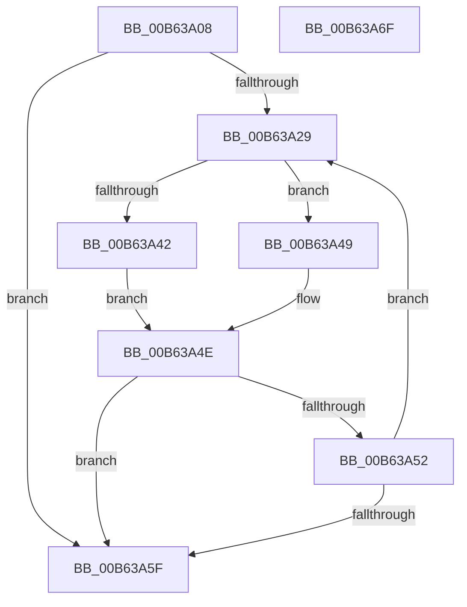

# IvtInitializeReservedDomains

- RVA: `0x00B63A08`–`0x00B63A70` (길이 `104` bytes)
- VA: `0x0000000140B63A08`
- 실행 섹션: `PAGELK`
- PDB 이름 있음: `예`; PDB Function 태그: `아니요`
- unwind 정보 RVA: `0x00060BC4`
- 디코드: `33`개 명령, `104/104` bytes 표시
- 미해석 바이트: `0` (있으면 어셈블리에 `.byte`로 보존)

> 이 문서는 커널 이미지의 기계어와 PDB 기호를 분석해 생성했습니다. 4번과 5번은 함수 원형과 자료형을 바이너리 사용 방식에서 추정한 C 해석이며 원본 소스 복구 결과는 아닙니다.

## 1. Dependencies

- 직접 호출 지점: **3**; 고유 호출 대상: **3**
- 직접 호출자로 확인된 함수: **2**
- RIP 상대 이미지 참조: **0**

### Outgoing calls
- `0x00B63A32` → [Feature_Test57481295__private_IsEnabledDeviceUsageNoInline](../../text/4F/Feature_Test57481295__private_IsEnabledDeviceUsageNoInline_function_004F7B90.md) (function, `0x004F7B90`)
- `0x00B63A42` → [HalpIvtpLegacyInitializeReservedDomain](HalpIvtpLegacyInitializeReservedDomain_function_00B63924.md) (function, `0x00B63924`)
- `0x00B63A49` → [HalpIvtpInitializeReservedDomain](HalpIvtpInitializeReservedDomain_function_00B63838.md) (function, `0x00B63838`)

### Direct callers
- [IvtLegacyProcessDeviceExceptions](IvtLegacyProcessDeviceExceptions_function_00B62944.md) at `0x00B6297B`
- [IvtProcessDeviceExceptions](IvtProcessDeviceExceptions_function_00B62C34.md) at `0x00B62C6E`

### Static image references
- 디코드된 RIP-relative 메모리 참조가 없습니다.

## 2. Other-region calls and transfers

- 다른 실행 섹션으로 향하는 call: **1**
  - `0x00B63A32` → [Feature_Test57481295__private_IsEnabledDeviceUsageNoInline](../../text/4F/Feature_Test57481295__private_IsEnabledDeviceUsageNoInline_function_004F7B90.md) (`PAGELK` → `.text`)
- 별도 외부 분기/꼬리 이동을 확인하지 못했습니다.

## 3. Assembly (complete function range)

```asm
00B63A08  48 89 5C 24 08                  mov qword ptr [rsp + 8], rbx
00B63A0D  48 89 74 24 10                  mov qword ptr [rsp + 0x10], rsi
00B63A12  57                              push rdi
00B63A13  48 83 EC 20                     sub rsp, 0x20
00B63A17  48 8B 91 60 01 00 00            mov rdx, qword ptr [rcx + 0x160]
00B63A1E  33 C0                           xor eax, eax
00B63A20  33 DB                           xor ebx, ebx
00B63A22  48 8B F9                        mov rdi, rcx
00B63A25  39 02                           cmp dword ptr [rdx], eax
00B63A27  76 36                           jbe 0x140b63a5f
00B63A29  8B F3                           mov esi, ebx
00B63A2B  48 C1 E6 04                     shl rsi, 4
00B63A2F  48 03 F2                        add rsi, rdx
00B63A32  E8 59 41 99 FF                  call 0x1404f7b90
00B63A37  48 8D 56 08                     lea rdx, [rsi + 8]
00B63A3B  48 8B CF                        mov rcx, rdi
00B63A3E  85 C0                           test eax, eax
00B63A40  75 07                           jne 0x140b63a49
00B63A42  E8 DD FE FF FF                  call 0x140b63924
00B63A47  EB 05                           jmp 0x140b63a4e
00B63A49  E8 EA FD FF FF                  call 0x140b63838
00B63A4E  85 C0                           test eax, eax
00B63A50  78 0D                           js 0x140b63a5f
00B63A52  48 8B 97 60 01 00 00            mov rdx, qword ptr [rdi + 0x160]
00B63A59  FF C3                           inc ebx
00B63A5B  3B 1A                           cmp ebx, dword ptr [rdx]
00B63A5D  72 CA                           jb 0x140b63a29
00B63A5F  48 8B 5C 24 30                  mov rbx, qword ptr [rsp + 0x30]
00B63A64  48 8B 74 24 38                  mov rsi, qword ptr [rsp + 0x38]
00B63A69  48 83 C4 20                     add rsp, 0x20
00B63A6D  5F                              pop rdi
00B63A6E  C3                              ret
00B63A6F  CC                              int3
```

## 4. C-style interpretation (structured pseudocode)

```c
__int64 __fastcall IvtInitializeReservedDomains(__int64 a1)
{
    __int64 result;
    __int64 v_rbx;
    __int64 v_rsi;
    __int64 v_rsp;
    unsigned __int64 v_stack_p10;
    unsigned __int64 v_stack_p8;

    v_stack_p8 = v_rbx;
    v_stack_p10 = v_rsi;
    v_rsp = (v_rsp) - (32);
    result = 0;
    v_rbx = 0;
    if ((*(unsigned int *)(*(unsigned __int64 *)(a1 + 352))) <= 0) goto loc_00B63A5F;
loc_00B63A29:
    v_rsi = (0) << (4);
    v_rsi = (v_rsi) + (*(unsigned __int64 *)(a1 + 352));
    result = Feature_Test57481295__private_IsEnabledDeviceUsageNoInline(a1, *(unsigned __int64 *)(a1 + 352), a3, a4);
    if ((unsigned int)(result) != 0) goto loc_00B63A49;
    result = HalpIvtpLegacyInitializeReservedDomain(a1, v_rsi + 8, a3, a4);
    goto loc_00B63A4E;
loc_00B63A49:
    result = HalpIvtpInitializeReservedDomain(a1, v_rsi + 8, a3, a4);
loc_00B63A4E:
    if (sign_flag) goto loc_00B63A5F;
    v_rbx = (unsigned int)((v_rbx) + 1);
    if (((unsigned int)(v_rbx)) < (*(unsigned int *)(*(unsigned __int64 *)(a1 + 352)))) goto loc_00B63A29;
loc_00B63A5F:
    v_rsp = (v_rsp) + (32);
    return result;
}
```

## 5. (Beta) C Style

```c
int64_t IvtInitializeReservedDomains(void *Arg1)
{
    uint8_t *arg1 = (uint8_t *)Arg1;

    int64_t result;
    int64_t local_rbx;
    int64_t local_rsi;
    int64_t local_rsp;
    uint64_t v_stack_p10;
    uint64_t v_stack_p8;

    v_stack_p8 = local_rbx;
    v_stack_p10 = local_rsi;
    local_rsp = (local_rsp) - (32);
    result = 0;
    local_rbx = 0;
    if ((*(uint32_t *)(*(uint64_t *)(arg1 + 0x160))) <= 0) goto loc_00B63A5F;
loc_00B63A29:
    local_rsi = (0) << (4);
    local_rsi = (local_rsi) + (*(uint64_t *)(arg1 + 0x160));
    result = Feature_Test57481295__private_IsEnabledDeviceUsageNoInline(Arg1, *(uint64_t *)(arg1 + 0x160), a3, a4);
    if ((uint32_t)(result) != 0) goto loc_00B63A49;
    result = HalpIvtpLegacyInitializeReservedDomain(Arg1, local_rsi + 8, a3, a4);
    goto loc_00B63A4E;
loc_00B63A49:
    result = HalpIvtpInitializeReservedDomain(Arg1, local_rsi + 8, a3, a4);
loc_00B63A4E:
    if (sign_flag) goto loc_00B63A5F;
    local_rbx = (uint32_t)((local_rbx) + 1);
    if (((uint32_t)(local_rbx)) < (*(uint32_t *)(*(uint64_t *)(arg1 + 0x160)))) goto loc_00B63A29;
loc_00B63A5F:
    local_rsp = (local_rsp) + (32);
    return result;
}
```

### 관측된 메모리 오프셋

구조체 형식이 확인되지 않은 접근은 인자 기준의 오프셋으로만 기록했습니다.

| 기준 인자 | 오프셋 표현 | 폭 (bit) | 접근 |
|---|---:|---:|---|
| `Arg1` | `+ 0x160` | `64` | `R` |

## 6. Execution-region graph

[열기: 2D/3D 그래프와 함수 탐색 컨트롤 패널](../../../control-panel.html?section=pagelk&rva=0x00B63A08&view=graph)

- 2D 그래프는 위에서 아래로 흐르고, 3D 그래프는 빈 공간을 드래그해 회전합니다. Shift+드래그는 이동, 휠은 확대·축소, 함수 노드 선택은 대상 보고서 이동입니다.

### Static fallback


