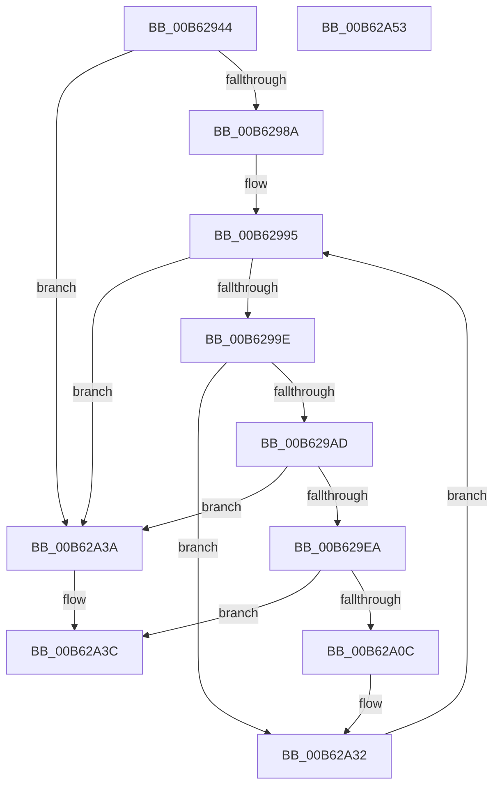

# IvtLegacyProcessDeviceExceptions

- RVA: `0x00B62944`–`0x00B62A54` (길이 `272` bytes)
- VA: `0x0000000140B62944`
- 실행 섹션: `PAGELK`
- PDB 이름 있음: `예`; PDB Function 태그: `아니요`
- unwind 정보 RVA: `0x000C53E8`
- 디코드: `75`개 명령, `272/272` bytes 표시
- 미해석 바이트: `0` (있으면 어셈블리에 `.byte`로 보존)

> 이 문서는 커널 이미지의 기계어와 PDB 기호를 분석해 생성했습니다. 4번과 5번은 함수 원형과 자료형을 바이너리 사용 방식에서 추정한 C 해석이며 원본 소스 복구 결과는 아닙니다.

## 1. Dependencies

- 직접 호출 지점: **7**; 고유 호출 대상: **6**
- 직접 호출자로 확인된 함수: **1**
- RIP 상대 이미지 참조: **0**

### Outgoing calls
- `0x00B62969` → [memset](../../text/6C/memset_function_006C6C40.md) (function, `0x006C6C40`)
- `0x00B6297B` → [IvtInitializeReservedDomains](IvtInitializeReservedDomains_function_00B63A08.md) (function, `0x00B63A08`)
- `0x00B6298A` → [HalpIommuGetExceptionList](../../text/55/HalpIommuGetExceptionList_function_00553878.md) (function, `0x00553878`)
- `0x00B629B7` → [memset](../../text/6C/memset_function_006C6C40.md) (function, `0x006C6C40`)
- `0x00B629DF` → [IvtAllocateDevice](../../text/57/IvtAllocateDevice_function_00579D24.md) (function, `0x00579D24`)
- `0x00B62A01` → [IvtLegacyAllocateTranslationStructures](../../text/57/IvtLegacyAllocateTranslationStructures_function_00570E28.md) (function, `0x00570E28`)
- `0x00B62A2D` → [IvtLegacyUpdateTranslationStructures](../../text/57/IvtLegacyUpdateTranslationStructures_function_0057247C.md) (function, `0x0057247C`)

### Direct callers
- [IvtInitializeIommu](IvtInitializeIommu_function_00B61FE0.md) at `0x00B62568`

### Static image references
- 디코드된 RIP-relative 메모리 참조가 없습니다.

## 2. Other-region calls and transfers

- 다른 실행 섹션으로 향하는 call: **6**
  - `0x00B62969` → [memset](../../text/6C/memset_function_006C6C40.md) (`PAGELK` → `.text`)
  - `0x00B6298A` → [HalpIommuGetExceptionList](../../text/55/HalpIommuGetExceptionList_function_00553878.md) (`PAGELK` → `.text`)
  - `0x00B629B7` → [memset](../../text/6C/memset_function_006C6C40.md) (`PAGELK` → `.text`)
  - `0x00B629DF` → [IvtAllocateDevice](../../text/57/IvtAllocateDevice_function_00579D24.md) (`PAGELK` → `.text`)
  - `0x00B62A01` → [IvtLegacyAllocateTranslationStructures](../../text/57/IvtLegacyAllocateTranslationStructures_function_00570E28.md) (`PAGELK` → `.text`)
  - `0x00B62A2D` → [IvtLegacyUpdateTranslationStructures](../../text/57/IvtLegacyUpdateTranslationStructures_function_0057247C.md) (`PAGELK` → `.text`)
- 별도 외부 분기/꼬리 이동을 확인하지 못했습니다.

## 3. Assembly (complete function range)

```asm
00B62944  48 89 5C 24 08                  mov qword ptr [rsp + 8], rbx
00B62949  55                              push rbp
00B6294A  56                              push rsi
00B6294B  57                              push rdi
00B6294C  41 56                           push r14
00B6294E  41 57                           push r15
00B62950  48 8D 6C 24 C9                  lea rbp, [rsp - 0x37]
00B62955  48 81 EC C0 00 00 00            sub rsp, 0xc0
00B6295C  33 D2                           xor edx, edx
00B6295E  48 8B F1                        mov rsi, rcx
00B62961  48 8D 4D C7                     lea rcx, [rbp - 0x39]
00B62965  44 8D 42 70                     lea r8d, [rdx + 0x70]
00B62969  E8 D2 42 B6 FF                  call 0x1406c6c40
00B6296E  48 83 65 6F 00                  and qword ptr [rbp + 0x6f], 0
00B62973  48 8B CE                        mov rcx, rsi
00B62976  48 83 65 77 00                  and qword ptr [rbp + 0x77], 0
00B6297B  E8 88 10 00 00                  call 0x140b63a08
00B62980  8B D8                           mov ebx, eax
00B62982  85 C0                           test eax, eax
00B62984  0F 88 B0 00 00 00               js 0x140b62a3a
00B6298A  E8 E9 0E 9F FF                  call 0x140553878
00B6298F  4C 8B F8                        mov r15, rax
00B62992  48 8B 38                        mov rdi, qword ptr [rax]
00B62995  49 3B FF                        cmp rdi, r15
00B62998  0F 84 9C 00 00 00               je 0x140b62a3a
00B6299E  8B 8E FC 00 00 00               mov ecx, dword ptr [rsi + 0xfc]
00B629A4  39 4F 10                        cmp dword ptr [rdi + 0x10], ecx
00B629A7  0F 85 85 00 00 00               jne 0x140b62a32
00B629AD  33 D2                           xor edx, edx
00B629AF  48 8D 4D CF                     lea rcx, [rbp - 0x31]
00B629B3  44 8D 42 68                     lea r8d, [rdx + 0x68]
00B629B7  E8 84 42 B6 FF                  call 0x1406c6c40
00B629BC  8B 4F 18                        mov ecx, dword ptr [rdi + 0x18]
00B629BF  48 8D 45 77                     lea rax, [rbp + 0x77]
00B629C3  83 65 CB 00                     and dword ptr [rbp - 0x35], 0
00B629C7  45 33 C0                        xor r8d, r8d
00B629CA  83 65 73 00                     and dword ptr [rbp + 0x73], 0
00B629CE  33 D2                           xor edx, edx
00B629D0  48 89 44 24 20                  mov qword ptr [rsp + 0x20], rax
00B629D5  C7 45 C7 01 00 00 00            mov dword ptr [rbp - 0x39], 1
00B629DC  89 4D 6F                        mov dword ptr [rbp + 0x6f], ecx
00B629DF  E8 40 73 A1 FF                  call 0x140579d24
00B629E4  8B D8                           mov ebx, eax
00B629E6  85 C0                           test eax, eax
00B629E8  78 50                           js 0x140b62a3a
00B629EA  4C 8B 75 77                     mov r14, qword ptr [rbp + 0x77]
00B629EE  45 33 C0                        xor r8d, r8d
00B629F1  48 83 64 24 28 00               and qword ptr [rsp + 0x28], 0
00B629F7  49 8B D6                        mov rdx, r14
00B629FA  48 8B CE                        mov rcx, rsi
00B629FD  4C 89 77 20                     mov qword ptr [rdi + 0x20], r14
00B62A01  E8 22 E4 A0 FF                  call 0x140570e28
00B62A06  8B D8                           mov ebx, eax
00B62A08  85 C0                           test eax, eax
00B62A0A  78 30                           js 0x140b62a3c
00B62A0C  4D 8B 4E 40                     mov r9, qword ptr [r14 + 0x40]
00B62A10  48 8D 45 C7                     lea rax, [rbp - 0x39]
00B62A14  C7 44 24 40 01 00 00 00         mov dword ptr [rsp + 0x40], 1
00B62A1C  48 8D 55 6F                     lea rdx, [rbp + 0x6f]
00B62A20  48 89 44 24 30                  mov qword ptr [rsp + 0x30], rax
00B62A25  48 8B CE                        mov rcx, rsi
00B62A28  83 64 24 20 00                  and dword ptr [rsp + 0x20], 0
00B62A2D  E8 4A FA A0 FF                  call 0x14057247c
00B62A32  48 8B 3F                        mov rdi, qword ptr [rdi]
00B62A35  E9 5B FF FF FF                  jmp 0x140b62995
00B62A3A  8B C3                           mov eax, ebx
00B62A3C  48 8B 9C 24 F0 00 00 00         mov rbx, qword ptr [rsp + 0xf0]
00B62A44  48 81 C4 C0 00 00 00            add rsp, 0xc0
00B62A4B  41 5F                           pop r15
00B62A4D  41 5E                           pop r14
00B62A4F  5F                              pop rdi
00B62A50  5E                              pop rsi
00B62A51  5D                              pop rbp
00B62A52  C3                              ret
00B62A53  CC                              int3
```

## 4. C-style interpretation (structured pseudocode)

```c
__int64 __fastcall IvtLegacyProcessDeviceExceptions(__int64 a1, int a2)
{
    __int64 result;
    __int64 v_rsp;
    unsigned __int64 v_stack_m5F;
    unsigned __int64 v_stack_m90;
    unsigned int v_stack_m94;
    unsigned __int64 v_stack_m98;
    unsigned int v_stack_mA8;
    unsigned __int64 v_stack_mB8;
    unsigned __int64 v_stack_mC0;
    unsigned __int64 v_stack_mC8;
    unsigned __int64 v_stack_p10;
    unsigned int v_stack_p14;
    unsigned __int64 v_stack_p18;
    unsigned __int64 v_stack_p8;

    v_stack_p8 = v_rbx;
    v_rsp = (v_rsp) - (192);
    a2 = 0;
    result = memset(v_stack_m98, a2, a2 + 112, a4);
    result = IvtInitializeReservedDomains(a1, a2, a2 + 112, a4);
    if (sign_flag) goto loc_00B62A3A;
    result = HalpIommuGetExceptionList(a1, a2, a2 + 112, a4);
loc_00B62995:
    if ((*(unsigned __int64 *)(result)) == result) goto loc_00B62A3A;
    if ((*(unsigned int *)(*(unsigned __int64 *)(result) + 16)) != ((unsigned int)((unsigned int)(*(unsigned int *)(a1 + 252))))) goto loc_00B62A32;
    a2 = 0;
    result = memset(v_stack_m90, a2, a2 + 104, a4);
    a3 = 0;
    a2 = 0;
    v_stack_mC8 = v_stack_p18;
    v_stack_m98 = 1;
    v_stack_p10 = (unsigned int)((unsigned int)(*(unsigned int *)(*(unsigned __int64 *)(result) + 24)));
    result = IvtAllocateDevice((unsigned int)(*(unsigned int *)(*(unsigned __int64 *)(result) + 24)), a2, a3, a4);
    if (sign_flag) goto loc_00B62A3A;
    a3 = 0;
    *(unsigned __int64 *)(*(unsigned __int64 *)(result) + 32) = v_stack_p18;
    result = IvtLegacyAllocateTranslationStructures(a1, v_stack_p18, a3, a4);
    if (sign_flag) goto loc_00B62A3C;
    v_stack_mA8 = 1;
    v_stack_mB8 = v_stack_m98;
    result = IvtLegacyUpdateTranslationStructures(a1, v_stack_p10, a3, *(unsigned __int64 *)(v_stack_p18 + 64));
loc_00B62A32:
    goto loc_00B62995;
loc_00B62A3A:
loc_00B62A3C:
    v_rsp = (v_rsp) + (192);
    return (unsigned int)((unsigned int)((unsigned int)((unsigned int)(result))));
}
```

## 5. (Beta) C Style

```c
int64_t IvtLegacyProcessDeviceExceptions(void *Arg1, int32_t Arg2)
{
    uint8_t *arg1 = (uint8_t *)Arg1;

    int64_t result;
    int64_t local_rsp;
    uint64_t v_stack_m5F;
    uint64_t v_stack_m90;
    uint32_t v_stack_m94;
    uint64_t v_stack_m98;
    uint32_t v_stack_mA8;
    uint64_t v_stack_mB8;
    uint64_t v_stack_mC0;
    uint64_t v_stack_mC8;
    uint64_t v_stack_p10;
    uint32_t v_stack_p14;
    uint64_t v_stack_p18;
    uint64_t v_stack_p8;

    v_stack_p8 = local_rbx;
    local_rsp = (local_rsp) - (192);
    Arg2 = 0;
    result = memset(v_stack_m98, Arg2, Arg2 + 112, a4);
    result = IvtInitializeReservedDomains(Arg1, Arg2, Arg2 + 112, a4);
    if (sign_flag) goto loc_00B62A3A;
    result = HalpIommuGetExceptionList(Arg1, Arg2, Arg2 + 112, a4);
loc_00B62995:
    if ((*(uint64_t *)(result)) == result) goto loc_00B62A3A;
    if ((*(uint32_t *)(*(uint64_t *)(result) + 0x10)) != ((uint32_t)((uint32_t)(*(uint32_t *)(arg1 + 0xFC))))) goto loc_00B62A32;
    Arg2 = 0;
    result = memset(v_stack_m90, Arg2, Arg2 + 104, a4);
    a3 = 0;
    Arg2 = 0;
    v_stack_mC8 = v_stack_p18;
    v_stack_m98 = 1;
    v_stack_p10 = (uint32_t)((uint32_t)(*(uint32_t *)(*(uint64_t *)(result) + 0x18)));
    result = IvtAllocateDevice((uint32_t)(*(uint32_t *)(*(uint64_t *)(result) + 0x18)), Arg2, a3, a4);
    if (sign_flag) goto loc_00B62A3A;
    a3 = 0;
    *(uint64_t *)(*(uint64_t *)(result) + 0x20) = v_stack_p18;
    result = IvtLegacyAllocateTranslationStructures(Arg1, v_stack_p18, a3, a4);
    if (sign_flag) goto loc_00B62A3C;
    v_stack_mA8 = 1;
    v_stack_mB8 = v_stack_m98;
    result = IvtLegacyUpdateTranslationStructures(Arg1, v_stack_p10, a3, *(uint64_t *)(v_stack_p18 + 0x40));
loc_00B62A32:
    goto loc_00B62995;
loc_00B62A3A:
loc_00B62A3C:
    local_rsp = (local_rsp) + (192);
    return (uint32_t)((uint32_t)((uint32_t)((uint32_t)(result))));
}
```

### 관측된 메모리 오프셋

구조체 형식이 확인되지 않은 접근은 인자 기준의 오프셋으로만 기록했습니다.

| 기준 인자 | 오프셋 표현 | 폭 (bit) | 접근 |
|---|---:|---:|---|
| `Arg1` | `+ 0xFC` | `32` | `R` |

## 6. Execution-region graph

[열기: 2D/3D 그래프와 함수 탐색 컨트롤 패널](../../../control-panel.html?section=pagelk&rva=0x00B62944&view=graph)

- 2D 그래프는 위에서 아래로 흐르고, 3D 그래프는 빈 공간을 드래그해 회전합니다. Shift+드래그는 이동, 휠은 확대·축소, 함수 노드 선택은 대상 보고서 이동입니다.

### Static fallback


