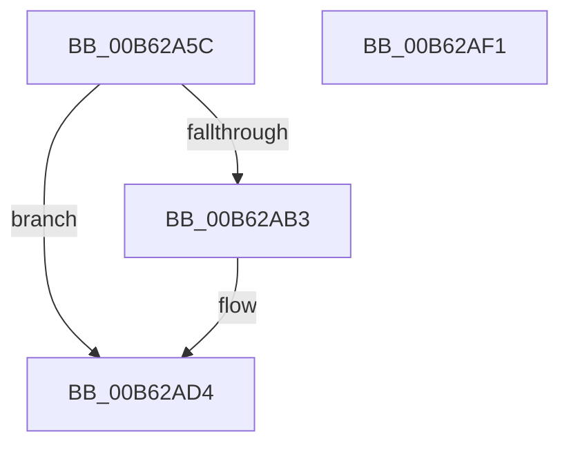

# IvtLegacySetupScalableModeDefaultPasidTables

- RVA: `0x00B62A5C`–`0x00B62AF2` (길이 `150` bytes)
- VA: `0x0000000140B62A5C`
- 실행 섹션: `PAGELK`
- PDB 이름 있음: `예`; PDB Function 태그: `아니요`
- unwind 정보 RVA: `0x00091ECC`
- 디코드: `40`개 명령, `150/150` bytes 표시
- 미해석 바이트: `0` (있으면 어셈블리에 `.byte`로 보존)

> 이 문서는 커널 이미지의 기계어와 PDB 기호를 분석해 생성했습니다. 4번과 5번은 함수 원형과 자료형을 바이너리 사용 방식에서 추정한 C 해석이며 원본 소스 복구 결과는 아닙니다.

## 1. Dependencies

- 직접 호출 지점: **2**; 고유 호출 대상: **2**
- 직접 호출자로 확인된 함수: **1**
- RIP 상대 이미지 참조: **0**

### Outgoing calls
- `0x00B62AA8` → [IvtLegacyAllocateScalableModePasidTables](../../text/57/IvtLegacyAllocateScalableModePasidTables_function_00570B20.md) (function, `0x00570B20`)
- `0x00B62ACB` → [IvtUpdateScalableModePasidTablesForPasid](../../text/4C/IvtUpdateScalableModePasidTablesForPasid_function_004CD628.md) (function, `0x004CD628`)

### Direct callers
- [IvtInitializeIommu](IvtInitializeIommu_function_00B61FE0.md) at `0x00B62391`

### Static image references
- 디코드된 RIP-relative 메모리 참조가 없습니다.

## 2. Other-region calls and transfers

- 다른 실행 섹션으로 향하는 call: **2**
  - `0x00B62AA8` → [IvtLegacyAllocateScalableModePasidTables](../../text/57/IvtLegacyAllocateScalableModePasidTables_function_00570B20.md) (`PAGELK` → `.text`)
  - `0x00B62ACB` → [IvtUpdateScalableModePasidTablesForPasid](../../text/4C/IvtUpdateScalableModePasidTablesForPasid_function_004CD628.md) (`PAGELK` → `.text`)
- 별도 외부 분기/꼬리 이동을 확인하지 못했습니다.

## 3. Assembly (complete function range)

```asm
00B62A5C  4C 8B DC                        mov r11, rsp
00B62A5F  49 89 5B 08                     mov qword ptr [r11 + 8], rbx
00B62A63  49 89 6B 10                     mov qword ptr [r11 + 0x10], rbp
00B62A67  49 89 73 18                     mov qword ptr [r11 + 0x18], rsi
00B62A6B  49 89 7B 20                     mov qword ptr [r11 + 0x20], rdi
00B62A6F  41 56                           push r14
00B62A71  48 83 EC 50                     sub rsp, 0x50
00B62A75  49 83 63 E0 00                  and qword ptr [r11 - 0x20], 0
00B62A7A  49 8D 43 E8                     lea rax, [r11 - 0x18]
00B62A7E  49 83 63 E8 00                  and qword ptr [r11 - 0x18], 0
00B62A83  49 8B E9                        mov rbp, r9
00B62A86  49 89 43 D8                     mov qword ptr [r11 - 0x28], rax
00B62A8A  44 8B F2                        mov r14d, edx
00B62A8D  C7 44 24 28 03 00 00 00         mov dword ptr [rsp + 0x28], 3
00B62A95  45 33 C9                        xor r9d, r9d
00B62A98  33 D2                           xor edx, edx
00B62A9A  C7 44 24 20 3F 00 00 00         mov dword ptr [rsp + 0x20], 0x3f
00B62AA2  49 8B D8                        mov rbx, r8
00B62AA5  48 8B F9                        mov rdi, rcx
00B62AA8  E8 73 E0 A0 FF                  call 0x140570b20
00B62AAD  8B F0                           mov esi, eax
00B62AAF  85 C0                           test eax, eax
00B62AB1  78 21                           js 0x140b62ad4
00B62AB3  48 89 6C 24 28                  mov qword ptr [rsp + 0x28], rbp
00B62AB8  45 8B CE                        mov r9d, r14d
00B62ABB  48 89 5C 24 20                  mov qword ptr [rsp + 0x20], rbx
00B62AC0  48 8B CF                        mov rcx, rdi
00B62AC3  48 8B 5C 24 40                  mov rbx, qword ptr [rsp + 0x40]
00B62AC8  48 8B D3                        mov rdx, rbx
00B62ACB  E8 58 AB 96 FF                  call 0x1404cd628
00B62AD0  48 89 5F 68                     mov qword ptr [rdi + 0x68], rbx
00B62AD4  48 8B 5C 24 60                  mov rbx, qword ptr [rsp + 0x60]
00B62AD9  8B C6                           mov eax, esi
00B62ADB  48 8B 74 24 70                  mov rsi, qword ptr [rsp + 0x70]
00B62AE0  48 8B 6C 24 68                  mov rbp, qword ptr [rsp + 0x68]
00B62AE5  48 8B 7C 24 78                  mov rdi, qword ptr [rsp + 0x78]
00B62AEA  48 83 C4 50                     add rsp, 0x50
00B62AEE  41 5E                           pop r14
00B62AF0  C3                              ret
00B62AF1  CC                              int3
```

## 4. C-style interpretation (structured pseudocode)

```c
__int64 __fastcall IvtLegacySetupScalableModeDefaultPasidTables(__int64 a1, int a2, __int64 a3, __int64 a4)
{
    __int64 result;
    __int64 v_rbx;
    __int64 v_rsp;
    unsigned __int64 v_stack_m18;
    unsigned int v_stack_m30;
    unsigned int v_stack_m38;
    unsigned __int64 v_stack_p10;
    unsigned __int64 v_stack_p18;
    unsigned __int64 v_stack_p20;
    unsigned __int64 v_stack_p8;

    *(unsigned __int64 *)(v_rsp + 8) = v_rbx;
    *(unsigned __int64 *)(v_rsp + 16) = v_rbp;
    *(unsigned __int64 *)(v_rsp + 24) = v_rsi;
    *(unsigned __int64 *)(v_rsp + 32) = v_rdi;
    v_rsp = (v_rsp) - (80);
    *(unsigned __int64 *)(v_rsp - 40) = v_rsp - 24;
    v_stack_m30 = 3;
    a4 = 0;
    a2 = 0;
    v_stack_m38 = 63;
    result = IvtLegacyAllocateScalableModePasidTables(a1, a2, a3, a4);
    v_rbx = a3;
    if (!(sign_flag)) {
        v_stack_m30 = 0;
        a4 = (unsigned int)((unsigned int)(a2));
        v_stack_m38 = a3;
        a1 = a1;
        v_rbx = v_stack_m18;
        a2 = v_rbx;
        result = IvtUpdateScalableModePasidTablesForPasid(a1, a2, a3, a4);
        *(unsigned __int64 *)(a1 + 104) = v_rbx;
    }
    v_rsp = (v_rsp) + (80);
    return (unsigned int)((unsigned int)((unsigned int)((unsigned int)(result))));
}
```

## 5. (Beta) C Style

```c
int64_t IvtLegacySetupScalableModeDefaultPasidTables(void *Arg1, int32_t Arg2, int64_t Arg3, int64_t Arg4)
{
    uint8_t *arg1 = (uint8_t *)Arg1;

    int64_t result;
    int64_t local_rbx;
    int64_t local_rsp;
    uint64_t v_stack_m18;
    uint32_t v_stack_m30;
    uint32_t v_stack_m38;
    uint64_t v_stack_p10;
    uint64_t v_stack_p18;
    uint64_t v_stack_p20;
    uint64_t v_stack_p8;

    *(uint64_t *)(local_rsp + 0x8) = local_rbx;
    *(uint64_t *)(local_rsp + 0x10) = local_rbp;
    *(uint64_t *)(local_rsp + 0x18) = local_rsi;
    *(uint64_t *)(local_rsp + 0x20) = local_rdi;
    local_rsp = (local_rsp) - (80);
    *(uint64_t *)(local_rsp - 0x28) = local_rsp - 24;
    v_stack_m30 = 3;
    Arg4 = 0;
    Arg2 = 0;
    v_stack_m38 = 63;
    result = IvtLegacyAllocateScalableModePasidTables(Arg1, Arg2, Arg3, Arg4);
    local_rbx = Arg3;
    if (!(sign_flag)) {
        v_stack_m30 = 0;
        Arg4 = (uint32_t)((uint32_t)(Arg2));
        v_stack_m38 = Arg3;
        Arg1 = Arg1;
        local_rbx = v_stack_m18;
        Arg2 = local_rbx;
        result = IvtUpdateScalableModePasidTablesForPasid(Arg1, Arg2, Arg3, Arg4);
        *(uint64_t *)(arg1 + 0x68) = local_rbx;
    }
    local_rsp = (local_rsp) + (80);
    return (uint32_t)((uint32_t)((uint32_t)((uint32_t)(result))));
}
```

### 관측된 메모리 오프셋

구조체 형식이 확인되지 않은 접근은 인자 기준의 오프셋으로만 기록했습니다.

| 기준 인자 | 오프셋 표현 | 폭 (bit) | 접근 |
|---|---:|---:|---|
| `Arg1` | `+ 0x68` | `64` | `W` |

## 6. Execution-region graph

[열기: 2D/3D 그래프와 함수 탐색 컨트롤 패널](../../../control-panel.html?section=pagelk&rva=0x00B62A5C&view=graph)

- 2D 그래프는 위에서 아래로 흐르고, 3D 그래프는 빈 공간을 드래그해 회전합니다. Shift+드래그는 이동, 휠은 확대·축소, 함수 노드 선택은 대상 보고서 이동입니다.

### Static fallback


