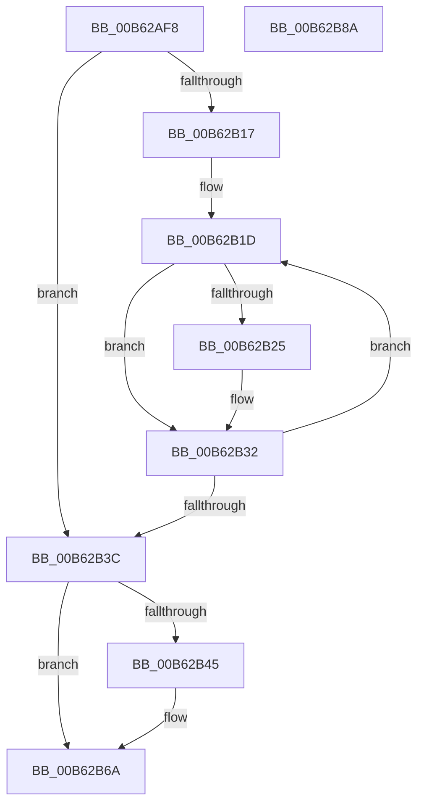

# IvtMarkHiberMemoryScalableModePasidTables

- RVA: `0x00B62AF8`–`0x00B62B8B` (길이 `147` bytes)
- VA: `0x0000000140B62AF8`
- 실행 섹션: `PAGELK`
- PDB 이름 있음: `예`; PDB Function 태그: `아니요`
- unwind 정보 RVA: `0x00060BC4`
- 디코드: `40`개 명령, `147/147` bytes 표시
- 미해석 바이트: `0` (있으면 어셈블리에 `.byte`로 보존)

> 이 문서는 커널 이미지의 기계어와 PDB 기호를 분석해 생성했습니다. 4번과 5번은 함수 원형과 자료형을 바이너리 사용 방식에서 추정한 C 해석이며 원본 소스 복구 결과는 아닙니다.

## 1. Dependencies

- 직접 호출 지점: **3**; 고유 호출 대상: **1**
- 직접 호출자로 확인된 함수: **1**
- RIP 상대 이미지 참조: **0**

### Outgoing calls
- `0x00B62B2D` → [HalpIommuExtMarkHiberMemory](../../text/55/HalpIommuExtMarkHiberMemory_function_00553604.md) (function, `0x00553604`)
- `0x00B62B65` → [HalpIommuExtMarkHiberMemory](../../text/55/HalpIommuExtMarkHiberMemory_function_00553604.md) (function, `0x00553604`)
- `0x00B62B75` → [HalpIommuExtMarkHiberMemory](../../text/55/HalpIommuExtMarkHiberMemory_function_00553604.md) (function, `0x00553604`)

### Direct callers
- [IvtMarkHiberRegions](IvtMarkHiberRegions_function_00B62BA0.md) at `0x00B62BFA`

### Static image references
- 디코드된 RIP-relative 메모리 참조가 없습니다.

## 2. Other-region calls and transfers

- 다른 실행 섹션으로 향하는 call: **3**
  - `0x00B62B2D` → [HalpIommuExtMarkHiberMemory](../../text/55/HalpIommuExtMarkHiberMemory_function_00553604.md) (`PAGELK` → `.text`)
  - `0x00B62B65` → [HalpIommuExtMarkHiberMemory](../../text/55/HalpIommuExtMarkHiberMemory_function_00553604.md) (`PAGELK` → `.text`)
  - `0x00B62B75` → [HalpIommuExtMarkHiberMemory](../../text/55/HalpIommuExtMarkHiberMemory_function_00553604.md) (`PAGELK` → `.text`)
- 별도 외부 분기/꼬리 이동을 확인하지 못했습니다.

## 3. Assembly (complete function range)

```asm
00B62AF8  48 89 5C 24 08                  mov qword ptr [rsp + 8], rbx
00B62AFD  48 89 74 24 10                  mov qword ptr [rsp + 0x10], rsi
00B62B02  57                              push rdi
00B62B03  48 83 EC 20                     sub rsp, 0x20
00B62B07  8B 42 24                        mov eax, dword ptr [rdx + 0x24]
00B62B0A  48 8B DA                        mov rbx, rdx
00B62B0D  C1 E8 06                        shr eax, 6
00B62B10  25 FF 3F 00 00                  and eax, 0x3fff
00B62B15  76 25                           jbe 0x140b62b3c
00B62B17  48 8D 7A 40                     lea rdi, [rdx + 0x40]
00B62B1B  8B F0                           mov esi, eax
00B62B1D  48 8B 17                        mov rdx, qword ptr [rdi]
00B62B20  48 85 D2                        test rdx, rdx
00B62B23  74 0D                           je 0x140b62b32
00B62B25  33 C9                           xor ecx, ecx
00B62B27  41 B8 00 10 00 00               mov r8d, 0x1000
00B62B2D  E8 D2 0A 9F FF                  call 0x140553604
00B62B32  48 83 C7 08                     add rdi, 8
00B62B36  48 83 EE 01                     sub rsi, 1
00B62B3A  75 E1                           jne 0x140b62b1d
00B62B3C  48 8B 53 38                     mov rdx, qword ptr [rbx + 0x38]
00B62B40  48 85 D2                        test rdx, rdx
00B62B43  74 25                           je 0x140b62b6a
00B62B45  44 8B 43 24                     mov r8d, dword ptr [rbx + 0x24]
00B62B49  33 C9                           xor ecx, ecx
00B62B4B  41 C1 E8 06                     shr r8d, 6
00B62B4F  41 81 E0 FF 3F 00 00            and r8d, 0x3fff
00B62B56  46 8D 04 C5 FF 0F 00 00         lea r8d, [r8*8 + 0xfff]
00B62B5E  41 81 E0 00 F0 FF FF            and r8d, 0xfffff000
00B62B65  E8 9A 0A 9F FF                  call 0x140553604
00B62B6A  41 B8 48 00 00 00               mov r8d, 0x48
00B62B70  48 8B D3                        mov rdx, rbx
00B62B73  33 C9                           xor ecx, ecx
00B62B75  E8 8A 0A 9F FF                  call 0x140553604
00B62B7A  48 8B 5C 24 30                  mov rbx, qword ptr [rsp + 0x30]
00B62B7F  48 8B 74 24 38                  mov rsi, qword ptr [rsp + 0x38]
00B62B84  48 83 C4 20                     add rsp, 0x20
00B62B88  5F                              pop rdi
00B62B89  C3                              ret
00B62B8A  CC                              int3
```

## 4. C-style interpretation (structured pseudocode)

```c
__int64 __fastcall IvtMarkHiberMemoryScalableModePasidTables(int a1, __int64 a2)
{
    __int64 result;
    __int64 v_rdi;
    __int64 v_rsi;
    __int64 v_rsp;
    unsigned __int64 v_stack_p10;
    unsigned __int64 v_stack_p8;

    v_stack_p8 = v_rbx;
    v_stack_p10 = v_rsi;
    v_rsp = (v_rsp) - (32);
    result = (unsigned int)(((unsigned int)(*(unsigned int *)(a2 + 36))) >> (6));
    result = (unsigned int)((result) & (0x3FFFULL));
    if (condition_is_below_or_equal) goto loc_00B62B3C;
loc_00B62B1D:
    if (*(unsigned __int64 *)(a2 + 64) != 0) {
        a1 = 0;
        a3 = 0x1000ULL;
        result = HalpIommuExtMarkHiberMemory(a1, *(unsigned __int64 *)(a2 + 64), a3, a4);
    }
    v_rdi = (a2 + 64) + (8);
    v_rsi = ((unsigned int)((unsigned int)(result))) - (1);
    if (condition_is_not_equal) goto loc_00B62B1D;
loc_00B62B3C:
    if (*(unsigned __int64 *)(a2 + 56) != 0) {
        a3 = *(unsigned int *)(a2 + 36);
        a1 = 0;
        a3 = (unsigned int)((a3) >> (6));
        a3 = (unsigned int)((a3) & (0x3FFFULL));
        a3 = a3 * 8 + 4095;
        a3 = (unsigned int)((a3) & (0xFFFFF000ULL));
        result = HalpIommuExtMarkHiberMemory(a1, *(unsigned __int64 *)(a2 + 56), a3, a4);
    }
    a1 = 0;
    result = HalpIommuExtMarkHiberMemory(a1, a2, 72, a4);
    v_rsp = (v_rsp) + (32);
    return result;
}
```

## 5. (Beta) C Style

```c
int64_t IvtMarkHiberMemoryScalableModePasidTables(int32_t Arg1, void *Arg2)
{
    uint8_t *arg2 = (uint8_t *)Arg2;

    int64_t result;
    int64_t local_rdi;
    int64_t local_rsi;
    int64_t local_rsp;
    uint64_t v_stack_p10;
    uint64_t v_stack_p8;

    v_stack_p8 = local_rbx;
    v_stack_p10 = local_rsi;
    local_rsp = (local_rsp) - (32);
    result = (uint32_t)(((uint32_t)(*(uint32_t *)(arg2 + 0x24))) >> (6));
    result = (uint32_t)((result) & (0x3FFFULL));
    if (condition_is_below_or_equal) goto loc_00B62B3C;
loc_00B62B1D:
    if (*(uint64_t *)(arg2 + 0x40) != 0) {
        Arg1 = 0;
        a3 = 0x1000ULL;
        result = HalpIommuExtMarkHiberMemory(Arg1, *(uint64_t *)(arg2 + 0x40), a3, a4);
    }
    local_rdi = (Arg2 + 64) + (8);
    local_rsi = ((uint32_t)((uint32_t)(result))) - (1);
    if (condition_is_not_equal) goto loc_00B62B1D;
loc_00B62B3C:
    if (*(uint64_t *)(arg2 + 0x38) != 0) {
        a3 = *(uint32_t *)(arg2 + 0x24);
        Arg1 = 0;
        a3 = (uint32_t)((a3) >> (6));
        a3 = (uint32_t)((a3) & (0x3FFFULL));
        a3 = a3 * 8 + 4095;
        a3 = (uint32_t)((a3) & (0xFFFFF000ULL));
        result = HalpIommuExtMarkHiberMemory(Arg1, *(uint64_t *)(arg2 + 0x38), a3, a4);
    }
    Arg1 = 0;
    result = HalpIommuExtMarkHiberMemory(Arg1, Arg2, 72, a4);
    local_rsp = (local_rsp) + (32);
    return result;
}
```

### 관측된 메모리 오프셋

구조체 형식이 확인되지 않은 접근은 인자 기준의 오프셋으로만 기록했습니다.

| 기준 인자 | 오프셋 표현 | 폭 (bit) | 접근 |
|---|---:|---:|---|
| `Arg2` | `+ 0x0` | `64` | `R` |
| `Arg2` | `+ 0x24` | `32` | `R` |
| `Arg2` | `+ 0x38` | `64` | `R` |
| `Arg2` | `+ 0x40` | `64` | `R` |

## 6. Execution-region graph

[열기: 2D/3D 그래프와 함수 탐색 컨트롤 패널](../../../control-panel.html?section=pagelk&rva=0x00B62AF8&view=graph)

- 2D 그래프는 위에서 아래로 흐르고, 3D 그래프는 빈 공간을 드래그해 회전합니다. Shift+드래그는 이동, 휠은 확대·축소, 함수 노드 선택은 대상 보고서 이동입니다.

### Static fallback


