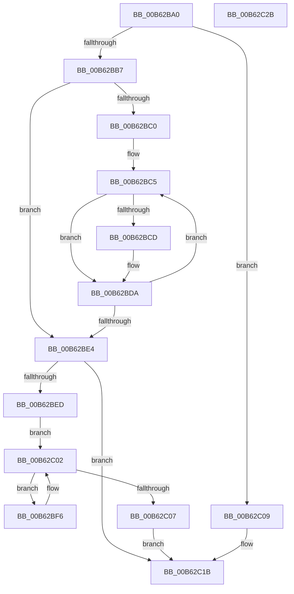

# IvtMarkHiberRegions

- RVA: `0x00B62BA0`–`0x00B62C2C` (길이 `140` bytes)
- VA: `0x0000000140B62BA0`
- 실행 섹션: `PAGELK`
- PDB 이름 있음: `예`; PDB Function 태그: `아니요`
- unwind 정보 RVA: `0x00060BC4`
- 디코드: `40`개 명령, `140/140` bytes 표시
- 미해석 바이트: `0` (있으면 어셈블리에 `.byte`로 보존)

> 이 문서는 커널 이미지의 기계어와 PDB 기호를 분석해 생성했습니다. 4번과 5번은 함수 원형과 자료형을 바이너리 사용 방식에서 추정한 C 해석이며 원본 소스 복구 결과는 아닙니다.

## 1. Dependencies

- 직접 호출 지점: **3**; 고유 호출 대상: **2**
- 직접 호출자로 확인된 함수: **0**
- RIP 상대 이미지 참조: **0**

### Outgoing calls
- `0x00B62BD5` → [HalpIommuExtMarkHiberMemory](../../text/55/HalpIommuExtMarkHiberMemory_function_00553604.md) (function, `0x00553604`)
- `0x00B62BFA` → [IvtMarkHiberMemoryScalableModePasidTables](IvtMarkHiberMemoryScalableModePasidTables_function_00B62AF8.md) (function, `0x00B62AF8`)
- `0x00B62C16` → [HalpIommuExtMarkHiberMemory](../../text/55/HalpIommuExtMarkHiberMemory_function_00553604.md) (function, `0x00553604`)

### Direct callers
- 이 함수 시작 RVA로 연결되는 직접 call은 확인되지 않았습니다. 간접 호출은 완전히 역산할 수 없습니다.

### Static image references
- 디코드된 RIP-relative 메모리 참조가 없습니다.

## 2. Other-region calls and transfers

- 다른 실행 섹션으로 향하는 call: **2**
  - `0x00B62BD5` → [HalpIommuExtMarkHiberMemory](../../text/55/HalpIommuExtMarkHiberMemory_function_00553604.md) (`PAGELK` → `.text`)
  - `0x00B62C16` → [HalpIommuExtMarkHiberMemory](../../text/55/HalpIommuExtMarkHiberMemory_function_00553604.md) (`PAGELK` → `.text`)
- 별도 외부 분기/꼬리 이동을 확인하지 못했습니다.

## 3. Assembly (complete function range)

```asm
00B62BA0  48 89 5C 24 08                  mov qword ptr [rsp + 8], rbx
00B62BA5  48 89 74 24 10                  mov qword ptr [rsp + 0x10], rsi
00B62BAA  57                              push rdi
00B62BAB  48 83 EC 20                     sub rsp, 0x20
00B62BAF  48 8B DA                        mov rbx, rdx
00B62BB2  48 85 C9                        test rcx, rcx
00B62BB5  75 52                           jne 0x140b62c09
00B62BB7  48 8B 7A 20                     mov rdi, qword ptr [rdx + 0x20]
00B62BBB  48 85 FF                        test rdi, rdi
00B62BBE  74 24                           je 0x140b62be4
00B62BC0  BE 00 02 00 00                  mov esi, 0x200
00B62BC5  48 8B 17                        mov rdx, qword ptr [rdi]
00B62BC8  48 85 D2                        test rdx, rdx
00B62BCB  74 0D                           je 0x140b62bda
00B62BCD  33 C9                           xor ecx, ecx
00B62BCF  41 B8 00 10 00 00               mov r8d, 0x1000
00B62BD5  E8 2A 0A 9F FF                  call 0x140553604
00B62BDA  48 83 C7 08                     add rdi, 8
00B62BDE  48 83 EE 01                     sub rsi, 1
00B62BE2  75 E1                           jne 0x140b62bc5
00B62BE4  80 BB 3C 01 00 00 00            cmp byte ptr [rbx + 0x13c], 0
00B62BEB  74 2E                           je 0x140b62c1b
00B62BED  48 8D 7B 58                     lea rdi, [rbx + 0x58]
00B62BF1  48 8B 1F                        mov rbx, qword ptr [rdi]
00B62BF4  EB 0C                           jmp 0x140b62c02
00B62BF6  48 8D 53 F0                     lea rdx, [rbx - 0x10]
00B62BFA  E8 F9 FE FF FF                  call 0x140b62af8
00B62BFF  48 8B 1B                        mov rbx, qword ptr [rbx]
00B62C02  48 3B DF                        cmp rbx, rdi
00B62C05  75 EF                           jne 0x140b62bf6
00B62C07  EB 12                           jmp 0x140b62c1b
00B62C09  48 81 C2 D0 00 00 00            add rdx, 0xd0
00B62C10  41 B8 08 00 00 00               mov r8d, 8
00B62C16  E8 E9 09 9F FF                  call 0x140553604
00B62C1B  48 8B 5C 24 30                  mov rbx, qword ptr [rsp + 0x30]
00B62C20  48 8B 74 24 38                  mov rsi, qword ptr [rsp + 0x38]
00B62C25  48 83 C4 20                     add rsp, 0x20
00B62C29  5F                              pop rdi
00B62C2A  C3                              ret
00B62C2B  CC                              int3
```

## 4. C-style interpretation (structured pseudocode)

```c
__int64 __fastcall IvtMarkHiberRegions(__int64 a1, __int64 a2)
{
    __int64 result;
    __int64 v_rdi;
    __int64 v_rsi;
    __int64 v_rsp;
    unsigned __int64 v_stack_p10;
    unsigned __int64 v_stack_p8;

    v_stack_p8 = v_rbx;
    v_stack_p10 = v_rsi;
    v_rsp = (v_rsp) - (32);
    if (a1 != 0) goto loc_00B62C09;
    if (*(unsigned __int64 *)(a2 + 32) == 0) goto loc_00B62BE4;
loc_00B62BC5:
    if (*(unsigned __int64 *)(*(unsigned __int64 *)(a2 + 32)) != 0) {
        a1 = 0;
        a3 = 0x1000ULL;
        result = HalpIommuExtMarkHiberMemory(a1, *(unsigned __int64 *)(*(unsigned __int64 *)(a2 + 32)), a3, a4);
    }
    v_rdi = (*(unsigned __int64 *)(a2 + 32)) + (8);
    v_rsi = (512) - (1);
    if (condition_is_not_equal) goto loc_00B62BC5;
loc_00B62BE4:
    if ((*(unsigned __int8 *)(a2 + 316)) == 0) goto loc_00B62C1B;
    goto loc_00B62C02;
loc_00B62BF6:
    result = IvtMarkHiberMemoryScalableModePasidTables(a1, *(unsigned __int64 *)(a2 + 88) - 16, a3, a4);
loc_00B62C02:
    if ((*(unsigned __int64 *)(*(unsigned __int64 *)(a2 + 88))) != (a2 + 88)) goto loc_00B62BF6;
    goto loc_00B62C1B;
loc_00B62C09:
    a2 = (*(unsigned __int64 *)(a2 + 88) - 16) + (208);
    result = HalpIommuExtMarkHiberMemory(a1, a2, 8, a4);
loc_00B62C1B:
    v_rsp = (v_rsp) + (32);
    return result;
}
```

## 5. (Beta) C Style

```c
int64_t IvtMarkHiberRegions(int64_t Arg1, void *Arg2)
{
    uint8_t *arg2 = (uint8_t *)Arg2;

    int64_t result;
    int64_t local_rdi;
    int64_t local_rsi;
    int64_t local_rsp;
    uint64_t v_stack_p10;
    uint64_t v_stack_p8;

    v_stack_p8 = local_rbx;
    v_stack_p10 = local_rsi;
    local_rsp = (local_rsp) - (32);
    if (Arg1 != 0) goto loc_00B62C09;
    if (*(uint64_t *)(arg2 + 0x20) == 0) goto loc_00B62BE4;
loc_00B62BC5:
    if (*(uint64_t *)(*(uint64_t *)(arg2 + 0x20)) != 0) {
        Arg1 = 0;
        a3 = 0x1000ULL;
        result = HalpIommuExtMarkHiberMemory(Arg1, *(uint64_t *)(*(uint64_t *)(arg2 + 0x20)), a3, a4);
    }
    local_rdi = (*(uint64_t *)(arg2 + 0x20)) + (8);
    local_rsi = (512) - (1);
    if (condition_is_not_equal) goto loc_00B62BC5;
loc_00B62BE4:
    if ((*(uint8_t *)(arg2 + 0x13C)) == 0) goto loc_00B62C1B;
    goto loc_00B62C02;
loc_00B62BF6:
    result = IvtMarkHiberMemoryScalableModePasidTables(Arg1, *(uint64_t *)(arg2 + 0x58) - 16, a3, a4);
loc_00B62C02:
    if ((*(uint64_t *)(*(uint64_t *)(arg2 + 0x58))) != (Arg2 + 88)) goto loc_00B62BF6;
    goto loc_00B62C1B;
loc_00B62C09:
    Arg2 = (*(uint64_t *)(arg2 + 0x58) - 16) + (208);
    result = HalpIommuExtMarkHiberMemory(Arg1, Arg2, 8, a4);
loc_00B62C1B:
    local_rsp = (local_rsp) + (32);
    return result;
}
```

### 관측된 메모리 오프셋

구조체 형식이 확인되지 않은 접근은 인자 기준의 오프셋으로만 기록했습니다.

| 기준 인자 | 오프셋 표현 | 폭 (bit) | 접근 |
|---|---:|---:|---|
| `Arg2` | `+ 0x0` | `64` | `R` |
| `Arg2` | `+ 0x20` | `64` | `R` |
| `Arg2` | `+ 0x58` | `64` | `R` |
| `Arg2` | `+ 0x13C` | `8` | `R` |

## 6. Execution-region graph

[열기: 2D/3D 그래프와 함수 탐색 컨트롤 패널](../../../control-panel.html?section=pagelk&rva=0x00B62BA0&view=graph)

- 2D 그래프는 위에서 아래로 흐르고, 3D 그래프는 빈 공간을 드래그해 회전합니다. Shift+드래그는 이동, 휠은 확대·축소, 함수 노드 선택은 대상 보고서 이동입니다.

### Static fallback


