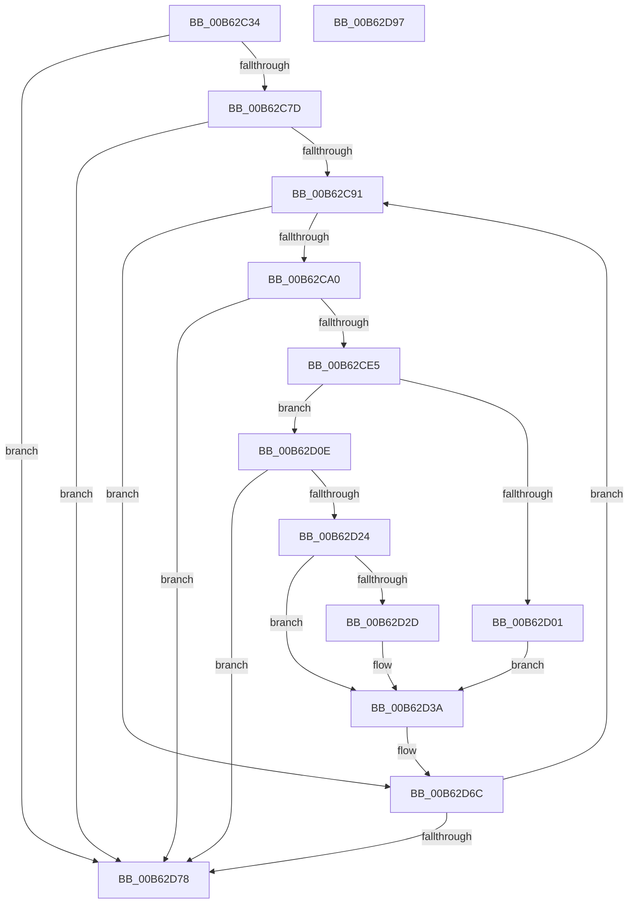

# IvtProcessDeviceExceptions

- RVA: `0x00B62C34`–`0x00B62D98` (길이 `356` bytes)
- VA: `0x0000000140B62C34`
- 실행 섹션: `PAGELK`
- PDB 이름 있음: `예`; PDB Function 태그: `아니요`
- unwind 정보 RVA: `0x000C53C8`
- 디코드: `88`개 명령, `356/356` bytes 표시
- 미해석 바이트: `0` (있으면 어셈블리에 `.byte`로 보존)

> 이 문서는 커널 이미지의 기계어와 PDB 기호를 분석해 생성했습니다. 4번과 5번은 함수 원형과 자료형을 바이너리 사용 방식에서 추정한 C 해석이며 원본 소스 복구 결과는 아닙니다.

## 1. Dependencies

- 직접 호출 지점: **8**; 고유 호출 대상: **7**
- 직접 호출자로 확인된 함수: **1**
- RIP 상대 이미지 참조: **0**

### Outgoing calls
- `0x00B62C5D` → [memset](../../text/6C/memset_function_006C6C40.md) (function, `0x006C6C40`)
- `0x00B62C6E` → [IvtInitializeReservedDomains](IvtInitializeReservedDomains_function_00B63A08.md) (function, `0x00B63A08`)
- `0x00B62C7D` → [HalpIommuGetExceptionList](../../text/55/HalpIommuGetExceptionList_function_00553878.md) (function, `0x00553878`)
- `0x00B62CAB` → [memset](../../text/6C/memset_function_006C6C40.md) (function, `0x006C6C40`)
- `0x00B62CD6` → [IvtAllocateDevice](../../text/57/IvtAllocateDevice_function_00579D24.md) (function, `0x00579D24`)
- `0x00B62CF7` → [IvtGetScalableModePasidTables](../../text/56/IvtGetScalableModePasidTables_function_0056FD5C.md) (function, `0x0056FD5C`)
- `0x00B62D19` → [IvtAllocateTranslationStructures](../../text/56/IvtAllocateTranslationStructures_function_0056EC58.md) (function, `0x0056EC58`)
- `0x00B62D5E` → [IvtUpdateTranslationStructures](../../text/4F/IvtUpdateTranslationStructures_function_004F913C.md) (function, `0x004F913C`)

### Direct callers
- [IvtInitializeIommu](IvtInitializeIommu_function_00B61FE0.md) at `0x00B6256F`

### Static image references
- 디코드된 RIP-relative 메모리 참조가 없습니다.

## 2. Other-region calls and transfers

- 다른 실행 섹션으로 향하는 call: **7**
  - `0x00B62C5D` → [memset](../../text/6C/memset_function_006C6C40.md) (`PAGELK` → `.text`)
  - `0x00B62C7D` → [HalpIommuGetExceptionList](../../text/55/HalpIommuGetExceptionList_function_00553878.md) (`PAGELK` → `.text`)
  - `0x00B62CAB` → [memset](../../text/6C/memset_function_006C6C40.md) (`PAGELK` → `.text`)
  - `0x00B62CD6` → [IvtAllocateDevice](../../text/57/IvtAllocateDevice_function_00579D24.md) (`PAGELK` → `.text`)
  - `0x00B62CF7` → [IvtGetScalableModePasidTables](../../text/56/IvtGetScalableModePasidTables_function_0056FD5C.md) (`PAGELK` → `.text`)
  - `0x00B62D19` → [IvtAllocateTranslationStructures](../../text/56/IvtAllocateTranslationStructures_function_0056EC58.md) (`PAGELK` → `.text`)
  - `0x00B62D5E` → [IvtUpdateTranslationStructures](../../text/4F/IvtUpdateTranslationStructures_function_004F913C.md) (`PAGELK` → `.text`)
- 별도 외부 분기/꼬리 이동을 확인하지 못했습니다.

## 3. Assembly (complete function range)

```asm
00B62C34  48 89 5C 24 08                  mov qword ptr [rsp + 8], rbx
00B62C39  48 89 6C 24 18                  mov qword ptr [rsp + 0x18], rbp
00B62C3E  48 89 74 24 20                  mov qword ptr [rsp + 0x20], rsi
00B62C43  57                              push rdi
00B62C44  41 56                           push r14
00B62C46  41 57                           push r15
00B62C48  48 81 EC B0 00 00 00            sub rsp, 0xb0
00B62C4F  33 D2                           xor edx, edx
00B62C51  48 8B F1                        mov rsi, rcx
00B62C54  48 8D 4C 24 40                  lea rcx, [rsp + 0x40]
00B62C59  44 8D 42 70                     lea r8d, [rdx + 0x70]
00B62C5D  E8 DE 3F B6 FF                  call 0x1406c6c40
00B62C62  48 83 A4 24 D8 00 00 00 00      and qword ptr [rsp + 0xd8], 0
00B62C6B  48 8B CE                        mov rcx, rsi
00B62C6E  E8 95 0D 00 00                  call 0x140b63a08
00B62C73  8B E8                           mov ebp, eax
00B62C75  85 C0                           test eax, eax
00B62C77  0F 88 FB 00 00 00               js 0x140b62d78
00B62C7D  E8 F6 0B 9F FF                  call 0x140553878
00B62C82  4C 8B F0                        mov r14, rax
00B62C85  48 8B 18                        mov rbx, qword ptr [rax]
00B62C88  48 3B D8                        cmp rbx, rax
00B62C8B  0F 84 E7 00 00 00               je 0x140b62d78
00B62C91  8B 8E FC 00 00 00               mov ecx, dword ptr [rsi + 0xfc]
00B62C97  39 4B 10                        cmp dword ptr [rbx + 0x10], ecx
00B62C9A  0F 85 CC 00 00 00               jne 0x140b62d6c
00B62CA0  33 D2                           xor edx, edx
00B62CA2  48 8D 4C 24 48                  lea rcx, [rsp + 0x48]
00B62CA7  44 8D 42 68                     lea r8d, [rdx + 0x68]
00B62CAB  E8 90 3F B6 FF                  call 0x1406c6c40
00B62CB0  44 8B 7B 18                     mov r15d, dword ptr [rbx + 0x18]
00B62CB4  48 8D 84 24 D8 00 00 00         lea rax, [rsp + 0xd8]
00B62CBC  83 64 24 44 00                  and dword ptr [rsp + 0x44], 0
00B62CC1  45 33 C0                        xor r8d, r8d
00B62CC4  33 D2                           xor edx, edx
00B62CC6  48 89 44 24 20                  mov qword ptr [rsp + 0x20], rax
00B62CCB  41 8B CF                        mov ecx, r15d
00B62CCE  C7 44 24 40 01 00 00 00         mov dword ptr [rsp + 0x40], 1
00B62CD6  E8 49 70 A1 FF                  call 0x140579d24
00B62CDB  8B E8                           mov ebp, eax
00B62CDD  85 C0                           test eax, eax
00B62CDF  0F 88 93 00 00 00               js 0x140b62d78
00B62CE5  48 8B BC 24 D8 00 00 00         mov rdi, qword ptr [rsp + 0xd8]
00B62CED  41 8B D7                        mov edx, r15d
00B62CF0  48 8B CE                        mov rcx, rsi
00B62CF3  48 89 7B 20                     mov qword ptr [rbx + 0x20], rdi
00B62CF7  E8 60 D0 A0 FF                  call 0x14056fd5c
00B62CFC  48 85 C0                        test rax, rax
00B62CFF  74 0D                           je 0x140b62d0e
00B62D01  48 89 47 40                     mov qword ptr [rdi + 0x40], rax
00B62D05  8B 40 2C                        mov eax, dword ptr [rax + 0x2c]
00B62D08  89 44 24 70                     mov dword ptr [rsp + 0x70], eax
00B62D0C  EB 2C                           jmp 0x140b62d3a
00B62D0E  4C 8D 44 24 40                  lea r8, [rsp + 0x40]
00B62D13  48 8B D7                        mov rdx, rdi
00B62D16  48 8B CE                        mov rcx, rsi
00B62D19  E8 3A BF A0 FF                  call 0x14056ec58
00B62D1E  8B E8                           mov ebp, eax
00B62D20  85 C0                           test eax, eax
00B62D22  78 54                           js 0x140b62d78
00B62D24  80 BE 40 01 00 00 00            cmp byte ptr [rsi + 0x140], 0
00B62D2B  74 0D                           je 0x140b62d3a
00B62D2D  48 8B 47 48                     mov rax, qword ptr [rdi + 0x48]
00B62D31  48 89 47 40                     mov qword ptr [rdi + 0x40], rax
00B62D35  48 83 67 48 00                  and qword ptr [rdi + 0x48], 0
00B62D3A  48 C7 44 24 38 00 00 01 00      mov qword ptr [rsp + 0x38], 0x10000
00B62D43  48 8D 44 24 40                  lea rax, [rsp + 0x40]
00B62D48  C7 44 24 30 01 00 00 00         mov dword ptr [rsp + 0x30], 1
00B62D50  45 33 C9                        xor r9d, r9d
00B62D53  48 8B D7                        mov rdx, rdi
00B62D56  48 89 44 24 28                  mov qword ptr [rsp + 0x28], rax
00B62D5B  48 8B CE                        mov rcx, rsi
00B62D5E  E8 D9 63 99 FF                  call 0x1404f913c
00B62D63  48 83 A4 24 D8 00 00 00 00      and qword ptr [rsp + 0xd8], 0
00B62D6C  48 8B 1B                        mov rbx, qword ptr [rbx]
00B62D6F  49 3B DE                        cmp rbx, r14
00B62D72  0F 85 19 FF FF FF               jne 0x140b62c91
00B62D78  4C 8D 9C 24 B0 00 00 00         lea r11, [rsp + 0xb0]
00B62D80  8B C5                           mov eax, ebp
00B62D82  49 8B 5B 20                     mov rbx, qword ptr [r11 + 0x20]
00B62D86  49 8B 6B 30                     mov rbp, qword ptr [r11 + 0x30]
00B62D8A  49 8B 73 38                     mov rsi, qword ptr [r11 + 0x38]
00B62D8E  49 8B E3                        mov rsp, r11
00B62D91  41 5F                           pop r15
00B62D93  41 5E                           pop r14
00B62D95  5F                              pop rdi
00B62D96  C3                              ret
00B62D97  CC                              int3
```

## 4. C-style interpretation (structured pseudocode)

```c
__int64 __fastcall IvtProcessDeviceExceptions(__int64 a1, int a2, __int64 a3, int a4)
{
    __int64 result;
    __int64 v_rsp;
    unsigned __int64 v_stack_m18;
    unsigned int v_stack_m58;
    unsigned __int64 v_stack_m80;
    unsigned int v_stack_m84;
    unsigned __int64 v_stack_m88;
    unsigned __int64 v_stack_m90;
    unsigned int v_stack_m98;
    unsigned __int64 v_stack_mA0;
    unsigned __int64 v_stack_mA8;
    unsigned __int64 v_stack_p10;
    unsigned __int64 v_stack_p18;
    unsigned __int64 v_stack_p20;
    unsigned __int64 v_stack_p8;

    v_stack_p8 = v_rbx;
    v_stack_p18 = v_rbp;
    v_stack_p20 = v_rsi;
    v_rsp = (v_rsp) - (176);
    a2 = 0;
    result = memset(v_stack_m88, a2, a2 + 112, a4);
    result = IvtInitializeReservedDomains(a1, a2, a2 + 112, a4);
    if (sign_flag) goto loc_00B62D78;
    result = HalpIommuGetExceptionList(a1, a2, a2 + 112, a4);
    if ((*(unsigned __int64 *)(result)) == result) goto loc_00B62D78;
loc_00B62C91:
    if ((*(unsigned int *)(*(unsigned __int64 *)(result) + 16)) != ((unsigned int)((unsigned int)(*(unsigned int *)(a1 + 252))))) goto loc_00B62D6C;
    a2 = 0;
    result = memset(v_stack_m80, a2, a2 + 104, a4);
    a3 = 0;
    a2 = 0;
    v_stack_mA8 = v_stack_p10;
    v_stack_m88 = 1;
    result = IvtAllocateDevice((unsigned int)((unsigned int)((unsigned int)(*(unsigned int *)(*(unsigned __int64 *)(result) + 24)))), a2, a3, a4);
    if (sign_flag) goto loc_00B62D78;
    *(unsigned __int64 *)(*(unsigned __int64 *)(result) + 32) = v_stack_p10;
    result = IvtGetScalableModePasidTables(a1, (unsigned int)((unsigned int)((unsigned int)(*(unsigned int *)(*(unsigned __int64 *)(result) + 24)))), a3, a4);
    if (result == 0) goto loc_00B62D0E;
    *(unsigned __int64 *)(v_stack_p10 + 64) = result;
    v_stack_m58 = (unsigned int)((unsigned int)(*(unsigned int *)(result + 44)));
    goto loc_00B62D3A;
loc_00B62D0E:
    result = IvtAllocateTranslationStructures(a1, v_stack_p10, v_stack_m88, a4);
    if (sign_flag) goto loc_00B62D78;
    if ((*(unsigned __int8 *)(a1 + 320)) != 0) {
        result = *(unsigned __int64 *)(v_stack_p10 + 72);
        *(unsigned __int64 *)(v_stack_p10 + 64) = result;
    }
    v_stack_m90 = 0x10000ULL;
    v_stack_m98 = 1;
    a4 = 0;
    v_stack_mA0 = v_stack_m88;
    result = IvtUpdateTranslationStructures(a1, v_stack_p10, v_stack_m88, a4);
loc_00B62D6C:
    if ((*(unsigned __int64 *)(*(unsigned __int64 *)(result))) != result) goto loc_00B62C91;
loc_00B62D78:
    return (unsigned int)((unsigned int)((unsigned int)((unsigned int)(result))));
}
```

## 5. (Beta) C Style

```c
int64_t IvtProcessDeviceExceptions(void *Arg1, int32_t Arg2, int64_t Arg3, int32_t Arg4)
{
    uint8_t *arg1 = (uint8_t *)Arg1;

    int64_t result;
    int64_t local_rsp;
    uint64_t v_stack_m18;
    uint32_t v_stack_m58;
    uint64_t v_stack_m80;
    uint32_t v_stack_m84;
    uint64_t v_stack_m88;
    uint64_t v_stack_m90;
    uint32_t v_stack_m98;
    uint64_t v_stack_mA0;
    uint64_t v_stack_mA8;
    uint64_t v_stack_p10;
    uint64_t v_stack_p18;
    uint64_t v_stack_p20;
    uint64_t v_stack_p8;

    v_stack_p8 = local_rbx;
    v_stack_p18 = local_rbp;
    v_stack_p20 = local_rsi;
    local_rsp = (local_rsp) - (176);
    Arg2 = 0;
    result = memset(v_stack_m88, Arg2, Arg2 + 112, Arg4);
    result = IvtInitializeReservedDomains(Arg1, Arg2, Arg2 + 112, Arg4);
    if (sign_flag) goto loc_00B62D78;
    result = HalpIommuGetExceptionList(Arg1, Arg2, Arg2 + 112, Arg4);
    if ((*(uint64_t *)(result)) == result) goto loc_00B62D78;
loc_00B62C91:
    if ((*(uint32_t *)(*(uint64_t *)(result) + 0x10)) != ((uint32_t)((uint32_t)(*(uint32_t *)(arg1 + 0xFC))))) goto loc_00B62D6C;
    Arg2 = 0;
    result = memset(v_stack_m80, Arg2, Arg2 + 104, Arg4);
    Arg3 = 0;
    Arg2 = 0;
    v_stack_mA8 = v_stack_p10;
    v_stack_m88 = 1;
    result = IvtAllocateDevice((uint32_t)((uint32_t)((uint32_t)(*(uint32_t *)(*(uint64_t *)(result) + 0x18)))), Arg2, Arg3, Arg4);
    if (sign_flag) goto loc_00B62D78;
    *(uint64_t *)(*(uint64_t *)(result) + 0x20) = v_stack_p10;
    result = IvtGetScalableModePasidTables(Arg1, (uint32_t)((uint32_t)((uint32_t)(*(uint32_t *)(*(uint64_t *)(result) + 0x18)))), Arg3, Arg4);
    if (result == 0) goto loc_00B62D0E;
    *(uint64_t *)(v_stack_p10 + 0x40) = result;
    v_stack_m58 = (uint32_t)((uint32_t)(*(uint32_t *)(result + 0x2C)));
    goto loc_00B62D3A;
loc_00B62D0E:
    result = IvtAllocateTranslationStructures(Arg1, v_stack_p10, v_stack_m88, Arg4);
    if (sign_flag) goto loc_00B62D78;
    if ((*(uint8_t *)(arg1 + 0x140)) != 0) {
        result = *(uint64_t *)(v_stack_p10 + 0x48);
        *(uint64_t *)(v_stack_p10 + 0x40) = result;
    }
    v_stack_m90 = 0x10000ULL;
    v_stack_m98 = 1;
    Arg4 = 0;
    v_stack_mA0 = v_stack_m88;
    result = IvtUpdateTranslationStructures(Arg1, v_stack_p10, v_stack_m88, Arg4);
loc_00B62D6C:
    if ((*(uint64_t *)(*(uint64_t *)(result))) != result) goto loc_00B62C91;
loc_00B62D78:
    return (uint32_t)((uint32_t)((uint32_t)((uint32_t)(result))));
}
```

### 관측된 메모리 오프셋

구조체 형식이 확인되지 않은 접근은 인자 기준의 오프셋으로만 기록했습니다.

| 기준 인자 | 오프셋 표현 | 폭 (bit) | 접근 |
|---|---:|---:|---|
| `Arg1` | `+ 0xFC` | `32` | `R` |
| `Arg1` | `+ 0x140` | `8` | `R` |

## 6. Execution-region graph

[열기: 2D/3D 그래프와 함수 탐색 컨트롤 패널](../../../control-panel.html?section=pagelk&rva=0x00B62C34&view=graph)

- 2D 그래프는 위에서 아래로 흐르고, 3D 그래프는 빈 공간을 드래그해 회전합니다. Shift+드래그는 이동, 휠은 확대·축소, 함수 노드 선택은 대상 보고서 이동입니다.

### Static fallback


