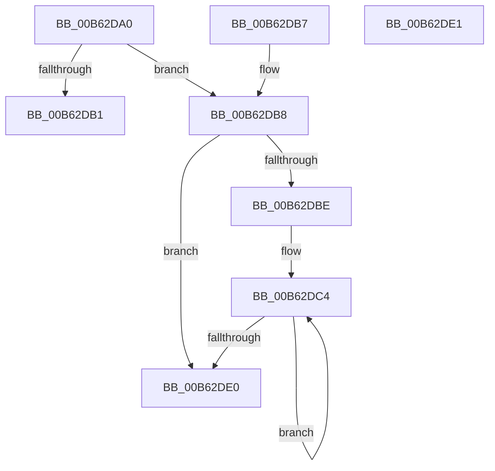

# IvtProcessReservedDomains

- RVA: `0x00B62DA0`–`0x00B62DE2` (길이 `66` bytes)
- VA: `0x0000000140B62DA0`
- 실행 섹션: `PAGELK`
- PDB 이름 있음: `예`; PDB Function 태그: `아니요`
- unwind 정보 RVA: `0x000DB714`
- 디코드: `22`개 명령, `66/66` bytes 표시
- 미해석 바이트: `0` (있으면 어셈블리에 `.byte`로 보존)

> 이 문서는 커널 이미지의 기계어와 PDB 기호를 분석해 생성했습니다. 4번과 5번은 함수 원형과 자료형을 바이너리 사용 방식에서 추정한 C 해석이며 원본 소스 복구 결과는 아닙니다.

## 1. Dependencies

- 직접 호출 지점: **0**; 고유 호출 대상: **0**
- 직접 호출자로 확인된 함수: **0**
- RIP 상대 이미지 참조: **0**

### Outgoing calls
- 직접 디코드된 call 명령이 없습니다.

### Direct callers
- 이 함수 시작 RVA로 연결되는 직접 call은 확인되지 않았습니다. 간접 호출은 완전히 역산할 수 없습니다.

### Static image references
- 디코드된 RIP-relative 메모리 참조가 없습니다.

## 2. Other-region calls and transfers

- 다른 실행 섹션으로 향하는 call: **0**
- 별도 외부 분기/꼬리 이동을 확인하지 못했습니다.

## 3. Assembly (complete function range)

```asm
00B62DA0  48 8B 81 60 01 00 00            mov rax, qword ptr [rcx + 0x160]
00B62DA7  4D 8B C8                        mov r9, r8
00B62DAA  4C 8B D9                        mov r11, rcx
00B62DAD  3B 10                           cmp edx, dword ptr [rax]
00B62DAF  74 07                           je 0x140b62db8
00B62DB1  B8 0D 00 00 C0                  mov eax, 0xc000000d
00B62DB6  C3                              ret
00B62DB7  CC                              int3
00B62DB8  33 C0                           xor eax, eax
00B62DBA  85 D2                           test edx, edx
00B62DBC  74 22                           je 0x140b62de0
00B62DBE  44 8B C0                        mov r8d, eax
00B62DC1  44 8B D2                        mov r10d, edx
00B62DC4  49 8B 09                        mov rcx, qword ptr [r9]
00B62DC7  4D 8D 40 10                     lea r8, [r8 + 0x10]
00B62DCB  49 8B 93 60 01 00 00            mov rdx, qword ptr [r11 + 0x160]
00B62DD2  4D 8D 49 08                     lea r9, [r9 + 8]
00B62DD6  4A 89 0C 02                     mov qword ptr [rdx + r8], rcx
00B62DDA  49 83 EA 01                     sub r10, 1
00B62DDE  75 E4                           jne 0x140b62dc4
00B62DE0  C3                              ret
00B62DE1  CC                              int3
```

## 4. C-style interpretation (structured pseudocode)

```c
__int64 __fastcall IvtProcessReservedDomains(__int64 a1, int a2, __int64 a3)
{
    __int64 result;
    __int64 v_r10;

    if (a2 == (*(unsigned int *)(*(unsigned __int64 *)(a1 + 352)))) goto loc_00B62DB8;
    return (unsigned int)(0xC000000DULL);
loc_00B62DB8:
    result = 0;
    if (a2 == 0) goto loc_00B62DE0;
loc_00B62DC4:
    *(unsigned __int64 *)(*(unsigned __int64 *)(a1 + 352) + 0 + 16 * 1) = *(unsigned __int64 *)(a3);
    v_r10 = ((unsigned int)(a2)) - (1);
    if (condition_is_not_equal) goto loc_00B62DC4;
loc_00B62DE0:
    return result;
}
```

## 5. (Beta) C Style

```c
int64_t IvtProcessReservedDomains(void *Arg1, int32_t Arg2, void *Arg3)
{
    uint8_t *arg1 = (uint8_t *)Arg1;
    uint8_t *arg3 = (uint8_t *)Arg3;

    int64_t result;
    int64_t local_r10;

    if (Arg2 == (*(uint32_t *)(*(uint64_t *)(arg1 + 0x160)))) goto loc_00B62DB8;
    return (uint32_t)(0xC000000DULL);
loc_00B62DB8:
    result = 0;
    if (Arg2 == 0) goto loc_00B62DE0;
loc_00B62DC4:
    *(uint64_t *)(*(uint64_t *)(arg1 + 0x160) + 0x0 + 0x10 * 1) = *(uint64_t *)(arg3);
    local_r10 = ((uint32_t)(Arg2)) - (1);
    if (condition_is_not_equal) goto loc_00B62DC4;
loc_00B62DE0:
    return result;
}
```

### 관측된 메모리 오프셋

구조체 형식이 확인되지 않은 접근은 인자 기준의 오프셋으로만 기록했습니다.

| 기준 인자 | 오프셋 표현 | 폭 (bit) | 접근 |
|---|---:|---:|---|
| `Arg1` | `+ 0x160` | `64` | `R` |
| `Arg3` | `+ 0x0` | `64` | `R` |
| `Arg3` | `+ 0x8` | `64` | `R` |

## 6. Execution-region graph

[열기: 2D/3D 그래프와 함수 탐색 컨트롤 패널](../../../control-panel.html?section=pagelk&rva=0x00B62DA0&view=graph)

- 2D 그래프는 위에서 아래로 흐르고, 3D 그래프는 빈 공간을 드래그해 회전합니다. Shift+드래그는 이동, 휠은 확대·축소, 함수 노드 선택은 대상 보고서 이동입니다.

### Static fallback


