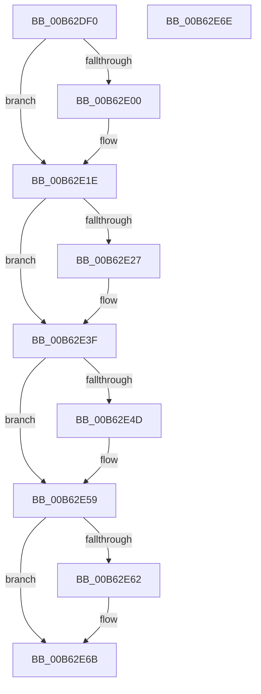

# IvtSetMessageInterruptRouting

- RVA: `0x00B62DF0`–`0x00B62E6F` (길이 `127` bytes)
- VA: `0x0000000140B62DF0`
- 실행 섹션: `PAGELK`
- PDB 이름 있음: `예`; PDB Function 태그: `아니요`
- unwind 정보 RVA: `0x000DB714`
- 디코드: `30`개 명령, `127/127` bytes 표시
- 미해석 바이트: `0` (있으면 어셈블리에 `.byte`로 보존)

> 이 문서는 커널 이미지의 기계어와 PDB 기호를 분석해 생성했습니다. 4번과 5번은 함수 원형과 자료형을 바이너리 사용 방식에서 추정한 C 해석이며 원본 소스 복구 결과는 아닙니다.

## 1. Dependencies

- 직접 호출 지점: **0**; 고유 호출 대상: **0**
- 직접 호출자로 확인된 함수: **0**
- RIP 상대 이미지 참조: **0**

### Outgoing calls
- 직접 디코드된 call 명령이 없습니다.

### Direct callers
- 이 함수 시작 RVA로 연결되는 직접 call은 확인되지 않았습니다. 간접 호출은 완전히 역산할 수 없습니다.

### Static image references
- 디코드된 RIP-relative 메모리 참조가 없습니다.

## 2. Other-region calls and transfers

- 다른 실행 섹션으로 향하는 call: **0**
- 별도 외부 분기/꼬리 이동을 확인하지 못했습니다.

## 3. Assembly (complete function range)

```asm
00B62DF0  48 8B 51 08                     mov rdx, qword ptr [rcx + 8]
00B62DF4  45 33 D2                        xor r10d, r10d
00B62DF7  44 38 91 3C 01 00 00            cmp byte ptr [rcx + 0x13c], r10b
00B62DFE  74 1E                           je 0x140b62e1e
00B62E00  49 8B C0                        mov rax, r8
00B62E03  48 C1 E8 20                     shr rax, 0x20
00B62E07  89 82 EC 00 00 00               mov dword ptr [rdx + 0xec], eax
00B62E0D  F0 44 09 14 24                  lock or dword ptr [rsp], r10d
00B62E12  44 89 82 E8 00 00 00            mov dword ptr [rdx + 0xe8], r8d
00B62E19  F0 44 09 14 24                  lock or dword ptr [rsp], r10d
00B62E1E  44 38 91 3E 01 00 00            cmp byte ptr [rcx + 0x13e], r10b
00B62E25  74 18                           je 0x140b62e3f
00B62E27  49 8B C0                        mov rax, r8
00B62E2A  48 C1 E8 20                     shr rax, 0x20
00B62E2E  89 42 44                        mov dword ptr [rdx + 0x44], eax
00B62E31  F0 44 09 14 24                  lock or dword ptr [rsp], r10d
00B62E36  44 89 42 40                     mov dword ptr [rdx + 0x40], r8d
00B62E3A  F0 44 09 14 24                  lock or dword ptr [rsp], r10d
00B62E3F  41 0F BA F1 0E                  btr r9d, 0xe
00B62E44  44 38 91 3C 01 00 00            cmp byte ptr [rcx + 0x13c], r10b
00B62E4B  74 0C                           je 0x140b62e59
00B62E4D  44 89 8A E4 00 00 00            mov dword ptr [rdx + 0xe4], r9d
00B62E54  F0 44 09 14 24                  lock or dword ptr [rsp], r10d
00B62E59  44 38 91 3E 01 00 00            cmp byte ptr [rcx + 0x13e], r10b
00B62E60  74 09                           je 0x140b62e6b
00B62E62  44 89 4A 3C                     mov dword ptr [rdx + 0x3c], r9d
00B62E66  F0 44 09 14 24                  lock or dword ptr [rsp], r10d
00B62E6B  33 C0                           xor eax, eax
00B62E6D  C3                              ret
00B62E6E  CC                              int3
```

## 4. C-style interpretation (structured pseudocode)

```c
__int64 __fastcall IvtSetMessageInterruptRouting(__int64 a1, __int64 a2, __int64 a3, int a4)
{
    __int64 result;
    __int64 v_r10;
    unsigned int v_stack_p0;

    v_r10 = 0;
    if ((*(unsigned __int8 *)(a1 + 316)) != 0) {
        result = a3;
        result = (result) >> (32);
        *(unsigned int *)(*(unsigned __int64 *)(a1 + 8) + 236) = (unsigned int)(result);
        *(unsigned int *)(*(unsigned __int64 *)(a1 + 8) + 232) = (unsigned int)(a3);
    }
    if ((*(unsigned __int8 *)(a1 + 318)) != 0) {
        result = a3;
        result = (result) >> (32);
        *(unsigned int *)(*(unsigned __int64 *)(a1 + 8) + 68) = (unsigned int)(result);
        *(unsigned int *)(*(unsigned __int64 *)(a1 + 8) + 64) = (unsigned int)(a3);
    }
    if ((*(unsigned __int8 *)(a1 + 316)) != 0) {
        *(unsigned int *)(*(unsigned __int64 *)(a1 + 8) + 228) = a4;
    }
    if ((*(unsigned __int8 *)(a1 + 318)) != 0) {
        *(unsigned int *)(*(unsigned __int64 *)(a1 + 8) + 60) = a4;
    }
    result = 0;
    return result;
}
```

## 5. (Beta) C Style

```c
int64_t IvtSetMessageInterruptRouting(void *Arg1, int64_t Arg2, int64_t Arg3, int32_t Arg4)
{
    uint8_t *arg1 = (uint8_t *)Arg1;

    int64_t result;
    int64_t local_r10;
    uint32_t v_stack_p0;

    local_r10 = 0;
    if ((*(uint8_t *)(arg1 + 0x13C)) != 0) {
        result = Arg3;
        result = (result) >> (32);
        *(uint32_t *)(*(uint64_t *)(arg1 + 0x8) + 0xEC) = (uint32_t)(result);
        *(uint32_t *)(*(uint64_t *)(arg1 + 0x8) + 0xE8) = (uint32_t)(Arg3);
    }
    if ((*(uint8_t *)(arg1 + 0x13E)) != 0) {
        result = Arg3;
        result = (result) >> (32);
        *(uint32_t *)(*(uint64_t *)(arg1 + 0x8) + 0x44) = (uint32_t)(result);
        *(uint32_t *)(*(uint64_t *)(arg1 + 0x8) + 0x40) = (uint32_t)(Arg3);
    }
    if ((*(uint8_t *)(arg1 + 0x13C)) != 0) {
        *(uint32_t *)(*(uint64_t *)(arg1 + 0x8) + 0xE4) = Arg4;
    }
    if ((*(uint8_t *)(arg1 + 0x13E)) != 0) {
        *(uint32_t *)(*(uint64_t *)(arg1 + 0x8) + 0x3C) = Arg4;
    }
    result = 0;
    return result;
}
```

### 관측된 메모리 오프셋

구조체 형식이 확인되지 않은 접근은 인자 기준의 오프셋으로만 기록했습니다.

| 기준 인자 | 오프셋 표현 | 폭 (bit) | 접근 |
|---|---:|---:|---|
| `Arg1` | `+ 0x8` | `64` | `R` |
| `Arg1` | `+ 0x13C` | `8` | `R` |
| `Arg1` | `+ 0x13E` | `8` | `R` |

## 6. Execution-region graph

[열기: 2D/3D 그래프와 함수 탐색 컨트롤 패널](../../../control-panel.html?section=pagelk&rva=0x00B62DF0&view=graph)

- 2D 그래프는 위에서 아래로 흐르고, 3D 그래프는 빈 공간을 드래그해 회전합니다. Shift+드래그는 이동, 휠은 확대·축소, 함수 노드 선택은 대상 보고서 이동입니다.

### Static fallback


