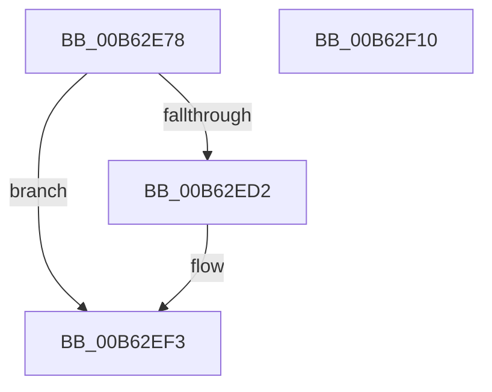

# IvtSetupScalableModeDefaultPasidTables

- RVA: `0x00B62E78`–`0x00B62F11` (길이 `153` bytes)
- VA: `0x0000000140B62E78`
- 실행 섹션: `PAGELK`
- PDB 이름 있음: `예`; PDB Function 태그: `아니요`
- unwind 정보 RVA: `0x000BF908`
- 디코드: `42`개 명령, `153/153` bytes 표시
- 미해석 바이트: `0` (있으면 어셈블리에 `.byte`로 보존)

> 이 문서는 커널 이미지의 기계어와 PDB 기호를 분석해 생성했습니다. 4번과 5번은 함수 원형과 자료형을 바이너리 사용 방식에서 추정한 C 해석이며 원본 소스 복구 결과는 아닙니다.

## 1. Dependencies

- 직접 호출 지점: **2**; 고유 호출 대상: **2**
- 직접 호출자로 확인된 함수: **1**
- RIP 상대 이미지 참조: **0**

### Outgoing calls
- `0x00B62EC7` → [IvtAllocateScalableModePasidTables](../../text/56/IvtAllocateScalableModePasidTables_function_0056E8DC.md) (function, `0x0056E8DC`)
- `0x00B62EEA` → [IvtUpdateScalableModePasidTablesForPasid](../../text/4C/IvtUpdateScalableModePasidTablesForPasid_function_004CD628.md) (function, `0x004CD628`)

### Direct callers
- [IvtInitializeIommu](IvtInitializeIommu_function_00B61FE0.md) at `0x00B623B8`

### Static image references
- 디코드된 RIP-relative 메모리 참조가 없습니다.

## 2. Other-region calls and transfers

- 다른 실행 섹션으로 향하는 call: **2**
  - `0x00B62EC7` → [IvtAllocateScalableModePasidTables](../../text/56/IvtAllocateScalableModePasidTables_function_0056E8DC.md) (`PAGELK` → `.text`)
  - `0x00B62EEA` → [IvtUpdateScalableModePasidTablesForPasid](../../text/4C/IvtUpdateScalableModePasidTablesForPasid_function_004CD628.md) (`PAGELK` → `.text`)
- 별도 외부 분기/꼬리 이동을 확인하지 못했습니다.

## 3. Assembly (complete function range)

```asm
00B62E78  4C 8B DC                        mov r11, rsp
00B62E7B  49 89 5B 08                     mov qword ptr [r11 + 8], rbx
00B62E7F  49 89 6B 10                     mov qword ptr [r11 + 0x10], rbp
00B62E83  49 89 73 18                     mov qword ptr [r11 + 0x18], rsi
00B62E87  49 89 7B 20                     mov qword ptr [r11 + 0x20], rdi
00B62E8B  41 56                           push r14
00B62E8D  48 83 EC 60                     sub rsp, 0x60
00B62E91  49 83 63 D8 00                  and qword ptr [r11 - 0x28], 0
00B62E96  49 8D 43 E8                     lea rax, [r11 - 0x18]
00B62E9A  49 83 63 E8 00                  and qword ptr [r11 - 0x18], 0
00B62E9F  4D 8B F1                        mov r14, r9
00B62EA2  49 89 43 D0                     mov qword ptr [r11 - 0x30], rax
00B62EA6  8B EA                           mov ebp, edx
00B62EA8  89 54 24 30                     mov dword ptr [rsp + 0x30], edx
00B62EAC  45 33 C9                        xor r9d, r9d
00B62EAF  C7 44 24 28 03 00 00 00         mov dword ptr [rsp + 0x28], 3
00B62EB7  33 D2                           xor edx, edx
00B62EB9  C7 44 24 20 3F 00 00 00         mov dword ptr [rsp + 0x20], 0x3f
00B62EC1  49 8B D8                        mov rbx, r8
00B62EC4  48 8B F9                        mov rdi, rcx
00B62EC7  E8 10 BA A0 FF                  call 0x14056e8dc
00B62ECC  8B F0                           mov esi, eax
00B62ECE  85 C0                           test eax, eax
00B62ED0  78 21                           js 0x140b62ef3
00B62ED2  4C 89 74 24 28                  mov qword ptr [rsp + 0x28], r14
00B62ED7  44 8B CD                        mov r9d, ebp
00B62EDA  48 89 5C 24 20                  mov qword ptr [rsp + 0x20], rbx
00B62EDF  48 8B CF                        mov rcx, rdi
00B62EE2  48 8B 5C 24 50                  mov rbx, qword ptr [rsp + 0x50]
00B62EE7  48 8B D3                        mov rdx, rbx
00B62EEA  E8 39 A7 96 FF                  call 0x1404cd628
00B62EEF  48 89 5F 68                     mov qword ptr [rdi + 0x68], rbx
00B62EF3  4C 8D 5C 24 60                  lea r11, [rsp + 0x60]
00B62EF8  8B C6                           mov eax, esi
00B62EFA  49 8B 5B 10                     mov rbx, qword ptr [r11 + 0x10]
00B62EFE  49 8B 6B 18                     mov rbp, qword ptr [r11 + 0x18]
00B62F02  49 8B 73 20                     mov rsi, qword ptr [r11 + 0x20]
00B62F06  49 8B 7B 28                     mov rdi, qword ptr [r11 + 0x28]
00B62F0A  49 8B E3                        mov rsp, r11
00B62F0D  41 5E                           pop r14
00B62F0F  C3                              ret
00B62F10  CC                              int3
```

## 4. C-style interpretation (structured pseudocode)

```c
__int64 __fastcall IvtSetupScalableModeDefaultPasidTables(__int64 a1, int a2, __int64 a3, __int64 a4)
{
    __int64 result;
    __int64 v_rbx;
    __int64 v_rsp;
    unsigned __int64 v_stack_m18;
    unsigned int v_stack_m38;
    unsigned int v_stack_m40;
    unsigned int v_stack_m48;
    unsigned __int64 v_stack_m8;

    *(unsigned __int64 *)(v_rsp + 8) = v_rbx;
    *(unsigned __int64 *)(v_rsp + 16) = v_rbp;
    *(unsigned __int64 *)(v_rsp + 24) = v_rsi;
    *(unsigned __int64 *)(v_rsp + 32) = v_rdi;
    v_rsp = (v_rsp) - (96);
    *(unsigned __int64 *)(v_rsp - 48) = v_rsp - 24;
    v_stack_m38 = a2;
    a4 = 0;
    v_stack_m40 = 3;
    a2 = 0;
    v_stack_m48 = 63;
    result = IvtAllocateScalableModePasidTables(a1, a2, a3, a4);
    v_rbx = a3;
    if (!(sign_flag)) {
        v_stack_m40 = 0;
        a4 = (unsigned int)((unsigned int)(a2));
        v_stack_m48 = a3;
        a1 = a1;
        v_rbx = v_stack_m18;
        a2 = v_rbx;
        result = IvtUpdateScalableModePasidTablesForPasid(a1, a2, a3, a4);
        *(unsigned __int64 *)(a1 + 104) = v_rbx;
    }
    return (unsigned int)((unsigned int)((unsigned int)((unsigned int)(result))));
}
```

## 5. (Beta) C Style

```c
int64_t IvtSetupScalableModeDefaultPasidTables(void *Arg1, int32_t Arg2, int64_t Arg3, int64_t Arg4)
{
    uint8_t *arg1 = (uint8_t *)Arg1;

    int64_t result;
    int64_t local_rbx;
    int64_t local_rsp;
    uint64_t v_stack_m18;
    uint32_t v_stack_m38;
    uint32_t v_stack_m40;
    uint32_t v_stack_m48;
    uint64_t v_stack_m8;

    *(uint64_t *)(local_rsp + 0x8) = local_rbx;
    *(uint64_t *)(local_rsp + 0x10) = local_rbp;
    *(uint64_t *)(local_rsp + 0x18) = local_rsi;
    *(uint64_t *)(local_rsp + 0x20) = local_rdi;
    local_rsp = (local_rsp) - (96);
    *(uint64_t *)(local_rsp - 0x30) = local_rsp - 24;
    v_stack_m38 = Arg2;
    Arg4 = 0;
    v_stack_m40 = 3;
    Arg2 = 0;
    v_stack_m48 = 63;
    result = IvtAllocateScalableModePasidTables(Arg1, Arg2, Arg3, Arg4);
    local_rbx = Arg3;
    if (!(sign_flag)) {
        v_stack_m40 = 0;
        Arg4 = (uint32_t)((uint32_t)(Arg2));
        v_stack_m48 = Arg3;
        Arg1 = Arg1;
        local_rbx = v_stack_m18;
        Arg2 = local_rbx;
        result = IvtUpdateScalableModePasidTablesForPasid(Arg1, Arg2, Arg3, Arg4);
        *(uint64_t *)(arg1 + 0x68) = local_rbx;
    }
    return (uint32_t)((uint32_t)((uint32_t)((uint32_t)(result))));
}
```

### 관측된 메모리 오프셋

구조체 형식이 확인되지 않은 접근은 인자 기준의 오프셋으로만 기록했습니다.

| 기준 인자 | 오프셋 표현 | 폭 (bit) | 접근 |
|---|---:|---:|---|
| `Arg1` | `+ 0x68` | `64` | `W` |

## 6. Execution-region graph

[열기: 2D/3D 그래프와 함수 탐색 컨트롤 패널](../../../control-panel.html?section=pagelk&rva=0x00B62E78&view=graph)

- 2D 그래프는 위에서 아래로 흐르고, 3D 그래프는 빈 공간을 드래그해 회전합니다. Shift+드래그는 이동, 휠은 확대·축소, 함수 노드 선택은 대상 보고서 이동입니다.

### Static fallback


