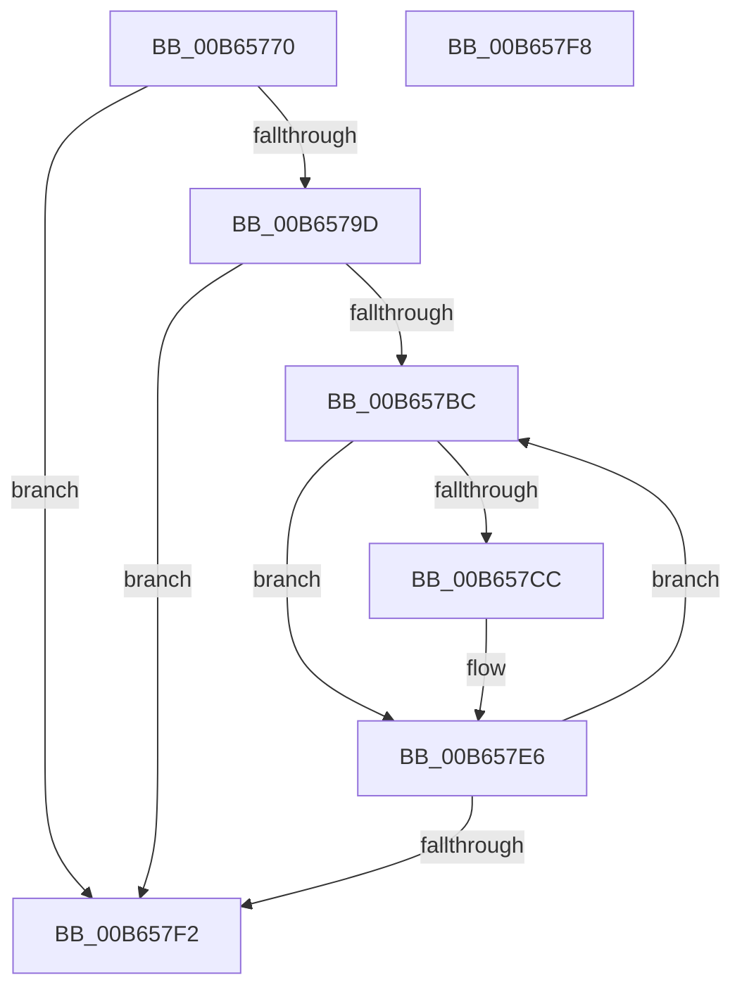

# KdMarkHiberPhase

- RVA: `0x00B65770`–`0x00B657F9` (길이 `137` bytes)
- VA: `0x0000000140B65770`
- 실행 섹션: `PAGELK`
- PDB 이름 있음: `예`; PDB Function 태그: `아니요`
- unwind 정보 RVA: `0x00064C80`
- 디코드: `34`개 명령, `137/137` bytes 표시
- 미해석 바이트: `0` (있으면 어셈블리에 `.byte`로 보존)

> 이 문서는 커널 이미지의 기계어와 PDB 기호를 분석해 생성했습니다. 4번과 5번은 함수 원형과 자료형을 바이너리 사용 방식에서 추정한 C 해석이며 원본 소스 복구 결과는 아닙니다.

## 1. Dependencies

- 직접 호출 지점: **3**; 고유 호출 대상: **2**
- 직접 호출자로 확인된 함수: **1**
- RIP 상대 이미지 참조: **5**

### Outgoing calls
- `0x00B6578F` → [PoSetHiberRange](../../text/47/PoSetHiberRange_function_0047C580.md) (function, `0x0047C580`)
- `0x00B657A4` → `kdcom.dll!KdSetHiberRange` (import, 간접 대상; import `kdcom.dll!KdSetHiberRange`)
- `0x00B657E1` → [PoSetHiberRange](../../text/47/PoSetHiberRange_function_0047C580.md) (function, `0x0047C580`)

### Direct callers
- [PopMarkComponentsBootPhase](PopMarkComponentsBootPhase_function_00B6E0E4.md) at `0x00B6E209`

### Static image references
- `0x00B65781` → RVA `0x00E0AA1C` (`.data`; read)
- `0x00B6579D` → RVA `0x00F475E0` (`.data`; read)
- `0x00B657A4` → RVA `0x001516C8` (`kdcom.dll!KdSetHiberRange (IAT)`; read)
- `0x00B657B0` → RVA `0x00FC6A80` (`ALMOSTRO`; read)
- `0x00B657BC` → RVA `0x00F55CC0` (`.data`; read)

## 2. Other-region calls and transfers

- 다른 실행 섹션으로 향하는 call: **2**
  - `0x00B6578F` → [PoSetHiberRange](../../text/47/PoSetHiberRange_function_0047C580.md) (`PAGELK` → `.text`)
  - `0x00B657E1` → [PoSetHiberRange](../../text/47/PoSetHiberRange_function_0047C580.md) (`PAGELK` → `.text`)
- 별도 외부 분기/꼬리 이동을 확인하지 못했습니다.

## 3. Assembly (complete function range)

```asm
00B65770  40 53                           push rbx
00B65772  48 83 EC 30                     sub rsp, 0x30
00B65776  45 33 C9                        xor r9d, r9d
00B65779  C7 44 24 20 4B 64 6C 62         mov dword ptr [rsp + 0x20], 0x626c644b
00B65781  4C 8D 05 94 52 2A 00            lea r8, [rip + 0x2a5294]
00B65788  BA 00 00 01 00                  mov edx, 0x10000
00B6578D  33 C9                           xor ecx, ecx
00B6578F  E8 EC 6D 91 FF                  call 0x14047c580
00B65794  80 3D 81 52 2A 00 00            cmp byte ptr [rip + 0x2a5281], 0
00B6579B  75 55                           jne 0x140b657f2
00B6579D  48 8D 0D 3C 1E 3E 00            lea rcx, [rip + 0x3e1e3c]
00B657A4  48 FF 15 1D BF 5E FF            call qword ptr [rip - 0xa140e3]
00B657AB  0F 1F 44 00 00                  nop dword ptr [rax + rax]
00B657B0  8B 05 CA 12 46 00               mov eax, dword ptr [rip + 0x4612ca]
00B657B6  33 DB                           xor ebx, ebx
00B657B8  85 C0                           test eax, eax
00B657BA  74 36                           je 0x140b657f2
00B657BC  4C 8D 05 FD 04 3F 00            lea r8, [rip + 0x3f04fd]
00B657C3  4D 8B 04 D8                     mov r8, qword ptr [r8 + rbx*8]
00B657C7  4D 85 C0                        test r8, r8
00B657CA  74 1A                           je 0x140b657e6
00B657CC  BA 00 00 01 00                  mov edx, 0x10000
00B657D1  C7 44 24 20 4B 64 6C 62         mov dword ptr [rsp + 0x20], 0x626c644b
00B657D9  33 C9                           xor ecx, ecx
00B657DB  41 B9 00 10 00 00               mov r9d, 0x1000
00B657E1  E8 9A 6D 91 FF                  call 0x14047c580
00B657E6  8B 05 94 12 46 00               mov eax, dword ptr [rip + 0x461294]
00B657EC  FF C3                           inc ebx
00B657EE  3B D8                           cmp ebx, eax
00B657F0  72 CA                           jb 0x140b657bc
00B657F2  48 83 C4 30                     add rsp, 0x30
00B657F6  5B                              pop rbx
00B657F7  C3                              ret
00B657F8  CC                              int3
```

## 4. C-style interpretation (structured pseudocode)

```c
__int64 __fastcall KdMarkHiberPhase(int a1, __int64 a2, __int64 a3, int a4)
{
    __int64 result;
    __int64 v_rbx;
    __int64 v_rsp;
    unsigned int v_stack_m18;

    v_rsp = (v_rsp) - (48);
    a4 = 0;
    v_stack_m18 = 0x626C644BULL;
    a1 = 0;
    result = PoSetHiberRange(a1, (unsigned int)(0x10000ULL), v_rip + 2773652, a4);
    if ((*(unsigned __int8 *)(v_rip + 2773633)) != 0) goto loc_00B657F2;
    result = kdcom_dll_KdSetHiberRange(v_rip + 4070972, (unsigned int)(0x10000ULL), v_rip + 2773652, a4);
    v_rbx = 0;
    if ((unsigned int)((unsigned int)(*(unsigned int *)(v_rip + 4592330))) == 0) goto loc_00B657F2;
loc_00B657BC:
    result = (unsigned int)(*(unsigned int *)(v_rip + 4592330));
    if (*(unsigned __int64 *)(v_rip + 4130045 + v_rbx * 8) != 0) {
        a2 = 0x10000ULL;
        v_stack_m18 = 0x626C644BULL;
        a1 = 0;
        a4 = 0x1000ULL;
        result = PoSetHiberRange(a1, a2, *(unsigned __int64 *)(v_rip + 4130045 + v_rbx * 8), a4);
    }
    v_rbx = (unsigned int)((v_rbx) + 1);
    if (((unsigned int)(v_rbx)) < ((unsigned int)((unsigned int)(*(unsigned int *)(v_rip + 4592276))))) goto loc_00B657BC;
loc_00B657F2:
    v_rsp = (v_rsp) + (48);
    return (unsigned int)(*(unsigned int *)(v_rip + 4592276));
}
```

## 5. (Beta) C Style

```c
int64_t KdMarkHiberPhase(int32_t Arg1, int64_t Arg2, int64_t Arg3, int32_t Arg4)
{
    int64_t result;
    int64_t local_rbx;
    int64_t local_rsp;
    uint32_t v_stack_m18;

    local_rsp = (local_rsp) - (48);
    Arg4 = 0;
    v_stack_m18 = 0x626C644BULL;
    Arg1 = 0;
    result = PoSetHiberRange(Arg1, (uint32_t)(0x10000ULL), v_rip + 2773652, Arg4);
    if ((*(uint8_t *)(v_rip + 0x2A5281)) != 0) goto loc_00B657F2;
    result = kernel_indirect_call(v_rip + 4070972, (uint32_t)(0x10000ULL), v_rip + 2773652, Arg4);
    local_rbx = 0;
    if ((uint32_t)((uint32_t)(*(uint32_t *)(v_rip + 0x4612CA))) == 0) goto loc_00B657F2;
loc_00B657BC:
    result = (uint32_t)(*(uint32_t *)(v_rip + 0x4612CA));
    if (*(uint64_t *)(v_rip + 0x3F04FD + local_rbx * 8) != 0) {
        Arg2 = 0x10000ULL;
        v_stack_m18 = 0x626C644BULL;
        Arg1 = 0;
        Arg4 = 0x1000ULL;
        result = PoSetHiberRange(Arg1, Arg2, *(uint64_t *)(v_rip + 0x3F04FD + local_rbx * 8), Arg4);
    }
    local_rbx = (uint32_t)((local_rbx) + 1);
    if (((uint32_t)(local_rbx)) < ((uint32_t)((uint32_t)(*(uint32_t *)(v_rip + 0x461294))))) goto loc_00B657BC;
loc_00B657F2:
    local_rsp = (local_rsp) + (48);
    return (uint32_t)(*(uint32_t *)(v_rip + 0x461294));
}
```

## 6. Execution-region graph

[열기: 2D/3D 그래프와 함수 탐색 컨트롤 패널](../../../control-panel.html?section=pagelk&rva=0x00B65770&view=graph)

- 2D 그래프는 위에서 아래로 흐르고, 3D 그래프는 빈 공간을 드래그해 회전합니다. Shift+드래그는 이동, 휠은 확대·축소, 함수 노드 선택은 대상 보고서 이동입니다.

### Static fallback


