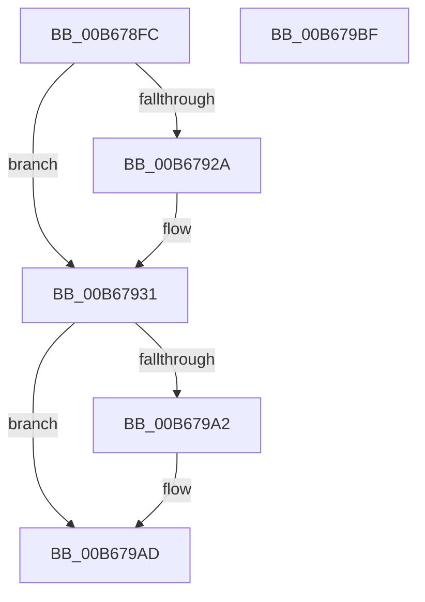

# KeInitializeClockOtherProcessors

- RVA: `0x00B678FC`–`0x00B679C0` (길이 `196` bytes)
- VA: `0x0000000140B678FC`
- 실행 섹션: `PAGELK`
- PDB 이름 있음: `예`; PDB Function 태그: `아니요`
- unwind 정보 RVA: `0x0005CAAC`
- 디코드: `46`개 명령, `196/196` bytes 표시
- 미해석 바이트: `0` (있으면 어셈블리에 `.byte`로 보존)

> 이 문서는 커널 이미지의 기계어와 PDB 기호를 분석해 생성했습니다. 4번과 5번은 함수 원형과 자료형을 바이너리 사용 방식에서 추정한 C 해석이며 원본 소스 복구 결과는 아닙니다.

## 1. Dependencies

- 직접 호출 지점: **9**; 고유 호출 대상: **5**
- 직접 호출자로 확인된 함수: **1**
- RIP 상대 이미지 참조: **6**

### Outgoing calls
- `0x00B6790C` → [KiGetClockTimerState](../../text/4F/KiGetClockTimerState_function_004F8CC4.md) (function, `0x004F8CC4`)
- `0x00B6792C` → [KiRaiseIrqlProcessIrqlFlags](../../text/4F/KiRaiseIrqlProcessIrqlFlags_function_004F56FC.md) (function, `0x004F56FC`)
- `0x00B67938` → [guard_dispatch_icall](../../text/6B/guard_dispatch_icall_function_006BAAD0.md) (function, `0x006BAAD0`)
- `0x00B6793F` → [KiSetPendingTick](../../text/44/KiSetPendingTick_function_004400F4.md) (function, `0x004400F4`)
- `0x00B6794B` → [guard_dispatch_icall](../../text/6B/guard_dispatch_icall_function_006BAAD0.md) (function, `0x006BAAD0`)
- `0x00B67959` → [guard_dispatch_icall](../../text/6B/guard_dispatch_icall_function_006BAAD0.md) (function, `0x006BAAD0`)
- `0x00B67972` → [guard_dispatch_icall](../../text/6B/guard_dispatch_icall_function_006BAAD0.md) (function, `0x006BAAD0`)
- `0x00B67979` → [KiSetPendingTick](../../text/44/KiSetPendingTick_function_004400F4.md) (function, `0x004400F4`)
- `0x00B679A8` → [KiLowerIrqlProcessIrqlFlags](../../text/4F/KiLowerIrqlProcessIrqlFlags_function_004F5698.md) (function, `0x004F5698`)

### Direct callers
- [KiInitializeKernel](KiInitializeKernel_function_00B68D20.md) at `0x00B69602`

### Static image references
- `0x00B67921` → RVA `0x00FC6D20` (`ALMOSTRO`; read)
- `0x00B67931` → RVA `0x00E00AE8` (`.data`; read)
- `0x00B67944` → RVA `0x00E00AE0` (`.data`; read)
- `0x00B67950` → RVA `0x00E00AD8` (`.data`; read)
- `0x00B6795E` → RVA `0x00FC6AA0` (`ALMOSTRO`; read)
- `0x00B67969` → RVA `0x00E00AF0` (`.data`; read)

## 2. Other-region calls and transfers

- 다른 실행 섹션으로 향하는 call: **9**
  - `0x00B6790C` → [KiGetClockTimerState](../../text/4F/KiGetClockTimerState_function_004F8CC4.md) (`PAGELK` → `.text`)
  - `0x00B6792C` → [KiRaiseIrqlProcessIrqlFlags](../../text/4F/KiRaiseIrqlProcessIrqlFlags_function_004F56FC.md) (`PAGELK` → `.text`)
  - `0x00B67938` → [guard_dispatch_icall](../../text/6B/guard_dispatch_icall_function_006BAAD0.md) (`PAGELK` → `.text`)
  - `0x00B6793F` → [KiSetPendingTick](../../text/44/KiSetPendingTick_function_004400F4.md) (`PAGELK` → `.text`)
  - `0x00B6794B` → [guard_dispatch_icall](../../text/6B/guard_dispatch_icall_function_006BAAD0.md) (`PAGELK` → `.text`)
  - `0x00B67959` → [guard_dispatch_icall](../../text/6B/guard_dispatch_icall_function_006BAAD0.md) (`PAGELK` → `.text`)
  - `0x00B67972` → [guard_dispatch_icall](../../text/6B/guard_dispatch_icall_function_006BAAD0.md) (`PAGELK` → `.text`)
  - `0x00B67979` → [KiSetPendingTick](../../text/44/KiSetPendingTick_function_004400F4.md) (`PAGELK` → `.text`)
  - `0x00B679A8` → [KiLowerIrqlProcessIrqlFlags](../../text/4F/KiLowerIrqlProcessIrqlFlags_function_004F5698.md) (`PAGELK` → `.text`)
- 별도 외부 분기/꼬리 이동을 확인하지 못했습니다.

## 3. Assembly (complete function range)

```asm
00B678FC  48 89 5C 24 08                  mov qword ptr [rsp + 8], rbx
00B67901  57                              push rdi
00B67902  48 83 EC 20                     sub rsp, 0x20
00B67906  48 83 64 24 38 00               and qword ptr [rsp + 0x38], 0
00B6790C  E8 B3 13 99 FF                  call 0x1404f8cc4
00B67911  48 8B F8                        mov rdi, rax
00B67914  44 0F 20 C3                     mov rbx, cr8
00B67918  BA 0D 00 00 00                  mov edx, 0xd
00B6791D  44 0F 22 C2                     mov cr8, rdx
00B67921  83 3D F8 F3 45 00 00            cmp dword ptr [rip + 0x45f3f8], 0
00B67928  74 07                           je 0x140b67931
00B6792A  8A CB                           mov cl, bl
00B6792C  E8 CB DD 98 FF                  call 0x1404f56fc
00B67931  48 8B 05 B0 91 29 00            mov rax, qword ptr [rip + 0x2991b0]
00B67938  E8 93 31 B5 FF                  call 0x1406baad0
00B6793D  33 C9                           xor ecx, ecx
00B6793F  E8 B0 87 8D FF                  call 0x1404400f4
00B67944  48 8B 05 95 91 29 00            mov rax, qword ptr [rip + 0x299195]
00B6794B  E8 80 31 B5 FF                  call 0x1406baad0
00B67950  48 8B 05 81 91 29 00            mov rax, qword ptr [rip + 0x299181]
00B67957  B1 01                           mov cl, 1
00B67959  E8 72 31 B5 FF                  call 0x1406baad0
00B6795E  8B 15 3C F1 45 00               mov edx, dword ptr [rip + 0x45f13c]
00B67964  4C 8D 44 24 38                  lea r8, [rsp + 0x38]
00B67969  48 8B 05 80 91 29 00            mov rax, qword ptr [rip + 0x299180]
00B67970  33 C9                           xor ecx, ecx
00B67972  E8 59 31 B5 FF                  call 0x1406baad0
00B67977  B1 01                           mov cl, 1
00B67979  E8 76 87 8D FF                  call 0x1404400f4
00B6797E  44 8B 54 24 38                  mov r10d, dword ptr [rsp + 0x38]
00B67983  8B 05 17 F1 45 00               mov eax, dword ptr [rip + 0x45f117]
00B67989  89 47 0C                        mov dword ptr [rdi + 0xc], eax
00B6798C  44 89 57 08                     mov dword ptr [rdi + 8], r10d
00B67990  66 C7 87 88 00 00 00 01 00      mov word ptr [rdi + 0x88], 1
00B67999  83 3D 80 F3 45 00 00            cmp dword ptr [rip + 0x45f380], 0
00B679A0  74 0B                           je 0x140b679ad
00B679A2  44 0F 20 C1                     mov rcx, cr8
00B679A6  8A D3                           mov dl, bl
00B679A8  E8 EB DC 98 FF                  call 0x1404f5698
00B679AD  0F B6 C3                        movzx eax, bl
00B679B0  44 0F 22 C0                     mov cr8, rax
00B679B4  48 8B 5C 24 30                  mov rbx, qword ptr [rsp + 0x30]
00B679B9  48 83 C4 20                     add rsp, 0x20
00B679BD  5F                              pop rdi
00B679BE  C3                              ret
00B679BF  CC                              int3
```

## 4. C-style interpretation (structured pseudocode)

```c
__int64 __fastcall KeInitializeClockOtherProcessors(void)
{
    __int64 result;
    __int64 v_rsp;
    unsigned __int64 v_stack_p10;
    unsigned __int64 v_stack_p8;

    v_stack_p8 = v_rbx;
    v_rsp = (v_rsp) - (32);
    result = KiGetClockTimerState(a1, a2, a3, a4);
    if ((*(unsigned int *)(v_rip + 4584440)) != 0) {
        a1 = (unsigned __int8)(v_cr8);
        result = KiRaiseIrqlProcessIrqlFlags(a1, 13, a3, a4);
    }
    result = guard_dispatch_icall(a1, 13, a3, a4);
    a1 = 0;
    result = KiSetPendingTick(a1, 13, a3, a4);
    result = guard_dispatch_icall(a1, 13, a3, a4);
    result = guard_dispatch_icall(1, 13, a3, a4);
    a1 = 0;
    result = guard_dispatch_icall(a1, (unsigned int)(*(unsigned int *)(v_rip + 4583740)), v_stack_p10, a4);
    result = KiSetPendingTick(1, (unsigned int)(*(unsigned int *)(v_rip + 4583740)), v_stack_p10, a4);
    *(unsigned int *)(result + 12) = (unsigned int)((unsigned int)(*(unsigned int *)(v_rip + 4583703)));
    *(unsigned int *)(result + 8) = (unsigned int)((unsigned int)(v_stack_p10));
    *(unsigned __int16 *)(result + 136) = 1;
    result = (unsigned int)(*(unsigned int *)(v_rip + 4583703));
    if ((*(unsigned int *)(v_rip + 4584320)) != 0) {
        a1 = 13;
        a2 = (unsigned __int8)(v_cr8);
        result = KiLowerIrqlProcessIrqlFlags(a1, a2, v_stack_p10, a4);
    }
    v_rsp = (v_rsp) + (32);
    return (unsigned __int8)(v_cr8);
}
```

## 5. (Beta) C Style

```c
void KeInitializeClockOtherProcessors(void)
{
    int64_t result;
    int64_t local_rsp;
    uint64_t v_stack_p10;
    uint64_t v_stack_p8;

    v_stack_p8 = local_rbx;
    local_rsp = (local_rsp) - (32);
    result = KiGetClockTimerState(a1, a2, a3, a4);
    if ((*(uint32_t *)(v_rip + 0x45F3F8)) != 0) {
        a1 = (uint8_t)(v_cr8);
        result = KiRaiseIrqlProcessIrqlFlags(a1, 13, a3, a4);
    }
    result = guard_dispatch_icall(a1, 13, a3, a4);
    a1 = 0;
    result = KiSetPendingTick(a1, 13, a3, a4);
    result = guard_dispatch_icall(a1, 13, a3, a4);
    result = guard_dispatch_icall(1, 13, a3, a4);
    a1 = 0;
    result = guard_dispatch_icall(a1, (uint32_t)(*(uint32_t *)(v_rip + 0x45F13C)), v_stack_p10, a4);
    result = KiSetPendingTick(1, (uint32_t)(*(uint32_t *)(v_rip + 0x45F13C)), v_stack_p10, a4);
    *(uint32_t *)(result + 0xC) = (uint32_t)((uint32_t)(*(uint32_t *)(v_rip + 0x45F117)));
    *(uint32_t *)(result + 0x8) = (uint32_t)((uint32_t)(v_stack_p10));
    *(uint16_t *)(result + 0x88) = 1;
    result = (uint32_t)(*(uint32_t *)(v_rip + 0x45F117));
    if ((*(uint32_t *)(v_rip + 0x45F380)) != 0) {
        a1 = 13;
        a2 = (uint8_t)(v_cr8);
        result = KiLowerIrqlProcessIrqlFlags(a1, a2, v_stack_p10, a4);
    }
    local_rsp = (local_rsp) + (32);
    return (uint8_t)(v_cr8);
}
```

## 6. Execution-region graph

[열기: 2D/3D 그래프와 함수 탐색 컨트롤 패널](../../../control-panel.html?section=pagelk&rva=0x00B678FC&view=graph)

- 2D 그래프는 위에서 아래로 흐르고, 3D 그래프는 빈 공간을 드래그해 회전합니다. Shift+드래그는 이동, 휠은 확대·축소, 함수 노드 선택은 대상 보고서 이동입니다.

### Static fallback


