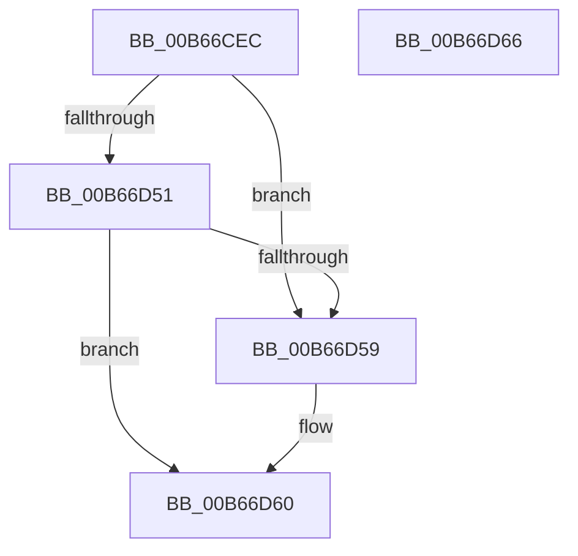

# KeInitializeXSaveStructures

- RVA: `0x00B66CEC`–`0x00B66D67` (길이 `123` bytes)
- VA: `0x0000000140B66CEC`
- 실행 섹션: `PAGELK`
- PDB 이름 있음: `예`; PDB Function 태그: `아니요`
- unwind 정보 RVA: `0x00064C80`
- 디코드: `26`개 명령, `123/123` bytes 표시
- 미해석 바이트: `0` (있으면 어셈블리에 `.byte`로 보존)

> 이 문서는 커널 이미지의 기계어와 PDB 기호를 분석해 생성했습니다. 4번과 5번은 함수 원형과 자료형을 바이너리 사용 방식에서 추정한 C 해석이며 원본 소스 복구 결과는 아닙니다.

## 1. Dependencies

- 직접 호출 지점: **1**; 고유 호출 대상: **1**
- 직접 호출자로 확인된 함수: **1**
- RIP 상대 이미지 참조: **4**

### Outgoing calls
- `0x00B66D27` → [ExInitializeSystemLookasideList](../B7/ExInitializeSystemLookasideList_function_00B7E57C.md) (function, `0x00B7E57C`)

### Direct callers
- [InitBootProcessor](../../init/C1/InitBootProcessor_function_00C1B1C8.md) at `0x00C1B707`

### Static image references
- `0x00B66CFB` → RVA `0x00EFAC00` (`.data`; read)
- `0x00B66D07` → RVA `0x00E15980` (`.data`; read)
- `0x00B66D43` → RVA `0x00F225E8` (`.data`; read)
- `0x00B66D59` → RVA `0x00F225E8` (`.data`; read/write)

## 2. Other-region calls and transfers

- 다른 실행 섹션으로 향하는 call: **0**
- 별도 외부 분기/꼬리 이동을 확인하지 못했습니다.

## 3. Assembly (complete function range)

```asm
00B66CEC  40 53                           push rbx
00B66CEE  48 83 EC 30                     sub rsp, 0x30
00B66CF2  A1 E8 03 00 00 80 F7 FF FF      movabs eax, dword ptr [0xfffff780000003e8]
00B66CFB  48 8D 0D FE 3E 39 00            lea rcx, [rip + 0x393efe]
00B66D02  48 89 4C 24 28                  mov qword ptr [rsp + 0x28], rcx
00B66D07  48 8D 1D 72 EC 2A 00            lea rbx, [rip + 0x2aec72]
00B66D0E  BA 00 02 00 00                  mov edx, 0x200
00B66D13  66 C7 44 24 20 80 00            mov word ptr [rsp + 0x20], 0x80
00B66D1A  41 B9 58 53 61 4C               mov r9d, 0x4c615358
00B66D20  48 8B CB                        mov rcx, rbx
00B66D23  44 8D 40 3F                     lea r8d, [rax + 0x3f]
00B66D27  E8 50 78 01 00                  call 0x140b7e57c
00B66D2C  65 48 8B 04 25 20 00 00 00      mov rax, qword ptr gs:[0x20]
00B66D35  48 89 98 98 08 00 00            mov qword ptr [rax + 0x898], rbx
00B66D3C  48 89 98 90 08 00 00            mov qword ptr [rax + 0x890], rbx
00B66D43  8B 0D 9F B8 3B 00               mov ecx, dword ptr [rip + 0x3bb89f]
00B66D49  8D 41 FF                        lea eax, [rcx - 1]
00B66D4C  83 F8 0E                        cmp eax, 0xe
00B66D4F  76 08                           jbe 0x140b66d59
00B66D51  81 F9 01 04 00 00               cmp ecx, 0x401
00B66D57  72 07                           jb 0x140b66d60
00B66D59  83 25 88 B8 3B 00 00            and dword ptr [rip + 0x3bb888], 0
00B66D60  48 83 C4 30                     add rsp, 0x30
00B66D64  5B                              pop rbx
00B66D65  C3                              ret
00B66D66  CC                              int3
```

## 4. C-style interpretation (structured pseudocode)

```c
__int64 __fastcall KeInitializeXSaveStructures(void)
{
    __int64 result;
    __int64 v_rsp;
    unsigned __int64 v_stack_m10;
    unsigned __int16 v_stack_m18;

    v_rsp = (v_rsp) - (48);
    v_stack_m10 = v_rip + 3751678;
    v_stack_m18 = 128;
    result = ExInitializeSystemLookasideList(v_rip + 2813042, 512, result + 63, (unsigned int)(0x4C615358ULL));
    *(unsigned __int64 *)(*(unsigned __int64 *)(gs_base + (0 + 32)) + 2200) = v_rip + 2813042;
    *(unsigned __int64 *)(*(unsigned __int64 *)(gs_base + (0 + 32)) + 2192) = v_rip + 2813042;
    if (((unsigned int)((unsigned int)(*(unsigned int *)(v_rip + 3913887)) - 1)) <= 14) goto loc_00B66D59;
    if (((unsigned int)((unsigned int)(*(unsigned int *)(v_rip + 3913887)))) >= 0x401ULL) {
    }
    v_rsp = (v_rsp) + (48);
    return (unsigned int)(*(unsigned int *)(v_rip + 3913887)) - 1;
}
```

## 5. (Beta) C Style

```c
void KeInitializeXSaveStructures(void)
{
    int64_t result;
    int64_t local_rsp;
    uint64_t v_stack_m10;
    uint16_t v_stack_m18;

    local_rsp = (local_rsp) - (48);
    v_stack_m10 = v_rip + 3751678;
    v_stack_m18 = 128;
    result = ExInitializeSystemLookasideList(v_rip + 2813042, 512, result + 63, (uint32_t)(0x4C615358ULL));
    *(uint64_t *)(*(uint64_t *)(gs_base + (0 + 0x20)) + 0x898) = v_rip + 2813042;
    *(uint64_t *)(*(uint64_t *)(gs_base + (0 + 0x20)) + 0x890) = v_rip + 2813042;
    if (((uint32_t)((uint32_t)(*(uint32_t *)(v_rip + 0x3BB89F)) - 1)) <= 14) goto loc_00B66D59;
    if (((uint32_t)((uint32_t)(*(uint32_t *)(v_rip + 0x3BB89F)))) >= 0x401ULL) {
    }
    local_rsp = (local_rsp) + (48);
    return (uint32_t)(*(uint32_t *)(v_rip + 0x3BB89F)) - 1;
}
```

## 6. Execution-region graph

[열기: 2D/3D 그래프와 함수 탐색 컨트롤 패널](../../../control-panel.html?section=pagelk&rva=0x00B66CEC&view=graph)

- 2D 그래프는 위에서 아래로 흐르고, 3D 그래프는 빈 공간을 드래그해 회전합니다. Shift+드래그는 이동, 휠은 확대·축소, 함수 노드 선택은 대상 보고서 이동입니다.

### Static fallback


