# KeMarkPcrHiberPhase

- RVA: `0x00B65800`–`0x00B65D11` (길이 `1,297` bytes)
- VA: `0x0000000140B65800`
- 실행 섹션: `PAGELK`
- PDB 이름 있음: `예`; PDB Function 태그: `아니요`
- unwind 정보 RVA: `0x0008C20C`
- 디코드: `314`개 명령, `1,297/1,297` bytes 표시
- 미해석 바이트: `0` (있으면 어셈블리에 `.byte`로 보존)

> 이 문서는 커널 이미지의 기계어와 PDB 기호를 분석해 생성했습니다. 4번과 5번은 함수 원형과 자료형을 바이너리 사용 방식에서 추정한 C 해석이며 원본 소스 복구 결과는 아닙니다.

## 1. Dependencies

- 직접 호출 지점: **25**; 고유 호출 대상: **1**
- 직접 호출자로 확인된 함수: **1**
- RIP 상대 이미지 참조: **15**

### Outgoing calls
- `0x00B65849` → [PoSetHiberRange](../../text/47/PoSetHiberRange_function_0047C580.md) (function, `0x0047C580`)
- `0x00B65860` → [PoSetHiberRange](../../text/47/PoSetHiberRange_function_0047C580.md) (function, `0x0047C580`)
- `0x00B65875` → [PoSetHiberRange](../../text/47/PoSetHiberRange_function_0047C580.md) (function, `0x0047C580`)
- `0x00B658B2` → [PoSetHiberRange](../../text/47/PoSetHiberRange_function_0047C580.md) (function, `0x0047C580`)
- `0x00B6590E` → [PoSetHiberRange](../../text/47/PoSetHiberRange_function_0047C580.md) (function, `0x0047C580`)
- `0x00B65936` → [PoSetHiberRange](../../text/47/PoSetHiberRange_function_0047C580.md) (function, `0x0047C580`)
- `0x00B6596C` → [PoSetHiberRange](../../text/47/PoSetHiberRange_function_0047C580.md) (function, `0x0047C580`)
- `0x00B6599D` → [PoSetHiberRange](../../text/47/PoSetHiberRange_function_0047C580.md) (function, `0x0047C580`)
- `0x00B659BA` → [PoSetHiberRange](../../text/47/PoSetHiberRange_function_0047C580.md) (function, `0x0047C580`)
- `0x00B659EF` → [PoSetHiberRange](../../text/47/PoSetHiberRange_function_0047C580.md) (function, `0x0047C580`)
- `0x00B65A18` → [PoSetHiberRange](../../text/47/PoSetHiberRange_function_0047C580.md) (function, `0x0047C580`)
- `0x00B65A45` → [PoSetHiberRange](../../text/47/PoSetHiberRange_function_0047C580.md) (function, `0x0047C580`)
- `0x00B65A80` → [PoSetHiberRange](../../text/47/PoSetHiberRange_function_0047C580.md) (function, `0x0047C580`)
- `0x00B65AA6` → [PoSetHiberRange](../../text/47/PoSetHiberRange_function_0047C580.md) (function, `0x0047C580`)
- `0x00B65B20` → [PoSetHiberRange](../../text/47/PoSetHiberRange_function_0047C580.md) (function, `0x0047C580`)
- `0x00B65B69` → [PoSetHiberRange](../../text/47/PoSetHiberRange_function_0047C580.md) (function, `0x0047C580`)
- `0x00B65BB0` → [PoSetHiberRange](../../text/47/PoSetHiberRange_function_0047C580.md) (function, `0x0047C580`)
- `0x00B65BD4` → [PoSetHiberRange](../../text/47/PoSetHiberRange_function_0047C580.md) (function, `0x0047C580`)
- `0x00B65C01` → [PoSetHiberRange](../../text/47/PoSetHiberRange_function_0047C580.md) (function, `0x0047C580`)
- `0x00B65C21` → [PoSetHiberRange](../../text/47/PoSetHiberRange_function_0047C580.md) (function, `0x0047C580`)
- `0x00B65C55` → [PoSetHiberRange](../../text/47/PoSetHiberRange_function_0047C580.md) (function, `0x0047C580`)
- `0x00B65C6E` → [PoSetHiberRange](../../text/47/PoSetHiberRange_function_0047C580.md) (function, `0x0047C580`)
- `0x00B65C95` → [PoSetHiberRange](../../text/47/PoSetHiberRange_function_0047C580.md) (function, `0x0047C580`)
- `0x00B65CD2` → [PoSetHiberRange](../../text/47/PoSetHiberRange_function_0047C580.md) (function, `0x0047C580`)
- `0x00B65CEE` → [PoSetHiberRange](../../text/47/PoSetHiberRange_function_0047C580.md) (function, `0x0047C580`)

### Direct callers
- [PopMarkComponentsBootPhase](PopMarkComponentsBootPhase_function_00B6E0E4.md) at `0x00B6E1E6`

### Static image references
- `0x00B6587A` → RVA `0x00E66960` (`.data`; read)
- `0x00B65886` → RVA `0x00FC6A80` (`ALMOSTRO`; read)
- `0x00B658E4` → RVA `0x01201840` (`CFGRO`; read)
- `0x00B658EB` → RVA `0x00FC5060` (`ALMOSTRO`; read)
- `0x00B6593B` → RVA `0x01201841` (`CFGRO`; read)
- `0x00B659CB` → RVA `0x00FC5020` (`ALMOSTRO`; read)
- `0x00B659FE` → RVA `0x00FC507C` (`ALMOSTRO`; read)
- `0x00B65B34` → RVA `0x00FC6B30` (`ALMOSTRO`; read)
- `0x00B65B46` → RVA `0x00FC50D0` (`ALMOSTRO`; read)
- `0x00B65B7A` → RVA `0x00FC6C30` (`ALMOSTRO`; read)
- `0x00B65BD9` → RVA `0x00F10EF8` (`.data`; read)
- `0x00B65BEA` → RVA `0x00F10EE8` (`.data`; read)
- `0x00B65C06` → RVA `0x00F10F00` (`.data`; read)
- `0x00B65C73` → RVA `0x00F234A0` (`.data`; read)
- `0x00B65CD7` → RVA `0x00EFEE38` (`.data`; read)

## 2. Other-region calls and transfers

- 다른 실행 섹션으로 향하는 call: **25**
  - `0x00B65849` → [PoSetHiberRange](../../text/47/PoSetHiberRange_function_0047C580.md) (`PAGELK` → `.text`)
  - `0x00B65860` → [PoSetHiberRange](../../text/47/PoSetHiberRange_function_0047C580.md) (`PAGELK` → `.text`)
  - `0x00B65875` → [PoSetHiberRange](../../text/47/PoSetHiberRange_function_0047C580.md) (`PAGELK` → `.text`)
  - `0x00B658B2` → [PoSetHiberRange](../../text/47/PoSetHiberRange_function_0047C580.md) (`PAGELK` → `.text`)
  - `0x00B6590E` → [PoSetHiberRange](../../text/47/PoSetHiberRange_function_0047C580.md) (`PAGELK` → `.text`)
  - `0x00B65936` → [PoSetHiberRange](../../text/47/PoSetHiberRange_function_0047C580.md) (`PAGELK` → `.text`)
  - `0x00B6596C` → [PoSetHiberRange](../../text/47/PoSetHiberRange_function_0047C580.md) (`PAGELK` → `.text`)
  - `0x00B6599D` → [PoSetHiberRange](../../text/47/PoSetHiberRange_function_0047C580.md) (`PAGELK` → `.text`)
  - `0x00B659BA` → [PoSetHiberRange](../../text/47/PoSetHiberRange_function_0047C580.md) (`PAGELK` → `.text`)
  - `0x00B659EF` → [PoSetHiberRange](../../text/47/PoSetHiberRange_function_0047C580.md) (`PAGELK` → `.text`)
  - `0x00B65A18` → [PoSetHiberRange](../../text/47/PoSetHiberRange_function_0047C580.md) (`PAGELK` → `.text`)
  - `0x00B65A45` → [PoSetHiberRange](../../text/47/PoSetHiberRange_function_0047C580.md) (`PAGELK` → `.text`)
  - `0x00B65A80` → [PoSetHiberRange](../../text/47/PoSetHiberRange_function_0047C580.md) (`PAGELK` → `.text`)
  - `0x00B65AA6` → [PoSetHiberRange](../../text/47/PoSetHiberRange_function_0047C580.md) (`PAGELK` → `.text`)
  - `0x00B65B20` → [PoSetHiberRange](../../text/47/PoSetHiberRange_function_0047C580.md) (`PAGELK` → `.text`)
  - `0x00B65B69` → [PoSetHiberRange](../../text/47/PoSetHiberRange_function_0047C580.md) (`PAGELK` → `.text`)
  - `0x00B65BB0` → [PoSetHiberRange](../../text/47/PoSetHiberRange_function_0047C580.md) (`PAGELK` → `.text`)
  - `0x00B65BD4` → [PoSetHiberRange](../../text/47/PoSetHiberRange_function_0047C580.md) (`PAGELK` → `.text`)
  - `0x00B65C01` → [PoSetHiberRange](../../text/47/PoSetHiberRange_function_0047C580.md) (`PAGELK` → `.text`)
  - `0x00B65C21` → [PoSetHiberRange](../../text/47/PoSetHiberRange_function_0047C580.md) (`PAGELK` → `.text`)
  - `0x00B65C55` → [PoSetHiberRange](../../text/47/PoSetHiberRange_function_0047C580.md) (`PAGELK` → `.text`)
  - `0x00B65C6E` → [PoSetHiberRange](../../text/47/PoSetHiberRange_function_0047C580.md) (`PAGELK` → `.text`)
  - `0x00B65C95` → [PoSetHiberRange](../../text/47/PoSetHiberRange_function_0047C580.md) (`PAGELK` → `.text`)
  - `0x00B65CD2` → [PoSetHiberRange](../../text/47/PoSetHiberRange_function_0047C580.md) (`PAGELK` → `.text`)
  - `0x00B65CEE` → [PoSetHiberRange](../../text/47/PoSetHiberRange_function_0047C580.md) (`PAGELK` → `.text`)
- 별도 외부 분기/꼬리 이동을 확인하지 못했습니다.

## 3. Assembly (complete function range)

```asm
00B65800  48 8B C4                        mov rax, rsp
00B65803  48 89 58 08                     mov qword ptr [rax + 8], rbx
00B65807  48 89 68 10                     mov qword ptr [rax + 0x10], rbp
00B6580B  48 89 70 18                     mov qword ptr [rax + 0x18], rsi
00B6580F  57                              push rdi
00B65810  41 54                           push r12
00B65812  41 55                           push r13
00B65814  41 56                           push r14
00B65816  41 57                           push r15
00B65818  48 83 EC 30                     sub rsp, 0x30
00B6581C  48 8B 79 20                     mov rdi, qword ptr [rcx + 0x20]
00B65820  45 33 ED                        xor r13d, r13d
00B65823  4C 8B 79 08                     mov r15, qword ptr [rcx + 8]
00B65827  BB 4B 65 70 63                  mov ebx, 0x6370654b
00B6582C  41 BC 00 00 01 00               mov r12d, 0x10000
00B65832  44 39 6F 24                     cmp dword ptr [rdi + 0x24], r13d
00B65836  75 4E                           jne 0x140b65886
00B65838  4C 8B C1                        mov r8, rcx
00B6583B  89 58 C8                        mov dword ptr [rax - 0x38], ebx
00B6583E  33 C9                           xor ecx, ecx
00B65840  41 B9 80 D0 00 00               mov r9d, 0xd080
00B65846  41 8B D4                        mov edx, r12d
00B65849  E8 32 6D 91 FF                  call 0x14047c580
00B6584E  41 B9 00 CF 00 00               mov r9d, 0xcf00
00B65854  89 5C 24 20                     mov dword ptr [rsp + 0x20], ebx
00B65858  4C 8B C7                        mov r8, rdi
00B6585B  41 8B D4                        mov edx, r12d
00B6585E  33 C9                           xor ecx, ecx
00B65860  E8 1B 6D 91 FF                  call 0x14047c580
00B65865  45 8D 4D 68                     lea r9d, [r13 + 0x68]
00B65869  89 5C 24 20                     mov dword ptr [rsp + 0x20], ebx
00B6586D  4D 8B C7                        mov r8, r15
00B65870  41 8B D4                        mov edx, r12d
00B65873  33 C9                           xor ecx, ecx
00B65875  E8 06 6D 91 FF                  call 0x14047c580
00B6587A  48 8D 0D DF 10 30 00            lea rcx, [rip + 0x3010df]
00B65881  45 8B CD                        mov r9d, r13d
00B65884  EB 20                           jmp 0x140b658a6
00B65886  44 8B 0D F3 11 46 00            mov r9d, dword ptr [rip + 0x4611f3]
00B6588D  41 81 C1 8E 03 00 00            add r9d, 0x38e
00B65894  41 C1 E1 06                     shl r9d, 6
00B65898  41 81 E1 00 F0 FF FF            and r9d, 0xfffff000
00B6589F  41 81 C1 00 70 00 00            add r9d, 0x7000
00B658A6  4C 8B C1                        mov r8, rcx
00B658A9  89 5C 24 20                     mov dword ptr [rsp + 0x20], ebx
00B658AD  33 C9                           xor ecx, ecx
00B658AF  41 8B D4                        mov edx, r12d
00B658B2  E8 C9 6C 91 FF                  call 0x14047c580
00B658B7  BE 01 00 00 00                  mov esi, 1
00B658BC  41 BE 00 10 00 00               mov r14d, 0x1000
00B658C2  8D 6E 07                        lea ebp, [rsi + 7]
00B658C5  49 8B 5C 2F 1C                  mov rbx, qword ptr [r15 + rbp + 0x1c]
00B658CA  8B C6                           mov eax, esi
00B658CC  83 E8 01                        sub eax, 1
00B658CF  74 13                           je 0x140b658e4
00B658D1  83 E8 01                        sub eax, 1
00B658D4  74 0E                           je 0x140b658e4
00B658D6  83 E8 01                        sub eax, 1
00B658D9  74 09                           je 0x140b658e4
00B658DB  83 F8 01                        cmp eax, 1
00B658DE  0F 85 8D 00 00 00               jne 0x140b65971
00B658E4  44 38 2D 55 BF 69 00            cmp byte ptr [rip + 0x69bf55], r13b
00B658EB  44 8B 35 6E F7 45 00            mov r14d, dword ptr [rip + 0x45f76e]
00B658F2  74 2C                           je 0x140b65920
00B658F4  4C 8D 83 30 FE FF FF            lea r8, [rbx - 0x1d0]
00B658FB  C7 44 24 20 4B 65 70 63         mov dword ptr [rsp + 0x20], 0x6370654b
00B65903  41 B9 00 02 00 00               mov r9d, 0x200
00B65909  41 8B D4                        mov edx, r12d
00B6590C  33 C9                           xor ecx, ecx
00B6590E  E8 6D 6C 91 FF                  call 0x14047c580
00B65913  48 8B 5B 08                     mov rbx, qword ptr [rbx + 8]
00B65917  49 2B DE                        sub rbx, r14
00B6591A  48 83 C3 20                     add rbx, 0x20
00B6591E  EB 03                           jmp 0x140b65923
00B65920  49 2B DE                        sub rbx, r14
00B65923  4D 8B CE                        mov r9, r14
00B65926  C7 44 24 20 4B 65 70 63         mov dword ptr [rsp + 0x20], 0x6370654b
00B6592E  4C 8B C3                        mov r8, rbx
00B65931  41 8B D4                        mov edx, r12d
00B65934  33 C9                           xor ecx, ecx
00B65936  E8 45 6C 91 FF                  call 0x14047c580
00B6593B  44 38 2D FF BE 69 00            cmp byte ptr [rip + 0x69beff], r13b
00B65942  41 BE 00 10 00 00               mov r14d, 0x1000
00B65948  74 27                           je 0x140b65971
00B6594A  48 8B 87 B0 9B 00 00            mov rax, qword ptr [rdi + 0x9bb0]
00B65951  45 8B CE                        mov r9d, r14d
00B65954  41 8B D4                        mov edx, r12d
00B65957  C7 44 24 20 4B 65 73 73         mov dword ptr [rsp + 0x20], 0x7373654b
00B6595F  33 C9                           xor ecx, ecx
00B65961  4C 8B 04 28                     mov r8, qword ptr [rax + rbp]
00B65965  49 81 E8 F8 0F 00 00            sub r8, 0xff8
00B6596C  E8 0F 6C 91 FF                  call 0x14047c580
00B65971  FF C6                           inc esi
00B65973  48 83 C5 08                     add rbp, 8
00B65977  83 FE 04                        cmp esi, 4
00B6597A  0F 86 45 FF FF FF               jbe 0x140b658c5
00B65980  44 0F B7 8F 66 01 00 00         movzx r9d, word ptr [rdi + 0x166]
00B65988  BB 4B 65 70 73                  mov ebx, 0x7370654b
00B6598D  4C 8B 87 68 01 00 00            mov r8, qword ptr [rdi + 0x168]
00B65994  41 8B D4                        mov edx, r12d
00B65997  33 C9                           xor ecx, ecx
00B65999  89 5C 24 20                     mov dword ptr [rsp + 0x20], ebx
00B6599D  E8 DE 6B 91 FF                  call 0x14047c580
00B659A2  44 0F B7 8F 56 01 00 00         movzx r9d, word ptr [rdi + 0x156]
00B659AA  41 8B D4                        mov edx, r12d
00B659AD  4C 8B 87 58 01 00 00            mov r8, qword ptr [rdi + 0x158]
00B659B4  33 C9                           xor ecx, ecx
00B659B6  89 5C 24 20                     mov dword ptr [rsp + 0x20], ebx
00B659BA  E8 C1 6B 91 FF                  call 0x14047c580
00B659BF  4C 8B 87 A0 38 00 00            mov r8, qword ptr [rdi + 0x38a0]
00B659C6  BB FF 0F 00 00                  mov ebx, 0xfff
00B659CB  44 8B 0D 4E F6 45 00            mov r9d, dword ptr [rip + 0x45f64e]
00B659D2  4C 03 C3                        add r8, rbx
00B659D5  49 C7 C7 00 F0 FF FF            mov r15, 0xfffffffffffff000
00B659DC  C7 44 24 20 4B 65 73 74         mov dword ptr [rsp + 0x20], 0x7473654b
00B659E4  4D 23 C7                        and r8, r15
00B659E7  41 8B D4                        mov edx, r12d
00B659EA  4D 2B C1                        sub r8, r9
00B659ED  33 C9                           xor ecx, ecx
00B659EF  E8 8C 6B 91 FF                  call 0x14047c580
00B659F4  4C 8B 87 68 87 00 00            mov r8, qword ptr [rdi + 0x8768]
00B659FB  41 8B D4                        mov edx, r12d
00B659FE  44 8B 0D 77 F6 45 00            mov r9d, dword ptr [rip + 0x45f677]
00B65A05  4C 03 C3                        add r8, rbx
00B65A08  4D 23 C7                        and r8, r15
00B65A0B  C7 44 24 20 4B 65 73 65         mov dword ptr [rsp + 0x20], 0x6573654b
00B65A13  4D 2B C1                        sub r8, r9
00B65A16  33 C9                           xor ecx, ecx
00B65A18  E8 63 6B 91 FF                  call 0x14047c580
00B65A1D  48 8D B7 40 38 00 00            lea rsi, [rdi + 0x3840]
00B65A24  BD 02 00 00 00                  mov ebp, 2
00B65A29  48 8B 1E                        mov rbx, qword ptr [rsi]
00B65A2C  EB 1F                           jmp 0x140b65a4d
00B65A2E  4C 8D 43 F8                     lea r8, [rbx - 8]
00B65A32  C7 44 24 20 4B 65 64 70         mov dword ptr [rsp + 0x20], 0x7064654b
00B65A3A  41 B9 40 00 00 00               mov r9d, 0x40
00B65A40  41 8B D4                        mov edx, r12d
00B65A43  33 C9                           xor ecx, ecx
00B65A45  E8 36 6B 91 FF                  call 0x14047c580
00B65A4A  48 8B 1B                        mov rbx, qword ptr [rbx]
00B65A4D  48 85 DB                        test rbx, rbx
00B65A50  75 DC                           jne 0x140b65a2e
00B65A52  48 83 C6 30                     add rsi, 0x30
00B65A56  48 83 ED 01                     sub rbp, 1
00B65A5A  75 CD                           jne 0x140b65a29
00B65A5C  4C 8B 87 10 38 00 00            mov r8, qword ptr [rdi + 0x3810]
00B65A63  4D 85 C0                        test r8, r8
00B65A66  0F 84 C8 00 00 00               je 0x140b65b34
00B65A6C  41 BF 4B 65 64 72               mov r15d, 0x7264654b
00B65A72  44 8D 4B 10                     lea r9d, [rbx + 0x10]
00B65A76  41 8B D4                        mov edx, r12d
00B65A79  44 89 7C 24 20                  mov dword ptr [rsp + 0x20], r15d
00B65A7E  33 C9                           xor ecx, ecx
00B65A80  E8 FB 6A 91 FF                  call 0x14047c580
00B65A85  4C 8B 87 10 38 00 00            mov r8, qword ptr [rdi + 0x3810]
00B65A8C  41 8B D4                        mov edx, r12d
00B65A8F  33 C9                           xor ecx, ecx
00B65A91  44 89 7C 24 20                  mov dword ptr [rsp + 0x20], r15d
00B65A96  45 8B 48 04                     mov r9d, dword ptr [r8 + 4]
00B65A9A  4D 8B 40 08                     mov r8, qword ptr [r8 + 8]
00B65A9E  49 C1 E9 05                     shr r9, 5
00B65AA2  49 C1 E1 03                     shl r9, 3
00B65AA6  E8 D5 6A 91 FF                  call 0x14047c580
00B65AAB  48 8B AF 10 38 00 00            mov rbp, qword ptr [rdi + 0x3810]
00B65AB2  49 BE 02 00 00 00 00 00 00 80   movabs r14, 0x8000000000000002
00B65ABC  48 8B 75 08                     mov rsi, qword ptr [rbp + 8]
00B65AC0  48 8B DE                        mov rbx, rsi
00B65AC3  48 85 DB                        test rbx, rbx
00B65AC6  74 17                           je 0x140b65adf
00B65AC8  48 8B 03                        mov rax, qword ptr [rbx]
00B65ACB  49 23 C6                        and rax, r14
00B65ACE  49 3B C6                        cmp rax, r14
00B65AD1  75 04                           jne 0x140b65ad7
00B65AD3  49 8B 45 00                     mov rax, qword ptr [r13]
00B65AD7  48 8B 1B                        mov rbx, qword ptr [rbx]
00B65ADA  F6 C3 01                        test bl, 1
00B65ADD  74 26                           je 0x140b65b05
00B65ADF  8B 4D 04                        mov ecx, dword ptr [rbp + 4]
00B65AE2  48 83 C6 08                     add rsi, 8
00B65AE6  48 8B 45 08                     mov rax, qword ptr [rbp + 8]
00B65AEA  48 C1 E9 05                     shr rcx, 5
00B65AEE  48 8D 14 C8                     lea rdx, [rax + rcx*8]
00B65AF2  48 3B F2                        cmp rsi, rdx
00B65AF5  73 30                           jae 0x140b65b27
00B65AF7  48 8B 1E                        mov rbx, qword ptr [rsi]
00B65AFA  F6 C3 01                        test bl, 1
00B65AFD  74 06                           je 0x140b65b05
00B65AFF  48 83 C6 08                     add rsi, 8
00B65B03  EB ED                           jmp 0x140b65af2
00B65B05  48 8B C3                        mov rax, rbx
00B65B08  48 85 C0                        test rax, rax
00B65B0B  74 1A                           je 0x140b65b27
00B65B0D  41 B9 20 00 00 00               mov r9d, 0x20
00B65B13  44 89 7C 24 20                  mov dword ptr [rsp + 0x20], r15d
00B65B18  4C 8B C3                        mov r8, rbx
00B65B1B  41 8B D4                        mov edx, r12d
00B65B1E  33 C9                           xor ecx, ecx
00B65B20  E8 5B 6A 91 FF                  call 0x14047c580
00B65B25  EB 9C                           jmp 0x140b65ac3
00B65B27  41 BE 00 10 00 00               mov r14d, 0x1000
00B65B2D  49 C7 C7 00 F0 FF FF            mov r15, 0xfffffffffffff000
00B65B34  48 F7 05 F1 0F 46 00 00 00 80 00  test qword ptr [rip + 0x460ff1], 0x800000
00B65B3F  B9 D0 04 00 00                  mov ecx, 0x4d0
00B65B44  74 0C                           je 0x140b65b52
00B65B46  8B 0D 84 F5 45 00               mov ecx, dword ptr [rip + 0x45f584]
00B65B4C  81 C1 2F 03 00 00               add ecx, 0x32f
00B65B52  4C 8B 87 C0 8F 00 00            mov r8, qword ptr [rdi + 0x8fc0]
00B65B59  41 8B D4                        mov edx, r12d
00B65B5C  44 8B C9                        mov r9d, ecx
00B65B5F  33 C9                           xor ecx, ecx
00B65B61  C7 44 24 20 4B 65 73 78         mov dword ptr [rsp + 0x20], 0x7873654b
00B65B69  E8 12 6A 91 FF                  call 0x14047c580
00B65B6E  4C 8B 87 C0 06 00 00            mov r8, qword ptr [rdi + 0x6c0]
00B65B75  4D 85 C0                        test r8, r8
00B65B78  74 3B                           je 0x140b65bb5
00B65B7A  44 8B 0D AF 10 46 00            mov r9d, dword ptr [rip + 0x4610af]
00B65B81  48 B8 00 06 00 00 80 F7 FF FF   movabs rax, 0xfffff78000000600
00B65B8B  49 83 C1 40                     add r9, 0x40
00B65B8F  C7 44 24 20 4B 65 73 73         mov dword ptr [rsp + 0x20], 0x7373654b
00B65B97  41 8B D4                        mov edx, r12d
00B65B9A  8B 08                           mov ecx, dword ptr [rax]
00B65B9C  48 B8 E8 03 00 00 80 F7 FF FF   movabs rax, 0xfffff780000003e8
00B65BA6  8B 00                           mov eax, dword ptr [rax]
00B65BA8  48 2B C8                        sub rcx, rax
00B65BAB  4C 03 C9                        add r9, rcx
00B65BAE  33 C9                           xor ecx, ecx
00B65BB0  E8 CB 69 91 FF                  call 0x14047c580
00B65BB5  4C 8B 87 40 88 00 00            mov r8, qword ptr [rdi + 0x8840]
00B65BBC  4D 85 C0                        test r8, r8
00B65BBF  74 18                           je 0x140b65bd9
00B65BC1  41 B9 78 05 00 00               mov r9d, 0x578
00B65BC7  C7 44 24 20 4B 65 49 73         mov dword ptr [rsp + 0x20], 0x7349654b
00B65BCF  41 8B D4                        mov edx, r12d
00B65BD2  33 C9                           xor ecx, ecx
00B65BD4  E8 A7 69 91 FF                  call 0x14047c580
00B65BD9  4C 8B 05 18 B3 3A 00            mov r8, qword ptr [rip + 0x3ab318]
00B65BE0  BB 4D 74 72 72                  mov ebx, 0x7272744d
00B65BE5  4D 85 C0                        test r8, r8
00B65BE8  74 1C                           je 0x140b65c06
00B65BEA  8B 05 F8 B2 3A 00               mov eax, dword ptr [rip + 0x3ab2f8]
00B65BF0  41 8B D4                        mov edx, r12d
00B65BF3  44 0F B6 C8                     movzx r9d, al
00B65BF7  33 C9                           xor ecx, ecx
00B65BF9  41 C1 E1 04                     shl r9d, 4
00B65BFD  89 5C 24 20                     mov dword ptr [rsp + 0x20], ebx
00B65C01  E8 7A 69 91 FF                  call 0x14047c580
00B65C06  4C 8B 05 F3 B2 3A 00            mov r8, qword ptr [rip + 0x3ab2f3]
00B65C0D  4D 85 C0                        test r8, r8
00B65C10  74 14                           je 0x140b65c26
00B65C12  41 B9 58 00 00 00               mov r9d, 0x58
00B65C18  89 5C 24 20                     mov dword ptr [rsp + 0x20], ebx
00B65C1C  41 8B D4                        mov edx, r12d
00B65C1F  33 C9                           xor ecx, ecx
00B65C21  E8 5A 69 91 FF                  call 0x14047c580
00B65C26  48 8B 77 08                     mov rsi, qword ptr [rdi + 8]
00B65C2A  41 B9 98 07 00 00               mov r9d, 0x798
00B65C30  4C 8B C6                        mov r8, rsi
00B65C33  C7 44 24 20 4B 65 74 68         mov dword ptr [rsp + 0x20], 0x6874654b
00B65C3B  41 8B D4                        mov edx, r12d
00B65C3E  33 C9                           xor ecx, ecx
00B65C40  48 8B 7E 30                     mov rdi, qword ptr [rsi + 0x30]
00B65C44  48 8B 5E 38                     mov rbx, qword ptr [rsi + 0x38]
00B65C48  48 81 C7 FF 0F 00 00            add rdi, 0xfff
00B65C4F  49 23 FF                        and rdi, r15
00B65C52  48 2B DF                        sub rbx, rdi
00B65C55  E8 26 69 91 FF                  call 0x14047c580
00B65C5A  BD 4B 65 73 74                  mov ebp, 0x7473654b
00B65C5F  4C 8B CB                        mov r9, rbx
00B65C62  4C 8B C7                        mov r8, rdi
00B65C65  89 6C 24 20                     mov dword ptr [rsp + 0x20], ebp
00B65C69  41 8B D4                        mov edx, r12d
00B65C6C  33 C9                           xor ecx, ecx
00B65C6E  E8 0D 69 91 FF                  call 0x14047c580
00B65C73  48 8B 1D 26 D8 3B 00            mov rbx, qword ptr [rip + 0x3bd826]
00B65C7A  48 8D 3D 1F D8 3B 00            lea rdi, [rip + 0x3bd81f]
00B65C81  EB 1A                           jmp 0x140b65c9d
00B65C83  41 B9 30 00 00 00               mov r9d, 0x30
00B65C89  89 6C 24 20                     mov dword ptr [rsp + 0x20], ebp
00B65C8D  4C 8B C3                        mov r8, rbx
00B65C90  41 8B D4                        mov edx, r12d
00B65C93  33 C9                           xor ecx, ecx
00B65C95  E8 E6 68 91 FF                  call 0x14047c580
00B65C9A  48 8B 1B                        mov rbx, qword ptr [rbx]
00B65C9D  48 3B DF                        cmp rbx, rdi
00B65CA0  75 E1                           jne 0x140b65c83
00B65CA2  44 38 2D 98 BB 69 00            cmp byte ptr [rip + 0x69bb98], r13b
00B65CA9  74 2C                           je 0x140b65cd7
00B65CAB  4C 8B 86 20 04 00 00            mov r8, qword ptr [rsi + 0x420]
00B65CB2  41 8B D4                        mov edx, r12d
00B65CB5  4C 8B 8E 18 04 00 00            mov r9, qword ptr [rsi + 0x418]
00B65CBC  4D 23 C7                        and r8, r15
00B65CBF  4D 03 C6                        add r8, r14
00B65CC2  C7 44 24 20 4B 65 73 73         mov dword ptr [rsp + 0x20], 0x7373654b
00B65CCA  4D 2B C8                        sub r9, r8
00B65CCD  33 C9                           xor ecx, ecx
00B65CCF  4D 2B CE                        sub r9, r14
00B65CD2  E8 A9 68 91 FF                  call 0x14047c580
00B65CD7  4C 8B 05 5A 91 39 00            mov r8, qword ptr [rip + 0x39915a]
00B65CDE  4D 8B CE                        mov r9, r14
00B65CE1  41 8B D4                        mov edx, r12d
00B65CE4  C7 44 24 20 45 78 6C 70         mov dword ptr [rsp + 0x20], 0x706c7845
00B65CEC  33 C9                           xor ecx, ecx
00B65CEE  E8 8D 68 91 FF                  call 0x14047c580
00B65CF3  48 8B 5C 24 60                  mov rbx, qword ptr [rsp + 0x60]
00B65CF8  48 8B 6C 24 68                  mov rbp, qword ptr [rsp + 0x68]
00B65CFD  48 8B 74 24 70                  mov rsi, qword ptr [rsp + 0x70]
00B65D02  48 83 C4 30                     add rsp, 0x30
00B65D06  41 5F                           pop r15
00B65D08  41 5E                           pop r14
00B65D0A  41 5D                           pop r13
00B65D0C  41 5C                           pop r12
00B65D0E  5F                              pop rdi
00B65D0F  C3                              ret
00B65D10  CC                              int3
```

## 4. C-style interpretation (structured pseudocode)

```c
__int64 __fastcall KeMarkPcrHiberPhase(__int64 a1)
{
    __int64 result;
    __int64 v_r13;
    __int64 v_rbp;
    __int64 v_rbx;
    __int64 v_rdi;
    __int64 v_rsi;
    __int64 v_rsp;
    unsigned int v_stack_m38;
    unsigned __int64 v_stack_p10;
    unsigned __int64 v_stack_p18;
    unsigned __int64 v_stack_p8;

    *(unsigned __int64 *)(v_rsp + 8) = v_rbx;
    *(unsigned __int64 *)(v_rsp + 16) = v_rbp;
    *(unsigned __int64 *)(v_rsp + 24) = v_rsi;
    v_rsp = (v_rsp) - (48);
    v_r13 = 0;
    if ((*(unsigned int *)(*(unsigned __int64 *)(a1 + 32) + 36)) != 0) goto loc_00B65886;
    *(unsigned int *)(v_rsp - 56) = (unsigned int)((unsigned int)(0x6370654BULL));
    a1 = 0;
    result = PoSetHiberRange(a1, (unsigned int)((unsigned int)((unsigned int)(0x10000ULL))), a1, (unsigned int)(0xD080ULL));
    v_stack_m38 = (unsigned int)((unsigned int)(0x6370654BULL));
    a1 = 0;
    result = PoSetHiberRange(a1, (unsigned int)((unsigned int)((unsigned int)(0x10000ULL))), *(unsigned __int64 *)(a1 + 32), (unsigned int)(0xCF00ULL));
    v_stack_m38 = (unsigned int)((unsigned int)(0x6370654BULL));
    a1 = 0;
    result = PoSetHiberRange(a1, (unsigned int)((unsigned int)((unsigned int)(0x10000ULL))), *(unsigned __int64 *)(a1 + 8), v_r13 + 104);
    goto loc_00B658A6;
loc_00B65886:
    a4 = (unsigned int)(((unsigned int)(*(unsigned int *)(v_rip + 4592115))) + (910));
    a4 = (unsigned int)((a4) << (6));
    a4 = (unsigned int)((a4) & (0xFFFFF000ULL));
    a4 = (unsigned int)((a4) + (0x7000ULL));
loc_00B658A6:
    v_stack_m38 = (unsigned int)((unsigned int)(0x6370654BULL));
    a1 = 0;
    result = PoSetHiberRange(a1, (unsigned int)((unsigned int)((unsigned int)(0x10000ULL))), v_rip + 3150047, a4);
loc_00B658C5:
    result = (unsigned int)((1) - (1));
    if (condition_is_equal) goto loc_00B658E4;
    result = (unsigned int)((result) - (1));
    if (condition_is_equal) goto loc_00B658E4;
    result = (unsigned int)((result) - (1));
    if (condition_is_equal) goto loc_00B658E4;
    if (((unsigned int)(result)) != 1) goto loc_00B65971;
loc_00B658E4:
    if ((*(unsigned __int8 *)(v_rip + 6930261)) == 0) goto loc_00B65920;
    v_stack_m38 = 0x6370654BULL;
    a1 = 0;
    result = PoSetHiberRange(a1, (unsigned int)((unsigned int)((unsigned int)(0x10000ULL))), *(unsigned __int64 *)(*(unsigned __int64 *)(a1 + 8) + 1 + 7 * 1 + 28) - 464, 512);
    v_rbx = (*(unsigned __int64 *)(*(unsigned __int64 *)(*(unsigned __int64 *)(a1 + 8) + 1 + 7 * 1 + 28) + 8)) - ((unsigned int)(*(unsigned int *)(v_rip + 4585326)));
    v_rbx = (v_rbx) + (32);
    goto loc_00B65923;
loc_00B65920:
    v_rbx = (v_rbx) - ((unsigned int)(*(unsigned int *)(v_rip + 4585326)));
loc_00B65923:
    v_stack_m38 = 0x6370654BULL;
    a1 = 0;
    result = PoSetHiberRange(a1, (unsigned int)((unsigned int)((unsigned int)(0x10000ULL))), v_rbx, (unsigned int)(*(unsigned int *)(v_rip + 4585326)));
    if ((*(unsigned __int8 *)(v_rip + 6930175)) != 0) {
        result = *(unsigned __int64 *)(*(unsigned __int64 *)(a1 + 32) + 39856);
        a4 = (unsigned int)((unsigned int)(0x1000ULL));
        a2 = (unsigned int)((unsigned int)(0x10000ULL));
        v_stack_m38 = 0x7373654BULL;
        a1 = 0;
        a3 = *(unsigned __int64 *)(result + 1 + 7 * 1);
        a3 = (a3) - (0xFF8ULL);
        result = PoSetHiberRange(a1, a2, a3, a4);
    }
    v_rsi = (unsigned int)((1) + 1);
    v_rbp = (1 + 7) + (8);
    if (((unsigned int)(v_rsi)) <= 4) goto loc_00B658C5;
    a1 = 0;
    v_stack_m38 = (unsigned int)((unsigned int)(0x7370654BULL));
    result = PoSetHiberRange(a1, (unsigned int)((unsigned int)((unsigned int)(0x10000ULL))), *(unsigned __int64 *)(*(unsigned __int64 *)(a1 + 32) + 360), *(unsigned __int16 *)(*(unsigned __int64 *)(a1 + 32) + 358));
    a1 = 0;
    v_stack_m38 = (unsigned int)((unsigned int)(0x7370654BULL));
    result = PoSetHiberRange(a1, (unsigned int)((unsigned int)((unsigned int)(0x10000ULL))), *(unsigned __int64 *)(*(unsigned __int64 *)(a1 + 32) + 344), *(unsigned __int16 *)(*(unsigned __int64 *)(a1 + 32) + 342));
    a3 = (*(unsigned __int64 *)(*(unsigned __int64 *)(a1 + 32) + 14496)) + ((unsigned int)(0xFFFULL));
    v_stack_m38 = 0x7473654BULL;
    a3 = (a3) & (0xFFFFFFFFFFFFF000ULL);
    a3 = (a3) - ((unsigned int)(*(unsigned int *)(v_rip + 4585038)));
    a1 = 0;
    result = PoSetHiberRange(a1, (unsigned int)((unsigned int)((unsigned int)(0x10000ULL))), a3, (unsigned int)(*(unsigned int *)(v_rip + 4585038)));
    a3 = (*(unsigned __int64 *)(*(unsigned __int64 *)(a1 + 32) + 34664)) + ((unsigned int)(0xFFFULL));
    a3 = (a3) & (0xFFFFFFFFFFFFF000ULL);
    v_stack_m38 = 0x6573654BULL;
    a3 = (a3) - ((unsigned int)(*(unsigned int *)(v_rip + 4585079)));
    a1 = 0;
    result = PoSetHiberRange(a1, (unsigned int)((unsigned int)((unsigned int)(0x10000ULL))), a3, (unsigned int)(*(unsigned int *)(v_rip + 4585079)));
loc_00B65A29:
    goto loc_00B65A4D;
loc_00B65A2E:
    v_stack_m38 = 0x7064654BULL;
    a1 = 0;
    result = PoSetHiberRange(a1, (unsigned int)((unsigned int)((unsigned int)(0x10000ULL))), *(unsigned __int64 *)(*(unsigned __int64 *)(a1 + 32) + 14400) - 8, 64);
loc_00B65A4D:
    if (*(unsigned __int64 *)(*(unsigned __int64 *)(*(unsigned __int64 *)(a1 + 32) + 14400)) != 0) goto loc_00B65A2E;
    v_rsi = (*(unsigned __int64 *)(a1 + 32) + 14400) + (48);
    v_rbp = (2) - (1);
    if (condition_is_not_equal) goto loc_00B65A29;
    if (*(unsigned __int64 *)(*(unsigned __int64 *)(a1 + 32) + 14352) == 0) goto loc_00B65B34;
    v_stack_m38 = (unsigned int)((unsigned int)(0x7264654BULL));
    a1 = 0;
    result = PoSetHiberRange(a1, (unsigned int)((unsigned int)((unsigned int)(0x10000ULL))), *(unsigned __int64 *)(*(unsigned __int64 *)(a1 + 32) + 14352), *(unsigned __int64 *)(*(unsigned __int64 *)(*(unsigned __int64 *)(a1 + 32) + 14400)) + 16);
    a1 = 0;
    v_stack_m38 = (unsigned int)((unsigned int)(0x7264654BULL));
    a4 = ((unsigned int)(*(unsigned int *)(*(unsigned __int64 *)(*(unsigned __int64 *)(a1 + 32) + 14352) + 4))) >> (5);
    a4 = (a4) << (3);
    result = PoSetHiberRange(a1, (unsigned int)((unsigned int)((unsigned int)(0x10000ULL))), *(unsigned __int64 *)(*(unsigned __int64 *)(*(unsigned __int64 *)(a1 + 32) + 14352) + 8), a4);
loc_00B65AC3:
    if (*(unsigned __int64 *)(*(unsigned __int64 *)(*(unsigned __int64 *)(a1 + 32) + 14352) + 8) == 0) goto loc_00B65ADF;
    result = (*(unsigned __int64 *)(*(unsigned __int64 *)(*(unsigned __int64 *)(*(unsigned __int64 *)(a1 + 32) + 14352) + 8))) & ((unsigned int)(0x1000ULL));
    if (result == ((unsigned int)(0x1000ULL))) {
        result = *(unsigned __int64 *)(v_r13);
    }
    if ((((unsigned __int8)(*(unsigned __int64 *)(*(unsigned __int64 *)(*(unsigned __int64 *)(*(unsigned __int64 *)(a1 + 32) + 14352) + 8)))) & (1)) == 0) goto loc_00B65B05;
loc_00B65ADF:
    v_rsi = (*(unsigned __int64 *)(*(unsigned __int64 *)(*(unsigned __int64 *)(a1 + 32) + 14352) + 8)) + (8);
    a1 = ((unsigned int)(*(unsigned int *)(*(unsigned __int64 *)(*(unsigned __int64 *)(a1 + 32) + 14352) + 4))) >> (5);
loc_00B65AF2:
    if (v_rsi >= (*(unsigned __int64 *)(*(unsigned __int64 *)(*(unsigned __int64 *)(a1 + 32) + 14352) + 8) + a1 * 8)) goto loc_00B65B27;
    if ((((unsigned __int8)(*(unsigned __int64 *)(v_rsi))) & (1)) == 0) goto loc_00B65B05;
    v_rsi = (v_rsi) + (8);
    goto loc_00B65AF2;
loc_00B65B05:
    if (*(unsigned __int64 *)(v_rsi) == 0) goto loc_00B65B27;
    v_stack_m38 = (unsigned int)((unsigned int)(0x7264654BULL));
    a1 = 0;
    result = PoSetHiberRange(a1, (unsigned int)((unsigned int)((unsigned int)(0x10000ULL))), *(unsigned __int64 *)(v_rsi), 32);
    goto loc_00B65AC3;
loc_00B65B27:
loc_00B65B34:
    if (((*(unsigned __int64 *)(v_rip + 4591601)) & (0x800000ULL)) != 0) {
        a1 = *(unsigned int *)(v_rip + 4584836);
        a1 = (unsigned int)((a1) + (815));
    }
    a1 = 0;
    v_stack_m38 = 0x7873654BULL;
    result = PoSetHiberRange(a1, (unsigned int)((unsigned int)((unsigned int)(0x10000ULL))), *(unsigned __int64 *)(*(unsigned __int64 *)(a1 + 32) + 36800), (unsigned int)((unsigned int)(a1)));
    if (*(unsigned __int64 *)(*(unsigned __int64 *)(a1 + 32) + 1728) != 0) {
        a4 = *(unsigned int *)(v_rip + 4591791);
        a4 = (a4) + (64);
        v_stack_m38 = 0x7373654BULL;
        a2 = (unsigned int)((unsigned int)(0x10000ULL));
        a1 = *(unsigned int *)(result);
        result = *(unsigned int *)(result);
        a1 = (a1) - (result);
        a4 = (a4) + (a1);
        a1 = 0;
        result = PoSetHiberRange(a1, a2, *(unsigned __int64 *)(*(unsigned __int64 *)(a1 + 32) + 1728), a4);
    }
    if (*(unsigned __int64 *)(*(unsigned __int64 *)(a1 + 32) + 34880) != 0) {
        a4 = 0x578ULL;
        v_stack_m38 = 0x7349654BULL;
        a2 = (unsigned int)((unsigned int)(0x10000ULL));
        a1 = 0;
        result = PoSetHiberRange(a1, a2, *(unsigned __int64 *)(*(unsigned __int64 *)(a1 + 32) + 34880), a4);
    }
    if (*(unsigned __int64 *)(v_rip + 3846936) != 0) {
        result = *(unsigned int *)(v_rip + 3846904);
        a2 = (unsigned int)((unsigned int)(0x10000ULL));
        a4 = (unsigned __int8)(result);
        a1 = 0;
        a4 = (unsigned int)((a4) << (4));
        v_stack_m38 = (unsigned int)((unsigned int)(0x7272744DULL));
        result = PoSetHiberRange(a1, a2, *(unsigned __int64 *)(v_rip + 3846936), a4);
    }
    if (*(unsigned __int64 *)(v_rip + 3846899) != 0) {
        a4 = 88;
        v_stack_m38 = (unsigned int)((unsigned int)(0x7272744DULL));
        a2 = (unsigned int)((unsigned int)(0x10000ULL));
        a1 = 0;
        result = PoSetHiberRange(a1, a2, *(unsigned __int64 *)(v_rip + 3846899), a4);
    }
    v_stack_m38 = 0x6874654BULL;
    a1 = 0;
    v_rdi = (*(unsigned __int64 *)(*(unsigned __int64 *)(*(unsigned __int64 *)(a1 + 32) + 8) + 48)) + (0xFFFULL);
    v_rdi = (v_rdi) & (0xFFFFFFFFFFFFF000ULL);
    v_rbx = (*(unsigned __int64 *)(*(unsigned __int64 *)(*(unsigned __int64 *)(a1 + 32) + 8) + 56)) - (v_rdi);
    result = PoSetHiberRange(a1, (unsigned int)((unsigned int)((unsigned int)(0x10000ULL))), *(unsigned __int64 *)(*(unsigned __int64 *)(a1 + 32) + 8), (unsigned int)(0x798ULL));
    v_stack_m38 = (unsigned int)((unsigned int)(0x7473654BULL));
    a1 = 0;
    result = PoSetHiberRange(a1, (unsigned int)((unsigned int)((unsigned int)(0x10000ULL))), v_rdi, v_rbx);
    goto loc_00B65C9D;
loc_00B65C83:
    v_stack_m38 = (unsigned int)((unsigned int)(0x7473654BULL));
    a1 = 0;
    result = PoSetHiberRange(a1, (unsigned int)((unsigned int)((unsigned int)(0x10000ULL))), *(unsigned __int64 *)(v_rip + 3921958), 48);
loc_00B65C9D:
    if ((*(unsigned __int64 *)(*(unsigned __int64 *)(v_rip + 3921958))) != (v_rip + 3921951)) goto loc_00B65C83;
    if ((*(unsigned __int8 *)(v_rip + 6929304)) != 0) {
        a3 = *(unsigned __int64 *)(*(unsigned __int64 *)(*(unsigned __int64 *)(a1 + 32) + 8) + 1056);
        a2 = (unsigned int)((unsigned int)(0x10000ULL));
        a4 = *(unsigned __int64 *)(*(unsigned __int64 *)(*(unsigned __int64 *)(a1 + 32) + 8) + 1048);
        a3 = (a3) & (0xFFFFFFFFFFFFF000ULL);
        a3 = (a3) + ((unsigned int)(0x1000ULL));
        v_stack_m38 = 0x7373654BULL;
        a4 = (a4) - (a3);
        a1 = 0;
        a4 = (a4) - ((unsigned int)(0x1000ULL));
        result = PoSetHiberRange(a1, a2, a3, a4);
    }
    v_stack_m38 = 0x706C7845ULL;
    a1 = 0;
    result = PoSetHiberRange(a1, (unsigned int)((unsigned int)((unsigned int)(0x10000ULL))), *(unsigned __int64 *)(v_rip + 3772762), (unsigned int)(0x1000ULL));
    v_rsp = (v_rsp) + (48);
    return result;
}
```

## 5. (Beta) C Style

```c
int64_t KeMarkPcrHiberPhase(void *Arg1)
{
    uint8_t *arg1 = (uint8_t *)Arg1;

    int64_t result;
    int64_t local_r13;
    int64_t local_rbp;
    int64_t local_rbx;
    int64_t local_rdi;
    int64_t local_rsi;
    int64_t local_rsp;
    uint32_t v_stack_m38;
    uint64_t v_stack_p10;
    uint64_t v_stack_p18;
    uint64_t v_stack_p8;

    *(uint64_t *)(local_rsp + 0x8) = local_rbx;
    *(uint64_t *)(local_rsp + 0x10) = local_rbp;
    *(uint64_t *)(local_rsp + 0x18) = local_rsi;
    local_rsp = (local_rsp) - (48);
    local_r13 = 0;
    if ((*(uint32_t *)(*(uint64_t *)(arg1 + 0x20) + 0x24)) != 0) goto loc_00B65886;
    *(uint32_t *)(local_rsp - 0x38) = (uint32_t)((uint32_t)(0x6370654BULL));
    Arg1 = 0;
    result = PoSetHiberRange(Arg1, (uint32_t)((uint32_t)((uint32_t)(0x10000ULL))), Arg1, (uint32_t)(0xD080ULL));
    v_stack_m38 = (uint32_t)((uint32_t)(0x6370654BULL));
    Arg1 = 0;
    result = PoSetHiberRange(Arg1, (uint32_t)((uint32_t)((uint32_t)(0x10000ULL))), *(uint64_t *)(arg1 + 0x20), (uint32_t)(0xCF00ULL));
    v_stack_m38 = (uint32_t)((uint32_t)(0x6370654BULL));
    Arg1 = 0;
    result = PoSetHiberRange(Arg1, (uint32_t)((uint32_t)((uint32_t)(0x10000ULL))), *(uint64_t *)(arg1 + 0x8), local_r13 + 104);
    goto loc_00B658A6;
loc_00B65886:
    a4 = (uint32_t)(((uint32_t)(*(uint32_t *)(v_rip + 0x4611F3))) + (910));
    a4 = (uint32_t)((a4) << (6));
    a4 = (uint32_t)((a4) & (0xFFFFF000ULL));
    a4 = (uint32_t)((a4) + (0x7000ULL));
loc_00B658A6:
    v_stack_m38 = (uint32_t)((uint32_t)(0x6370654BULL));
    Arg1 = 0;
    result = PoSetHiberRange(Arg1, (uint32_t)((uint32_t)((uint32_t)(0x10000ULL))), v_rip + 3150047, a4);
loc_00B658C5:
    result = (uint32_t)((1) - (1));
    if (condition_is_equal) goto loc_00B658E4;
    result = (uint32_t)((result) - (1));
    if (condition_is_equal) goto loc_00B658E4;
    result = (uint32_t)((result) - (1));
    if (condition_is_equal) goto loc_00B658E4;
    if (((uint32_t)(result)) != 1) goto loc_00B65971;
loc_00B658E4:
    if ((*(uint8_t *)(v_rip + 0x69BF55)) == 0) goto loc_00B65920;
    v_stack_m38 = 0x6370654BULL;
    Arg1 = 0;
    result = PoSetHiberRange(Arg1, (uint32_t)((uint32_t)((uint32_t)(0x10000ULL))), *(uint64_t *)(*(uint64_t *)(arg1 + 0x8) + 0x1 + 0x7 * 1 + 0x1C) - 464, 512);
    local_rbx = (*(uint64_t *)(*(uint64_t *)(*(uint64_t *)(arg1 + 0x8) + 0x1 + 0x7 * 1 + 0x1C) + 0x8)) - ((uint32_t)(*(uint32_t *)(v_rip + 0x45F76E)));
    local_rbx = (local_rbx) + (32);
    goto loc_00B65923;
loc_00B65920:
    local_rbx = (local_rbx) - ((uint32_t)(*(uint32_t *)(v_rip + 0x45F76E)));
loc_00B65923:
    v_stack_m38 = 0x6370654BULL;
    Arg1 = 0;
    result = PoSetHiberRange(Arg1, (uint32_t)((uint32_t)((uint32_t)(0x10000ULL))), local_rbx, (uint32_t)(*(uint32_t *)(v_rip + 0x45F76E)));
    if ((*(uint8_t *)(v_rip + 0x69BEFF)) != 0) {
        result = *(uint64_t *)(*(uint64_t *)(arg1 + 0x20) + 0x9BB0);
        a4 = (uint32_t)((uint32_t)(0x1000ULL));
        a2 = (uint32_t)((uint32_t)(0x10000ULL));
        v_stack_m38 = 0x7373654BULL;
        Arg1 = 0;
        a3 = *(uint64_t *)(result + 0x1 + 0x7 * 1);
        a3 = (a3) - (0xFF8ULL);
        result = PoSetHiberRange(Arg1, a2, a3, a4);
    }
    local_rsi = (uint32_t)((1) + 1);
    local_rbp = (1 + 7) + (8);
    if (((uint32_t)(local_rsi)) <= 4) goto loc_00B658C5;
    Arg1 = 0;
    v_stack_m38 = (uint32_t)((uint32_t)(0x7370654BULL));
    result = PoSetHiberRange(Arg1, (uint32_t)((uint32_t)((uint32_t)(0x10000ULL))), *(uint64_t *)(*(uint64_t *)(arg1 + 0x20) + 0x168), *(uint16_t *)(*(uint64_t *)(arg1 + 0x20) + 0x166));
    Arg1 = 0;
    v_stack_m38 = (uint32_t)((uint32_t)(0x7370654BULL));
    result = PoSetHiberRange(Arg1, (uint32_t)((uint32_t)((uint32_t)(0x10000ULL))), *(uint64_t *)(*(uint64_t *)(arg1 + 0x20) + 0x158), *(uint16_t *)(*(uint64_t *)(arg1 + 0x20) + 0x156));
    a3 = (*(uint64_t *)(*(uint64_t *)(arg1 + 0x20) + 0x38A0)) + ((uint32_t)(0xFFFULL));
    v_stack_m38 = 0x7473654BULL;
    a3 = (a3) & (0xFFFFFFFFFFFFF000ULL);
    a3 = (a3) - ((uint32_t)(*(uint32_t *)(v_rip + 0x45F64E)));
    Arg1 = 0;
    result = PoSetHiberRange(Arg1, (uint32_t)((uint32_t)((uint32_t)(0x10000ULL))), a3, (uint32_t)(*(uint32_t *)(v_rip + 0x45F64E)));
    a3 = (*(uint64_t *)(*(uint64_t *)(arg1 + 0x20) + 0x8768)) + ((uint32_t)(0xFFFULL));
    a3 = (a3) & (0xFFFFFFFFFFFFF000ULL);
    v_stack_m38 = 0x6573654BULL;
    a3 = (a3) - ((uint32_t)(*(uint32_t *)(v_rip + 0x45F677)));
    Arg1 = 0;
    result = PoSetHiberRange(Arg1, (uint32_t)((uint32_t)((uint32_t)(0x10000ULL))), a3, (uint32_t)(*(uint32_t *)(v_rip + 0x45F677)));
loc_00B65A29:
    goto loc_00B65A4D;
loc_00B65A2E:
    v_stack_m38 = 0x7064654BULL;
    Arg1 = 0;
    result = PoSetHiberRange(Arg1, (uint32_t)((uint32_t)((uint32_t)(0x10000ULL))), *(uint64_t *)(*(uint64_t *)(arg1 + 0x20) + 0x3840) - 8, 64);
loc_00B65A4D:
    if (*(uint64_t *)(*(uint64_t *)(*(uint64_t *)(arg1 + 0x20) + 0x3840)) != 0) goto loc_00B65A2E;
    local_rsi = (*(uint64_t *)(arg1 + 0x20) + 14400) + (48);
    local_rbp = (2) - (1);
    if (condition_is_not_equal) goto loc_00B65A29;
    if (*(uint64_t *)(*(uint64_t *)(arg1 + 0x20) + 0x3810) == 0) goto loc_00B65B34;
    v_stack_m38 = (uint32_t)((uint32_t)(0x7264654BULL));
    Arg1 = 0;
    result = PoSetHiberRange(Arg1, (uint32_t)((uint32_t)((uint32_t)(0x10000ULL))), *(uint64_t *)(*(uint64_t *)(arg1 + 0x20) + 0x3810), *(uint64_t *)(*(uint64_t *)(*(uint64_t *)(arg1 + 0x20) + 0x3840)) + 16);
    Arg1 = 0;
    v_stack_m38 = (uint32_t)((uint32_t)(0x7264654BULL));
    a4 = ((uint32_t)(*(uint32_t *)(*(uint64_t *)(*(uint64_t *)(arg1 + 0x20) + 0x3810) + 0x4))) >> (5);
    a4 = (a4) << (3);
    result = PoSetHiberRange(Arg1, (uint32_t)((uint32_t)((uint32_t)(0x10000ULL))), *(uint64_t *)(*(uint64_t *)(*(uint64_t *)(arg1 + 0x20) + 0x3810) + 0x8), a4);
loc_00B65AC3:
    if (*(uint64_t *)(*(uint64_t *)(*(uint64_t *)(arg1 + 0x20) + 0x3810) + 0x8) == 0) goto loc_00B65ADF;
    result = (*(uint64_t *)(*(uint64_t *)(*(uint64_t *)(*(uint64_t *)(arg1 + 0x20) + 0x3810) + 0x8))) & ((uint32_t)(0x1000ULL));
    if (result == ((uint32_t)(0x1000ULL))) {
        result = *(uint64_t *)(local_r13);
    }
    if ((((uint8_t)(*(uint64_t *)(*(uint64_t *)(*(uint64_t *)(*(uint64_t *)(arg1 + 0x20) + 0x3810) + 0x8)))) & (1)) == 0) goto loc_00B65B05;
loc_00B65ADF:
    local_rsi = (*(uint64_t *)(*(uint64_t *)(*(uint64_t *)(arg1 + 0x20) + 0x3810) + 0x8)) + (8);
    Arg1 = ((uint32_t)(*(uint32_t *)(*(uint64_t *)(*(uint64_t *)(arg1 + 0x20) + 0x3810) + 0x4))) >> (5);
loc_00B65AF2:
    if (local_rsi >= (*(uint64_t *)(*(uint64_t *)(*(uint64_t *)(arg1 + 0x20) + 0x3810) + 0x8) + Arg1 * 8)) goto loc_00B65B27;
    if ((((uint8_t)(*(uint64_t *)(local_rsi))) & (1)) == 0) goto loc_00B65B05;
    local_rsi = (local_rsi) + (8);
    goto loc_00B65AF2;
loc_00B65B05:
    if (*(uint64_t *)(local_rsi) == 0) goto loc_00B65B27;
    v_stack_m38 = (uint32_t)((uint32_t)(0x7264654BULL));
    Arg1 = 0;
    result = PoSetHiberRange(Arg1, (uint32_t)((uint32_t)((uint32_t)(0x10000ULL))), *(uint64_t *)(local_rsi), 32);
    goto loc_00B65AC3;
loc_00B65B27:
loc_00B65B34:
    if (((*(uint64_t *)(v_rip + 0x460FF1)) & (0x800000ULL)) != 0) {
        Arg1 = *(uint32_t *)(v_rip + 0x45F584);
        Arg1 = (uint32_t)((Arg1) + (815));
    }
    Arg1 = 0;
    v_stack_m38 = 0x7873654BULL;
    result = PoSetHiberRange(Arg1, (uint32_t)((uint32_t)((uint32_t)(0x10000ULL))), *(uint64_t *)(*(uint64_t *)(arg1 + 0x20) + 0x8FC0), (uint32_t)((uint32_t)(Arg1)));
    if (*(uint64_t *)(*(uint64_t *)(arg1 + 0x20) + 0x6C0) != 0) {
        a4 = *(uint32_t *)(v_rip + 0x4610AF);
        a4 = (a4) + (64);
        v_stack_m38 = 0x7373654BULL;
        a2 = (uint32_t)((uint32_t)(0x10000ULL));
        Arg1 = *(uint32_t *)(result);
        result = *(uint32_t *)(result);
        Arg1 = (Arg1) - (result);
        a4 = (a4) + (Arg1);
        Arg1 = 0;
        result = PoSetHiberRange(Arg1, a2, *(uint64_t *)(*(uint64_t *)(arg1 + 0x20) + 0x6C0), a4);
    }
    if (*(uint64_t *)(*(uint64_t *)(arg1 + 0x20) + 0x8840) != 0) {
        a4 = 0x578ULL;
        v_stack_m38 = 0x7349654BULL;
        a2 = (uint32_t)((uint32_t)(0x10000ULL));
        Arg1 = 0;
        result = PoSetHiberRange(Arg1, a2, *(uint64_t *)(*(uint64_t *)(arg1 + 0x20) + 0x8840), a4);
    }
    if (*(uint64_t *)(v_rip + 0x3AB318) != 0) {
        result = *(uint32_t *)(v_rip + 0x3AB2F8);
        a2 = (uint32_t)((uint32_t)(0x10000ULL));
        a4 = (uint8_t)(result);
        Arg1 = 0;
        a4 = (uint32_t)((a4) << (4));
        v_stack_m38 = (uint32_t)((uint32_t)(0x7272744DULL));
        result = PoSetHiberRange(Arg1, a2, *(uint64_t *)(v_rip + 0x3AB318), a4);
    }
    if (*(uint64_t *)(v_rip + 0x3AB2F3) != 0) {
        a4 = 88;
        v_stack_m38 = (uint32_t)((uint32_t)(0x7272744DULL));
        a2 = (uint32_t)((uint32_t)(0x10000ULL));
        Arg1 = 0;
        result = PoSetHiberRange(Arg1, a2, *(uint64_t *)(v_rip + 0x3AB2F3), a4);
    }
    v_stack_m38 = 0x6874654BULL;
    Arg1 = 0;
    local_rdi = (*(uint64_t *)(*(uint64_t *)(*(uint64_t *)(arg1 + 0x20) + 0x8) + 0x30)) + (0xFFFULL);
    local_rdi = (local_rdi) & (0xFFFFFFFFFFFFF000ULL);
    local_rbx = (*(uint64_t *)(*(uint64_t *)(*(uint64_t *)(arg1 + 0x20) + 0x8) + 0x38)) - (local_rdi);
    result = PoSetHiberRange(Arg1, (uint32_t)((uint32_t)((uint32_t)(0x10000ULL))), *(uint64_t *)(*(uint64_t *)(arg1 + 0x20) + 0x8), (uint32_t)(0x798ULL));
    v_stack_m38 = (uint32_t)((uint32_t)(0x7473654BULL));
    Arg1 = 0;
    result = PoSetHiberRange(Arg1, (uint32_t)((uint32_t)((uint32_t)(0x10000ULL))), local_rdi, local_rbx);
    goto loc_00B65C9D;
loc_00B65C83:
    v_stack_m38 = (uint32_t)((uint32_t)(0x7473654BULL));
    Arg1 = 0;
    result = PoSetHiberRange(Arg1, (uint32_t)((uint32_t)((uint32_t)(0x10000ULL))), *(uint64_t *)(v_rip + 0x3BD826), 48);
loc_00B65C9D:
    if ((*(uint64_t *)(*(uint64_t *)(v_rip + 0x3BD826))) != (v_rip + 3921951)) goto loc_00B65C83;
    if ((*(uint8_t *)(v_rip + 0x69BB98)) != 0) {
        a3 = *(uint64_t *)(*(uint64_t *)(*(uint64_t *)(arg1 + 0x20) + 0x8) + 0x420);
        a2 = (uint32_t)((uint32_t)(0x10000ULL));
        a4 = *(uint64_t *)(*(uint64_t *)(*(uint64_t *)(arg1 + 0x20) + 0x8) + 0x418);
        a3 = (a3) & (0xFFFFFFFFFFFFF000ULL);
        a3 = (a3) + ((uint32_t)(0x1000ULL));
        v_stack_m38 = 0x7373654BULL;
        a4 = (a4) - (a3);
        Arg1 = 0;
        a4 = (a4) - ((uint32_t)(0x1000ULL));
        result = PoSetHiberRange(Arg1, a2, a3, a4);
    }
    v_stack_m38 = 0x706C7845ULL;
    Arg1 = 0;
    result = PoSetHiberRange(Arg1, (uint32_t)((uint32_t)((uint32_t)(0x10000ULL))), *(uint64_t *)(v_rip + 0x39915A), (uint32_t)(0x1000ULL));
    local_rsp = (local_rsp) + (48);
    return result;
}
```

### 관측된 메모리 오프셋

구조체 형식이 확인되지 않은 접근은 인자 기준의 오프셋으로만 기록했습니다.

| 기준 인자 | 오프셋 표현 | 폭 (bit) | 접근 |
|---|---:|---:|---|
| `Arg1` | `+ 0x8` | `64` | `R` |
| `Arg1` | `+ 0x20` | `64` | `R` |

## 6. Execution-region graph

[열기: 2D/3D 그래프와 함수 탐색 컨트롤 패널](../../../control-panel.html?section=pagelk&rva=0x00B65800&view=graph)

- 2D 그래프는 위에서 아래로 흐르고, 3D 그래프는 빈 공간을 드래그해 회전합니다. Shift+드래그는 이동, 휠은 확대·축소, 함수 노드 선택은 대상 보고서 이동입니다.

### Static fallback

```mermaid
flowchart TD
  bb_00B65800[BB_00B65800]
  bb_00B65838[BB_00B65838]
  bb_00B65886[BB_00B65886]
  bb_00B658A6[BB_00B658A6]
  bb_00B658C5[BB_00B658C5]
  bb_00B658D1[BB_00B658D1]
  bb_00B658D6[BB_00B658D6]
  bb_00B658DB[BB_00B658DB]
  bb_00B658E4[BB_00B658E4]
  bb_00B658F4[BB_00B658F4]
  bb_00B65920[BB_00B65920]
  bb_00B65923[BB_00B65923]
  bb_00B6594A[BB_00B6594A]
  bb_00B65971[BB_00B65971]
  bb_00B65980[BB_00B65980]
  bb_00B65A29[BB_00B65A29]
  bb_00B65A2E[BB_00B65A2E]
  bb_00B65A4D[BB_00B65A4D]
  bb_00B65A52[BB_00B65A52]
  bb_00B65A5C[BB_00B65A5C]
  bb_00B65A6C[BB_00B65A6C]
  bb_00B65AC3[BB_00B65AC3]
  bb_00B65AC8[BB_00B65AC8]
  bb_00B65AD3[BB_00B65AD3]
  bb_00B65AD7[BB_00B65AD7]
  bb_00B65ADF[BB_00B65ADF]
  bb_00B65AF2[BB_00B65AF2]
  bb_00B65AF7[BB_00B65AF7]
  bb_00B65AFF[BB_00B65AFF]
  bb_00B65B05[BB_00B65B05]
  bb_00B65B0D[BB_00B65B0D]
  bb_00B65B27[BB_00B65B27]
  bb_00B65B34[BB_00B65B34]
  bb_00B65B46[BB_00B65B46]
  bb_00B65B52[BB_00B65B52]
  bb_00B65B7A[BB_00B65B7A]
  bb_00B65BB5[BB_00B65BB5]
  bb_00B65BC1[BB_00B65BC1]
  bb_00B65BD9[BB_00B65BD9]
  bb_00B65BEA[BB_00B65BEA]
  bb_00B65C06[BB_00B65C06]
  bb_00B65C12[BB_00B65C12]
  bb_00B65C26[BB_00B65C26]
  bb_00B65C83[BB_00B65C83]
  bb_00B65C9D[BB_00B65C9D]
  bb_00B65CA2[BB_00B65CA2]
  bb_00B65CAB[BB_00B65CAB]
  bb_00B65CD7[BB_00B65CD7]
  bb_00B65D10[BB_00B65D10]
  bb_00B65800 -->|branch| bb_00B65886
  bb_00B65800 -->|fallthrough| bb_00B65838
  bb_00B65838 -->|branch| bb_00B658A6
  bb_00B65886 -->|flow| bb_00B658A6
  bb_00B658A6 -->|flow| bb_00B658C5
  bb_00B658C5 -->|branch| bb_00B658E4
  bb_00B658C5 -->|fallthrough| bb_00B658D1
  bb_00B658D1 -->|branch| bb_00B658E4
  bb_00B658D1 -->|fallthrough| bb_00B658D6
  bb_00B658D6 -->|branch| bb_00B658E4
  bb_00B658D6 -->|fallthrough| bb_00B658DB
  bb_00B658DB -->|branch| bb_00B65971
  bb_00B658DB -->|fallthrough| bb_00B658E4
  bb_00B658E4 -->|branch| bb_00B65920
  bb_00B658E4 -->|fallthrough| bb_00B658F4
  bb_00B658F4 -->|branch| bb_00B65923
  bb_00B65920 -->|flow| bb_00B65923
  bb_00B65923 -->|branch| bb_00B65971
  bb_00B65923 -->|fallthrough| bb_00B6594A
  bb_00B6594A -->|flow| bb_00B65971
  bb_00B65971 -->|branch| bb_00B658C5
  bb_00B65971 -->|fallthrough| bb_00B65980
  bb_00B65980 -->|flow| bb_00B65A29
  bb_00B65A29 -->|branch| bb_00B65A4D
  bb_00B65A2E -->|flow| bb_00B65A4D
  bb_00B65A4D -->|branch| bb_00B65A2E
  bb_00B65A4D -->|fallthrough| bb_00B65A52
  bb_00B65A52 -->|branch| bb_00B65A29
  bb_00B65A52 -->|fallthrough| bb_00B65A5C
  bb_00B65A5C -->|branch| bb_00B65B34
  bb_00B65A5C -->|fallthrough| bb_00B65A6C
  bb_00B65A6C -->|flow| bb_00B65AC3
  bb_00B65AC3 -->|branch| bb_00B65ADF
  bb_00B65AC3 -->|fallthrough| bb_00B65AC8
  bb_00B65AC8 -->|branch| bb_00B65AD7
  bb_00B65AC8 -->|fallthrough| bb_00B65AD3
  bb_00B65AD3 -->|flow| bb_00B65AD7
  bb_00B65AD7 -->|branch| bb_00B65B05
  bb_00B65AD7 -->|fallthrough| bb_00B65ADF
  bb_00B65ADF -->|flow| bb_00B65AF2
  bb_00B65AF2 -->|branch| bb_00B65B27
  bb_00B65AF2 -->|fallthrough| bb_00B65AF7
  bb_00B65AF7 -->|branch| bb_00B65B05
  bb_00B65AF7 -->|fallthrough| bb_00B65AFF
  bb_00B65AFF -->|branch| bb_00B65AF2
  bb_00B65B05 -->|branch| bb_00B65B27
  bb_00B65B05 -->|fallthrough| bb_00B65B0D
  bb_00B65B0D -->|branch| bb_00B65AC3
  bb_00B65B27 -->|flow| bb_00B65B34
  bb_00B65B34 -->|branch| bb_00B65B52
  bb_00B65B34 -->|fallthrough| bb_00B65B46
  bb_00B65B46 -->|flow| bb_00B65B52
  bb_00B65B52 -->|branch| bb_00B65BB5
  bb_00B65B52 -->|fallthrough| bb_00B65B7A
  bb_00B65B7A -->|flow| bb_00B65BB5
  bb_00B65BB5 -->|branch| bb_00B65BD9
  bb_00B65BB5 -->|fallthrough| bb_00B65BC1
  bb_00B65BC1 -->|flow| bb_00B65BD9
  bb_00B65BD9 -->|branch| bb_00B65C06
  bb_00B65BD9 -->|fallthrough| bb_00B65BEA
  bb_00B65BEA -->|flow| bb_00B65C06
  bb_00B65C06 -->|branch| bb_00B65C26
  bb_00B65C06 -->|fallthrough| bb_00B65C12
  bb_00B65C12 -->|flow| bb_00B65C26
  bb_00B65C26 -->|branch| bb_00B65C9D
  bb_00B65C83 -->|flow| bb_00B65C9D
  bb_00B65C9D -->|branch| bb_00B65C83
  bb_00B65C9D -->|fallthrough| bb_00B65CA2
  bb_00B65CA2 -->|branch| bb_00B65CD7
  bb_00B65CA2 -->|fallthrough| bb_00B65CAB
  bb_00B65CAB -->|flow| bb_00B65CD7
```


