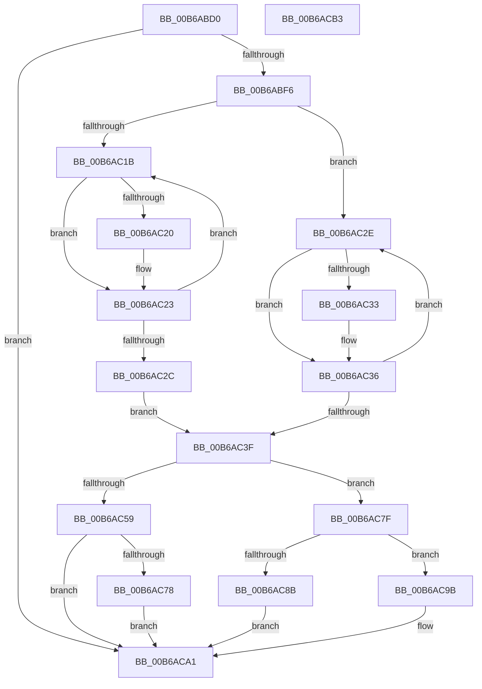

# KeWriteProtectPAT

- RVA: `0x00B6ABD0`–`0x00B6ACB4` (길이 `228` bytes)
- VA: `0x0000000140B6ABD0`
- 실행 섹션: `PAGELK`
- PDB 이름 있음: `예`; PDB Function 태그: `아니요`
- unwind 정보 RVA: `0x000CA9F4`
- 디코드: `62`개 명령, `228/228` bytes 표시
- 미해석 바이트: `0` (있으면 어셈블리에 `.byte`로 보존)

> 이 문서는 커널 이미지의 기계어와 PDB 기호를 분석해 생성했습니다. 4번과 5번은 함수 원형과 자료형을 바이너리 사용 방식에서 추정한 C 해석이며 원본 소스 복구 결과는 아닙니다.

## 1. Dependencies

- 직접 호출 지점: **2**; 고유 호출 대상: **2**
- 직접 호출자로 확인된 함수: **2**
- RIP 상대 이미지 참조: **3**

### Outgoing calls
- `0x00B6AC78` → [KiSetUserTbFlushPending](../../text/6B/KiSetUserTbFlushPending_function_006B20C0.md) (function, `0x006B20C0`)
- `0x00B6ACA9` → [_security_check_cookie](../../text/6A/_security_check_cookie_function_006AC640.md) (function, `0x006AC640`)

### Direct callers
- [HaliAcpiSleep](../../text/56/HaliAcpiSleep_function_0056AD60.md) at `0x0056B035`
- [HaliAcpiSleep](../../text/56/HaliAcpiSleep_function_0056AD60.md) at `0x0056B2BA`
- [HaliCompleteAcpiAPSleep](../../text/56/HaliCompleteAcpiAPSleep_function_0056B320.md) at `0x0056B36F`

### Static image references
- `0x00B6ABD4` → RVA `0x00E0A740` (`.data`; read)
- `0x00B6ABE9` → RVA `0x00FC6A84` (`ALMOSTRO`; read)
- `0x00B6AC50` → RVA `0x00FC6A87` (`ALMOSTRO`; read)

## 2. Other-region calls and transfers

- 다른 실행 섹션으로 향하는 call: **2**
  - `0x00B6AC78` → [KiSetUserTbFlushPending](../../text/6B/KiSetUserTbFlushPending_function_006B20C0.md) (`PAGELK` → `.text`)
  - `0x00B6ACA9` → [_security_check_cookie](../../text/6A/_security_check_cookie_function_006AC640.md) (`PAGELK` → `.text`)
- 별도 외부 분기/꼬리 이동을 확인하지 못했습니다.

## 3. Assembly (complete function range)

```asm
00B6ABD0  48 83 EC 38                     sub rsp, 0x38
00B6ABD4  48 8B 05 65 FB 29 00            mov rax, qword ptr [rip + 0x29fb65]
00B6ABDB  48 33 C4                        xor rax, rsp
00B6ABDE  48 89 44 24 28                  mov qword ptr [rsp + 0x28], rax
00B6ABE3  45 33 C9                        xor r9d, r9d
00B6ABE6  44 8A C1                        mov r8b, cl
00B6ABE9  44 38 0D 94 BE 45 00            cmp byte ptr [rip + 0x45be94], r9b
00B6ABF0  0F 85 AB 00 00 00               jne 0x140b6aca1
00B6ABF6  41 BA 77 02 00 00               mov r10d, 0x277
00B6ABFC  41 8B CA                        mov ecx, r10d
00B6ABFF  0F 32                           rdmsr
00B6AC01  48 C1 E2 20                     shl rdx, 0x20
00B6AC05  41 8D 49 08                     lea ecx, [r9 + 8]
00B6AC09  48 0B C2                        or rax, rdx
00B6AC0C  48 89 44 24 20                  mov qword ptr [rsp + 0x20], rax
00B6AC11  48 8D 44 24 20                  lea rax, [rsp + 0x20]
00B6AC16  45 84 C0                        test r8b, r8b
00B6AC19  74 13                           je 0x140b6ac2e
00B6AC1B  80 38 06                        cmp byte ptr [rax], 6
00B6AC1E  75 03                           jne 0x140b6ac23
00B6AC20  C6 00 05                        mov byte ptr [rax], 5
00B6AC23  48 FF C0                        inc rax
00B6AC26  48 83 E9 01                     sub rcx, 1
00B6AC2A  75 EF                           jne 0x140b6ac1b
00B6AC2C  EB 11                           jmp 0x140b6ac3f
00B6AC2E  80 38 05                        cmp byte ptr [rax], 5
00B6AC31  75 03                           jne 0x140b6ac36
00B6AC33  C6 00 06                        mov byte ptr [rax], 6
00B6AC36  48 FF C0                        inc rax
00B6AC39  48 83 E9 01                     sub rcx, 1
00B6AC3D  75 EF                           jne 0x140b6ac2e
00B6AC3F  48 8B 54 24 20                  mov rdx, qword ptr [rsp + 0x20]
00B6AC44  41 8B CA                        mov ecx, r10d
00B6AC47  48 8B C2                        mov rax, rdx
00B6AC4A  48 C1 EA 20                     shr rdx, 0x20
00B6AC4E  0F 30                           wrmsr
00B6AC50  44 38 0D 30 BE 45 00            cmp byte ptr [rip + 0x45be30], r9b
00B6AC57  74 26                           je 0x140b6ac7f
00B6AC59  0F 20 D8                        mov rax, cr3
00B6AC5C  0F 22 D8                        mov cr3, rax
00B6AC5F  65 48 8B 04 25 88 01 00 00      mov rax, qword ptr gs:[0x188]
00B6AC68  48 8B 88 B8 00 00 00            mov rcx, qword ptr [rax + 0xb8]
00B6AC6F  44 38 89 60 01 00 00            cmp byte ptr [rcx + 0x160], r9b
00B6AC76  75 29                           jne 0x140b6aca1
00B6AC78  E8 43 74 B4 FF                  call 0x1406b20c0
00B6AC7D  EB 22                           jmp 0x140b6aca1
00B6AC7F  0F 20 E1                        mov rcx, cr4
00B6AC82  48 F7 C1 80 00 02 00            test rcx, 0x20080
00B6AC89  74 10                           je 0x140b6ac9b
00B6AC8B  48 8B C1                        mov rax, rcx
00B6AC8E  48 0F BA F8 07                  btc rax, 7
00B6AC93  0F 22 E0                        mov cr4, rax
00B6AC96  0F 22 E1                        mov cr4, rcx
00B6AC99  EB 06                           jmp 0x140b6aca1
00B6AC9B  0F 20 D8                        mov rax, cr3
00B6AC9E  0F 22 D8                        mov cr3, rax
00B6ACA1  48 8B 4C 24 28                  mov rcx, qword ptr [rsp + 0x28]
00B6ACA6  48 33 CC                        xor rcx, rsp
00B6ACA9  E8 92 19 B4 FF                  call 0x1406ac640
00B6ACAE  48 83 C4 38                     add rsp, 0x38
00B6ACB2  C3                              ret
00B6ACB3  CC                              int3
```

## 4. C-style interpretation (structured pseudocode)

```c
__int64 __fastcall KeWriteProtectPAT(unsigned __int8 a1, __int64 a2, __int64 a3, int a4)
{
    __int64 result;
    __int64 v_rsp;
    unsigned __int64 v_stack_m10;
    unsigned __int64 v_stack_m18;

    v_rsp = (v_rsp) - (56);
    result = (*(unsigned __int64 *)(v_rip + 2751333)) ^ (v_rsp);
    v_stack_m10 = result;
    a4 = 0;
    if ((*(unsigned __int8 *)(v_rip + 4570772)) != 0) goto loc_00B6ACA1;
    a2 = (a2) << (32);
    result = (result) | (a2);
    v_stack_m18 = result;
    if (a1 == 0) goto loc_00B6AC2E;
loc_00B6AC1B:
    if ((*(unsigned __int8 *)(v_stack_m18)) == 6) {
        *(unsigned __int8 *)(v_stack_m18) = 5;
    }
    result = (v_stack_m18) + 1;
    a1 = (a4 + 8) - (1);
    if (condition_is_not_equal) goto loc_00B6AC1B;
    goto loc_00B6AC3F;
loc_00B6AC2E:
    if ((*(unsigned __int8 *)(result)) == 5) {
        *(unsigned __int8 *)(result) = 6;
    }
    result = (result) + 1;
    a1 = (a1) - (1);
    if (condition_is_not_equal) goto loc_00B6AC2E;
loc_00B6AC3F:
    a2 = (v_stack_m18) >> (32);
    if ((*(unsigned __int8 *)(v_rip + 4570672)) == 0) goto loc_00B6AC7F;
    if ((*(unsigned __int8 *)(*(unsigned __int64 *)(*(unsigned __int64 *)(gs_base + (0 + 392)) + 184) + 352)) != 0) goto loc_00B6ACA1;
    result = KiSetUserTbFlushPending(*(unsigned __int64 *)(*(unsigned __int64 *)(gs_base + (0 + 392)) + 184), a2, a1, a4);
    goto loc_00B6ACA1;
loc_00B6AC7F:
    if (((v_cr4) & (0x20080ULL)) == 0) goto loc_00B6AC9B;
    goto loc_00B6ACA1;
loc_00B6AC9B:
loc_00B6ACA1:
    a1 = (v_stack_m10) ^ (v_rsp);
    result = _security_check_cookie(a1, a2, a1, a4);
    v_rsp = (v_rsp) + (56);
    return result;
}
```

## 5. (Beta) C Style

```c
int64_t KeWriteProtectPAT(uint8_t Arg1, int64_t Arg2, int64_t Arg3, int32_t Arg4)
{
    int64_t result;
    int64_t local_rsp;
    uint64_t v_stack_m10;
    uint64_t v_stack_m18;

    local_rsp = (local_rsp) - (56);
    result = (*(uint64_t *)(v_rip + 0x29FB65)) ^ (local_rsp);
    v_stack_m10 = result;
    Arg4 = 0;
    if ((*(uint8_t *)(v_rip + 0x45BE94)) != 0) goto loc_00B6ACA1;
    Arg2 = (Arg2) << (32);
    result = (result) | (Arg2);
    v_stack_m18 = result;
    if (Arg1 == 0) goto loc_00B6AC2E;
loc_00B6AC1B:
    if ((*(uint8_t *)(v_stack_m18)) == 6) {
        *(uint8_t *)(v_stack_m18) = 5;
    }
    result = (v_stack_m18) + 1;
    Arg1 = (Arg4 + 8) - (1);
    if (condition_is_not_equal) goto loc_00B6AC1B;
    goto loc_00B6AC3F;
loc_00B6AC2E:
    if ((*(uint8_t *)(result)) == 5) {
        *(uint8_t *)(result) = 6;
    }
    result = (result) + 1;
    Arg1 = (Arg1) - (1);
    if (condition_is_not_equal) goto loc_00B6AC2E;
loc_00B6AC3F:
    Arg2 = (v_stack_m18) >> (32);
    if ((*(uint8_t *)(v_rip + 0x45BE30)) == 0) goto loc_00B6AC7F;
    if ((*(uint8_t *)(*(uint64_t *)(*(uint64_t *)(gs_base + (0 + 0x188)) + 0xB8) + 0x160)) != 0) goto loc_00B6ACA1;
    result = KiSetUserTbFlushPending(*(uint64_t *)(*(uint64_t *)(gs_base + (0 + 0x188)) + 0xB8), Arg2, Arg1, Arg4);
    goto loc_00B6ACA1;
loc_00B6AC7F:
    if (((v_cr4) & (0x20080ULL)) == 0) goto loc_00B6AC9B;
    goto loc_00B6ACA1;
loc_00B6AC9B:
loc_00B6ACA1:
    Arg1 = (v_stack_m10) ^ (local_rsp);
    result = _security_check_cookie(Arg1, Arg2, Arg1, Arg4);
    local_rsp = (local_rsp) + (56);
    return result;
}
```

## 6. Execution-region graph

[열기: 2D/3D 그래프와 함수 탐색 컨트롤 패널](../../../control-panel.html?section=pagelk&rva=0x00B6ABD0&view=graph)

- 2D 그래프는 위에서 아래로 흐르고, 3D 그래프는 빈 공간을 드래그해 회전합니다. Shift+드래그는 이동, 휠은 확대·축소, 함수 노드 선택은 대상 보고서 이동입니다.

### Static fallback


