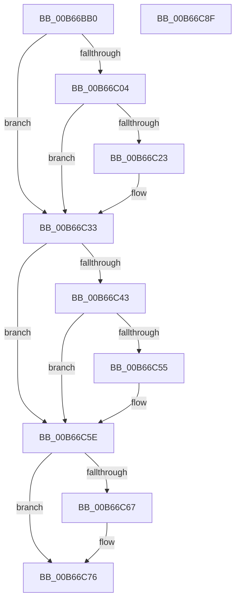

# KeWriteProtectProcessorState

- RVA: `0x00B66BB0`–`0x00B66C90` (길이 `224` bytes)
- VA: `0x0000000140B66BB0`
- 실행 섹션: `PAGELK`
- PDB 이름 있음: `예`; PDB Function 태그: `아니요`
- unwind 정보 RVA: `0x000A1FF8`
- 디코드: `59`개 명령, `224/224` bytes 표시
- 미해석 바이트: `0` (있으면 어셈블리에 `.byte`로 보존)

> 이 문서는 커널 이미지의 기계어와 PDB 기호를 분석해 생성했습니다. 4번과 5번은 함수 원형과 자료형을 바이너리 사용 방식에서 추정한 C 해석이며 원본 소스 복구 결과는 아닙니다.

## 1. Dependencies

- 직접 호출 지점: **6**; 고유 호출 대상: **4**
- 직접 호출자로 확인된 함수: **2**
- RIP 상대 이미지 참조: **2**

### Outgoing calls
- `0x00B66BFB` → [MmSetPageProtection](../../text/4E/MmSetPageProtection_function_004E1580.md) (function, `0x004E1580`)
- `0x00B66C15` → [MmSetPageProtection](../../text/4E/MmSetPageProtection_function_004E1580.md) (function, `0x004E1580`)
- `0x00B66C2E` → [MmSetPageProtection](../../text/4E/MmSetPageProtection_function_004E1580.md) (function, `0x004E1580`)
- `0x00B66C4C` → [KiShadowProcessorAllocation](KiShadowProcessorAllocation_function_00B6AE5C.md) (function, `0x00B6AE5C`)
- `0x00B66C58` → [KeBugCheck](../../text/4F/KeBugCheck_function_004FD640.md) (function, `0x004FD640`)
- `0x00B66C71` → [VslFinishStartSecureProcessor](../../text/58/VslFinishStartSecureProcessor_function_0058E25C.md) (function, `0x0058E25C`)

### Direct callers
- [MakeGdtReadOnly](../../text/53/MakeGdtReadOnly_function_0053BA98.md) at `0x0053BB1E`
- [KiDynamicProcessorInitialization](../../text/5B/KiDynamicProcessorInitialization_function_005B7C6C.md) at `0x005B7CDC`

### Static image references
- `0x00B66BCE` → RVA `0x00FC6A84` (`ALMOSTRO`; read)
- `0x00B66C1A` → RVA `0x01201840` (`CFGRO`; read)

## 2. Other-region calls and transfers

- 다른 실행 섹션으로 향하는 call: **5**
  - `0x00B66BFB` → [MmSetPageProtection](../../text/4E/MmSetPageProtection_function_004E1580.md) (`PAGELK` → `.text`)
  - `0x00B66C15` → [MmSetPageProtection](../../text/4E/MmSetPageProtection_function_004E1580.md) (`PAGELK` → `.text`)
  - `0x00B66C2E` → [MmSetPageProtection](../../text/4E/MmSetPageProtection_function_004E1580.md) (`PAGELK` → `.text`)
  - `0x00B66C58` → [KeBugCheck](../../text/4F/KeBugCheck_function_004FD640.md) (`PAGELK` → `.text`)
  - `0x00B66C71` → [VslFinishStartSecureProcessor](../../text/58/VslFinishStartSecureProcessor_function_0058E25C.md) (`PAGELK` → `.text`)
- 별도 외부 분기/꼬리 이동을 확인하지 못했습니다.

## 3. Assembly (complete function range)

```asm
00B66BB0  48 89 5C 24 08                  mov qword ptr [rsp + 8], rbx
00B66BB5  48 89 6C 24 10                  mov qword ptr [rsp + 0x10], rbp
00B66BBA  48 89 74 24 18                  mov qword ptr [rsp + 0x18], rsi
00B66BBF  57                              push rdi
00B66BC0  41 54                           push r12
00B66BC2  41 56                           push r14
00B66BC4  48 83 EC 20                     sub rsp, 0x20
00B66BC8  48 8B 31                        mov rsi, qword ptr [rcx]
00B66BCB  45 33 F6                        xor r14d, r14d
00B66BCE  44 38 35 AF FE 45 00            cmp byte ptr [rip + 0x45feaf], r14b
00B66BD5  48 8B F9                        mov rdi, rcx
00B66BD8  48 8B 49 38                     mov rcx, qword ptr [rcx + 0x38]
00B66BDC  41 BC 00 10 00 00               mov r12d, 0x1000
00B66BE2  41 0F B6 DE                     movzx ebx, r14b
00B66BE6  41 8B D4                        mov edx, r12d
00B66BE9  41 8D 46 01                     lea eax, [r14 + 1]
00B66BED  45 8D 46 02                     lea r8d, [r14 + 2]
00B66BF1  0F 45 D8                        cmovne ebx, eax
00B66BF4  48 8D AE 50 D0 FF FF            lea rbp, [rsi - 0x2fb0]
00B66BFB  E8 80 A9 97 FF                  call 0x1404e1580
00B66C00  84 DB                           test bl, bl
00B66C02  74 2F                           je 0x140b66c33
00B66C04  48 81 E6 00 F0 FF FF            and rsi, 0xfffffffffffff000
00B66C0B  45 8D 46 02                     lea r8d, [r14 + 2]
00B66C0F  48 8B CE                        mov rcx, rsi
00B66C12  41 8B D4                        mov edx, r12d
00B66C15  E8 66 A9 97 FF                  call 0x1404e1580
00B66C1A  44 38 35 1F AC 69 00            cmp byte ptr [rip + 0x69ac1f], r14b
00B66C21  74 10                           je 0x140b66c33
00B66C23  48 8B 4F 08                     mov rcx, qword ptr [rdi + 8]
00B66C27  45 8D 46 02                     lea r8d, [r14 + 2]
00B66C2B  41 8B D4                        mov edx, r12d
00B66C2E  E8 4D A9 97 FF                  call 0x1404e1580
00B66C33  48 8D 9F 80 01 00 00            lea rbx, [rdi + 0x180]
00B66C3A  44 39 B7 A4 01 00 00            cmp dword ptr [rdi + 0x1a4], r14d
00B66C41  75 1B                           jne 0x140b66c5e
00B66C43  45 33 C0                        xor r8d, r8d
00B66C46  48 8B D5                        mov rdx, rbp
00B66C49  48 8B CB                        mov rcx, rbx
00B66C4C  E8 0B 42 00 00                  call 0x140b6ae5c
00B66C51  85 C0                           test eax, eax
00B66C53  75 09                           jne 0x140b66c5e
00B66C55  8D 48 7D                        lea ecx, [rax + 0x7d]
00B66C58  E8 E3 69 99 FF                  call 0x1404fd640
00B66C5D  CC                              int3
00B66C5E  44 38 35 1F FE 45 00            cmp byte ptr [rip + 0x45fe1f], r14b
00B66C65  74 0F                           je 0x140b66c76
00B66C67  48 8B 97 40 91 00 00            mov rdx, qword ptr [rdi + 0x9140]
00B66C6E  48 8B CB                        mov rcx, rbx
00B66C71  E8 E6 75 A2 FF                  call 0x14058e25c
00B66C76  48 8B 5C 24 40                  mov rbx, qword ptr [rsp + 0x40]
00B66C7B  48 8B 6C 24 48                  mov rbp, qword ptr [rsp + 0x48]
00B66C80  48 8B 74 24 50                  mov rsi, qword ptr [rsp + 0x50]
00B66C85  48 83 C4 20                     add rsp, 0x20
00B66C89  41 5E                           pop r14
00B66C8B  41 5C                           pop r12
00B66C8D  5F                              pop rdi
00B66C8E  C3                              ret
00B66C8F  CC                              int3
```

## 4. C-style interpretation (structured pseudocode)

```c
__int64 __fastcall KeWriteProtectProcessorState(__int64 a1)
{
    __int64 result;
    __int64 v_r14;
    __int64 v_rbx;
    __int64 v_rsi;
    __int64 v_rsp;
    unsigned __int64 v_stack_p10;
    unsigned __int64 v_stack_p18;
    unsigned __int64 v_stack_p8;

    v_stack_p8 = v_rbx;
    v_stack_p10 = v_rbp;
    v_stack_p18 = v_rsi;
    v_rsp = (v_rsp) - (32);
    v_r14 = 0;
    v_rbx = 0;
    if ((*(unsigned __int8 *)(v_rip + 4587183)) != 0) { v_rbx = (unsigned int)(v_r14 + 1); }
    result = MmSetPageProtection(*(unsigned __int64 *)(a1 + 56), (unsigned int)((unsigned int)((unsigned int)(0x1000ULL))), v_r14 + 2, a4);
    if ((unsigned __int8)(v_rbx) == 0) goto loc_00B66C33;
    v_rsi = (*(unsigned __int64 *)(a1)) & (0xFFFFFFFFFFFFF000ULL);
    result = MmSetPageProtection(v_rsi, (unsigned int)((unsigned int)((unsigned int)(0x1000ULL))), v_r14 + 2, a4);
    if ((*(unsigned __int8 *)(v_rip + 6925343)) != 0) {
        a1 = *(unsigned __int64 *)(a1 + 8);
        a3 = v_r14 + 2;
        a2 = (unsigned int)((unsigned int)(0x1000ULL));
        result = MmSetPageProtection(a1, a2, a3, a4);
    }
    if ((*(unsigned int *)(a1 + 420)) != 0) goto loc_00B66C5E;
    a3 = 0;
    result = KiShadowProcessorAllocation(a1 + 384, *(unsigned __int64 *)(a1) - 12208, a3, a4);
    if ((unsigned int)(result) == 0) {
        a1 = result + 125;
        result = KeBugCheck(a1, *(unsigned __int64 *)(a1) - 12208, a3, a4);
    }
    if ((*(unsigned __int8 *)(v_rip + 4587039)) != 0) {
        a2 = *(unsigned __int64 *)(a1 + 37184);
        a1 = a1 + 384;
        result = VslFinishStartSecureProcessor(a1, a2, a3, a4);
    }
    v_rsp = (v_rsp) + (32);
    return result;
}
```

## 5. (Beta) C Style

```c
int64_t KeWriteProtectProcessorState(void *Arg1)
{
    uint8_t *arg1 = (uint8_t *)Arg1;

    int64_t result;
    int64_t local_r14;
    int64_t local_rbx;
    int64_t local_rsi;
    int64_t local_rsp;
    uint64_t v_stack_p10;
    uint64_t v_stack_p18;
    uint64_t v_stack_p8;

    v_stack_p8 = local_rbx;
    v_stack_p10 = local_rbp;
    v_stack_p18 = local_rsi;
    local_rsp = (local_rsp) - (32);
    local_r14 = 0;
    local_rbx = 0;
    if ((*(uint8_t *)(v_rip + 0x45FEAF)) != 0) { local_rbx = (uint32_t)(local_r14 + 1); }
    result = MmSetPageProtection(*(uint64_t *)(arg1 + 0x38), (uint32_t)((uint32_t)((uint32_t)(0x1000ULL))), local_r14 + 2, a4);
    if ((uint8_t)(local_rbx) == 0) goto loc_00B66C33;
    local_rsi = (*(uint64_t *)(arg1)) & (0xFFFFFFFFFFFFF000ULL);
    result = MmSetPageProtection(local_rsi, (uint32_t)((uint32_t)((uint32_t)(0x1000ULL))), local_r14 + 2, a4);
    if ((*(uint8_t *)(v_rip + 0x69AC1F)) != 0) {
        Arg1 = *(uint64_t *)(arg1 + 0x8);
        a3 = local_r14 + 2;
        a2 = (uint32_t)((uint32_t)(0x1000ULL));
        result = MmSetPageProtection(Arg1, a2, a3, a4);
    }
    if ((*(uint32_t *)(arg1 + 0x1A4)) != 0) goto loc_00B66C5E;
    a3 = 0;
    result = KiShadowProcessorAllocation(Arg1 + 384, *(uint64_t *)(arg1) - 12208, a3, a4);
    if ((uint32_t)(result) == 0) {
        Arg1 = result + 125;
        result = KeBugCheck(Arg1, *(uint64_t *)(arg1) - 12208, a3, a4);
    }
    if ((*(uint8_t *)(v_rip + 0x45FE1F)) != 0) {
        a2 = *(uint64_t *)(arg1 + 0x9140);
        Arg1 = Arg1 + 384;
        result = VslFinishStartSecureProcessor(Arg1, a2, a3, a4);
    }
    local_rsp = (local_rsp) + (32);
    return result;
}
```

### 관측된 메모리 오프셋

구조체 형식이 확인되지 않은 접근은 인자 기준의 오프셋으로만 기록했습니다.

| 기준 인자 | 오프셋 표현 | 폭 (bit) | 접근 |
|---|---:|---:|---|
| `Arg1` | `+ 0x0` | `64` | `R` |
| `Arg1` | `+ 0x8` | `64` | `R` |
| `Arg1` | `+ 0x38` | `64` | `R` |
| `Arg1` | `+ 0x180` | `64` | `R` |
| `Arg1` | `+ 0x1A4` | `32` | `R` |
| `Arg1` | `+ 0x9140` | `64` | `R` |

## 6. Execution-region graph

[열기: 2D/3D 그래프와 함수 탐색 컨트롤 패널](../../../control-panel.html?section=pagelk&rva=0x00B66BB0&view=graph)

- 2D 그래프는 위에서 아래로 흐르고, 3D 그래프는 빈 공간을 드래그해 회전합니다. Shift+드래그는 이동, 휠은 확대·축소, 함수 노드 선택은 대상 보고서 이동입니다.

### Static fallback


