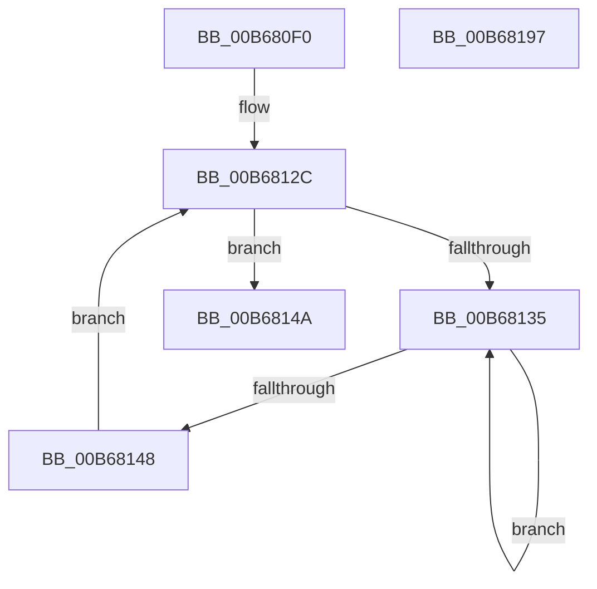

# KiAddCpuToSystemCpuPartition

- RVA: `0x00B680F0`–`0x00B68198` (길이 `168` bytes)
- VA: `0x0000000140B680F0`
- 실행 섹션: `PAGELK`
- PDB 이름 있음: `예`; PDB Function 태그: `아니요`
- unwind 정보 RVA: `0x0005CF00`
- 디코드: `37`개 명령, `168/168` bytes 표시
- 미해석 바이트: `0` (있으면 어셈블리에 `.byte`로 보존)

> 이 문서는 커널 이미지의 기계어와 PDB 기호를 분석해 생성했습니다. 4번과 5번은 함수 원형과 자료형을 바이너리 사용 방식에서 추정한 C 해석이며 원본 소스 복구 결과는 아닙니다.

## 1. Dependencies

- 직접 호출 지점: **8**; 고유 호출 대상: **7**
- 직접 호출자로 확인된 함수: **1**
- RIP 상대 이미지 참조: **3**

### Outgoing calls
- `0x00B68100` → [KiAcquireCpuPartitionLockAtDpcLevel](../../text/5C/KiAcquireCpuPartitionLockAtDpcLevel_function_005C12C0.md) (function, `0x005C12C0`)
- `0x00B68112` → [KeAddProcessorAffinityEx](../../text/25/KeAddProcessorAffinityEx_function_0025B6F0.md) (function, `0x0025B6F0`)
- `0x00B68122` → [KxReleaseSpinLock](../../text/20/KxReleaseSpinLock_function_00206670.md) (function, `0x00206670`)
- `0x00B6813A` → [KeYieldProcessorEx](../../text/3F/KeYieldProcessorEx_function_003FBD00.md) (function, `0x003FBD00`)
- `0x00B68165` → [RtlWriteAcquireTickLock](../../text/39/RtlWriteAcquireTickLock_function_0039D3B4.md) (function, `0x0039D3B4`)
- `0x00B68174` → [KeAddProcessorAffinityEx](../../text/25/KeAddProcessorAffinityEx_function_0025B6F0.md) (function, `0x0025B6F0`)
- `0x00B68180` → [RtlWriteReleaseTickLock](../../text/45/RtlWriteReleaseTickLock_function_0045C50C.md) (function, `0x0045C50C`)
- `0x00B6818C` → [KiNotifyAvailableCpusChangeCpuPartition](../../text/5B/KiNotifyAvailableCpusChangeCpuPartition_function_005B9AD8.md) (function, `0x005B9AD8`)

### Direct callers
- [KiCompleteKernelInit](KiCompleteKernelInit_function_00B66090.md) at `0x00B663AC`

### Static image references
- `0x00B680F9` → RVA `0x00FC6C20` (`ALMOSTRO`; read)
- `0x00B6815E` → RVA `0x00F23460` (`.data`; read)
- `0x00B6816D` → RVA `0x00F22EA0` (`.data`; read)

## 2. Other-region calls and transfers

- 다른 실행 섹션으로 향하는 call: **8**
  - `0x00B68100` → [KiAcquireCpuPartitionLockAtDpcLevel](../../text/5C/KiAcquireCpuPartitionLockAtDpcLevel_function_005C12C0.md) (`PAGELK` → `.text`)
  - `0x00B68112` → [KeAddProcessorAffinityEx](../../text/25/KeAddProcessorAffinityEx_function_0025B6F0.md) (`PAGELK` → `.text`)
  - `0x00B68122` → [KxReleaseSpinLock](../../text/20/KxReleaseSpinLock_function_00206670.md) (`PAGELK` → `.text`)
  - `0x00B6813A` → [KeYieldProcessorEx](../../text/3F/KeYieldProcessorEx_function_003FBD00.md) (`PAGELK` → `.text`)
  - `0x00B68165` → [RtlWriteAcquireTickLock](../../text/39/RtlWriteAcquireTickLock_function_0039D3B4.md) (`PAGELK` → `.text`)
  - `0x00B68174` → [KeAddProcessorAffinityEx](../../text/25/KeAddProcessorAffinityEx_function_0025B6F0.md) (`PAGELK` → `.text`)
  - `0x00B68180` → [RtlWriteReleaseTickLock](../../text/45/RtlWriteReleaseTickLock_function_0045C50C.md) (`PAGELK` → `.text`)
  - `0x00B6818C` → [KiNotifyAvailableCpusChangeCpuPartition](../../text/5B/KiNotifyAvailableCpusChangeCpuPartition_function_005B9AD8.md) (`PAGELK` → `.text`)
- 별도 외부 분기/꼬리 이동을 확인하지 못했습니다.

## 3. Assembly (complete function range)

```asm
00B680F0  40 53                           push rbx
00B680F2  48 83 EC 20                     sub rsp, 0x20
00B680F6  48 8B D9                        mov rbx, rcx
00B680F9  48 8B 0D 20 EB 45 00            mov rcx, qword ptr [rip + 0x45eb20]
00B68100  E8 BB 91 A5 FF                  call 0x1405c12c0
00B68105  48 8B 0D 14 EB 45 00            mov rcx, qword ptr [rip + 0x45eb14]
00B6810C  8B 53 24                        mov edx, dword ptr [rbx + 0x24]
00B6810F  48 8B 09                        mov rcx, qword ptr [rcx]
00B68112  E8 D9 35 6F FF                  call 0x14025b6f0
00B68117  48 8B 0D 02 EB 45 00            mov rcx, qword ptr [rip + 0x45eb02]
00B6811E  48 83 C1 08                     add rcx, 8
00B68122  E8 49 E5 69 FF                  call 0x140206670
00B68127  83 64 24 30 00                  and dword ptr [rsp + 0x30], 0
00B6812C  F0 48 0F BA 6B 30 00            lock bts qword ptr [rbx + 0x30], 0
00B68133  73 15                           jae 0x140b6814a
00B68135  48 8D 4C 24 30                  lea rcx, [rsp + 0x30]
00B6813A  E8 C1 3B 89 FF                  call 0x1403fbd00
00B6813F  48 8B 43 30                     mov rax, qword ptr [rbx + 0x30]
00B68143  48 85 C0                        test rax, rax
00B68146  75 ED                           jne 0x140b68135
00B68148  EB E2                           jmp 0x140b6812c
00B6814A  48 8B 05 CF EA 45 00            mov rax, qword ptr [rip + 0x45eacf]
00B68151  48 89 83 F0 37 00 00            mov qword ptr [rbx + 0x37f0], rax
00B68158  F0 48 83 63 30 00               lock and qword ptr [rbx + 0x30], 0
00B6815E  48 8D 0D FB B2 3B 00            lea rcx, [rip + 0x3bb2fb]
00B68165  E8 4A 52 83 FF                  call 0x14039d3b4
00B6816A  8B 53 24                        mov edx, dword ptr [rbx + 0x24]
00B6816D  48 8D 0D 2C AD 3B 00            lea rcx, [rip + 0x3bad2c]
00B68174  E8 77 35 6F FF                  call 0x14025b6f0
00B68179  48 8D 0D E0 B2 3B 00            lea rcx, [rip + 0x3bb2e0]
00B68180  E8 87 43 8F FF                  call 0x14045c50c
00B68185  48 8B 0D 94 EA 45 00            mov rcx, qword ptr [rip + 0x45ea94]
00B6818C  E8 47 19 A5 FF                  call 0x1405b9ad8
00B68191  48 83 C4 20                     add rsp, 0x20
00B68195  5B                              pop rbx
00B68196  C3                              ret
00B68197  CC                              int3
```

## 4. C-style interpretation (structured pseudocode)

```c
__int64 __fastcall KiAddCpuToSystemCpuPartition(__int64 a1)
{
    __int64 result;
    __int64 v_rsp;
    unsigned int v_stack_p8;

    v_rsp = (v_rsp) - (32);
    result = KiAcquireCpuPartitionLockAtDpcLevel(*(unsigned __int64 *)(v_rip + 4582176), a2, a3, a4);
    result = KeAddProcessorAffinityEx(*(unsigned __int64 *)(*(unsigned __int64 *)(v_rip + 4582164)), (unsigned int)(*(unsigned int *)(a1 + 36)), a3, a4);
    a1 = (*(unsigned __int64 *)(v_rip + 4582146)) + (8);
    result = KxReleaseSpinLock(a1, (unsigned int)(*(unsigned int *)(a1 + 36)), a3, a4);
loc_00B6812C:
    if (condition_is_above_or_equal) goto loc_00B6814A;
loc_00B68135:
    result = KeYieldProcessorEx(v_stack_p8, (unsigned int)(*(unsigned int *)(a1 + 36)), a3, a4);
    if (*(unsigned __int64 *)(a1 + 48) != 0) goto loc_00B68135;
    goto loc_00B6812C;
loc_00B6814A:
    *(unsigned __int64 *)(a1 + 14320) = *(unsigned __int64 *)(v_rip + 4582095);
    result = RtlWriteAcquireTickLock(v_rip + 3912443, (unsigned int)(*(unsigned int *)(a1 + 36)), a3, a4);
    result = KeAddProcessorAffinityEx(v_rip + 3910956, (unsigned int)(*(unsigned int *)(a1 + 36)), a3, a4);
    result = RtlWriteReleaseTickLock(v_rip + 3912416, (unsigned int)(*(unsigned int *)(a1 + 36)), a3, a4);
    result = KiNotifyAvailableCpusChangeCpuPartition(*(unsigned __int64 *)(v_rip + 4582036), (unsigned int)(*(unsigned int *)(a1 + 36)), a3, a4);
    v_rsp = (v_rsp) + (32);
    return result;
}
```

## 5. (Beta) C Style

```c
int64_t KiAddCpuToSystemCpuPartition(void *Arg1)
{
    uint8_t *arg1 = (uint8_t *)Arg1;

    int64_t result;
    int64_t local_rsp;
    uint32_t v_stack_p8;

    local_rsp = (local_rsp) - (32);
    result = KiAcquireCpuPartitionLockAtDpcLevel(*(uint64_t *)(v_rip + 0x45EB20), a2, a3, a4);
    result = KeAddProcessorAffinityEx(*(uint64_t *)(*(uint64_t *)(v_rip + 0x45EB14)), (uint32_t)(*(uint32_t *)(arg1 + 0x24)), a3, a4);
    Arg1 = (*(uint64_t *)(v_rip + 0x45EB02)) + (8);
    result = KxReleaseSpinLock(Arg1, (uint32_t)(*(uint32_t *)(arg1 + 0x24)), a3, a4);
loc_00B6812C:
    if (condition_is_above_or_equal) goto loc_00B6814A;
loc_00B68135:
    result = KeYieldProcessorEx(v_stack_p8, (uint32_t)(*(uint32_t *)(arg1 + 0x24)), a3, a4);
    if (*(uint64_t *)(arg1 + 0x30) != 0) goto loc_00B68135;
    goto loc_00B6812C;
loc_00B6814A:
    *(uint64_t *)(arg1 + 0x37F0) = *(uint64_t *)(v_rip + 0x45EACF);
    result = RtlWriteAcquireTickLock(v_rip + 3912443, (uint32_t)(*(uint32_t *)(arg1 + 0x24)), a3, a4);
    result = KeAddProcessorAffinityEx(v_rip + 3910956, (uint32_t)(*(uint32_t *)(arg1 + 0x24)), a3, a4);
    result = RtlWriteReleaseTickLock(v_rip + 3912416, (uint32_t)(*(uint32_t *)(arg1 + 0x24)), a3, a4);
    result = KiNotifyAvailableCpusChangeCpuPartition(*(uint64_t *)(v_rip + 0x45EA94), (uint32_t)(*(uint32_t *)(arg1 + 0x24)), a3, a4);
    local_rsp = (local_rsp) + (32);
    return result;
}
```

### 관측된 메모리 오프셋

구조체 형식이 확인되지 않은 접근은 인자 기준의 오프셋으로만 기록했습니다.

| 기준 인자 | 오프셋 표현 | 폭 (bit) | 접근 |
|---|---:|---:|---|
| `Arg1` | `+ 0x24` | `32` | `R` |
| `Arg1` | `+ 0x30` | `64` | `R` |
| `Arg1` | `+ 0x30` | `64` | `R/W` |
| `Arg1` | `+ 0x37F0` | `64` | `W` |

## 6. Execution-region graph

[열기: 2D/3D 그래프와 함수 탐색 컨트롤 패널](../../../control-panel.html?section=pagelk&rva=0x00B680F0&view=graph)

- 2D 그래프는 위에서 아래로 흐르고, 3D 그래프는 빈 공간을 드래그해 회전합니다. Shift+드래그는 이동, 휠은 확대·축소, 함수 노드 선택은 대상 보고서 이동입니다.

### Static fallback


