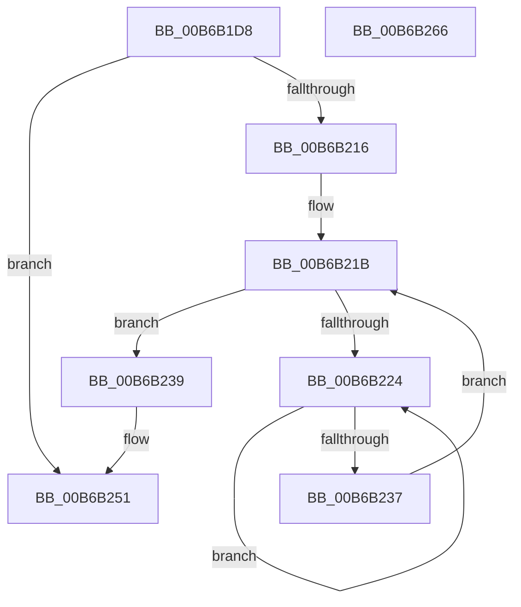

# KiAddProcessorToGroupSchedulingDatabase

- RVA: `0x00B6B1D8`–`0x00B6B267` (길이 `143` bytes)
- VA: `0x0000000140B6B1D8`
- 실행 섹션: `PAGELK`
- PDB 이름 있음: `예`; PDB Function 태그: `아니요`
- unwind 정보 RVA: `0x000BED58`
- 디코드: `36`개 명령, `143/143` bytes 표시
- 미해석 바이트: `0` (있으면 어셈블리에 `.byte`로 보존)

> 이 문서는 커널 이미지의 기계어와 PDB 기호를 분석해 생성했습니다. 4번과 5번은 함수 원형과 자료형을 바이너리 사용 방식에서 추정한 C 해석이며 원본 소스 복구 결과는 아닙니다.

## 1. Dependencies

- 직접 호출 지점: **5**; 고유 호출 대상: **5**
- 직접 호출자로 확인된 함수: **1**
- RIP 상대 이미지 참조: **3**

### Outgoing calls
- `0x00B6B1F4` → [KiInitializeProcessorGroupSchedulingData](../../text/5C/KiInitializeProcessorGroupSchedulingData_function_005C8B10.md) (function, `0x005C8B10`)
- `0x00B6B208` → [KeAcquireInStackQueuedSpinLock](../../text/27/KeAcquireInStackQueuedSpinLock_function_002757A0.md) (function, `0x002757A0`)
- `0x00B6B229` → [KeYieldProcessorEx](../../text/3F/KeYieldProcessorEx_function_003FBD00.md) (function, `0x003FBD00`)
- `0x00B6B246` → [KiAddProcessorToGroupSchedulingList](../../text/5C/KiAddProcessorToGroupSchedulingList_function_005C8878.md) (function, `0x005C8878`)
- `0x00B6B256` → [KeReleaseInStackQueuedSpinLock](../../text/34/KeReleaseInStackQueuedSpinLock_function_00342CE0.md) (function, `0x00342CE0`)

### Direct callers
- [KiStartDynamicProcessor](../../page/74/KiStartDynamicProcessor_function_007456C8.md) at `0x00745A62`

### Static image references
- `0x00B6B201` → RVA `0x00FCF180` (`CACHEALI`; read)
- `0x00B6B20D` → RVA `0x00FC6ABC` (`ALMOSTRO`; read)
- `0x00B6B23C` → RVA `0x00F23420` (`.data`; read)

## 2. Other-region calls and transfers

- 다른 실행 섹션으로 향하는 call: **5**
  - `0x00B6B1F4` → [KiInitializeProcessorGroupSchedulingData](../../text/5C/KiInitializeProcessorGroupSchedulingData_function_005C8B10.md) (`PAGELK` → `.text`)
  - `0x00B6B208` → [KeAcquireInStackQueuedSpinLock](../../text/27/KeAcquireInStackQueuedSpinLock_function_002757A0.md) (`PAGELK` → `.text`)
  - `0x00B6B229` → [KeYieldProcessorEx](../../text/3F/KeYieldProcessorEx_function_003FBD00.md) (`PAGELK` → `.text`)
  - `0x00B6B246` → [KiAddProcessorToGroupSchedulingList](../../text/5C/KiAddProcessorToGroupSchedulingList_function_005C8878.md) (`PAGELK` → `.text`)
  - `0x00B6B256` → [KeReleaseInStackQueuedSpinLock](../../text/34/KeReleaseInStackQueuedSpinLock_function_00342CE0.md) (`PAGELK` → `.text`)
- 별도 외부 분기/꼬리 이동을 확인하지 못했습니다.

## 3. Assembly (complete function range)

```asm
00B6B1D8  48 89 5C 24 10                  mov qword ptr [rsp + 0x10], rbx
00B6B1DD  57                              push rdi
00B6B1DE  48 83 EC 40                     sub rsp, 0x40
00B6B1E2  33 C0                           xor eax, eax
00B6B1E4  0F 57 C0                        xorps xmm0, xmm0
00B6B1E7  0F 11 44 24 20                  movups xmmword ptr [rsp + 0x20], xmm0
00B6B1EC  48 89 44 24 30                  mov qword ptr [rsp + 0x30], rax
00B6B1F1  48 8B D9                        mov rbx, rcx
00B6B1F4  E8 17 D9 A5 FF                  call 0x1405c8b10
00B6B1F9  8B 79 24                        mov edi, dword ptr [rcx + 0x24]
00B6B1FC  48 8D 54 24 20                  lea rdx, [rsp + 0x20]
00B6B201  48 8D 0D 78 3F 46 00            lea rcx, [rip + 0x463f78]
00B6B208  E8 93 A5 70 FF                  call 0x1402757a0
00B6B20D  80 3D A8 B8 45 00 00            cmp byte ptr [rip + 0x45b8a8], 0
00B6B214  74 3B                           je 0x140b6b251
00B6B216  83 64 24 50 00                  and dword ptr [rsp + 0x50], 0
00B6B21B  F0 48 0F BA 6B 30 00            lock bts qword ptr [rbx + 0x30], 0
00B6B222  73 15                           jae 0x140b6b239
00B6B224  48 8D 4C 24 50                  lea rcx, [rsp + 0x50]
00B6B229  E8 D2 0A 89 FF                  call 0x1403fbd00
00B6B22E  48 8B 43 30                     mov rax, qword ptr [rbx + 0x30]
00B6B232  48 85 C0                        test rax, rax
00B6B235  75 ED                           jne 0x140b6b224
00B6B237  EB E2                           jmp 0x140b6b21b
00B6B239  44 8B C7                        mov r8d, edi
00B6B23C  48 8D 15 DD 81 3B 00            lea rdx, [rip + 0x3b81dd]
00B6B243  48 8B CB                        mov rcx, rbx
00B6B246  E8 2D D6 A5 FF                  call 0x1405c8878
00B6B24B  F0 48 83 63 30 00               lock and qword ptr [rbx + 0x30], 0
00B6B251  48 8D 4C 24 20                  lea rcx, [rsp + 0x20]
00B6B256  E8 85 7A 7D FF                  call 0x140342ce0
00B6B25B  48 8B 5C 24 58                  mov rbx, qword ptr [rsp + 0x58]
00B6B260  48 83 C4 40                     add rsp, 0x40
00B6B264  5F                              pop rdi
00B6B265  C3                              ret
00B6B266  CC                              int3
```

## 4. C-style interpretation (structured pseudocode)

```c
__int64 __fastcall KiAddProcessorToGroupSchedulingDatabase(__int64 a1)
{
    __int64 result;
    __int64 v_rsp;
    unsigned __int64 v_stack_m18;
    unsigned __int64 v_stack_m28;
    unsigned __int64 v_stack_p10;
    unsigned int v_stack_p8;

    v_stack_p10 = v_rbx;
    v_rsp = (v_rsp) - (64);
    result = 0;
    v_stack_m28 = v_xmm0;
    v_stack_m18 = 0;
    result = KiInitializeProcessorGroupSchedulingData(a1, a2, a3, a4);
    result = KeAcquireInStackQueuedSpinLock(v_rip + 4603768, v_stack_m28, a3, a4);
    if ((*(unsigned __int8 *)(v_rip + 4569256)) == 0) goto loc_00B6B251;
loc_00B6B21B:
    if ((*(unsigned __int8 *)(v_rip + 4569256)) >= 0) goto loc_00B6B239;
loc_00B6B224:
    result = KeYieldProcessorEx(v_stack_p8, v_stack_m28, a3, a4);
    if (*(unsigned __int64 *)(a1 + 48) != 0) goto loc_00B6B224;
    goto loc_00B6B21B;
loc_00B6B239:
    result = KiAddProcessorToGroupSchedulingList(a1, v_rip + 3899869, (unsigned int)((unsigned int)((unsigned int)(*(unsigned int *)(a1 + 36)))), a4);
loc_00B6B251:
    result = KeReleaseInStackQueuedSpinLock(v_stack_m28, v_rip + 3899869, (unsigned int)((unsigned int)((unsigned int)(*(unsigned int *)(a1 + 36)))), a4);
    v_rsp = (v_rsp) + (64);
    return result;
}
```

## 5. (Beta) C Style

```c
int64_t KiAddProcessorToGroupSchedulingDatabase(void *Arg1)
{
    uint8_t *arg1 = (uint8_t *)Arg1;

    int64_t result;
    int64_t local_rsp;
    uint64_t v_stack_m18;
    uint64_t v_stack_m28;
    uint64_t v_stack_p10;
    uint32_t v_stack_p8;

    v_stack_p10 = local_rbx;
    local_rsp = (local_rsp) - (64);
    result = 0;
    v_stack_m28 = v_xmm0;
    v_stack_m18 = 0;
    result = KiInitializeProcessorGroupSchedulingData(Arg1, a2, a3, a4);
    result = KeAcquireInStackQueuedSpinLock(v_rip + 4603768, v_stack_m28, a3, a4);
    if ((*(uint8_t *)(v_rip + 0x45B8A8)) == 0) goto loc_00B6B251;
loc_00B6B21B:
    if ((*(uint8_t *)(v_rip + 0x45B8A8)) >= 0) goto loc_00B6B239;
loc_00B6B224:
    result = KeYieldProcessorEx(v_stack_p8, v_stack_m28, a3, a4);
    if (*(uint64_t *)(arg1 + 0x30) != 0) goto loc_00B6B224;
    goto loc_00B6B21B;
loc_00B6B239:
    result = KiAddProcessorToGroupSchedulingList(Arg1, v_rip + 3899869, (uint32_t)((uint32_t)((uint32_t)(*(uint32_t *)(arg1 + 0x24)))), a4);
loc_00B6B251:
    result = KeReleaseInStackQueuedSpinLock(v_stack_m28, v_rip + 3899869, (uint32_t)((uint32_t)((uint32_t)(*(uint32_t *)(arg1 + 0x24)))), a4);
    local_rsp = (local_rsp) + (64);
    return result;
}
```

### 관측된 메모리 오프셋

구조체 형식이 확인되지 않은 접근은 인자 기준의 오프셋으로만 기록했습니다.

| 기준 인자 | 오프셋 표현 | 폭 (bit) | 접근 |
|---|---:|---:|---|
| `Arg1` | `+ 0x30` | `64` | `R` |
| `Arg1` | `+ 0x30` | `64` | `R/W` |

## 6. Execution-region graph

[열기: 2D/3D 그래프와 함수 탐색 컨트롤 패널](../../../control-panel.html?section=pagelk&rva=0x00B6B1D8&view=graph)

- 2D 그래프는 위에서 아래로 흐르고, 3D 그래프는 빈 공간을 드래그해 회전합니다. Shift+드래그는 이동, 휠은 확대·축소, 함수 노드 선택은 대상 보고서 이동입니다.

### Static fallback


