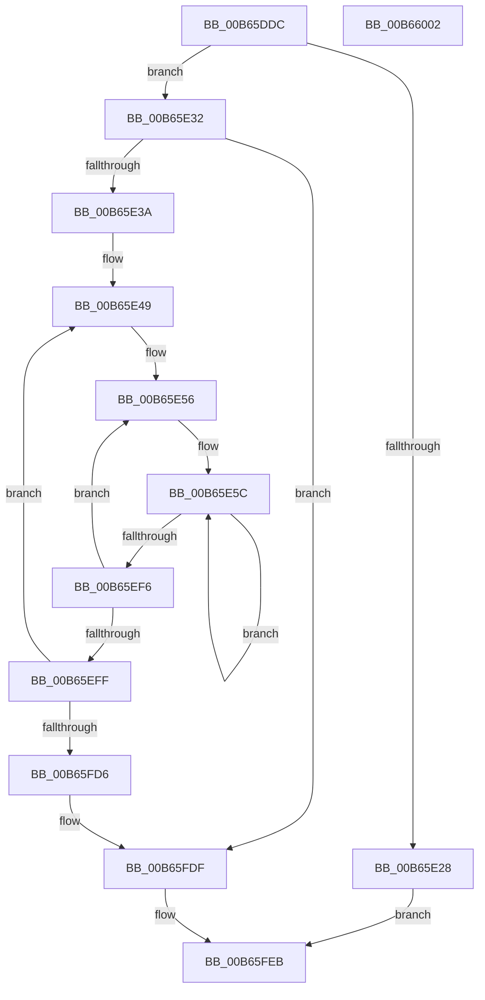

# KiAllocateHeteroConfigBuffer

- RVA: `0x00B65DDC`–`0x00B66003` (길이 `551` bytes)
- VA: `0x0000000140B65DDC`
- 실행 섹션: `PAGELK`
- PDB 이름 있음: `예`; PDB Function 태그: `아니요`
- unwind 정보 RVA: `0x000C9F0C`
- 디코드: `115`개 명령, `551/551` bytes 표시
- 미해석 바이트: `0` (있으면 어셈블리에 `.byte`로 보존)

> 이 문서는 커널 이미지의 기계어와 PDB 기호를 분석해 생성했습니다. 4번과 5번은 함수 원형과 자료형을 바이너리 사용 방식에서 추정한 C 해석이며 원본 소스 복구 결과는 아닙니다.

## 1. Dependencies

- 직접 호출 지점: **12**; 고유 호출 대상: **3**
- 직접 호출자로 확인된 함수: **1**
- RIP 상대 이미지 참조: **1**

### Outgoing calls
- `0x00B65DF7` → [KeGetThreadWorkloadClassCount](../../text/4F/KeGetThreadWorkloadClassCount_function_004F8CB4.md) (function, `0x004F8CB4`)
- `0x00B65E16` → [ExAllocatePool2](../../poolcode/B8/ExAllocatePool2_function_00B820F0.md) (function, `0x00B820F0`)
- `0x00B65E72` → [memset](../../text/6C/memset_function_006C6C40.md) (function, `0x006C6C40`)
- `0x00B65E97` → [memset](../../text/6C/memset_function_006C6C40.md) (function, `0x006C6C40`)
- `0x00B65EBC` → [memset](../../text/6C/memset_function_006C6C40.md) (function, `0x006C6C40`)
- `0x00B65EE1` → [memset](../../text/6C/memset_function_006C6C40.md) (function, `0x006C6C40`)
- `0x00B65F21` → [memset](../../text/6C/memset_function_006C6C40.md) (function, `0x006C6C40`)
- `0x00B65F39` → [memset](../../text/6C/memset_function_006C6C40.md) (function, `0x006C6C40`)
- `0x00B65F5B` → [memset](../../text/6C/memset_function_006C6C40.md) (function, `0x006C6C40`)
- `0x00B65F7D` → [memset](../../text/6C/memset_function_006C6C40.md) (function, `0x006C6C40`)
- `0x00B65F9F` → [memset](../../text/6C/memset_function_006C6C40.md) (function, `0x006C6C40`)
- `0x00B65FC1` → [memset](../../text/6C/memset_function_006C6C40.md) (function, `0x006C6C40`)

### Direct callers
- [PoInitHeteroDetection](../../init/C3/PoInitHeteroDetection_function_00C3D244.md) at `0x00C3D293`

### Static image references
- `0x00B65FE4` → RVA `0x00F234D8` (`.data`; write)

## 2. Other-region calls and transfers

- 다른 실행 섹션으로 향하는 call: **12**
  - `0x00B65DF7` → [KeGetThreadWorkloadClassCount](../../text/4F/KeGetThreadWorkloadClassCount_function_004F8CB4.md) (`PAGELK` → `.text`)
  - `0x00B65E16` → [ExAllocatePool2](../../poolcode/B8/ExAllocatePool2_function_00B820F0.md) (`PAGELK` → `POOLCODE`)
  - `0x00B65E72` → [memset](../../text/6C/memset_function_006C6C40.md) (`PAGELK` → `.text`)
  - `0x00B65E97` → [memset](../../text/6C/memset_function_006C6C40.md) (`PAGELK` → `.text`)
  - `0x00B65EBC` → [memset](../../text/6C/memset_function_006C6C40.md) (`PAGELK` → `.text`)
  - `0x00B65EE1` → [memset](../../text/6C/memset_function_006C6C40.md) (`PAGELK` → `.text`)
  - `0x00B65F21` → [memset](../../text/6C/memset_function_006C6C40.md) (`PAGELK` → `.text`)
  - `0x00B65F39` → [memset](../../text/6C/memset_function_006C6C40.md) (`PAGELK` → `.text`)
  - `0x00B65F5B` → [memset](../../text/6C/memset_function_006C6C40.md) (`PAGELK` → `.text`)
  - `0x00B65F7D` → [memset](../../text/6C/memset_function_006C6C40.md) (`PAGELK` → `.text`)
  - `0x00B65F9F` → [memset](../../text/6C/memset_function_006C6C40.md) (`PAGELK` → `.text`)
  - `0x00B65FC1` → [memset](../../text/6C/memset_function_006C6C40.md) (`PAGELK` → `.text`)
- 별도 외부 분기/꼬리 이동을 확인하지 못했습니다.

## 3. Assembly (complete function range)

```asm
00B65DDC  48 89 5C 24 18                  mov qword ptr [rsp + 0x18], rbx
00B65DE1  48 89 6C 24 20                  mov qword ptr [rsp + 0x20], rbp
00B65DE6  48 89 4C 24 08                  mov qword ptr [rsp + 8], rcx
00B65DEB  56                              push rsi
00B65DEC  57                              push rdi
00B65DED  41 54                           push r12
00B65DEF  41 56                           push r14
00B65DF1  41 57                           push r15
00B65DF3  48 83 EC 20                     sub rsp, 0x20
00B65DF7  E8 B8 2E 99 FF                  call 0x1404f8cb4
00B65DFC  69 D0 F0 3F 00 00               imul edx, eax, 0x3ff0
00B65E02  B9 40 00 00 00                  mov ecx, 0x40
00B65E07  8B E8                           mov ebp, eax
00B65E09  41 B8 4B 65 48 65               mov r8d, 0x6548654b
00B65E0F  89 6C 24 50                     mov dword ptr [rsp + 0x50], ebp
00B65E13  83 C2 20                        add edx, 0x20
00B65E16  E8 D5 C2 01 00                  call 0x140b820f0
00B65E1B  48 89 44 24 58                  mov qword ptr [rsp + 0x58], rax
00B65E20  48 8B F0                        mov rsi, rax
00B65E23  48 85 C0                        test rax, rax
00B65E26  75 0A                           jne 0x140b65e32
00B65E28  B8 9A 00 00 C0                  mov eax, 0xc000009a
00B65E2D  E9 B9 01 00 00                  jmp 0x140b65feb
00B65E32  85 ED                           test ebp, ebp
00B65E34  0F 84 A5 01 00 00               je 0x140b65fdf
00B65E3A  48 8D B8 2C 01 00 00            lea rdi, [rax + 0x12c]
00B65E41  4C 8B E5                        mov r12, rbp
00B65E44  BE 01 00 00 00                  mov esi, 1
00B65E49  48 8D 9F 28 05 00 00            lea rbx, [rdi + 0x528]
00B65E50  41 BE 07 00 00 00               mov r14d, 7
00B65E56  41 BF 02 00 00 00               mov r15d, 2
00B65E5C  83 23 00                        and dword ptr [rbx], 0
00B65E5F  48 8D 4B 04                     lea rcx, [rbx + 4]
00B65E63  33 D2                           xor edx, edx
00B65E65  C7 43 FC 01 00 20 00            mov dword ptr [rbx - 4], 0x200001
00B65E6C  41 B8 00 01 00 00               mov r8d, 0x100
00B65E72  E8 C9 0D B6 FF                  call 0x1406c6c40
00B65E77  83 A3 70 0E 00 00 00            and dword ptr [rbx + 0xe70], 0
00B65E7E  48 8D 8B 74 0E 00 00            lea rcx, [rbx + 0xe74]
00B65E85  33 D2                           xor edx, edx
00B65E87  C7 83 6C 0E 00 00 01 00 20 00   mov dword ptr [rbx + 0xe6c], 0x200001
00B65E91  41 B8 00 01 00 00               mov r8d, 0x100
00B65E97  E8 A4 0D B6 FF                  call 0x1406c6c40
00B65E9C  83 A3 E0 1C 00 00 00            and dword ptr [rbx + 0x1ce0], 0
00B65EA3  48 8D 8B E4 1C 00 00            lea rcx, [rbx + 0x1ce4]
00B65EAA  33 D2                           xor edx, edx
00B65EAC  C7 83 DC 1C 00 00 01 00 20 00   mov dword ptr [rbx + 0x1cdc], 0x200001
00B65EB6  41 B8 00 01 00 00               mov r8d, 0x100
00B65EBC  E8 7F 0D B6 FF                  call 0x1406c6c40
00B65EC1  83 A3 50 2B 00 00 00            and dword ptr [rbx + 0x2b50], 0
00B65EC8  48 8D 8B 54 2B 00 00            lea rcx, [rbx + 0x2b54]
00B65ECF  33 D2                           xor edx, edx
00B65ED1  C7 83 4C 2B 00 00 01 00 20 00   mov dword ptr [rbx + 0x2b4c], 0x200001
00B65EDB  41 B8 00 01 00 00               mov r8d, 0x100
00B65EE1  E8 5A 0D B6 FF                  call 0x1406c6c40
00B65EE6  48 81 C3 08 01 00 00            add rbx, 0x108
00B65EED  4C 2B FE                        sub r15, rsi
00B65EF0  0F 85 66 FF FF FF               jne 0x140b65e5c
00B65EF6  4C 2B F6                        sub r14, rsi
00B65EF9  0F 85 57 FF FF FF               jne 0x140b65e56
00B65EFF  44 21 B7 F8 FE FF FF            and dword ptr [rdi - 0x108], r14d
00B65F06  48 8D 8F FC FE FF FF            lea rcx, [rdi - 0x104]
00B65F0D  BD 00 01 00 00                  mov ebp, 0x100
00B65F12  C7 87 F4 FE FF FF 01 00 20 00   mov dword ptr [rdi - 0x10c], 0x200001
00B65F1C  44 8B C5                        mov r8d, ebp
00B65F1F  33 D2                           xor edx, edx
00B65F21  E8 1A 0D B6 FF                  call 0x1406c6c40
00B65F26  44 21 37                        and dword ptr [rdi], r14d
00B65F29  48 8D 4F 04                     lea rcx, [rdi + 4]
00B65F2D  44 8B C5                        mov r8d, ebp
00B65F30  C7 47 FC 01 00 20 00            mov dword ptr [rdi - 4], 0x200001
00B65F37  33 D2                           xor edx, edx
00B65F39  E8 02 0D B6 FF                  call 0x1406c6c40
00B65F3E  44 21 B7 08 01 00 00            and dword ptr [rdi + 0x108], r14d
00B65F45  48 8D 8F 0C 01 00 00            lea rcx, [rdi + 0x10c]
00B65F4C  44 8B C5                        mov r8d, ebp
00B65F4F  C7 87 04 01 00 00 01 00 20 00   mov dword ptr [rdi + 0x104], 0x200001
00B65F59  33 D2                           xor edx, edx
00B65F5B  E8 E0 0C B6 FF                  call 0x1406c6c40
00B65F60  44 21 B7 10 02 00 00            and dword ptr [rdi + 0x210], r14d
00B65F67  48 8D 8F 14 02 00 00            lea rcx, [rdi + 0x214]
00B65F6E  44 8B C5                        mov r8d, ebp
00B65F71  C7 87 0C 02 00 00 01 00 20 00   mov dword ptr [rdi + 0x20c], 0x200001
00B65F7B  33 D2                           xor edx, edx
00B65F7D  E8 BE 0C B6 FF                  call 0x1406c6c40
00B65F82  44 21 B7 18 03 00 00            and dword ptr [rdi + 0x318], r14d
00B65F89  48 8D 8F 1C 03 00 00            lea rcx, [rdi + 0x31c]
00B65F90  44 8B C5                        mov r8d, ebp
00B65F93  C7 87 14 03 00 00 01 00 20 00   mov dword ptr [rdi + 0x314], 0x200001
00B65F9D  33 D2                           xor edx, edx
00B65F9F  E8 9C 0C B6 FF                  call 0x1406c6c40
00B65FA4  44 21 B7 20 04 00 00            and dword ptr [rdi + 0x420], r14d
00B65FAB  48 8D 8F 24 04 00 00            lea rcx, [rdi + 0x424]
00B65FB2  44 8B C5                        mov r8d, ebp
00B65FB5  C7 87 1C 04 00 00 01 00 20 00   mov dword ptr [rdi + 0x41c], 0x200001
00B65FBF  33 D2                           xor edx, edx
00B65FC1  E8 7A 0C B6 FF                  call 0x1406c6c40
00B65FC6  48 81 C7 F0 3F 00 00            add rdi, 0x3ff0
00B65FCD  4C 2B E6                        sub r12, rsi
00B65FD0  0F 85 73 FE FF FF               jne 0x140b65e49
00B65FD6  48 8B 74 24 58                  mov rsi, qword ptr [rsp + 0x58]
00B65FDB  8B 6C 24 50                     mov ebp, dword ptr [rsp + 0x50]
00B65FDF  89 6E 1C                        mov dword ptr [rsi + 0x1c], ebp
00B65FE2  33 C0                           xor eax, eax
00B65FE4  48 89 35 ED D4 3B 00            mov qword ptr [rip + 0x3bd4ed], rsi
00B65FEB  48 8B 5C 24 60                  mov rbx, qword ptr [rsp + 0x60]
00B65FF0  48 8B 6C 24 68                  mov rbp, qword ptr [rsp + 0x68]
00B65FF5  48 83 C4 20                     add rsp, 0x20
00B65FF9  41 5F                           pop r15
00B65FFB  41 5E                           pop r14
00B65FFD  41 5C                           pop r12
00B65FFF  5F                              pop rdi
00B66000  5E                              pop rsi
00B66001  C3                              ret
00B66002  CC                              int3
```

## 4. C-style interpretation (structured pseudocode)

```c
__int64 __fastcall KiAllocateHeteroConfigBuffer(__int64 a1)
{
    __int64 result;
    __int64 v_r12;
    __int64 v_r14;
    __int64 v_r15;
    __int64 v_rbx;
    __int64 v_rdi;
    __int64 v_rsp;
    unsigned __int64 v_stack_p10;
    unsigned __int64 v_stack_p18;
    unsigned __int64 v_stack_p20;
    unsigned __int64 v_stack_p8;

    v_stack_p18 = v_rbx;
    v_stack_p20 = v_rbp;
    v_stack_p8 = a1;
    v_rsp = (v_rsp) - (32);
    result = KeGetThreadWorkloadClassCount(a1, a2, a3, a4);
    a2 = (unsigned int)((a2) * ((unsigned int)(result)));
    v_stack_p8 = (unsigned int)((unsigned int)((unsigned int)(result)));
    a2 = (unsigned int)((a2) + (32));
    result = ExAllocatePool2(64, a2, (unsigned int)(0x6548654BULL), a4);
    v_stack_p10 = result;
    if (result != 0) goto loc_00B65E32;
    goto loc_00B65FEB;
loc_00B65E32:
    if ((unsigned int)((unsigned int)((unsigned int)(result))) == 0) goto loc_00B65FDF;
loc_00B65E49:
loc_00B65E56:
loc_00B65E5C:
    a2 = 0;
    *(unsigned int *)((unsigned int)(0xC000009AULL) + 300 + 1320 - 4) = 0x200001ULL;
    result = memset((unsigned int)(0xC000009AULL) + 300 + 1320 + 4, a2, 256, a4);
    a2 = 0;
    *(unsigned int *)((unsigned int)(0xC000009AULL) + 300 + 1320 + 3692) = 0x200001ULL;
    result = memset((unsigned int)(0xC000009AULL) + 300 + 1320 + 3700, a2, 256, a4);
    a2 = 0;
    *(unsigned int *)((unsigned int)(0xC000009AULL) + 300 + 1320 + 7388) = 0x200001ULL;
    result = memset((unsigned int)(0xC000009AULL) + 300 + 1320 + 7396, a2, 256, a4);
    a2 = 0;
    *(unsigned int *)((unsigned int)(0xC000009AULL) + 300 + 1320 + 11084) = 0x200001ULL;
    result = memset((unsigned int)(0xC000009AULL) + 300 + 1320 + 11092, a2, 256, a4);
    v_rbx = ((unsigned int)(0xC000009AULL) + 300 + 1320) + (264);
    v_r15 = (2) - (1);
    if (condition_is_not_equal) goto loc_00B65E5C;
    v_r14 = (7) - (1);
    if (condition_is_not_equal) goto loc_00B65E56;
    *(unsigned int *)((unsigned int)(0xC000009AULL) + 300 - 268) = 0x200001ULL;
    a2 = 0;
    result = memset((unsigned int)(0xC000009AULL) + 300 - 260, a2, 256, a4);
    *(unsigned int *)((unsigned int)(0xC000009AULL) + 300 - 4) = 0x200001ULL;
    a2 = 0;
    result = memset((unsigned int)(0xC000009AULL) + 300 + 4, a2, 256, a4);
    *(unsigned int *)((unsigned int)(0xC000009AULL) + 300 + 260) = 0x200001ULL;
    a2 = 0;
    result = memset((unsigned int)(0xC000009AULL) + 300 + 268, a2, 256, a4);
    *(unsigned int *)((unsigned int)(0xC000009AULL) + 300 + 524) = 0x200001ULL;
    a2 = 0;
    result = memset((unsigned int)(0xC000009AULL) + 300 + 532, a2, 256, a4);
    *(unsigned int *)((unsigned int)(0xC000009AULL) + 300 + 788) = 0x200001ULL;
    a2 = 0;
    result = memset((unsigned int)(0xC000009AULL) + 300 + 796, a2, 256, a4);
    *(unsigned int *)((unsigned int)(0xC000009AULL) + 300 + 1052) = 0x200001ULL;
    a2 = 0;
    result = memset((unsigned int)(0xC000009AULL) + 300 + 1060, a2, 256, a4);
    v_rdi = ((unsigned int)(0xC000009AULL) + 300) + (0x3FF0ULL);
    v_r12 = ((unsigned int)((unsigned int)(result))) - (1);
    if (condition_is_not_equal) goto loc_00B65E49;
loc_00B65FDF:
    *(unsigned int *)(v_stack_p10 + 28) = (unsigned int)((unsigned int)(v_stack_p8));
    result = 0;
    *(unsigned __int64 *)(v_rip + 3921133) = v_stack_p10;
loc_00B65FEB:
    v_rsp = (v_rsp) + (32);
    return result;
}
```

## 5. (Beta) C Style

```c
int64_t KiAllocateHeteroConfigBuffer(int64_t Arg1)
{
    int64_t result;
    int64_t local_r12;
    int64_t local_r14;
    int64_t local_r15;
    int64_t local_rbx;
    int64_t local_rdi;
    int64_t local_rsp;
    uint64_t v_stack_p10;
    uint64_t v_stack_p18;
    uint64_t v_stack_p20;
    uint64_t v_stack_p8;

    v_stack_p18 = local_rbx;
    v_stack_p20 = local_rbp;
    v_stack_p8 = Arg1;
    local_rsp = (local_rsp) - (32);
    result = KeGetThreadWorkloadClassCount(Arg1, a2, a3, a4);
    a2 = (uint32_t)((a2) * ((uint32_t)(result)));
    v_stack_p8 = (uint32_t)((uint32_t)((uint32_t)(result)));
    a2 = (uint32_t)((a2) + (32));
    result = ExAllocatePool2(64, a2, (uint32_t)(0x6548654BULL), a4);
    v_stack_p10 = result;
    if (result != 0) goto loc_00B65E32;
    goto loc_00B65FEB;
loc_00B65E32:
    if ((uint32_t)((uint32_t)((uint32_t)(result))) == 0) goto loc_00B65FDF;
loc_00B65E49:
loc_00B65E56:
loc_00B65E5C:
    a2 = 0;
    *(uint32_t *)((uint32_t)(0xC000009AULL) + 0x12C + 0x528 - 0x4) = 0x200001ULL;
    result = memset((uint32_t)(0xC000009AULL) + 300 + 1320 + 4, a2, 256, a4);
    a2 = 0;
    *(uint32_t *)((uint32_t)(0xC000009AULL) + 0x12C + 0x528 + 0xE6C) = 0x200001ULL;
    result = memset((uint32_t)(0xC000009AULL) + 300 + 1320 + 3700, a2, 256, a4);
    a2 = 0;
    *(uint32_t *)((uint32_t)(0xC000009AULL) + 0x12C + 0x528 + 0x1CDC) = 0x200001ULL;
    result = memset((uint32_t)(0xC000009AULL) + 300 + 1320 + 7396, a2, 256, a4);
    a2 = 0;
    *(uint32_t *)((uint32_t)(0xC000009AULL) + 0x12C + 0x528 + 0x2B4C) = 0x200001ULL;
    result = memset((uint32_t)(0xC000009AULL) + 300 + 1320 + 11092, a2, 256, a4);
    local_rbx = ((uint32_t)(0xC000009AULL) + 300 + 1320) + (264);
    local_r15 = (2) - (1);
    if (condition_is_not_equal) goto loc_00B65E5C;
    local_r14 = (7) - (1);
    if (condition_is_not_equal) goto loc_00B65E56;
    *(uint32_t *)((uint32_t)(0xC000009AULL) + 0x12C - 0x10C) = 0x200001ULL;
    a2 = 0;
    result = memset((uint32_t)(0xC000009AULL) + 300 - 260, a2, 256, a4);
    *(uint32_t *)((uint32_t)(0xC000009AULL) + 0x12C - 0x4) = 0x200001ULL;
    a2 = 0;
    result = memset((uint32_t)(0xC000009AULL) + 300 + 4, a2, 256, a4);
    *(uint32_t *)((uint32_t)(0xC000009AULL) + 0x12C + 0x104) = 0x200001ULL;
    a2 = 0;
    result = memset((uint32_t)(0xC000009AULL) + 300 + 268, a2, 256, a4);
    *(uint32_t *)((uint32_t)(0xC000009AULL) + 0x12C + 0x20C) = 0x200001ULL;
    a2 = 0;
    result = memset((uint32_t)(0xC000009AULL) + 300 + 532, a2, 256, a4);
    *(uint32_t *)((uint32_t)(0xC000009AULL) + 0x12C + 0x314) = 0x200001ULL;
    a2 = 0;
    result = memset((uint32_t)(0xC000009AULL) + 300 + 796, a2, 256, a4);
    *(uint32_t *)((uint32_t)(0xC000009AULL) + 0x12C + 0x41C) = 0x200001ULL;
    a2 = 0;
    result = memset((uint32_t)(0xC000009AULL) + 300 + 1060, a2, 256, a4);
    local_rdi = ((uint32_t)(0xC000009AULL) + 300) + (0x3FF0ULL);
    local_r12 = ((uint32_t)((uint32_t)(result))) - (1);
    if (condition_is_not_equal) goto loc_00B65E49;
loc_00B65FDF:
    *(uint32_t *)(v_stack_p10 + 0x1C) = (uint32_t)((uint32_t)(v_stack_p8));
    result = 0;
    *(uint64_t *)(v_rip + 0x3BD4ED) = v_stack_p10;
loc_00B65FEB:
    local_rsp = (local_rsp) + (32);
    return result;
}
```

## 6. Execution-region graph

[열기: 2D/3D 그래프와 함수 탐색 컨트롤 패널](../../../control-panel.html?section=pagelk&rva=0x00B65DDC&view=graph)

- 2D 그래프는 위에서 아래로 흐르고, 3D 그래프는 빈 공간을 드래그해 회전합니다. Shift+드래그는 이동, 휠은 확대·축소, 함수 노드 선택은 대상 보고서 이동입니다.

### Static fallback


