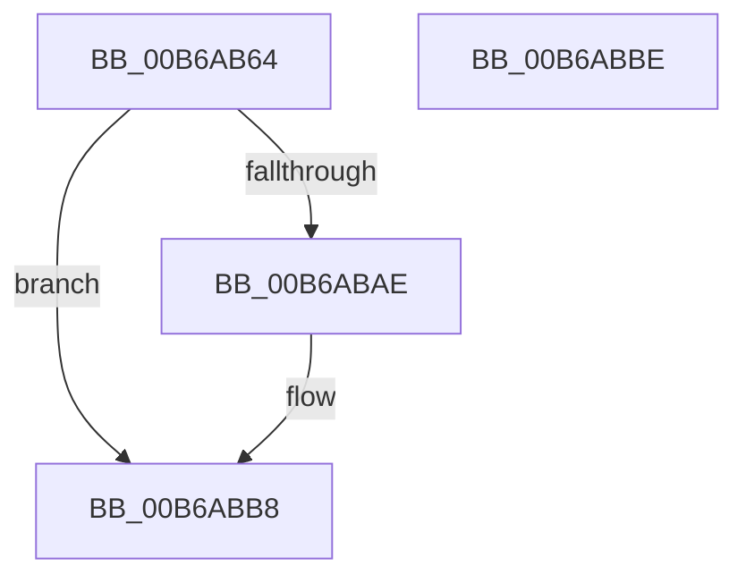

# KiAllocateIdleThread

- RVA: `0x00B6AB64`–`0x00B6ABBF` (길이 `91` bytes)
- VA: `0x0000000140B6AB64`
- 실행 섹션: `PAGELK`
- PDB 이름 있음: `예`; PDB Function 태그: `아니요`
- unwind 정보 RVA: `0x000697A4`
- 디코드: `24`개 명령, `91/91` bytes 표시
- 미해석 바이트: `0` (있으면 어셈블리에 `.byte`로 보존)

> 이 문서는 커널 이미지의 기계어와 PDB 기호를 분석해 생성했습니다. 4번과 5번은 함수 원형과 자료형을 바이너리 사용 방식에서 추정한 C 해석이며 원본 소스 복구 결과는 아닙니다.

## 1. Dependencies

- 직접 호출 지점: **1**; 고유 호출 대상: **1**
- 직접 호출자로 확인된 함수: **1**
- RIP 상대 이미지 참조: **3**

### Outgoing calls
- `0x00B6ABA5` → [KiAllocatePrcbThread](../../text/5B/KiAllocatePrcbThread_function_005B9130.md) (function, `0x005B9130`)

### Direct callers
- [KiAllocateProcessorStateInitializationParameters](../../text/5B/KiAllocateProcessorStateInitializationParameters_function_005B6F24.md) at `0x005B6F77`

### Static image references
- `0x00B6AB75` → RVA `0x01201841` (`CFGRO`; read)
- `0x00B6AB8E` → RVA `0x00E07130` (`.data`; read)
- `0x00B6AB9E` → RVA `0x006B2910` (`KiIdleLoop`; read)

## 2. Other-region calls and transfers

- 다른 실행 섹션으로 향하는 call: **1**
  - `0x00B6ABA5` → [KiAllocatePrcbThread](../../text/5B/KiAllocatePrcbThread_function_005B9130.md) (`PAGELK` → `.text`)
- 별도 외부 분기/꼬리 이동을 확인하지 못했습니다.

## 3. Assembly (complete function range)

```asm
00B6AB64  40 53                           push rbx
00B6AB66  48 83 EC 40                     sub rsp, 0x40
00B6AB6A  48 83 64 24 60 00               and qword ptr [rsp + 0x60], 0
00B6AB70  B8 04 00 00 00                  mov eax, 4
00B6AB75  80 3D C5 6C 69 00 00            cmp byte ptr [rip + 0x696cc5], 0
00B6AB7C  48 8B D9                        mov rbx, rcx
00B6AB7F  8D 48 08                        lea ecx, [rax + 8]
00B6AB82  0F 45 C1                        cmovne eax, ecx
00B6AB85  48 8D 4C 24 60                  lea rcx, [rsp + 0x60]
00B6AB8A  89 44 24 30                     mov dword ptr [rsp + 0x30], eax
00B6AB8E  48 8D 05 9B C5 29 00            lea rax, [rip + 0x29c59b]
00B6AB95  48 89 44 24 28                  mov qword ptr [rsp + 0x28], rax
00B6AB9A  89 54 24 20                     mov dword ptr [rsp + 0x20], edx
00B6AB9E  48 8D 15 6B 7D B4 FF            lea rdx, [rip - 0x4b8295]
00B6ABA5  E8 86 E5 A4 FF                  call 0x1405b9130
00B6ABAA  85 C0                           test eax, eax
00B6ABAC  78 0A                           js 0x140b6abb8
00B6ABAE  48 8B 44 24 60                  mov rax, qword ptr [rsp + 0x60]
00B6ABB3  48 89 03                        mov qword ptr [rbx], rax
00B6ABB6  33 C0                           xor eax, eax
00B6ABB8  48 83 C4 40                     add rsp, 0x40
00B6ABBC  5B                              pop rbx
00B6ABBD  C3                              ret
00B6ABBE  CC                              int3
```

## 4. C-style interpretation (structured pseudocode)

```c
__int64 __fastcall KiAllocateIdleThread(__int64 a1, int a2)
{
    __int64 result;
    __int64 v_rsp;
    unsigned int v_stack_m18;
    unsigned __int64 v_stack_m20;
    unsigned int v_stack_m28;
    unsigned __int64 v_stack_p18;

    v_rsp = (v_rsp) - (64);
    result = 4;
    if ((*(unsigned __int8 *)(v_rip + 6909125)) != 0) { result = (unsigned int)(4 + 8); }
    v_stack_m18 = (unsigned int)(result);
    v_stack_m20 = v_rip + 2737563;
    v_stack_m28 = a2;
    result = KiAllocatePrcbThread(v_stack_p18, v_rip - 4948629, a3, a4);
    if (!(sign_flag)) {
        result = v_stack_p18;
        *(unsigned __int64 *)(a1) = result;
        result = 0;
    }
    v_rsp = (v_rsp) + (64);
    return result;
}
```

## 5. (Beta) C Style

```c
int64_t KiAllocateIdleThread(void *Arg1, int32_t Arg2)
{
    uint8_t *arg1 = (uint8_t *)Arg1;

    int64_t result;
    int64_t local_rsp;
    uint32_t v_stack_m18;
    uint64_t v_stack_m20;
    uint32_t v_stack_m28;
    uint64_t v_stack_p18;

    local_rsp = (local_rsp) - (64);
    result = 4;
    if ((*(uint8_t *)(v_rip + 0x696CC5)) != 0) { result = (uint32_t)(4 + 8); }
    v_stack_m18 = (uint32_t)(result);
    v_stack_m20 = v_rip + 2737563;
    v_stack_m28 = Arg2;
    result = KiAllocatePrcbThread(v_stack_p18, v_rip - 4948629, a3, a4);
    if (!(sign_flag)) {
        result = v_stack_p18;
        *(uint64_t *)(arg1) = result;
        result = 0;
    }
    local_rsp = (local_rsp) + (64);
    return result;
}
```

### 관측된 메모리 오프셋

구조체 형식이 확인되지 않은 접근은 인자 기준의 오프셋으로만 기록했습니다.

| 기준 인자 | 오프셋 표현 | 폭 (bit) | 접근 |
|---|---:|---:|---|
| `Arg1` | `+ 0x0` | `64` | `W` |

## 6. Execution-region graph

[열기: 2D/3D 그래프와 함수 탐색 컨트롤 패널](../../../control-panel.html?section=pagelk&rva=0x00B6AB64&view=graph)

- 2D 그래프는 위에서 아래로 흐르고, 3D 그래프는 빈 공간을 드래그해 회전합니다. Shift+드래그는 이동, 휠은 확대·축소, 함수 노드 선택은 대상 보고서 이동입니다.

### Static fallback


