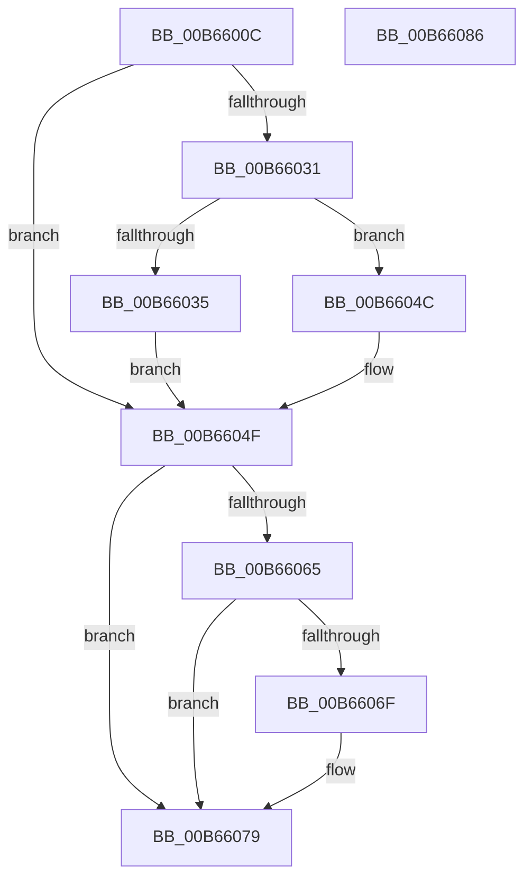

# KiApplyProcessorDpcLimits

- RVA: `0x00B6600C`–`0x00B66087` (길이 `123` bytes)
- VA: `0x0000000140B6600C`
- 실행 섹션: `PAGELK`
- PDB 이름 있음: `예`; PDB Function 태그: `아니요`
- unwind 정보 RVA: `0x00068D5C`
- 디코드: `37`개 명령, `123/123` bytes 표시
- 미해석 바이트: `0` (있으면 어셈블리에 `.byte`로 보존)

> 이 문서는 커널 이미지의 기계어와 PDB 기호를 분석해 생성했습니다. 4번과 5번은 함수 원형과 자료형을 바이너리 사용 방식에서 추정한 C 해석이며 원본 소스 복구 결과는 아닙니다.

## 1. Dependencies

- 직접 호출 지점: **3**; 고유 호출 대상: **3**
- 직접 호출자로 확인된 함수: **2**
- RIP 상대 이미지 참조: **0**

### Outgoing calls
- `0x00B66042` → [ExAllocatePool2](../../poolcode/B8/ExAllocatePool2_function_00B820F0.md) (function, `0x00B820F0`)
- `0x00B6605A` → [KiSetProcessorDpcLimits](../../text/5B/KiSetProcessorDpcLimits_function_005B8510.md) (function, `0x005B8510`)
- `0x00B66074` → [ExFreePoolWithTag](../../poolcode/B8/ExFreePoolWithTag_function_00B82870.md) (function, `0x00B82870`)

### Direct callers
- [KiUpdateProcessorDpcWatchdogConfiguration](../../text/5B/KiUpdateProcessorDpcWatchdogConfiguration_function_005B5E20.md) at `0x005B5E24`
- [KiInitializeProcessor](KiInitializeProcessor_function_00B66A0C.md) at `0x00B66AED`

### Static image references
- 디코드된 RIP-relative 메모리 참조가 없습니다.

## 2. Other-region calls and transfers

- 다른 실행 섹션으로 향하는 call: **3**
  - `0x00B66042` → [ExAllocatePool2](../../poolcode/B8/ExAllocatePool2_function_00B820F0.md) (`PAGELK` → `POOLCODE`)
  - `0x00B6605A` → [KiSetProcessorDpcLimits](../../text/5B/KiSetProcessorDpcLimits_function_005B8510.md) (`PAGELK` → `.text`)
  - `0x00B66074` → [ExFreePoolWithTag](../../poolcode/B8/ExFreePoolWithTag_function_00B82870.md) (`PAGELK` → `POOLCODE`)
- 별도 외부 분기/꼬리 이동을 확인하지 못했습니다.

## 3. Assembly (complete function range)

```asm
00B6600C  48 89 5C 24 10                  mov qword ptr [rsp + 0x10], rbx
00B66011  57                              push rdi
00B66012  48 83 EC 20                     sub rsp, 0x20
00B66016  48 83 64 24 30 00               and qword ptr [rsp + 0x30], 0
00B6601C  48 8B DA                        mov rbx, rdx
00B6601F  8B 42 18                        mov eax, dword ptr [rdx + 0x18]
00B66022  48 8B F9                        mov rdi, rcx
00B66025  4C 8B 81 A8 8E 00 00            mov r8, qword ptr [rcx + 0x8ea8]
00B6602C  39 42 1C                        cmp dword ptr [rdx + 0x1c], eax
00B6602F  74 1E                           je 0x140b6604f
00B66031  85 C0                           test eax, eax
00B66033  74 17                           je 0x140b6604c
00B66035  8B D0                           mov edx, eax
00B66037  B9 40 00 00 00                  mov ecx, 0x40
00B6603C  41 B8 4B 69 57 50               mov r8d, 0x5057694b
00B66042  E8 A9 C0 01 00                  call 0x140b820f0
00B66047  4C 8B C0                        mov r8, rax
00B6604A  EB 03                           jmp 0x140b6604f
00B6604C  45 33 C0                        xor r8d, r8d
00B6604F  4C 8D 4C 24 30                  lea r9, [rsp + 0x30]
00B66054  48 8B D3                        mov rdx, rbx
00B66057  48 8B CF                        mov rcx, rdi
00B6605A  E8 B1 24 A5 FF                  call 0x1405b8510
00B6605F  8B D8                           mov ebx, eax
00B66061  85 C0                           test eax, eax
00B66063  78 14                           js 0x140b66079
00B66065  48 8B 4C 24 30                  mov rcx, qword ptr [rsp + 0x30]
00B6606A  48 85 C9                        test rcx, rcx
00B6606D  74 0A                           je 0x140b66079
00B6606F  BA 4B 69 57 50                  mov edx, 0x5057694b
00B66074  E8 F7 C7 01 00                  call 0x140b82870
00B66079  8B C3                           mov eax, ebx
00B6607B  48 8B 5C 24 38                  mov rbx, qword ptr [rsp + 0x38]
00B66080  48 83 C4 20                     add rsp, 0x20
00B66084  5F                              pop rdi
00B66085  C3                              ret
00B66086  CC                              int3
```

## 4. C-style interpretation (structured pseudocode)

```c
__int64 __fastcall KiApplyProcessorDpcLimits(__int64 a1, __int64 a2)
{
    __int64 result;
    __int64 v_rsp;
    unsigned __int64 v_stack_p10;
    unsigned __int64 v_stack_p8;

    v_stack_p10 = v_rbx;
    v_rsp = (v_rsp) - (32);
    if ((*(unsigned int *)(a2 + 28)) == ((unsigned int)((unsigned int)(*(unsigned int *)(a2 + 24))))) goto loc_00B6604F;
    if ((unsigned int)((unsigned int)(*(unsigned int *)(a2 + 24))) == 0) goto loc_00B6604C;
    result = ExAllocatePool2(64, (unsigned int)((unsigned int)((unsigned int)(*(unsigned int *)(a2 + 24)))), (unsigned int)(0x5057694BULL), a4);
    goto loc_00B6604F;
loc_00B6604C:
    a3 = 0;
loc_00B6604F:
    result = KiSetProcessorDpcLimits(a1, a2, a3, v_stack_p8);
    if (sign_flag) goto loc_00B66079;
    if (v_stack_p8 != 0) {
        a2 = 0x5057694BULL;
        result = ExFreePoolWithTag(v_stack_p8, a2, a3, v_stack_p8);
    }
    v_rsp = (v_rsp) + (32);
    return (unsigned int)((unsigned int)((unsigned int)((unsigned int)(result))));
}
```

## 5. (Beta) C Style

```c
int64_t KiApplyProcessorDpcLimits(void *Arg1, void *Arg2)
{
    uint8_t *arg1 = (uint8_t *)Arg1;
    uint8_t *arg2 = (uint8_t *)Arg2;

    int64_t result;
    int64_t local_rsp;
    uint64_t v_stack_p10;
    uint64_t v_stack_p8;

    v_stack_p10 = local_rbx;
    local_rsp = (local_rsp) - (32);
    if ((*(uint32_t *)(arg2 + 0x1C)) == ((uint32_t)((uint32_t)(*(uint32_t *)(arg2 + 0x18))))) goto loc_00B6604F;
    if ((uint32_t)((uint32_t)(*(uint32_t *)(arg2 + 0x18))) == 0) goto loc_00B6604C;
    result = ExAllocatePool2(64, (uint32_t)((uint32_t)((uint32_t)(*(uint32_t *)(arg2 + 0x18)))), (uint32_t)(0x5057694BULL), a4);
    goto loc_00B6604F;
loc_00B6604C:
    a3 = 0;
loc_00B6604F:
    result = KiSetProcessorDpcLimits(Arg1, Arg2, a3, v_stack_p8);
    if (sign_flag) goto loc_00B66079;
    if (v_stack_p8 != 0) {
        Arg2 = 0x5057694BULL;
        result = ExFreePoolWithTag(v_stack_p8, Arg2, a3, v_stack_p8);
    }
    local_rsp = (local_rsp) + (32);
    return (uint32_t)((uint32_t)((uint32_t)((uint32_t)(result))));
}
```

### 관측된 메모리 오프셋

구조체 형식이 확인되지 않은 접근은 인자 기준의 오프셋으로만 기록했습니다.

| 기준 인자 | 오프셋 표현 | 폭 (bit) | 접근 |
|---|---:|---:|---|
| `Arg1` | `+ 0x8EA8` | `64` | `R` |
| `Arg2` | `+ 0x18` | `32` | `R` |
| `Arg2` | `+ 0x1C` | `32` | `R` |

## 6. Execution-region graph

[열기: 2D/3D 그래프와 함수 탐색 컨트롤 패널](../../../control-panel.html?section=pagelk&rva=0x00B6600C&view=graph)

- 2D 그래프는 위에서 아래로 흐르고, 3D 그래프는 빈 공간을 드래그해 회전합니다. Shift+드래그는 이동, 휠은 확대·축소, 함수 노드 선택은 대상 보고서 이동입니다.

### Static fallback


