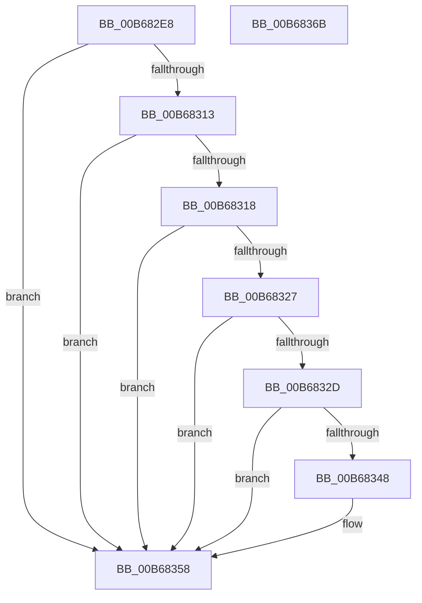

# KiCheckEnqueueStoreFeaturePresence

- RVA: `0x00B682E8`–`0x00B6836C` (길이 `132` bytes)
- VA: `0x0000000140B682E8`
- 실행 섹션: `PAGELK`
- PDB 이름 있음: `예`; PDB Function 태그: `아니요`
- unwind 정보 RVA: `0x000B64AC`
- 디코드: `38`개 명령, `132/132` bytes 표시
- 미해석 바이트: `0` (있으면 어셈블리에 `.byte`로 보존)

> 이 문서는 커널 이미지의 기계어와 PDB 기호를 분석해 생성했습니다. 4번과 5번은 함수 원형과 자료형을 바이너리 사용 방식에서 추정한 C 해석이며 원본 소스 복구 결과는 아닙니다.

## 1. Dependencies

- 직접 호출 지점: **1**; 고유 호출 대상: **1**
- 직접 호출자로 확인된 함수: **1**
- RIP 상대 이미지 참조: **2**

### Outgoing calls
- `0x00B68360` → [_security_check_cookie](../../text/6A/_security_check_cookie_function_006AC640.md) (function, `0x006AC640`)

### Direct callers
- [KiInitializeKernel](KiInitializeKernel_function_00B68D20.md) at `0x00B6906C`

### Static image references
- `0x00B682EE` → RVA `0x00E0A740` (`.data`; read)
- `0x00B68338` → RVA `0x00FC6C60` (`ALMOSTRO`; read)

## 2. Other-region calls and transfers

- 다른 실행 섹션으로 향하는 call: **1**
  - `0x00B68360` → [_security_check_cookie](../../text/6A/_security_check_cookie_function_006AC640.md) (`PAGELK` → `.text`)
- 별도 외부 분기/꼬리 이동을 확인하지 못했습니다.

## 3. Assembly (complete function range)

```asm
00B682E8  40 53                           push rbx
00B682EA  48 83 EC 20                     sub rsp, 0x20
00B682EE  48 8B 05 4B 24 2A 00            mov rax, qword ptr [rip + 0x2a244b]
00B682F5  48 33 C4                        xor rax, rsp
00B682F8  48 89 44 24 10                  mov qword ptr [rsp + 0x10], rax
00B682FD  4C 8B C1                        mov r8, rcx
00B68300  33 C0                           xor eax, eax
00B68302  33 C9                           xor ecx, ecx
00B68304  4C 8B CA                        mov r9, rdx
00B68307  0F A2                           cpuid
00B68309  41 80 B8 8D 00 00 00 02         cmp byte ptr [r8 + 0x8d], 2
00B68311  75 45                           jne 0x140b68358
00B68313  83 F8 07                        cmp eax, 7
00B68316  72 40                           jb 0x140b68358
00B68318  33 C9                           xor ecx, ecx
00B6831A  B8 07 00 00 00                  mov eax, 7
00B6831F  0F A2                           cpuid
00B68321  0F BA E1 1D                     bt ecx, 0x1d
00B68325  73 31                           jae 0x140b68358
00B68327  0F BA E1 1C                     bt ecx, 0x1c
00B6832B  73 2B                           jae 0x140b68358
00B6832D  49 8B 11                        mov rdx, qword ptr [r9]
00B68330  48 0F BA E2 17                  bt rdx, 0x17
00B68335  0F 92 C1                        setb cl
00B68338  48 0F BA 25 1F E9 45 00 0A      bt qword ptr [rip + 0x45e91f], 0xa
00B68341  0F 92 C0                        setb al
00B68344  84 C8                           test al, cl
00B68346  74 10                           je 0x140b68358
00B68348  48 B8 00 00 00 00 00 00 00 01   movabs rax, 0x100000000000000
00B68352  48 0B D0                        or rdx, rax
00B68355  49 89 11                        mov qword ptr [r9], rdx
00B68358  48 8B 4C 24 10                  mov rcx, qword ptr [rsp + 0x10]
00B6835D  48 33 CC                        xor rcx, rsp
00B68360  E8 DB 42 B4 FF                  call 0x1406ac640
00B68365  48 83 C4 20                     add rsp, 0x20
00B68369  5B                              pop rbx
00B6836A  C3                              ret
00B6836B  CC                              int3
```

## 4. C-style interpretation (structured pseudocode)

```c
__int64 __fastcall KiCheckEnqueueStoreFeaturePresence(__int64 a1, __int64 a2)
{
    __int64 result;
    __int64 v_rsp;
    unsigned __int64 v_stack_m18;

    v_rsp = (v_rsp) - (32);
    result = (*(unsigned __int64 *)(v_rip + 2761803)) ^ (v_rsp);
    v_stack_m18 = result;
    result = 0;
    a1 = 0;
    if ((*(unsigned __int8 *)(a1 + 141)) != 2) goto loc_00B68358;
    if (0 < 7) goto loc_00B68358;
    a1 = 0;
    if (condition_is_above_or_equal) goto loc_00B68358;
    if (condition_is_above_or_equal) goto loc_00B68358;
    a1 = (condition_is_below) ? 1 : 0;
    result = (condition_is_below) ? 1 : 0;
    if ((((unsigned __int8)(result)) & ((unsigned __int8)(a1))) != 0) {
        a2 = (*(unsigned __int64 *)(a2)) | (result);
        *(unsigned __int64 *)(a2) = a2;
    }
    a1 = (v_stack_m18) ^ (v_rsp);
    result = _security_check_cookie(a1, a2, a1, a2);
    v_rsp = (v_rsp) + (32);
    return result;
}
```

## 5. (Beta) C Style

```c
int64_t KiCheckEnqueueStoreFeaturePresence(void *Arg1, void *Arg2)
{
    uint8_t *arg1 = (uint8_t *)Arg1;
    uint8_t *arg2 = (uint8_t *)Arg2;

    int64_t result;
    int64_t local_rsp;
    uint64_t v_stack_m18;

    local_rsp = (local_rsp) - (32);
    result = (*(uint64_t *)(v_rip + 0x2A244B)) ^ (local_rsp);
    v_stack_m18 = result;
    result = 0;
    Arg1 = 0;
    if ((*(uint8_t *)(arg1 + 0x8D)) != 2) goto loc_00B68358;
    if (0 < 7) goto loc_00B68358;
    Arg1 = 0;
    if (condition_is_above_or_equal) goto loc_00B68358;
    if (condition_is_above_or_equal) goto loc_00B68358;
    Arg1 = (condition_is_below) ? 1 : 0;
    result = (condition_is_below) ? 1 : 0;
    if ((((uint8_t)(result)) & ((uint8_t)(Arg1))) != 0) {
        Arg2 = (*(uint64_t *)(arg2)) | (result);
        *(void **)(arg2) = Arg2;
    }
    Arg1 = (v_stack_m18) ^ (local_rsp);
    result = _security_check_cookie(Arg1, Arg2, Arg1, Arg2);
    local_rsp = (local_rsp) + (32);
    return result;
}
```

### 관측된 메모리 오프셋

구조체 형식이 확인되지 않은 접근은 인자 기준의 오프셋으로만 기록했습니다.

| 기준 인자 | 오프셋 표현 | 폭 (bit) | 접근 |
|---|---:|---:|---|
| `Arg1` | `+ 0x8D` | `8` | `R` |
| `Arg2` | `+ 0x0` | `64` | `R` |
| `Arg2` | `+ 0x0` | `64` | `W` |

## 6. Execution-region graph

[열기: 2D/3D 그래프와 함수 탐색 컨트롤 패널](../../../control-panel.html?section=pagelk&rva=0x00B682E8&view=graph)

- 2D 그래프는 위에서 아래로 흐르고, 3D 그래프는 빈 공간을 드래그해 회전합니다. Shift+드래그는 이동, 휠은 확대·축소, 함수 노드 선택은 대상 보고서 이동입니다.

### Static fallback


