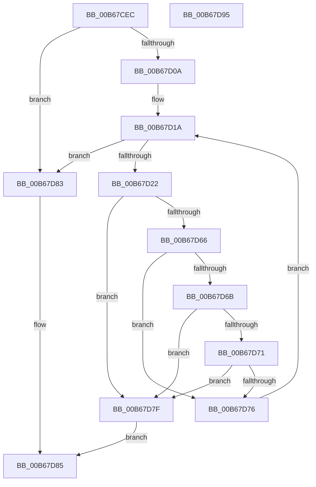

# KiCompareVarMtrr

- RVA: `0x00B67CEC`–`0x00B67D96` (길이 `170` bytes)
- VA: `0x0000000140B67CEC`
- 실행 섹션: `PAGELK`
- PDB 이름 있음: `예`; PDB Function 태그: `아니요`
- unwind 정보 RVA: `0x00069588`
- 디코드: `49`개 명령, `170/170` bytes 표시
- 미해석 바이트: `0` (있으면 어셈블리에 `.byte`로 보존)

> 이 문서는 커널 이미지의 기계어와 PDB 기호를 분석해 생성했습니다. 4번과 5번은 함수 원형과 자료형을 바이너리 사용 방식에서 추정한 C 해석이며 원본 소스 복구 결과는 아닙니다.

## 1. Dependencies

- 직접 호출 지점: **0**; 고유 호출 대상: **0**
- 직접 호출자로 확인된 함수: **1**
- RIP 상대 이미지 참조: **2**

### Outgoing calls
- 직접 디코드된 call 명령이 없습니다.

### Direct callers
- [KeLoadMTRR](../B7/KeLoadMTRR_function_00B7DDA0.md) at `0x00B7DDDB`

### Static image references
- `0x00B67D0A` → RVA `0x00F10EE8` (`.data`; read)
- `0x00B67D37` → RVA `0x00F10EF8` (`.data`; read)

## 2. Other-region calls and transfers

- 다른 실행 섹션으로 향하는 call: **0**
- 별도 외부 분기/꼬리 이동을 확인하지 못했습니다.

## 3. Assembly (complete function range)

```asm
00B67CEC  48 89 5C 24 08                  mov qword ptr [rsp + 8], rbx
00B67CF1  48 89 74 24 10                  mov qword ptr [rsp + 0x10], rsi
00B67CF6  48 89 7C 24 18                  mov qword ptr [rsp + 0x18], rdi
00B67CFB  65 48 8B 04 25 20 00 00 00      mov rax, qword ptr gs:[0x20]
00B67D04  83 78 24 00                     cmp dword ptr [rax + 0x24], 0
00B67D08  75 79                           jne 0x140b67d83
00B67D0A  0F B6 1D D7 91 3A 00            movzx ebx, byte ptr [rip + 0x3a91d7]
00B67D11  45 33 C9                        xor r9d, r9d
00B67D14  41 BA 01 02 00 00               mov r10d, 0x201
00B67D1A  45 8B D9                        mov r11d, r9d
00B67D1D  4C 3B DB                        cmp r11, rbx
00B67D20  73 61                           jae 0x140b67d83
00B67D22  41 8D 4A FF                     lea ecx, [r10 - 1]
00B67D26  0F 32                           rdmsr
00B67D28  48 C1 E2 20                     shl rdx, 0x20
00B67D2C  41 8B CA                        mov ecx, r10d
00B67D2F  48 0B C2                        or rax, rdx
00B67D32  4C 8B C0                        mov r8, rax
00B67D35  0F 32                           rdmsr
00B67D37  48 8B 35 BA 91 3A 00            mov rsi, qword ptr [rip + 0x3a91ba]
00B67D3E  4D 03 DB                        add r11, r11
00B67D41  48 C1 E2 20                     shl rdx, 0x20
00B67D45  48 0B C2                        or rax, rdx
00B67D48  48 8B D0                        mov rdx, rax
00B67D4B  4A 8B 7C DE 08                  mov rdi, qword ptr [rsi + r11*8 + 8]
00B67D50  48 C1 EA 0B                     shr rdx, 0xb
00B67D54  48 8B CF                        mov rcx, rdi
00B67D57  48 C1 E9 0B                     shr rcx, 0xb
00B67D5B  83 E2 01                        and edx, 1
00B67D5E  83 E1 01                        and ecx, 1
00B67D61  48 3B D1                        cmp rdx, rcx
00B67D64  75 19                           jne 0x140b67d7f
00B67D66  48 85 D2                        test rdx, rdx
00B67D69  74 0B                           je 0x140b67d76
00B67D6B  4E 3B 04 DE                     cmp r8, qword ptr [rsi + r11*8]
00B67D6F  75 0E                           jne 0x140b67d7f
00B67D71  48 3B C7                        cmp rax, rdi
00B67D74  75 09                           jne 0x140b67d7f
00B67D76  41 FF C1                        inc r9d
00B67D79  41 83 C2 02                     add r10d, 2
00B67D7D  EB 9B                           jmp 0x140b67d1a
00B67D7F  32 C0                           xor al, al
00B67D81  EB 02                           jmp 0x140b67d85
00B67D83  B0 01                           mov al, 1
00B67D85  48 8B 5C 24 08                  mov rbx, qword ptr [rsp + 8]
00B67D8A  48 8B 74 24 10                  mov rsi, qword ptr [rsp + 0x10]
00B67D8F  48 8B 7C 24 18                  mov rdi, qword ptr [rsp + 0x18]
00B67D94  C3                              ret
00B67D95  CC                              int3
```

## 4. C-style interpretation (structured pseudocode)

```c
__int64 __fastcall KiCompareVarMtrr(__int64 a1, __int64 a2, __int64 a3, int a4)
{
    __int64 result;
    __int64 v_r10;
    __int64 v_r11;
    unsigned __int64 v_stack_p10;
    unsigned __int64 v_stack_p18;
    unsigned __int64 v_stack_p8;

    v_stack_p8 = v_rbx;
    v_stack_p10 = v_rsi;
    v_stack_p18 = v_rdi;
    if ((*(unsigned int *)(*(unsigned __int64 *)(gs_base + (0 + 32)) + 36)) != 0) goto loc_00B67D83;
    a4 = 0;
loc_00B67D1A:
    if (0 >= (*(unsigned __int8 *)(v_rip + 3838423))) goto loc_00B67D83;
    a2 = (a2) << (32);
    result = (*(unsigned __int64 *)(gs_base + (0 + 32))) | (a2);
    v_r11 = (0) + (0);
    a2 = (a2) << (32);
    result = (result) | (a2);
    a2 = (result) >> (11);
    a1 = (*(unsigned __int64 *)(*(unsigned __int64 *)(v_rip + 3838394) + v_r11 * 8 + 8)) >> (11);
    a2 = (unsigned int)((a2) & (1));
    a1 = (unsigned int)((a1) & (1));
    if (a2 != a1) goto loc_00B67D7F;
    if (a2 == 0) goto loc_00B67D76;
    if (result != (*(unsigned __int64 *)(*(unsigned __int64 *)(v_rip + 3838394) + v_r11 * 8))) goto loc_00B67D7F;
    if (result != (*(unsigned __int64 *)(*(unsigned __int64 *)(v_rip + 3838394) + v_r11 * 8 + 8))) goto loc_00B67D7F;
loc_00B67D76:
    a4 = (unsigned int)((a4) + 1);
    v_r10 = (unsigned int)((513) + (2));
    goto loc_00B67D1A;
loc_00B67D7F:
    result = 0;
    goto loc_00B67D85;
loc_00B67D83:
loc_00B67D85:
    return 1;
}
```

## 5. (Beta) C Style

```c
int64_t KiCompareVarMtrr(int64_t Arg1, int64_t Arg2, int64_t Arg3, int32_t Arg4)
{
    int64_t result;
    int64_t local_r10;
    int64_t local_r11;
    uint64_t v_stack_p10;
    uint64_t v_stack_p18;
    uint64_t v_stack_p8;

    v_stack_p8 = local_rbx;
    v_stack_p10 = local_rsi;
    v_stack_p18 = local_rdi;
    if ((*(uint32_t *)(*(uint64_t *)(gs_base + (0 + 0x20)) + 0x24)) != 0) goto loc_00B67D83;
    Arg4 = 0;
loc_00B67D1A:
    if (0 >= (*(uint8_t *)(v_rip + 0x3A91D7))) goto loc_00B67D83;
    Arg2 = (Arg2) << (32);
    result = (*(uint64_t *)(gs_base + (0 + 0x20))) | (Arg2);
    local_r11 = (0) + (0);
    Arg2 = (Arg2) << (32);
    result = (result) | (Arg2);
    Arg2 = (result) >> (11);
    Arg1 = (*(uint64_t *)(*(uint64_t *)(v_rip + 0x3A91BA) + local_r11 * 8 + 0x8)) >> (11);
    Arg2 = (uint32_t)((Arg2) & (1));
    Arg1 = (uint32_t)((Arg1) & (1));
    if (Arg2 != Arg1) goto loc_00B67D7F;
    if (Arg2 == 0) goto loc_00B67D76;
    if (result != (*(uint64_t *)(*(uint64_t *)(v_rip + 0x3A91BA) + local_r11 * 8))) goto loc_00B67D7F;
    if (result != (*(uint64_t *)(*(uint64_t *)(v_rip + 0x3A91BA) + local_r11 * 8 + 0x8))) goto loc_00B67D7F;
loc_00B67D76:
    Arg4 = (uint32_t)((Arg4) + 1);
    local_r10 = (uint32_t)((513) + (2));
    goto loc_00B67D1A;
loc_00B67D7F:
    result = 0;
    goto loc_00B67D85;
loc_00B67D83:
loc_00B67D85:
    return 1;
}
```

## 6. Execution-region graph

[열기: 2D/3D 그래프와 함수 탐색 컨트롤 패널](../../../control-panel.html?section=pagelk&rva=0x00B67CEC&view=graph)

- 2D 그래프는 위에서 아래로 흐르고, 3D 그래프는 빈 공간을 드래그해 회전합니다. Shift+드래그는 이동, 휠은 확대·축소, 함수 노드 선택은 대상 보고서 이동입니다.

### Static fallback


