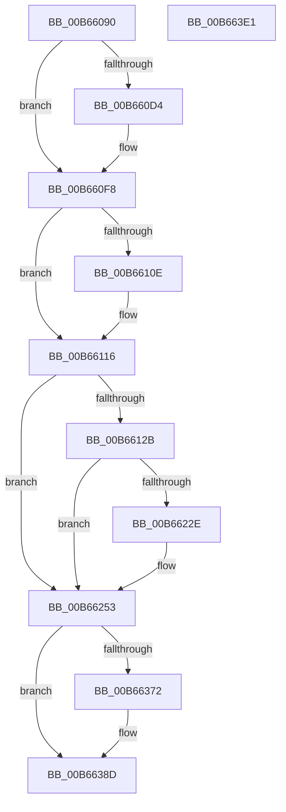

# KiCompleteKernelInit

- RVA: `0x00B66090`–`0x00B663E2` (길이 `850` bytes)
- VA: `0x0000000140B66090`
- 실행 섹션: `PAGELK`
- PDB 이름 있음: `예`; PDB Function 태그: `아니요`
- unwind 정보 RVA: `0x000C9EA4`
- 디코드: `180`개 명령, `850/850` bytes 표시
- 미해석 바이트: `0` (있으면 어셈블리에 `.byte`로 보존)

> 이 문서는 커널 이미지의 기계어와 PDB 기호를 분석해 생성했습니다. 4번과 5번은 함수 원형과 자료형을 바이너리 사용 방식에서 추정한 C 해석이며 원본 소스 복구 결과는 아닙니다.

## 1. Dependencies

- 직접 호출 지점: **26**; 고유 호출 대상: **21**
- 직접 호출자로 확인된 함수: **1**
- RIP 상대 이미지 참조: **33**

### Outgoing calls
- `0x00B66111` → [KiRaiseIrqlProcessIrqlFlags](../../text/4F/KiRaiseIrqlProcessIrqlFlags_function_004F56FC.md) (function, `0x004F56FC`)
- `0x00B6611E` → [KeAttachProcess](../../text/48/KeAttachProcess_function_00486540.md) (function, `0x00486540`)
- `0x00B6615C` → [KeInitializeTimer2](../../text/3A/KeInitializeTimer2_function_003A30B0.md) (function, `0x003A30B0`)
- `0x00B66172` → [KeInitializeDpc](../../text/45/KeInitializeDpc_function_0045BBD0.md) (function, `0x0045BBD0`)
- `0x00B66188` → [KeInitializeDpc](../../text/45/KeInitializeDpc_function_0045BBD0.md) (function, `0x0045BBD0`)
- `0x00B6619E` → [KeInitializeDpc](../../text/45/KeInitializeDpc_function_0045BBD0.md) (function, `0x0045BBD0`)
- `0x00B661CA` → [KeQueryPerformanceCounter](../../text/37/KeQueryPerformanceCounter_function_0037E7E0.md) (function, `0x0037E7E0`)
- `0x00B66220` → [KeRegisterBugCheckReasonCallback](../../text/47/KeRegisterBugCheckReasonCallback_function_004720A0.md) (function, `0x004720A0`)
- `0x00B66225` → [Feature_Servicing_ISRStatsInTriageDumps__private_IsEnabledDeviceUsageNoInline](../../text/5B/Feature_Servicing_ISRStatsInTriageDumps__private_IsEnabledDeviceUsageNoInline_function_005B6158.md) (function, `0x005B6158`)
- `0x00B6624E` → [KeRegisterBugCheckReasonCallback](../../text/47/KeRegisterBugCheckReasonCallback_function_004720A0.md) (function, `0x004720A0`)
- `0x00B66256` → [KiInitializeProcessorXSaveStructures](../../text/5B/KiInitializeProcessorXSaveStructures_function_005BA004.md) (function, `0x005BA004`)
- `0x00B66288` → [memset](../../text/6C/memset_function_006C6C40.md) (function, `0x006C6C40`)
- `0x00B662AF` → [KiAcquirePrcbLocksForGroupAffinity](../../text/5B/KiAcquirePrcbLocksForGroupAffinity_function_005B1C80.md) (function, `0x005B1C80`)
- `0x00B662FC` → [KiBuildShareCountListForSubNodeByAffinity](../../text/39/KiBuildShareCountListForSubNodeByAffinity_function_0039EE1C.md) (function, `0x0039EE1C`)
- `0x00B66313` → [KiWriteRankListMembersUnderLock](../../text/5C/KiWriteRankListMembersUnderLock_function_005C9004.md) (function, `0x005C9004`)
- `0x00B66339` → [KiBuildShareCountListForSubNodeByAffinity](../../text/39/KiBuildShareCountListForSubNodeByAffinity_function_0039EE1C.md) (function, `0x0039EE1C`)
- `0x00B66350` → [KiWriteRankListMembersUnderLock](../../text/5C/KiWriteRankListMembersUnderLock_function_005C9004.md) (function, `0x005C9004`)
- `0x00B66359` → [KiReleasePrcbLocksForGroupAffinity](../../text/5B/KiReleasePrcbLocksForGroupAffinity_function_005B2140.md) (function, `0x005B2140`)
- `0x00B66367` → [KiAcquirePrcbLocksForIsolationUnit](../../text/30/KiAcquirePrcbLocksForIsolationUnit_function_0030ED60.md) (function, `0x0030ED60`)
- `0x00B66380` → [KiSetProcessorIdle](../../text/41/KiSetProcessorIdle_function_00416950.md) (function, `0x00416950`)
- `0x00B66388` → [KiUpdateThreadQosGroupingSummaries](../../text/25/KiUpdateThreadQosGroupingSummaries_function_00257AEC.md) (function, `0x00257AEC`)
- `0x00B6639B` → [KiUpdateThreadPriority](../../text/25/KiUpdateThreadPriority_function_00257810.md) (function, `0x00257810`)
- `0x00B663A4` → [KiReleasePrcbLocksForIsolationUnit](../../text/39/KiReleasePrcbLocksForIsolationUnit_function_00399C50.md) (function, `0x00399C50`)
- `0x00B663AC` → [KiAddCpuToSystemCpuPartition](KiAddCpuToSystemCpuPartition_function_00B680F0.md) (function, `0x00B680F0`)
- `0x00B663B4` → [KiCreateCpuSetForProcessor](KiCreateCpuSetForProcessor_function_00B681A0.md) (function, `0x00B681A0`)
- `0x00B663C0` → [_security_check_cookie](../../text/6A/_security_check_cookie_function_006AC640.md) (function, `0x006AC640`)

### Direct callers
- [KiInitializeKernel](KiInitializeKernel_function_00B68D20.md) at `0x00B69579`

### Static image references
- `0x00B660AE` → RVA `0x00E0A740` (`.data`; read)
- `0x00B660D4` → RVA `0x00FC50C0` (`ALMOSTRO`; read)
- `0x00B660E0` → RVA `0x00FC50E8` (`ALMOSTRO`; read)
- `0x00B660EC` → RVA `0x00FC50C4` (`ALMOSTRO`; read)
- `0x00B66106` → RVA `0x00FC6D20` (`ALMOSTRO`; read)
- `0x00B66117` → RVA `0x00FC6AB0` (`ALMOSTRO`; read)
- `0x00B6612B` → RVA `0x00F22D28` (`.data`; read)
- `0x00B66132` → RVA `0x00F22D38` (`.data`; write)
- `0x00B6613D` → RVA `0x00F22D30` (`.data`; write)
- `0x00B66147` → RVA `0x00F22D28` (`.data`; write)
- `0x00B6614E` → RVA `0x005C4280` (`KiForegroundTimerCallback`; read)
- `0x00B66155` → RVA `0x00F22C20` (`.data`; read)
- `0x00B66164` → RVA `0x004C5A80` (`KiProcessPendingForegroundBoosts`; read)
- `0x00B6616B` → RVA `0x00F22CA8` (`.data`; read)
- `0x00B6617A` → RVA `0x005C4770` (`KiTriggerForegroundBoostDpc`; read)
- `0x00B66181` → RVA `0x00F22CE8` (`.data`; read)
- `0x00B66190` → RVA `0x00303790` (`KiUpdateVpBackingThreadPriorityDpcRoutine`; read)
- `0x00B66197` → RVA `0x00F22BC0` (`.data`; read)
- `0x00B661A3` → RVA `0x00F22C00` (`.data`; read)
- `0x00B661AA` → RVA `0x00F22BC1` (`.data`; write)
- `0x00B661B5` → RVA `0x00F22C08` (`.data`; write)
- `0x00B661BC` → RVA `0x00F22C00` (`.data`; write)
- `0x00B661C3` → RVA `0x00F22E58` (`.data`; write)
- `0x00B661DE` → RVA `0x00FC6FE0` (`ALMOSTRO`; write)
- `0x00B661EB` → RVA `0x00B7FC20` (` ?? ::OKHAJAOM::`string'`; read)
- `0x00B661F2` → RVA `0x00F22E8C` (`.data`; write)
- `0x00B66204` → RVA `0x00F22E60` (`.data`; read)
- `0x00B66212` → RVA `0x00FC7308` (`ALMOSTRO`; write)
- `0x00B66219` → RVA `0x005B8B40` (`KiSchedulerAssistBugCheckAddPagesCallback`; read)
- `0x00B6622E` → RVA `0x00B7FC40` (` ?? ::OKHAJAOM::`string'`; read)
- `0x00B66235` → RVA `0x00F10A8C` (`.data`; write)
- `0x00B66240` → RVA `0x005C5810` (`KiIntSteerCallbackRecordTriageCallback`; read)
- `0x00B66247` → RVA `0x00F10A60` (`.data`; read)

## 2. Other-region calls and transfers

- 다른 실행 섹션으로 향하는 call: **24**
  - `0x00B66111` → [KiRaiseIrqlProcessIrqlFlags](../../text/4F/KiRaiseIrqlProcessIrqlFlags_function_004F56FC.md) (`PAGELK` → `.text`)
  - `0x00B6611E` → [KeAttachProcess](../../text/48/KeAttachProcess_function_00486540.md) (`PAGELK` → `.text`)
  - `0x00B6615C` → [KeInitializeTimer2](../../text/3A/KeInitializeTimer2_function_003A30B0.md) (`PAGELK` → `.text`)
  - `0x00B66172` → [KeInitializeDpc](../../text/45/KeInitializeDpc_function_0045BBD0.md) (`PAGELK` → `.text`)
  - `0x00B66188` → [KeInitializeDpc](../../text/45/KeInitializeDpc_function_0045BBD0.md) (`PAGELK` → `.text`)
  - `0x00B6619E` → [KeInitializeDpc](../../text/45/KeInitializeDpc_function_0045BBD0.md) (`PAGELK` → `.text`)
  - `0x00B661CA` → [KeQueryPerformanceCounter](../../text/37/KeQueryPerformanceCounter_function_0037E7E0.md) (`PAGELK` → `.text`)
  - `0x00B66220` → [KeRegisterBugCheckReasonCallback](../../text/47/KeRegisterBugCheckReasonCallback_function_004720A0.md) (`PAGELK` → `.text`)
  - `0x00B66225` → [Feature_Servicing_ISRStatsInTriageDumps__private_IsEnabledDeviceUsageNoInline](../../text/5B/Feature_Servicing_ISRStatsInTriageDumps__private_IsEnabledDeviceUsageNoInline_function_005B6158.md) (`PAGELK` → `.text`)
  - `0x00B6624E` → [KeRegisterBugCheckReasonCallback](../../text/47/KeRegisterBugCheckReasonCallback_function_004720A0.md) (`PAGELK` → `.text`)
  - `0x00B66256` → [KiInitializeProcessorXSaveStructures](../../text/5B/KiInitializeProcessorXSaveStructures_function_005BA004.md) (`PAGELK` → `.text`)
  - `0x00B66288` → [memset](../../text/6C/memset_function_006C6C40.md) (`PAGELK` → `.text`)
  - `0x00B662AF` → [KiAcquirePrcbLocksForGroupAffinity](../../text/5B/KiAcquirePrcbLocksForGroupAffinity_function_005B1C80.md) (`PAGELK` → `.text`)
  - `0x00B662FC` → [KiBuildShareCountListForSubNodeByAffinity](../../text/39/KiBuildShareCountListForSubNodeByAffinity_function_0039EE1C.md) (`PAGELK` → `.text`)
  - `0x00B66313` → [KiWriteRankListMembersUnderLock](../../text/5C/KiWriteRankListMembersUnderLock_function_005C9004.md) (`PAGELK` → `.text`)
  - `0x00B66339` → [KiBuildShareCountListForSubNodeByAffinity](../../text/39/KiBuildShareCountListForSubNodeByAffinity_function_0039EE1C.md) (`PAGELK` → `.text`)
  - `0x00B66350` → [KiWriteRankListMembersUnderLock](../../text/5C/KiWriteRankListMembersUnderLock_function_005C9004.md) (`PAGELK` → `.text`)
  - `0x00B66359` → [KiReleasePrcbLocksForGroupAffinity](../../text/5B/KiReleasePrcbLocksForGroupAffinity_function_005B2140.md) (`PAGELK` → `.text`)
  - `0x00B66367` → [KiAcquirePrcbLocksForIsolationUnit](../../text/30/KiAcquirePrcbLocksForIsolationUnit_function_0030ED60.md) (`PAGELK` → `.text`)
  - `0x00B66380` → [KiSetProcessorIdle](../../text/41/KiSetProcessorIdle_function_00416950.md) (`PAGELK` → `.text`)
  - `0x00B66388` → [KiUpdateThreadQosGroupingSummaries](../../text/25/KiUpdateThreadQosGroupingSummaries_function_00257AEC.md) (`PAGELK` → `.text`)
  - `0x00B6639B` → [KiUpdateThreadPriority](../../text/25/KiUpdateThreadPriority_function_00257810.md) (`PAGELK` → `.text`)
  - `0x00B663A4` → [KiReleasePrcbLocksForIsolationUnit](../../text/39/KiReleasePrcbLocksForIsolationUnit_function_00399C50.md) (`PAGELK` → `.text`)
  - `0x00B663C0` → [_security_check_cookie](../../text/6A/_security_check_cookie_function_006AC640.md) (`PAGELK` → `.text`)
- 별도 외부 분기/꼬리 이동을 확인하지 못했습니다.

## 3. Assembly (complete function range)

```asm
00B66090  48 89 5C 24 18                  mov qword ptr [rsp + 0x18], rbx
00B66095  48 89 74 24 20                  mov qword ptr [rsp + 0x20], rsi
00B6609A  55                              push rbp
00B6609B  57                              push rdi
00B6609C  41 54                           push r12
00B6609E  41 56                           push r14
00B660A0  41 57                           push r15
00B660A2  48 8D 6C 24 C9                  lea rbp, [rsp - 0x37]
00B660A7  48 81 EC A0 00 00 00            sub rsp, 0xa0
00B660AE  48 8B 05 8B 46 2A 00            mov rax, qword ptr [rip + 0x2a468b]
00B660B5  48 33 C4                        xor rax, rsp
00B660B8  48 89 45 27                     mov qword ptr [rbp + 0x27], rax
00B660BC  33 F6                           xor esi, esi
00B660BE  41 8B D8                        mov ebx, r8d
00B660C1  48 89 75 C7                     mov qword ptr [rbp - 0x39], rsi
00B660C5  4C 8B FA                        mov r15, rdx
00B660C8  48 89 75 D7                     mov qword ptr [rbp - 0x29], rsi
00B660CC  4C 8B F1                        mov r14, rcx
00B660CF  45 85 C0                        test r8d, r8d
00B660D2  75 24                           jne 0x140b660f8
00B660D4  8B 05 E6 EF 45 00               mov eax, dword ptr [rip + 0x45efe6]
00B660DA  89 81 A8 38 00 00               mov dword ptr [rcx + 0x38a8], eax
00B660E0  8B 05 02 F0 45 00               mov eax, dword ptr [rip + 0x45f002]
00B660E6  89 81 B0 38 00 00               mov dword ptr [rcx + 0x38b0], eax
00B660EC  8B 05 D2 EF 45 00               mov eax, dword ptr [rip + 0x45efd2]
00B660F2  89 81 54 86 00 00               mov dword ptr [rcx + 0x8654], eax
00B660F8  44 0F 20 C1                     mov rcx, cr8
00B660FC  41 BC 02 00 00 00               mov r12d, 2
00B66102  45 0F 22 C4                     mov cr8, r12
00B66106  39 35 14 0C 46 00               cmp dword ptr [rip + 0x460c14], esi
00B6610C  74 08                           je 0x140b66116
00B6610E  41 8A D4                        mov dl, r12b
00B66111  E8 E6 F5 98 FF                  call 0x1404f56fc
00B66116  FB                              sti
00B66117  48 8B 0D 92 09 46 00            mov rcx, qword ptr [rip + 0x460992]
00B6611E  E8 1D 04 92 FF                  call 0x140486540
00B66123  85 DB                           test ebx, ebx
00B66125  0F 85 28 01 00 00               jne 0x140b66253
00B6612B  48 8D 05 F6 CB 3B 00            lea rax, [rip + 0x3bcbf6]
00B66132  48 89 35 FF CB 3B 00            mov qword ptr [rip + 0x3bcbff], rsi
00B66139  44 8D 4B 08                     lea r9d, [rbx + 8]
00B6613D  48 89 05 EC CB 3B 00            mov qword ptr [rip + 0x3bcbec], rax
00B66144  45 33 C0                        xor r8d, r8d
00B66147  48 89 05 DA CB 3B 00            mov qword ptr [rip + 0x3bcbda], rax
00B6614E  48 8D 15 2B E1 A5 FF            lea rdx, [rip - 0x5a1ed5]
00B66155  48 8D 0D C4 CA 3B 00            lea rcx, [rip + 0x3bcac4]
00B6615C  E8 4F CF 83 FF                  call 0x1403a30b0
00B66161  45 33 C0                        xor r8d, r8d
00B66164  48 8D 15 15 F9 95 FF            lea rdx, [rip - 0x6a06eb]
00B6616B  48 8D 0D 36 CB 3B 00            lea rcx, [rip + 0x3bcb36]
00B66172  E8 59 5A 8F FF                  call 0x14045bbd0
00B66177  45 33 C0                        xor r8d, r8d
00B6617A  48 8D 15 EF E5 A5 FF            lea rdx, [rip - 0x5a1a11]
00B66181  48 8D 0D 60 CB 3B 00            lea rcx, [rip + 0x3bcb60]
00B66188  E8 43 5A 8F FF                  call 0x14045bbd0
00B6618D  45 33 C0                        xor r8d, r8d
00B66190  48 8D 15 F9 D5 79 FF            lea rdx, [rip - 0x862a07]
00B66197  48 8D 0D 22 CA 3B 00            lea rcx, [rip + 0x3bca22]
00B6619E  E8 2D 5A 8F FF                  call 0x14045bbd0
00B661A3  48 8D 05 56 CA 3B 00            lea rax, [rip + 0x3bca56]
00B661AA  44 88 25 10 CA 3B 00            mov byte ptr [rip + 0x3bca10], r12b
00B661B1  48 8D 4D C7                     lea rcx, [rbp - 0x39]
00B661B5  48 89 05 4C CA 3B 00            mov qword ptr [rip + 0x3bca4c], rax
00B661BC  48 89 05 3D CA 3B 00            mov qword ptr [rip + 0x3bca3d], rax
00B661C3  48 89 35 8E CC 3B 00            mov qword ptr [rip + 0x3bcc8e], rsi
00B661CA  E8 11 86 81 FF                  call 0x14037e7e0
00B661CF  48 6B 4D C7 32                  imul rcx, qword ptr [rbp - 0x39], 0x32
00B661D4  48 B8 CF F7 53 E3 A5 9B C4 20   movabs rax, 0x20c49ba5e353f7cf
00B661DE  C7 05 F8 0D 46 00 64 00 00 00   mov dword ptr [rip + 0x460df8], 0x64
00B661E8  48 F7 E9                        imul rcx
00B661EB  4C 8D 0D 2E 9A 01 00            lea r9, [rip + 0x19a2e]
00B661F2  40 88 35 93 CC 3B 00            mov byte ptr [rip + 0x3bcc93], sil
00B661F9  48 C1 FA 07                     sar rdx, 7
00B661FD  44 8D 43 04                     lea r8d, [rbx + 4]
00B66201  48 8B C2                        mov rax, rdx
00B66204  48 8D 0D 55 CC 3B 00            lea rcx, [rip + 0x3bcc55]
00B6620B  48 C1 E8 3F                     shr rax, 0x3f
00B6620F  48 03 D0                        add rdx, rax
00B66212  48 89 15 EF 10 46 00            mov qword ptr [rip + 0x4610ef], rdx
00B66219  48 8D 15 20 29 A5 FF            lea rdx, [rip - 0x5ad6e0]
00B66220  E8 7B BE 90 FF                  call 0x1404720a0
00B66225  E8 2E FF A4 FF                  call 0x1405b6158
00B6622A  85 C0                           test eax, eax
00B6622C  74 25                           je 0x140b66253
00B6622E  4C 8D 0D 0B 9A 01 00            lea r9, [rip + 0x19a0b]
00B66235  40 88 35 50 A8 3A 00            mov byte ptr [rip + 0x3aa850], sil
00B6623C  44 8D 43 07                     lea r8d, [rbx + 7]
00B66240  48 8D 15 C9 F5 A5 FF            lea rdx, [rip - 0x5a0a37]
00B66247  48 8D 0D 12 A8 3A 00            lea rcx, [rip + 0x3aa812]
00B6624E  E8 4D BE 90 FF                  call 0x1404720a0
00B66253  49 8B CE                        mov rcx, r14
00B66256  E8 A9 3D A5 FF                  call 0x1405ba004
00B6625B  41 0F B6 86 D1 00 00 00         movzx eax, byte ptr [r14 + 0xd1]
00B66263  48 8D 4D E7                     lea rcx, [rbp - 0x19]
00B66267  49 8B BE C0 00 00 00            mov rdi, qword ptr [r14 + 0xc0]
00B6626E  33 D2                           xor edx, edx
00B66270  F0 48 0F AB 47 50               lock bts qword ptr [rdi + 0x50], rax
00B66276  41 0F B6 86 D1 00 00 00         movzx eax, byte ptr [r14 + 0xd1]
00B6627E  44 8D 42 40                     lea r8d, [rdx + 0x40]
00B66282  F0 48 0F AB 47 70               lock bts qword ptr [rdi + 0x70], rax
00B66288  E8 B3 09 B6 FF                  call 0x1406c6c40
00B6628D  41 0F B6 86 D0 00 00 00         movzx eax, byte ptr [r14 + 0xd0]
00B66295  48 8D 4D C7                     lea rcx, [rbp - 0x39]
00B66299  0F 57 C0                        xorps xmm0, xmm0
00B6629C  0F 11 45 C7                     movups xmmword ptr [rbp - 0x39], xmm0
00B662A0  66 89 45 CF                     mov word ptr [rbp - 0x31], ax
00B662A4  49 8B 86 78 8E 00 00            mov rax, qword ptr [r14 + 0x8e78]
00B662AB  48 89 45 C7                     mov qword ptr [rbp - 0x39], rax
00B662AF  E8 CC B9 A4 FF                  call 0x1405b1c80
00B662B4  49 8B 86 60 8E 00 00            mov rax, qword ptr [r14 + 0x8e60]
00B662BB  48 F7 D0                        not rax
00B662BE  41 C6 46 23 01                  mov byte ptr [r14 + 0x23], 1
00B662C3  F0 48 21 47 18                  lock and qword ptr [rdi + 0x18], rax
00B662C8  48 8B 5F 10                     mov rbx, qword ptr [rdi + 0x10]
00B662CC  48 8D 4D E7                     lea rcx, [rbp - 0x19]
00B662D0  48 8B 87 80 00 00 00            mov rax, qword ptr [rdi + 0x80]
00B662D7  48 F7 D3                        not rbx
00B662DA  4D 8B 86 C8 00 00 00            mov r8, qword ptr [r14 + 0xc8]
00B662E1  48 23 D8                        and rbx, rax
00B662E4  0F B7 97 88 00 00 00            movzx edx, word ptr [rdi + 0x88]
00B662EB  49 0B D8                        or rbx, r8
00B662EE  4C 8B CB                        mov r9, rbx
00B662F1  C7 44 24 20 01 00 00 00         mov dword ptr [rsp + 0x20], 1
00B662F9  4C 0B C0                        or r8, rax
00B662FC  E8 1B 8B 83 FF                  call 0x14039ee1c
00B66301  4D 8B 86 60 8E 00 00            mov r8, qword ptr [r14 + 0x8e60]
00B66308  48 8D 8F 00 02 00 00            lea rcx, [rdi + 0x200]
00B6630F  48 8D 55 E7                     lea rdx, [rbp - 0x19]
00B66313  E8 EC 2C A6 FF                  call 0x1405c9004
00B66318  4C 8B 87 80 00 00 00            mov r8, qword ptr [rdi + 0x80]
00B6631F  48 8D 4D E7                     lea rcx, [rbp - 0x19]
00B66323  4D 0B 86 C8 00 00 00            or r8, qword ptr [r14 + 0xc8]
00B6632A  4C 8B CB                        mov r9, rbx
00B6632D  0F B7 97 88 00 00 00            movzx edx, word ptr [rdi + 0x88]
00B66334  44 89 64 24 20                  mov dword ptr [rsp + 0x20], r12d
00B66339  E8 DE 8A 83 FF                  call 0x14039ee1c
00B6633E  4D 8B 86 78 8E 00 00            mov r8, qword ptr [r14 + 0x8e78]
00B66345  48 8D 8F 40 02 00 00            lea rcx, [rdi + 0x240]
00B6634C  48 8D 55 E7                     lea rdx, [rbp - 0x19]
00B66350  E8 AF 2C A6 FF                  call 0x1405c9004
00B66355  48 8D 4D C7                     lea rcx, [rbp - 0x39]
00B66359  E8 E2 BD A4 FF                  call 0x1405b2140
00B6635E  4C 8D 45 D7                     lea r8, [rbp - 0x29]
00B66362  33 D2                           xor edx, edx
00B66364  49 8B CE                        mov rcx, r14
00B66367  E8 F4 89 7A FF                  call 0x14030ed60
00B6636C  49 39 76 10                     cmp qword ptr [r14 + 0x10], rsi
00B66370  75 1B                           jne 0x140b6638d
00B66372  BA 01 00 00 00                  mov edx, 1
00B66377  49 8B CE                        mov rcx, r14
00B6637A  44 8B C2                        mov r8d, edx
00B6637D  40 B6 01                        mov sil, 1
00B66380  E8 CB 05 8B FF                  call 0x140416950
00B66385  49 8B CE                        mov rcx, r14
00B66388  E8 5F 17 6F FF                  call 0x140257aec
00B6638D  45 33 C9                        xor r9d, r9d
00B66390  40 88 74 24 20                  mov byte ptr [rsp + 0x20], sil
00B66395  4D 8B C7                        mov r8, r15
00B66398  49 8B CE                        mov rcx, r14
00B6639B  E8 70 14 6F FF                  call 0x140257810
00B663A0  48 8D 4D D7                     lea rcx, [rbp - 0x29]
00B663A4  E8 A7 38 83 FF                  call 0x140399c50
00B663A9  49 8B CE                        mov rcx, r14
00B663AC  E8 3F 1D 00 00                  call 0x140b680f0
00B663B1  49 8B CE                        mov rcx, r14
00B663B4  E8 E7 1D 00 00                  call 0x140b681a0
00B663B9  48 8B 4D 27                     mov rcx, qword ptr [rbp + 0x27]
00B663BD  48 33 CC                        xor rcx, rsp
00B663C0  E8 7B 62 B4 FF                  call 0x1406ac640
00B663C5  4C 8D 9C 24 A0 00 00 00         lea r11, [rsp + 0xa0]
00B663CD  49 8B 5B 40                     mov rbx, qword ptr [r11 + 0x40]
00B663D1  49 8B 73 48                     mov rsi, qword ptr [r11 + 0x48]
00B663D5  49 8B E3                        mov rsp, r11
00B663D8  41 5F                           pop r15
00B663DA  41 5E                           pop r14
00B663DC  41 5C                           pop r12
00B663DE  5F                              pop rdi
00B663DF  5D                              pop rbp
00B663E0  C3                              ret
00B663E1  CC                              int3
```

## 4. C-style interpretation (structured pseudocode)

```c
__int64 __fastcall KiCompleteKernelInit(__int64 a1, __int64 a2, int a3)
{
    __int64 result;
    __int64 v_rbx;
    __int64 v_rsi;
    __int64 v_rsp;
    unsigned __int64 v_stack_m28;
    unsigned __int64 v_stack_m38;
    unsigned __int64 v_stack_m5F;
    unsigned __int64 v_stack_m78;
    unsigned __int64 v_stack_m88;
    unsigned __int16 v_stack_m90;
    unsigned __int64 v_stack_m98;
    unsigned int v_stack_mA8;
    unsigned __int64 v_stack_p18;
    unsigned __int64 v_stack_p20;

    v_stack_p18 = v_rbx;
    v_stack_p20 = v_rsi;
    v_rsp = (v_rsp) - (160);
    result = (*(unsigned __int64 *)(v_rip + 2770571)) ^ (v_rsp);
    v_stack_m38 = result;
    v_rsi = 0;
    v_stack_m98 = 0;
    v_stack_m88 = 0;
    if (a3 == 0) {
        result = *(unsigned int *)(v_rip + 4583398);
        *(unsigned int *)(a1 + 14504) = (unsigned int)(result);
        result = *(unsigned int *)(v_rip + 4583426);
        *(unsigned int *)(a1 + 14512) = (unsigned int)(result);
        result = *(unsigned int *)(v_rip + 4583378);
        *(unsigned int *)(a1 + 34388) = (unsigned int)(result);
    }
    if ((*(unsigned int *)(v_rip + 4590612)) != 0) {
        a2 = 2;
        result = KiRaiseIrqlProcessIrqlFlags(v_cr8, a2, a3, a4);
    }
    result = KeAttachProcess(*(unsigned __int64 *)(v_rip + 4589970), a2, a3, a4);
    if ((unsigned int)((unsigned int)(a3)) != 0) goto loc_00B66253;
    *(unsigned __int64 *)(v_rip + 3918847) = 0;
    *(unsigned __int64 *)(v_rip + 3918828) = v_rip + 3918838;
    a3 = 0;
    *(unsigned __int64 *)(v_rip + 3918810) = v_rip + 3918838;
    result = KeInitializeTimer2(v_rip + 3918532, v_rip - 5906133, a3, (unsigned int)(a3) + 8);
    a3 = 0;
    result = KeInitializeDpc(v_rip + 3918646, v_rip - 6948587, a3, (unsigned int)(a3) + 8);
    a3 = 0;
    result = KeInitializeDpc(v_rip + 3918688, v_rip - 5904913, a3, (unsigned int)(a3) + 8);
    a3 = 0;
    result = KeInitializeDpc(v_rip + 3918370, v_rip - 8792583, a3, (unsigned int)(a3) + 8);
    *(unsigned __int8 *)(v_rip + 3918352) = 2;
    *(unsigned __int64 *)(v_rip + 3918412) = v_rip + 3918422;
    *(unsigned __int64 *)(v_rip + 3918397) = v_rip + 3918422;
    *(unsigned __int64 *)(v_rip + 3918990) = 0;
    result = KeQueryPerformanceCounter(v_stack_m98, v_rip - 8792583, a3, (unsigned int)(a3) + 8);
    a1 = (v_stack_m98) * (v_stack_m98);
    *(unsigned int *)(v_rip + 4591096) = 100;
    *(unsigned __int8 *)(v_rip + 3918995) = 0;
    a2 = (v_rip - 8792583) >> (7);
    result = (a2) >> (63);
    a2 = (a2) + (result);
    *(unsigned __int64 *)(v_rip + 4591855) = a2;
    result = KeRegisterBugCheckReasonCallback(v_rip + 3918933, v_rip - 5953248, (unsigned int)(a3) + 4, v_rip + 105006);
    result = Feature_Servicing_ISRStatsInTriageDumps__private_IsEnabledDeviceUsageNoInline(v_rip + 3918933, v_rip - 5953248, (unsigned int)(a3) + 4, v_rip + 105006);
    if ((unsigned int)(result) != 0) {
        a4 = v_rip + 104971;
        *(unsigned __int8 *)(v_rip + 3844176) = 0;
        a3 = (unsigned int)(a3) + 7;
        a2 = v_rip - 5900855;
        a1 = v_rip + 3844114;
        result = KeRegisterBugCheckReasonCallback(a1, a2, a3, a4);
    }
    result = KiInitializeProcessorXSaveStructures(a1, a2, a3, a4);
    a2 = 0;
    result = memset(v_stack_m78, a2, a2 + 64, a4);
    v_stack_m98 = v_xmm0;
    v_stack_m90 = (unsigned __int16)(*(unsigned __int8 *)(a1 + 208));
    v_stack_m98 = *(unsigned __int64 *)(a1 + 36472);
    result = KiAcquirePrcbLocksForGroupAffinity(v_stack_m98, a2, a2 + 64, a4);
    result = ~(*(unsigned __int64 *)(a1 + 36448));
    *(unsigned __int8 *)(a1 + 35) = 1;
    v_rbx = ~(*(unsigned __int64 *)(*(unsigned __int64 *)(a1 + 192) + 16));
    v_rbx = (v_rbx) & (*(unsigned __int64 *)(*(unsigned __int64 *)(a1 + 192) + 128));
    v_rbx = (v_rbx) | (*(unsigned __int64 *)(a1 + 200));
    v_stack_mA8 = 1;
    a3 = (*(unsigned __int64 *)(a1 + 200)) | (*(unsigned __int64 *)(*(unsigned __int64 *)(a1 + 192) + 128));
    result = KiBuildShareCountListForSubNodeByAffinity(v_stack_m78, *(unsigned __int16 *)(*(unsigned __int64 *)(a1 + 192) + 136), a3, v_rbx);
    result = KiWriteRankListMembersUnderLock(*(unsigned __int64 *)(a1 + 192) + 512, v_stack_m78, *(unsigned __int64 *)(a1 + 36448), v_rbx);
    a3 = (*(unsigned __int64 *)(*(unsigned __int64 *)(a1 + 192) + 128)) | (*(unsigned __int64 *)(a1 + 200));
    v_stack_mA8 = 2;
    result = KiBuildShareCountListForSubNodeByAffinity(v_stack_m78, *(unsigned __int16 *)(*(unsigned __int64 *)(a1 + 192) + 136), a3, v_rbx);
    result = KiWriteRankListMembersUnderLock(*(unsigned __int64 *)(a1 + 192) + 576, v_stack_m78, *(unsigned __int64 *)(a1 + 36472), v_rbx);
    result = KiReleasePrcbLocksForGroupAffinity(v_stack_m98, v_stack_m78, *(unsigned __int64 *)(a1 + 36472), v_rbx);
    a2 = 0;
    result = KiAcquirePrcbLocksForIsolationUnit(a1, a2, v_stack_m88, v_rbx);
    if ((*(unsigned __int64 *)(a1 + 16)) == 0) {
        a2 = 1;
        a1 = a1;
        a3 = (unsigned int)(a2);
        v_rsi = 1;
        result = KiSetProcessorIdle(a1, a2, a3, v_rbx);
        a1 = a1;
        result = KiUpdateThreadQosGroupingSummaries(a1, a2, a3, v_rbx);
    }
    a4 = 0;
    v_stack_mA8 = (unsigned __int8)(v_rsi);
    result = KiUpdateThreadPriority(a1, a2, a2, a4);
    result = KiReleasePrcbLocksForIsolationUnit(v_stack_m88, a2, a2, a4);
    result = KiAddCpuToSystemCpuPartition(a1, a2, a2, a4);
    result = KiCreateCpuSetForProcessor(a1, a2, a2, a4);
    a1 = (v_stack_m38) ^ (v_rsp);
    result = _security_check_cookie(a1, a2, a2, a4);
    return result;
}
```

## 5. (Beta) C Style

```c
int64_t KiCompleteKernelInit(void *Arg1, int64_t Arg2, int32_t Arg3)
{
    uint8_t *arg1 = (uint8_t *)Arg1;

    int64_t result;
    int64_t local_rbx;
    int64_t local_rsi;
    int64_t local_rsp;
    uint64_t v_stack_m28;
    uint64_t v_stack_m38;
    uint64_t v_stack_m5F;
    uint64_t v_stack_m78;
    uint64_t v_stack_m88;
    uint16_t v_stack_m90;
    uint64_t v_stack_m98;
    uint32_t v_stack_mA8;
    uint64_t v_stack_p18;
    uint64_t v_stack_p20;

    v_stack_p18 = local_rbx;
    v_stack_p20 = local_rsi;
    local_rsp = (local_rsp) - (160);
    result = (*(uint64_t *)(v_rip + 0x2A468B)) ^ (local_rsp);
    v_stack_m38 = result;
    local_rsi = 0;
    v_stack_m98 = 0;
    v_stack_m88 = 0;
    if (Arg3 == 0) {
        result = *(uint32_t *)(v_rip + 0x45EFE6);
        *(uint32_t *)(arg1 + 0x38A8) = (uint32_t)(result);
        result = *(uint32_t *)(v_rip + 0x45F002);
        *(uint32_t *)(arg1 + 0x38B0) = (uint32_t)(result);
        result = *(uint32_t *)(v_rip + 0x45EFD2);
        *(uint32_t *)(arg1 + 0x8654) = (uint32_t)(result);
    }
    if ((*(uint32_t *)(v_rip + 0x460C14)) != 0) {
        Arg2 = 2;
        result = KiRaiseIrqlProcessIrqlFlags(v_cr8, Arg2, Arg3, a4);
    }
    result = KeAttachProcess(*(uint64_t *)(v_rip + 0x460992), Arg2, Arg3, a4);
    if ((uint32_t)((uint32_t)(Arg3)) != 0) goto loc_00B66253;
    *(uint64_t *)(v_rip + 0x3BCBFF) = 0;
    *(uint64_t *)(v_rip + 0x3BCBEC) = v_rip + 3918838;
    Arg3 = 0;
    *(uint64_t *)(v_rip + 0x3BCBDA) = v_rip + 3918838;
    result = KeInitializeTimer2(v_rip + 3918532, v_rip - 5906133, Arg3, (uint32_t)(Arg3) + 8);
    Arg3 = 0;
    result = KeInitializeDpc(v_rip + 3918646, v_rip - 6948587, Arg3, (uint32_t)(Arg3) + 8);
    Arg3 = 0;
    result = KeInitializeDpc(v_rip + 3918688, v_rip - 5904913, Arg3, (uint32_t)(Arg3) + 8);
    Arg3 = 0;
    result = KeInitializeDpc(v_rip + 3918370, v_rip - 8792583, Arg3, (uint32_t)(Arg3) + 8);
    *(uint8_t *)(v_rip + 0x3BCA10) = 2;
    *(uint64_t *)(v_rip + 0x3BCA4C) = v_rip + 3918422;
    *(uint64_t *)(v_rip + 0x3BCA3D) = v_rip + 3918422;
    *(uint64_t *)(v_rip + 0x3BCC8E) = 0;
    result = KeQueryPerformanceCounter(v_stack_m98, v_rip - 8792583, Arg3, (uint32_t)(Arg3) + 8);
    Arg1 = (v_stack_m98) * (v_stack_m98);
    *(uint32_t *)(v_rip + 0x460DF8) = 100;
    *(uint8_t *)(v_rip + 0x3BCC93) = 0;
    Arg2 = (v_rip - 8792583) >> (7);
    result = (Arg2) >> (63);
    Arg2 = (Arg2) + (result);
    *(uint64_t *)(v_rip + 0x4610EF) = Arg2;
    result = KeRegisterBugCheckReasonCallback(v_rip + 3918933, v_rip - 5953248, (uint32_t)(Arg3) + 4, v_rip + 105006);
    result = Feature_Servicing_ISRStatsInTriageDumps__private_IsEnabledDeviceUsageNoInline(v_rip + 3918933, v_rip - 5953248, (uint32_t)(Arg3) + 4, v_rip + 105006);
    if ((uint32_t)(result) != 0) {
        a4 = v_rip + 104971;
        *(uint8_t *)(v_rip + 0x3AA850) = 0;
        Arg3 = (uint32_t)(Arg3) + 7;
        Arg2 = v_rip - 5900855;
        Arg1 = v_rip + 3844114;
        result = KeRegisterBugCheckReasonCallback(Arg1, Arg2, Arg3, a4);
    }
    result = KiInitializeProcessorXSaveStructures(Arg1, Arg2, Arg3, a4);
    Arg2 = 0;
    result = memset(v_stack_m78, Arg2, Arg2 + 64, a4);
    v_stack_m98 = v_xmm0;
    v_stack_m90 = (uint16_t)(*(uint8_t *)(arg1 + 0xD0));
    v_stack_m98 = *(uint64_t *)(arg1 + 0x8E78);
    result = KiAcquirePrcbLocksForGroupAffinity(v_stack_m98, Arg2, Arg2 + 64, a4);
    result = ~(*(uint64_t *)(arg1 + 0x8E60));
    *(uint8_t *)(arg1 + 0x23) = 1;
    local_rbx = ~(*(uint64_t *)(*(uint64_t *)(arg1 + 0xC0) + 0x10));
    local_rbx = (local_rbx) & (*(uint64_t *)(*(uint64_t *)(arg1 + 0xC0) + 0x80));
    local_rbx = (local_rbx) | (*(uint64_t *)(arg1 + 0xC8));
    v_stack_mA8 = 1;
    Arg3 = (*(uint64_t *)(arg1 + 0xC8)) | (*(uint64_t *)(*(uint64_t *)(arg1 + 0xC0) + 0x80));
    result = KiBuildShareCountListForSubNodeByAffinity(v_stack_m78, *(uint16_t *)(*(uint64_t *)(arg1 + 0xC0) + 0x88), Arg3, local_rbx);
    result = KiWriteRankListMembersUnderLock(*(uint64_t *)(arg1 + 0xC0) + 512, v_stack_m78, *(uint64_t *)(arg1 + 0x8E60), local_rbx);
    Arg3 = (*(uint64_t *)(*(uint64_t *)(arg1 + 0xC0) + 0x80)) | (*(uint64_t *)(arg1 + 0xC8));
    v_stack_mA8 = 2;
    result = KiBuildShareCountListForSubNodeByAffinity(v_stack_m78, *(uint16_t *)(*(uint64_t *)(arg1 + 0xC0) + 0x88), Arg3, local_rbx);
    result = KiWriteRankListMembersUnderLock(*(uint64_t *)(arg1 + 0xC0) + 576, v_stack_m78, *(uint64_t *)(arg1 + 0x8E78), local_rbx);
    result = KiReleasePrcbLocksForGroupAffinity(v_stack_m98, v_stack_m78, *(uint64_t *)(arg1 + 0x8E78), local_rbx);
    Arg2 = 0;
    result = KiAcquirePrcbLocksForIsolationUnit(Arg1, Arg2, v_stack_m88, local_rbx);
    if ((*(uint64_t *)(arg1 + 0x10)) == 0) {
        Arg2 = 1;
        Arg1 = Arg1;
        Arg3 = (uint32_t)(Arg2);
        local_rsi = 1;
        result = KiSetProcessorIdle(Arg1, Arg2, Arg3, local_rbx);
        Arg1 = Arg1;
        result = KiUpdateThreadQosGroupingSummaries(Arg1, Arg2, Arg3, local_rbx);
    }
    a4 = 0;
    v_stack_mA8 = (uint8_t)(local_rsi);
    result = KiUpdateThreadPriority(Arg1, Arg2, Arg2, a4);
    result = KiReleasePrcbLocksForIsolationUnit(v_stack_m88, Arg2, Arg2, a4);
    result = KiAddCpuToSystemCpuPartition(Arg1, Arg2, Arg2, a4);
    result = KiCreateCpuSetForProcessor(Arg1, Arg2, Arg2, a4);
    Arg1 = (v_stack_m38) ^ (local_rsp);
    result = _security_check_cookie(Arg1, Arg2, Arg2, a4);
    return result;
}
```

### 관측된 메모리 오프셋

구조체 형식이 확인되지 않은 접근은 인자 기준의 오프셋으로만 기록했습니다.

| 기준 인자 | 오프셋 표현 | 폭 (bit) | 접근 |
|---|---:|---:|---|
| `Arg1` | `+ 0x10` | `64` | `R` |
| `Arg1` | `+ 0x23` | `8` | `W` |
| `Arg1` | `+ 0xC0` | `64` | `R` |
| `Arg1` | `+ 0xC8` | `64` | `R` |
| `Arg1` | `+ 0xD0` | `8` | `R` |
| `Arg1` | `+ 0xD1` | `8` | `R` |
| `Arg1` | `+ 0x38A8` | `32` | `W` |
| `Arg1` | `+ 0x38B0` | `32` | `W` |
| `Arg1` | `+ 0x8654` | `32` | `W` |
| `Arg1` | `+ 0x8E60` | `64` | `R` |
| `Arg1` | `+ 0x8E78` | `64` | `R` |

## 6. Execution-region graph

[열기: 2D/3D 그래프와 함수 탐색 컨트롤 패널](../../../control-panel.html?section=pagelk&rva=0x00B66090&view=graph)

- 2D 그래프는 위에서 아래로 흐르고, 3D 그래프는 빈 공간을 드래그해 회전합니다. Shift+드래그는 이동, 휠은 확대·축소, 함수 노드 선택은 대상 보고서 이동입니다.

### Static fallback


