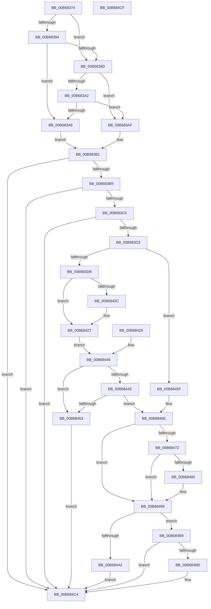

# KiConfigureAmdTprLowerInterruptDelayWorkaround

- RVA: `0x00B68374`–`0x00B684D0` (길이 `348` bytes)
- VA: `0x0000000140B68374`
- 실행 섹션: `PAGELK`
- PDB 이름 있음: `예`; PDB Function 태그: `아니요`
- unwind 정보 RVA: `0x000CA72C`
- 디코드: `97`개 명령, `348/348` bytes 표시
- 미해석 바이트: `0` (있으면 어셈블리에 `.byte`로 보존)

> 이 문서는 커널 이미지의 기계어와 PDB 기호를 분석해 생성했습니다. 4번과 5번은 함수 원형과 자료형을 바이너리 사용 방식에서 추정한 C 해석이며 원본 소스 복구 결과는 아닙니다.

## 1. Dependencies

- 직접 호출 지점: **2**; 고유 호출 대상: **2**
- 직접 호출자로 확인된 함수: **1**
- RIP 상대 이미지 참조: **3**

### Outgoing calls
- `0x00B683B9` → [HviIsAnyHypervisorPresent](../../text/4A/HviIsAnyHypervisorPresent_function_004ADC50.md) (function, `0x004ADC50`)
- `0x00B68493` → [KeBugCheckEx](../../text/4F/KeBugCheckEx_function_004FD660.md) (function, `0x004FD660`)

### Direct callers
- [KiInitializeKernel](KiInitializeKernel_function_00B68D20.md) at `0x00B6956B`

### Static image references
- `0x00B683C6` → RVA `0x00FC6DC8` (`ALMOSTRO`; read)
- `0x00B68453` → RVA `0x00FC6DC8` (`ALMOSTRO`; write)
- `0x00B684BD` → RVA `0x00FC6BC5` (`ALMOSTRO`; write)

## 2. Other-region calls and transfers

- 다른 실행 섹션으로 향하는 call: **2**
  - `0x00B683B9` → [HviIsAnyHypervisorPresent](../../text/4A/HviIsAnyHypervisorPresent_function_004ADC50.md) (`PAGELK` → `.text`)
  - `0x00B68493` → [KeBugCheckEx](../../text/4F/KeBugCheckEx_function_004FD660.md) (`PAGELK` → `.text`)
- 별도 외부 분기/꼬리 이동을 확인하지 못했습니다.

## 3. Assembly (complete function range)

```asm
00B68374  48 89 5C 24 18                  mov qword ptr [rsp + 0x18], rbx
00B68379  89 54 24 10                     mov dword ptr [rsp + 0x10], edx
00B6837D  48 89 4C 24 08                  mov qword ptr [rsp + 8], rcx
00B68382  57                              push rdi
00B68383  48 83 EC 40                     sub rsp, 0x40
00B68387  8B FA                           mov edi, edx
00B68389  48 8B D9                        mov rbx, rcx
00B6838C  8A 49 40                        mov cl, byte ptr [rcx + 0x40]
00B6838F  80 F9 17                        cmp cl, 0x17
00B68392  75 09                           jne 0x140b6839d
00B68394  8A 43 43                        mov al, byte ptr [rbx + 0x43]
00B68397  2C 30                           sub al, 0x30
00B68399  3C 0F                           cmp al, 0xf
00B6839B  76 0B                           jbe 0x140b683a8
00B6839D  80 F9 19                        cmp cl, 0x19
00B683A0  75 0D                           jne 0x140b683af
00B683A2  80 7B 43 0F                     cmp byte ptr [rbx + 0x43], 0xf
00B683A6  77 07                           ja 0x140b683af
00B683A8  B8 01 00 00 00                  mov eax, 1
00B683AD  EB 02                           jmp 0x140b683b1
00B683AF  33 C0                           xor eax, eax
00B683B1  85 C0                           test eax, eax
00B683B3  0F 84 0B 01 00 00               je 0x140b684c4
00B683B9  E8 92 58 94 FF                  call 0x1404adc50
00B683BE  84 C0                           test al, al
00B683C0  0F 85 FE 00 00 00               jne 0x140b684c4
00B683C6  83 3D FB E9 45 00 02            cmp dword ptr [rip + 0x45e9fb], 2
00B683CD  0F 84 F1 00 00 00               je 0x140b684c4
00B683D3  85 FF                           test edi, edi
00B683D5  0F 85 84 00 00 00               jne 0x140b6845f
00B683DB  45 32 D2                        xor r10b, r10b
00B683DE  48 C7 44 24 30 00 00 00 00      mov qword ptr [rsp + 0x30], 0
00B683E7  B9 15 00 01 C0                  mov ecx, 0xc0010015
00B683EC  0F 32                           rdmsr
00B683EE  48 C1 E2 20                     shl rdx, 0x20
00B683F2  48 0B C2                        or rax, rdx
00B683F5  4C 8B C8                        mov r9, rax
00B683F8  48 89 44 24 30                  mov qword ptr [rsp + 0x30], rax
00B683FD  49 B8 00 00 00 00 01 00 00 00   movabs r8, 0x100000000
00B68407  49 85 C0                        test r8, rax
00B6840A  75 1B                           jne 0x140b68427
00B6840C  48 8B D0                        mov rdx, rax
00B6840F  49 0B D0                        or rdx, r8
00B68412  48 8B C2                        mov rax, rdx
00B68415  48 C1 EA 20                     shr rdx, 0x20
00B68419  0F 30                           wrmsr
00B6841B  49 8B D1                        mov rdx, r9
00B6841E  49 8B C1                        mov rax, r9
00B68421  48 C1 EA 20                     shr rdx, 0x20
00B68425  0F 30                           wrmsr
00B68427  EB 20                           jmp 0x140b68449
00B68429  41 B2 01                        mov r10b, 1
00B6842C  B9 15 00 01 C0                  mov ecx, 0xc0010015
00B68431  49 B8 00 00 00 00 01 00 00 00   movabs r8, 0x100000000
00B6843B  8B 7C 24 58                     mov edi, dword ptr [rsp + 0x58]
00B6843F  48 8B 5C 24 50                  mov rbx, qword ptr [rsp + 0x50]
00B68444  4C 8B 4C 24 30                  mov r9, qword ptr [rsp + 0x30]
00B68449  45 84 D2                        test r10b, r10b
00B6844C  75 05                           jne 0x140b68453
00B6844E  4D 85 C8                        test r8, r9
00B68451  74 1B                           je 0x140b6846e
00B68453  C7 05 6B E9 45 00 02 00 00 00   mov dword ptr [rip + 0x45e96b], 2
00B6845D  EB 65                           jmp 0x140b684c4
00B6845F  B9 15 00 01 C0                  mov ecx, 0xc0010015
00B68464  49 B8 00 00 00 00 01 00 00 00   movabs r8, 0x100000000
00B6846E  85 FF                           test edi, edi
00B68470  74 27                           je 0x140b68499
00B68472  0F 32                           rdmsr
00B68474  48 C1 E2 20                     shl rdx, 0x20
00B68478  48 0B C2                        or rax, rdx
00B6847B  49 85 C0                        test r8, rax
00B6847E  74 19                           je 0x140b68499
00B68480  48 83 64 24 20 00               and qword ptr [rsp + 0x20], 0
00B68486  45 33 C9                        xor r9d, r9d
00B68489  4C 8B C0                        mov r8, rax
00B6848C  48 8B D3                        mov rdx, rbx
00B6848F  41 8D 49 3E                     lea ecx, [r9 + 0x3e]
00B68493  E8 C8 51 99 FF                  call 0x1404fd660
00B68498  CC                              int3
00B68499  83 3D 28 E9 45 00 01            cmp dword ptr [rip + 0x45e928], 1
00B684A0  75 17                           jne 0x140b684b9
00B684A2  0F 32                           rdmsr
00B684A4  48 C1 E2 20                     shl rdx, 0x20
00B684A8  48 0B C2                        or rax, rdx
00B684AB  49 0B C0                        or rax, r8
00B684AE  48 8B D0                        mov rdx, rax
00B684B1  48 C1 EA 20                     shr rdx, 0x20
00B684B5  0F 30                           wrmsr
00B684B7  EB 0B                           jmp 0x140b684c4
00B684B9  85 FF                           test edi, edi
00B684BB  75 07                           jne 0x140b684c4
00B684BD  C6 05 01 E7 45 00 01            mov byte ptr [rip + 0x45e701], 1
00B684C4  48 8B 5C 24 60                  mov rbx, qword ptr [rsp + 0x60]
00B684C9  48 83 C4 40                     add rsp, 0x40
00B684CD  5F                              pop rdi
00B684CE  C3                              ret
00B684CF  CC                              int3
```

## 4. C-style interpretation (structured pseudocode)

```c
__int64 __fastcall KiConfigureAmdTprLowerInterruptDelayWorkaround(__int64 a1, __int64 a2)
{
    __int64 result;
    __int64 v_r10;
    __int64 v_rsp;
    unsigned __int64 v_stack_m18;
    unsigned __int64 v_stack_m28;
    unsigned int v_stack_p10;
    unsigned __int64 v_stack_p18;
    unsigned __int64 v_stack_p8;

    v_stack_p18 = v_rbx;
    v_stack_p10 = (unsigned int)(a2);
    v_stack_p8 = a1;
    v_rsp = (v_rsp) - (64);
    if (((unsigned __int8)(*(unsigned __int8 *)(a1 + 64))) != 23) goto loc_00B6839D;
    result = (unsigned __int8)((*(unsigned __int8 *)(a1 + 67)) - (48));
    if (((unsigned __int8)(result)) <= 15) goto loc_00B683A8;
loc_00B6839D:
    if (((unsigned __int8)(*(unsigned __int8 *)(a1 + 64))) != 25) goto loc_00B683AF;
    if ((*(unsigned __int8 *)(a1 + 67)) > 15) goto loc_00B683AF;
loc_00B683A8:
    goto loc_00B683B1;
loc_00B683AF:
    result = 0;
loc_00B683B1:
    if (0 == 0) goto loc_00B684C4;
    result = HviIsAnyHypervisorPresent(*(unsigned __int8 *)(a1 + 64), a2, a3, a4);
    if ((unsigned __int8)(result) != 0) goto loc_00B684C4;
    if ((*(unsigned int *)(v_rip + 4581883)) == 2) goto loc_00B684C4;
    if ((unsigned int)((unsigned int)((unsigned int)(a2))) != 0) goto loc_00B6845F;
    v_r10 = 0;
    v_stack_m18 = 0;
    a2 = (a2) << (32);
    result = (result) | (a2);
    v_stack_m18 = result;
    if (((a3) & (result)) == 0) {
        a2 = result;
        a2 = (a2) | (a3);
        result = a2;
        a2 = (a2) >> (32);
        a2 = result;
        result = result;
        a2 = (a2) >> (32);
    }
    goto loc_00B68449;
loc_00B68449:
    if (0 != 0) goto loc_00B68453;
    if (((a3) & (result)) == 0) goto loc_00B6846E;
loc_00B68453:
    *(unsigned int *)(v_rip + 4581739) = 2;
    goto loc_00B684C4;
loc_00B6845F:
loc_00B6846E:
    if ((unsigned int)((unsigned int)((unsigned int)(a2))) == 0) goto loc_00B68499;
    a2 = (a2) << (32);
    result = (result) | (a2);
    if (((a3) & (result)) != 0) {
        a4 = 0;
        a3 = result;
        a2 = a1;
        a1 = a4 + 62;
        result = KeBugCheckEx(a1, a2, a3, a4);
    }
    if ((*(unsigned int *)(v_rip + 4581672)) != 1) goto loc_00B684B9;
    a2 = (a2) << (32);
    result = (result) | (a2);
    result = (result) | (a3);
    a2 = (result) >> (32);
    goto loc_00B684C4;
loc_00B684B9:
    if ((unsigned int)((unsigned int)((unsigned int)(a2))) == 0) {
        *(unsigned __int8 *)(v_rip + 4581121) = 1;
    }
    v_rsp = (v_rsp) + (64);
    return result;
}
```

## 5. (Beta) C Style

```c
int64_t KiConfigureAmdTprLowerInterruptDelayWorkaround(void *Arg1, int64_t Arg2)
{
    uint8_t *arg1 = (uint8_t *)Arg1;

    int64_t result;
    int64_t local_r10;
    int64_t local_rsp;
    uint64_t v_stack_m18;
    uint64_t v_stack_m28;
    uint32_t v_stack_p10;
    uint64_t v_stack_p18;
    uint64_t v_stack_p8;

    v_stack_p18 = local_rbx;
    v_stack_p10 = (uint32_t)(Arg2);
    v_stack_p8 = Arg1;
    local_rsp = (local_rsp) - (64);
    if (((uint8_t)(*(uint8_t *)(arg1 + 0x40))) != 23) goto loc_00B6839D;
    result = (uint8_t)((*(uint8_t *)(arg1 + 0x43)) - (48));
    if (((uint8_t)(result)) <= 15) goto loc_00B683A8;
loc_00B6839D:
    if (((uint8_t)(*(uint8_t *)(arg1 + 0x40))) != 25) goto loc_00B683AF;
    if ((*(uint8_t *)(arg1 + 0x43)) > 15) goto loc_00B683AF;
loc_00B683A8:
    goto loc_00B683B1;
loc_00B683AF:
    result = 0;
loc_00B683B1:
    if (0 == 0) goto loc_00B684C4;
    result = HviIsAnyHypervisorPresent(*(uint8_t *)(arg1 + 0x40), Arg2, a3, a4);
    if ((uint8_t)(result) != 0) goto loc_00B684C4;
    if ((*(uint32_t *)(v_rip + 0x45E9FB)) == 2) goto loc_00B684C4;
    if ((uint32_t)((uint32_t)((uint32_t)(Arg2))) != 0) goto loc_00B6845F;
    local_r10 = 0;
    v_stack_m18 = 0;
    Arg2 = (Arg2) << (32);
    result = (result) | (Arg2);
    v_stack_m18 = result;
    if (((a3) & (result)) == 0) {
        Arg2 = result;
        Arg2 = (Arg2) | (a3);
        result = Arg2;
        Arg2 = (Arg2) >> (32);
        Arg2 = result;
        result = result;
        Arg2 = (Arg2) >> (32);
    }
    goto loc_00B68449;
loc_00B68449:
    if (0 != 0) goto loc_00B68453;
    if (((a3) & (result)) == 0) goto loc_00B6846E;
loc_00B68453:
    *(uint32_t *)(v_rip + 0x45E96B) = 2;
    goto loc_00B684C4;
loc_00B6845F:
loc_00B6846E:
    if ((uint32_t)((uint32_t)((uint32_t)(Arg2))) == 0) goto loc_00B68499;
    Arg2 = (Arg2) << (32);
    result = (result) | (Arg2);
    if (((a3) & (result)) != 0) {
        a4 = 0;
        a3 = result;
        Arg2 = Arg1;
        Arg1 = a4 + 62;
        result = KeBugCheckEx(Arg1, Arg2, a3, a4);
    }
    if ((*(uint32_t *)(v_rip + 0x45E928)) != 1) goto loc_00B684B9;
    Arg2 = (Arg2) << (32);
    result = (result) | (Arg2);
    result = (result) | (a3);
    Arg2 = (result) >> (32);
    goto loc_00B684C4;
loc_00B684B9:
    if ((uint32_t)((uint32_t)((uint32_t)(Arg2))) == 0) {
        *(uint8_t *)(v_rip + 0x45E701) = 1;
    }
    local_rsp = (local_rsp) + (64);
    return result;
}
```

### 관측된 메모리 오프셋

구조체 형식이 확인되지 않은 접근은 인자 기준의 오프셋으로만 기록했습니다.

| 기준 인자 | 오프셋 표현 | 폭 (bit) | 접근 |
|---|---:|---:|---|
| `Arg1` | `+ 0x40` | `8` | `R` |
| `Arg1` | `+ 0x43` | `8` | `R` |

## 6. Execution-region graph

[열기: 2D/3D 그래프와 함수 탐색 컨트롤 패널](../../../control-panel.html?section=pagelk&rva=0x00B68374&view=graph)

- 2D 그래프는 위에서 아래로 흐르고, 3D 그래프는 빈 공간을 드래그해 회전합니다. Shift+드래그는 이동, 휠은 확대·축소, 함수 노드 선택은 대상 보고서 이동입니다.

### Static fallback


