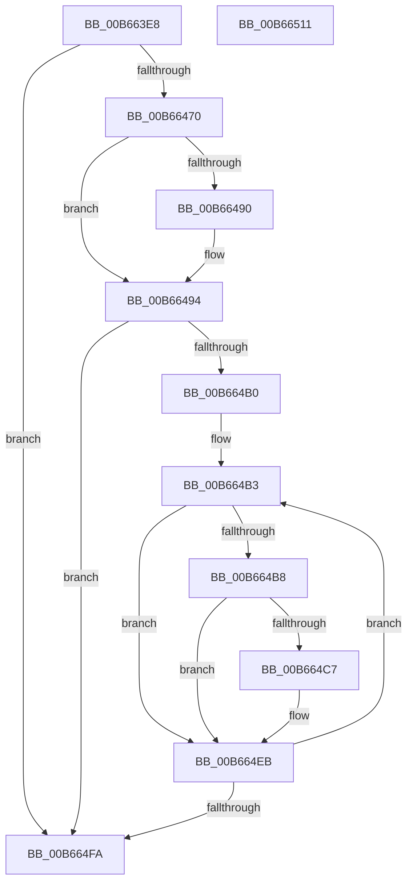

# KiConfigureProcessorBlock

- RVA: `0x00B663E8`–`0x00B66512` (길이 `298` bytes)
- VA: `0x0000000140B663E8`
- 실행 섹션: `PAGELK`
- PDB 이름 있음: `예`; PDB Function 태그: `아니요`
- unwind 정보 RVA: `0x0009C52C`
- 디코드: `78`개 명령, `298/298` bytes 표시
- 미해석 바이트: `0` (있으면 어셈블리에 `.byte`로 보존)

> 이 문서는 커널 이미지의 기계어와 PDB 기호를 분석해 생성했습니다. 4번과 5번은 함수 원형과 자료형을 바이너리 사용 방식에서 추정한 C 해석이며 원본 소스 복구 결과는 아닙니다.

## 1. Dependencies

- 직접 호출 지점: **3**; 고유 호출 대상: **3**
- 직접 호출자로 확인된 함수: **3**
- RIP 상대 이미지 참조: **4**

### Outgoing calls
- `0x00B66487` → [KeIsEmptyGroupMask](../../text/25/KeIsEmptyGroupMask_function_002553B0.md) (function, `0x002553B0`)
- `0x00B6649B` → [KeSetBitGroupMask](../../text/4B/KeSetBitGroupMask_function_004BEF90.md) (function, `0x004BEF90`)
- `0x00B664BD` → [KiGetSubNodeForGroup](../../text/45/KiGetSubNodeForGroup_function_0045311C.md) (function, `0x0045311C`)

### Direct callers
- [KiInitializeDynamicProcessorDpc](KiInitializeDynamicProcessorDpc_function_00B67A30.md) at `0x00B67ADC`
- [KiInitializeKernel](KiInitializeKernel_function_00B68D20.md) at `0x00B68F27`
- [KeStartAllProcessors](../../init/C3/KeStartAllProcessors_function_00C36F78.md) at `0x00C37383`

### Static image references
- `0x00B66408` → RVA `0x00F231B0` (`.data`; read)
- `0x00B6643F` → RVA `0x00F231B8` (`.data`; read)
- `0x00B66478` → RVA `0x00FCF6C0` (`CACHEALI`; read)
- `0x00B664A0` → RVA `0x00FC5000` (`ALMOSTRO`; read)

## 2. Other-region calls and transfers

- 다른 실행 섹션으로 향하는 call: **3**
  - `0x00B66487` → [KeIsEmptyGroupMask](../../text/25/KeIsEmptyGroupMask_function_002553B0.md) (`PAGELK` → `.text`)
  - `0x00B6649B` → [KeSetBitGroupMask](../../text/4B/KeSetBitGroupMask_function_004BEF90.md) (`PAGELK` → `.text`)
  - `0x00B664BD` → [KiGetSubNodeForGroup](../../text/45/KiGetSubNodeForGroup_function_0045311C.md) (`PAGELK` → `.text`)
- 별도 외부 분기/꼬리 이동을 확인하지 못했습니다.

## 3. Assembly (complete function range)

```asm
00B663E8  48 89 5C 24 08                  mov qword ptr [rsp + 8], rbx
00B663ED  48 89 6C 24 18                  mov qword ptr [rsp + 0x18], rbp
00B663F2  56                              push rsi
00B663F3  57                              push rdi
00B663F4  41 54                           push r12
00B663F6  41 56                           push r14
00B663F8  41 57                           push r15
00B663FA  48 83 EC 20                     sub rsp, 0x20
00B663FE  48 8B B1 C0 00 00 00            mov rsi, qword ptr [rcx + 0xc0]
00B66405  8B 49 24                        mov ecx, dword ptr [rcx + 0x24]
00B66408  48 8B 05 A1 CD 3B 00            mov rax, qword ptr [rip + 0x3bcda1]
00B6640F  4C 8B 8E 80 00 00 00            mov r9, qword ptr [rsi + 0x80]
00B66416  8B 04 88                        mov eax, dword ptr [rax + rcx*4]
00B66419  8B F8                           mov edi, eax
00B6641B  83 E0 3F                        and eax, 0x3f
00B6641E  C1 EF 06                        shr edi, 6
00B66421  49 0F AB C1                     bts r9, rax
00B66425  8B D7                           mov edx, edi
00B66427  49 0F BC C1                     bsf rax, r9
00B6642B  4C 89 8E 80 00 00 00            mov qword ptr [rsi + 0x80], r9
00B66432  88 46 7C                        mov byte ptr [rsi + 0x7c], al
00B66435  C1 E2 06                        shl edx, 6
00B66438  4D 0F BD C1                     bsr r8, r9
00B6643C  8D 0C 02                        lea ecx, [rdx + rax]
00B6643F  48 8B 05 72 CD 3B 00            mov rax, qword ptr [rip + 0x3bcd72]
00B66446  8B 0C 88                        mov ecx, dword ptr [rax + rcx*4]
00B66449  89 8E B0 00 00 00               mov dword ptr [rsi + 0xb0], ecx
00B6644F  42 8D 0C 02                     lea ecx, [rdx + r8]
00B66453  48 8B 05 5E CD 3B 00            mov rax, qword ptr [rip + 0x3bcd5e]
00B6645A  8B 0C 88                        mov ecx, dword ptr [rax + rcx*4]
00B6645D  49 8D 41 FF                     lea rax, [r9 - 1]
00B66461  89 8E B4 00 00 00               mov dword ptr [rsi + 0xb4], ecx
00B66467  49 85 C1                        test r9, rax
00B6646A  0F 85 8A 00 00 00               jne 0x140b664fa
00B66470  44 0F B7 BE 8A 00 00 00         movzx r15d, word ptr [rsi + 0x8a]
00B66478  48 8D 1D 41 92 46 00            lea rbx, [rip + 0x469241]
00B6647F  4A 8B 2C FB                     mov rbp, qword ptr [rbx + r15*8]
00B66483  48 8D 4D 10                     lea rcx, [rbp + 0x10]
00B66487  E8 24 EF 6E FF                  call 0x1402553b0
00B6648C  85 C0                           test eax, eax
00B6648E  74 04                           je 0x140b66494
00B66490  40 88 7D 0C                     mov byte ptr [rbp + 0xc], dil
00B66494  0F B7 D7                        movzx edx, di
00B66497  48 8D 4D 10                     lea rcx, [rbp + 0x10]
00B6649B  E8 F0 8A 95 FF                  call 0x1404bef90
00B664A0  44 0F B7 15 58 EB 45 00         movzx r10d, word ptr [rip + 0x45eb58]
00B664A8  45 33 C0                        xor r8d, r8d
00B664AB  45 85 D2                        test r10d, r10d
00B664AE  74 4A                           je 0x140b664fa
00B664B0  45 33 C9                        xor r9d, r9d
00B664B3  45 3B C7                        cmp r8d, r15d
00B664B6  74 33                           je 0x140b664eb
00B664B8  48 8B 0B                        mov rcx, qword ptr [rbx]
00B664BB  8B D7                           mov edx, edi
00B664BD  E8 5A CC 8E FF                  call 0x14045311c
00B664C2  48 85 C0                        test rax, rax
00B664C5  74 24                           je 0x140b664eb
00B664C7  48 8B 88 90 00 00 00            mov rcx, qword ptr [rax + 0x90]
00B664CE  4C 0F AB F9                     bts rcx, r15
00B664D2  48 89 88 90 00 00 00            mov qword ptr [rax + 0x90], rcx
00B664D9  48 8B 86 90 00 00 00            mov rax, qword ptr [rsi + 0x90]
00B664E0  4C 0F AB C8                     bts rax, r9
00B664E4  48 89 86 90 00 00 00            mov qword ptr [rsi + 0x90], rax
00B664EB  41 FF C0                        inc r8d
00B664EE  49 FF C1                        inc r9
00B664F1  48 83 C3 08                     add rbx, 8
00B664F5  45 3B C2                        cmp r8d, r10d
00B664F8  72 B9                           jb 0x140b664b3
00B664FA  48 8B 5C 24 50                  mov rbx, qword ptr [rsp + 0x50]
00B664FF  48 8B 6C 24 60                  mov rbp, qword ptr [rsp + 0x60]
00B66504  48 83 C4 20                     add rsp, 0x20
00B66508  41 5F                           pop r15
00B6650A  41 5E                           pop r14
00B6650C  41 5C                           pop r12
00B6650E  5F                              pop rdi
00B6650F  5E                              pop rsi
00B66510  C3                              ret
00B66511  CC                              int3
```

## 4. C-style interpretation (structured pseudocode)

```c
__int64 __fastcall KiConfigureProcessorBlock(__int64 a1)
{
    __int64 result;
    __int64 v_rbx;
    __int64 v_rdi;
    __int64 v_rsp;
    unsigned __int64 v_stack_p18;
    unsigned __int64 v_stack_p8;

    v_stack_p8 = v_rbx;
    v_stack_p18 = v_rbp;
    v_rsp = (v_rsp) - (32);
    result = (unsigned int)(((unsigned int)(*(unsigned int *)(*(unsigned __int64 *)(v_rip + 3919265) + (unsigned int)(*(unsigned int *)(a1 + 36)) * 4))) & (63));
    v_rdi = (unsigned int)(((unsigned int)((unsigned int)((unsigned int)(*(unsigned int *)(*(unsigned __int64 *)(v_rip + 3919265) + (unsigned int)(*(unsigned int *)(a1 + 36)) * 4))))) >> (6));
    *(unsigned __int64 *)(*(unsigned __int64 *)(a1 + 192) + 128) = *(unsigned __int64 *)(*(unsigned __int64 *)(a1 + 192) + 128);
    *(unsigned __int8 *)(*(unsigned __int64 *)(a1 + 192) + 124) = (unsigned __int8)(result);
    a2 = (unsigned int)(((unsigned int)((unsigned int)(v_rdi))) << (6));
    *(unsigned int *)(*(unsigned __int64 *)(a1 + 192) + 176) = (unsigned int)((unsigned int)(*(unsigned int *)(*(unsigned __int64 *)(v_rip + 3919218) + a2 + result * 1 * 4)));
    *(unsigned int *)(*(unsigned __int64 *)(a1 + 192) + 180) = (unsigned int)((unsigned int)(*(unsigned int *)(*(unsigned __int64 *)(v_rip + 3919198) + a2 + a3 * 1 * 4)));
    if (((*(unsigned __int64 *)(*(unsigned __int64 *)(a1 + 192) + 128)) & (*(unsigned __int64 *)(*(unsigned __int64 *)(a1 + 192) + 128) - 1)) != 0) goto loc_00B664FA;
    result = KeIsEmptyGroupMask(*(unsigned __int64 *)(v_rip + 4624961 + *(unsigned __int16 *)(*(unsigned __int64 *)(a1 + 192) + 138) * 8) + 16, a2, a3, *(unsigned __int64 *)(*(unsigned __int64 *)(a1 + 192) + 128));
    if ((unsigned int)(result) != 0) {
        *(unsigned __int8 *)(*(unsigned __int64 *)(v_rip + 4624961 + *(unsigned __int16 *)(*(unsigned __int64 *)(a1 + 192) + 138) * 8) + 12) = (unsigned __int8)(v_rdi);
    }
    result = KeSetBitGroupMask(*(unsigned __int64 *)(v_rip + 4624961 + *(unsigned __int16 *)(*(unsigned __int64 *)(a1 + 192) + 138) * 8) + 16, (unsigned __int16)(v_rdi), a3, *(unsigned __int64 *)(*(unsigned __int64 *)(a1 + 192) + 128));
    a3 = 0;
    if ((unsigned int)(*(unsigned __int16 *)(v_rip + 4582232)) == 0) goto loc_00B664FA;
    a4 = 0;
loc_00B664B3:
    if (0 == ((unsigned int)(*(unsigned __int16 *)(*(unsigned __int64 *)(a1 + 192) + 138)))) goto loc_00B664EB;
    result = KiGetSubNodeForGroup(*(unsigned __int64 *)(v_rip + 4624961), (unsigned int)((unsigned int)(v_rdi)), a3, a4);
    if (result != 0) {
        a1 = *(unsigned __int64 *)(result + 144);
        *(unsigned __int64 *)(result + 144) = a1;
        result = *(unsigned __int64 *)(*(unsigned __int64 *)(a1 + 192) + 144);
        *(unsigned __int64 *)(*(unsigned __int64 *)(a1 + 192) + 144) = result;
    }
    a3 = (unsigned int)((a3) + 1);
    a4 = (a4) + 1;
    v_rbx = (v_rip + 4624961) + (8);
    if (((unsigned int)(a3)) < ((unsigned int)(*(unsigned __int16 *)(v_rip + 4582232)))) goto loc_00B664B3;
loc_00B664FA:
    v_rsp = (v_rsp) + (32);
    return result;
}
```

## 5. (Beta) C Style

```c
int64_t KiConfigureProcessorBlock(void *Arg1)
{
    uint8_t *arg1 = (uint8_t *)Arg1;

    int64_t result;
    int64_t local_rbx;
    int64_t local_rdi;
    int64_t local_rsp;
    uint64_t v_stack_p18;
    uint64_t v_stack_p8;

    v_stack_p8 = local_rbx;
    v_stack_p18 = local_rbp;
    local_rsp = (local_rsp) - (32);
    result = (uint32_t)(((uint32_t)(*(uint32_t *)(*(uint64_t *)(v_rip + 0x3BCDA1) + (uint32_t)(*(uint32_t *)(arg1 + 0x24)) * 4))) & (63));
    local_rdi = (uint32_t)(((uint32_t)((uint32_t)((uint32_t)(*(uint32_t *)(*(uint64_t *)(v_rip + 0x3BCDA1) + (uint32_t)(*(uint32_t *)(arg1 + 0x24)) * 4))))) >> (6));
    *(uint64_t *)(*(uint64_t *)(arg1 + 0xC0) + 0x80) = *(uint64_t *)(*(uint64_t *)(arg1 + 0xC0) + 0x80);
    *(uint8_t *)(*(uint64_t *)(arg1 + 0xC0) + 0x7C) = (uint8_t)(result);
    a2 = (uint32_t)(((uint32_t)((uint32_t)(local_rdi))) << (6));
    *(uint32_t *)(*(uint64_t *)(arg1 + 0xC0) + 0xB0) = (uint32_t)((uint32_t)(*(uint32_t *)(*(uint64_t *)(v_rip + 0x3BCD72) + a2 + result * 1 * 4)));
    *(uint32_t *)(*(uint64_t *)(arg1 + 0xC0) + 0xB4) = (uint32_t)((uint32_t)(*(uint32_t *)(*(uint64_t *)(v_rip + 0x3BCD5E) + a2 + a3 * 1 * 4)));
    if (((*(uint64_t *)(*(uint64_t *)(arg1 + 0xC0) + 0x80)) & (*(uint64_t *)(*(uint64_t *)(arg1 + 0xC0) + 0x80) - 1)) != 0) goto loc_00B664FA;
    result = KeIsEmptyGroupMask(*(uint64_t *)(v_rip + 0x469241 + *(uint16_t *)(*(uint64_t *)(arg1 + 0xC0) + 0x8A) * 8) + 16, a2, a3, *(uint64_t *)(*(uint64_t *)(arg1 + 0xC0) + 0x80));
    if ((uint32_t)(result) != 0) {
        *(uint8_t *)(*(uint64_t *)(v_rip + 0x469241 + *(uint16_t *)(*(uint64_t *)(arg1 + 0xC0) + 0x8A) * 8) + 0xC) = (uint8_t)(local_rdi);
    }
    result = KeSetBitGroupMask(*(uint64_t *)(v_rip + 0x469241 + *(uint16_t *)(*(uint64_t *)(arg1 + 0xC0) + 0x8A) * 8) + 16, (uint16_t)(local_rdi), a3, *(uint64_t *)(*(uint64_t *)(arg1 + 0xC0) + 0x80));
    a3 = 0;
    if ((uint32_t)(*(uint16_t *)(v_rip + 0x45EB58)) == 0) goto loc_00B664FA;
    a4 = 0;
loc_00B664B3:
    if (0 == ((uint32_t)(*(uint16_t *)(*(uint64_t *)(arg1 + 0xC0) + 0x8A)))) goto loc_00B664EB;
    result = KiGetSubNodeForGroup(*(uint64_t *)(v_rip + 0x469241), (uint32_t)((uint32_t)(local_rdi)), a3, a4);
    if (result != 0) {
        Arg1 = *(uint64_t *)(result + 0x90);
        *(void **)(result + 0x90) = Arg1;
        result = *(uint64_t *)(*(uint64_t *)(arg1 + 0xC0) + 0x90);
        *(uint64_t *)(*(uint64_t *)(arg1 + 0xC0) + 0x90) = result;
    }
    a3 = (uint32_t)((a3) + 1);
    a4 = (a4) + 1;
    local_rbx = (v_rip + 4624961) + (8);
    if (((uint32_t)(a3)) < ((uint32_t)(*(uint16_t *)(v_rip + 0x45EB58)))) goto loc_00B664B3;
loc_00B664FA:
    local_rsp = (local_rsp) + (32);
    return result;
}
```

### 관측된 메모리 오프셋

구조체 형식이 확인되지 않은 접근은 인자 기준의 오프셋으로만 기록했습니다.

| 기준 인자 | 오프셋 표현 | 폭 (bit) | 접근 |
|---|---:|---:|---|
| `Arg1` | `+ 0x24` | `32` | `R` |
| `Arg1` | `+ 0xC0` | `64` | `R` |

## 6. Execution-region graph

[열기: 2D/3D 그래프와 함수 탐색 컨트롤 패널](../../../control-panel.html?section=pagelk&rva=0x00B663E8&view=graph)

- 2D 그래프는 위에서 아래로 흐르고, 3D 그래프는 빈 공간을 드래그해 회전합니다. Shift+드래그는 이동, 휠은 확대·축소, 함수 노드 선택은 대상 보고서 이동입니다.

### Static fallback


