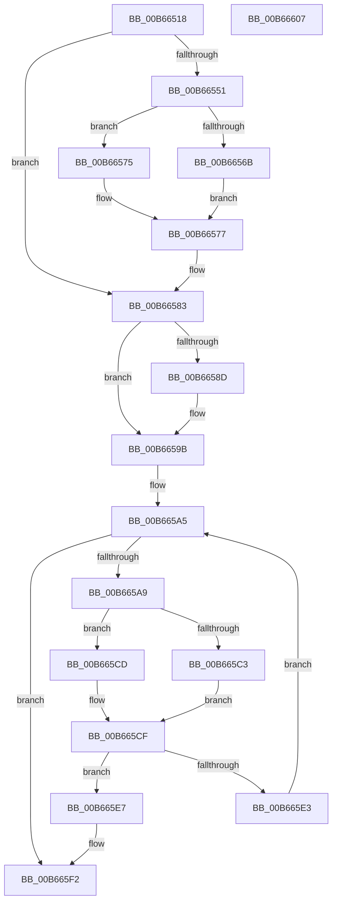

# KiConfigureSchedulingInformation

- RVA: `0x00B66518`–`0x00B66608` (길이 `240` bytes)
- VA: `0x0000000140B66518`
- 실행 섹션: `PAGELK`
- PDB 이름 있음: `예`; PDB Function 태그: `아니요`
- unwind 정보 RVA: `0x00064C80`
- 디코드: `57`개 명령, `240/240` bytes 표시
- 미해석 바이트: `0` (있으면 어셈블리에 `.byte`로 보존)

> 이 문서는 커널 이미지의 기계어와 PDB 기호를 분석해 생성했습니다. 4번과 5번은 함수 원형과 자료형을 바이너리 사용 방식에서 추정한 C 해석이며 원본 소스 복구 결과는 아닙니다.

## 1. Dependencies

- 직접 호출 지점: **2**; 고유 호출 대상: **2**
- 직접 호출자로 확인된 함수: **2**
- RIP 상대 이미지 참조: **0**

### Outgoing calls
- `0x00B6653A` → [KiQuerySubNodeActiveAffinity](../../text/43/KiQuerySubNodeActiveAffinity_function_0043F060.md) (function, `0x0043F060`)
- `0x00B665FC` → [KiConfigureCpuSetSchedulingInformation](../../text/2D/KiConfigureCpuSetSchedulingInformation_function_002D2E1C.md) (function, `0x002D2E1C`)

### Direct callers
- [KiInitializeDynamicProcessorDpc](KiInitializeDynamicProcessorDpc_function_00B67A30.md) at `0x00B67BA1`
- [KiInitializeDynamicProcessorDpc](KiInitializeDynamicProcessorDpc_function_00B67A30.md) at `0x00B67BDC`
- [KiConfigureAllSchedulingInformation](../../init/C3/KiConfigureAllSchedulingInformation_function_00C380D0.md) at `0x00C38128`

### Static image references
- 디코드된 RIP-relative 메모리 참조가 없습니다.

## 2. Other-region calls and transfers

- 다른 실행 섹션으로 향하는 call: **2**
  - `0x00B6653A` → [KiQuerySubNodeActiveAffinity](../../text/43/KiQuerySubNodeActiveAffinity_function_0043F060.md) (`PAGELK` → `.text`)
  - `0x00B665FC` → [KiConfigureCpuSetSchedulingInformation](../../text/2D/KiConfigureCpuSetSchedulingInformation_function_002D2E1C.md) (`PAGELK` → `.text`)
- 별도 외부 분기/꼬리 이동을 확인하지 못했습니다.

## 3. Assembly (complete function range)

```asm
00B66518  40 53                           push rbx
00B6651A  48 83 EC 30                     sub rsp, 0x30
00B6651E  0F 57 C0                        xorps xmm0, xmm0
00B66521  4C 8D 44 24 48                  lea r8, [rsp + 0x48]
00B66526  4C 8B C9                        mov r9, rcx
00B66529  48 8D 54 24 20                  lea rdx, [rsp + 0x20]
00B6652E  48 8B 89 C0 00 00 00            mov rcx, qword ptr [rcx + 0xc0]
00B66535  0F 11 44 24 20                  movups xmmword ptr [rsp + 0x20], xmm0
00B6653A  E8 21 8B 8D FF                  call 0x14043f060
00B6653F  41 8B 99 94 8B 00 00            mov ebx, dword ptr [r9 + 0x8b94]
00B66546  4D 8D 91 D0 00 00 00            lea r10, [r9 + 0xd0]
00B6654D  85 DB                           test ebx, ebx
00B6654F  74 32                           je 0x140b66583
00B66551  41 0F B6 12                     movzx edx, byte ptr [r10]
00B66555  8D 4B FF                        lea ecx, [rbx - 1]
00B66558  48 69 C9 08 01 00 00            imul rcx, rcx, 0x108
00B6655F  49 03 C9                        add rcx, r9
00B66562  66 3B 91 00 AF 00 00            cmp dx, word ptr [rcx + 0xaf00]
00B66569  73 0A                           jae 0x140b66575
00B6656B  48 8B 8C D1 08 AF 00 00         mov rcx, qword ptr [rcx + rdx*8 + 0xaf08]
00B66573  EB 02                           jmp 0x140b66577
00B66575  33 C9                           xor ecx, ecx
00B66577  48 23 4C 24 20                  and rcx, qword ptr [rsp + 0x20]
00B6657C  49 89 89 70 8E 00 00            mov qword ptr [r9 + 0x8e70], rcx
00B66583  49 83 B9 70 8E 00 00 00         cmp qword ptr [r9 + 0x8e70], 0
00B6658B  75 0E                           jne 0x140b6659b
00B6658D  49 8B 81 C8 00 00 00            mov rax, qword ptr [r9 + 0xc8]
00B66594  49 89 81 70 8E 00 00            mov qword ptr [r9 + 0x8e70], rax
00B6659B  45 0F B6 81 D1 00 00 00         movzx r8d, byte ptr [r9 + 0xd1]
00B665A3  33 D2                           xor edx, edx
00B665A5  3B D3                           cmp edx, ebx
00B665A7  73 49                           jae 0x140b665f2
00B665A9  45 0F B6 1A                     movzx r11d, byte ptr [r10]
00B665AD  8B C2                           mov eax, edx
00B665AF  48 69 C8 08 01 00 00            imul rcx, rax, 0x108
00B665B6  49 03 C9                        add rcx, r9
00B665B9  66 44 3B 99 00 AF 00 00         cmp r11w, word ptr [rcx + 0xaf00]
00B665C1  73 0A                           jae 0x140b665cd
00B665C3  4A 8B 8C D9 08 AF 00 00         mov rcx, qword ptr [rcx + r11*8 + 0xaf08]
00B665CB  EB 02                           jmp 0x140b665cf
00B665CD  33 C9                           xor ecx, ecx
00B665CF  49 8B 81 60 8E 00 00            mov rax, qword ptr [r9 + 0x8e60]
00B665D6  48 23 4C 24 20                  and rcx, qword ptr [rsp + 0x20]
00B665DB  48 F7 D0                        not rax
00B665DE  48 85 C1                        test rcx, rax
00B665E1  75 04                           jne 0x140b665e7
00B665E3  FF C2                           inc edx
00B665E5  EB BE                           jmp 0x140b665a5
00B665E7  4C 0F BC C1                     bsf r8, rcx
00B665EB  49 89 89 68 8E 00 00            mov qword ptr [r9 + 0x8e68], rcx
00B665F2  49 8B C9                        mov rcx, r9
00B665F5  45 89 81 54 8E 00 00            mov dword ptr [r9 + 0x8e54], r8d
00B665FC  E8 1B C8 76 FF                  call 0x1402d2e1c
00B66601  48 83 C4 30                     add rsp, 0x30
00B66605  5B                              pop rbx
00B66606  C3                              ret
00B66607  CC                              int3
```

## 4. C-style interpretation (structured pseudocode)

```c
__int64 __fastcall KiConfigureSchedulingInformation(__int64 a1)
{
    __int64 result;
    __int64 v_rsp;
    unsigned __int64 v_stack_m18;
    unsigned __int64 v_stack_p10;

    v_rsp = (v_rsp) - (48);
    v_stack_m18 = v_xmm0;
    result = KiQuerySubNodeActiveAffinity(*(unsigned __int64 *)(a1 + 192), v_stack_m18, v_stack_p10, a1);
    if ((unsigned int)((unsigned int)(*(unsigned int *)(a1 + 35732))) == 0) goto loc_00B66583;
    a1 = ((unsigned int)(*(unsigned int *)(a1 + 35732)) - 1) * ((unsigned int)(*(unsigned int *)(a1 + 35732)) - 1);
    a1 = (a1) + (a1);
    if (((unsigned __int16)(*(unsigned __int8 *)(a1 + 208))) >= (*(unsigned __int16 *)(a1 + 44800))) goto loc_00B66575;
    goto loc_00B66577;
loc_00B66575:
    a1 = 0;
loc_00B66577:
    a1 = (a1) & (v_stack_m18);
    *(unsigned __int64 *)(a1 + 36464) = a1;
loc_00B66583:
    if ((*(unsigned __int64 *)(a1 + 36464)) == 0) {
        result = *(unsigned __int64 *)(a1 + 200);
        *(unsigned __int64 *)(a1 + 36464) = result;
    }
    a2 = 0;
loc_00B665A5:
    if (0 >= ((unsigned int)((unsigned int)(*(unsigned int *)(a1 + 35732))))) goto loc_00B665F2;
    a1 = (a1) * (0);
    a1 = (a1) + (a1);
    if (((unsigned __int16)(*(unsigned __int8 *)(a1 + 208))) >= (*(unsigned __int16 *)(a1 + 44800))) goto loc_00B665CD;
    goto loc_00B665CF;
loc_00B665CD:
    a1 = 0;
loc_00B665CF:
    a1 = (a1) & (v_stack_m18);
    result = ~(*(unsigned __int64 *)(a1 + 36448));
    if (((a1) & (result)) != 0) goto loc_00B665E7;
    a2 = (unsigned int)((a2) + 1);
    goto loc_00B665A5;
loc_00B665E7:
    *(unsigned __int64 *)(a1 + 36456) = a1;
loc_00B665F2:
    *(unsigned int *)(a1 + 36436) = (unsigned int)(*(unsigned __int8 *)(a1 + 209));
    result = KiConfigureCpuSetSchedulingInformation(a1, a2, *(unsigned __int8 *)(a1 + 209), a1);
    v_rsp = (v_rsp) + (48);
    return result;
}
```

## 5. (Beta) C Style

```c
int64_t KiConfigureSchedulingInformation(void *Arg1)
{
    uint8_t *arg1 = (uint8_t *)Arg1;

    int64_t result;
    int64_t local_rsp;
    uint64_t v_stack_m18;
    uint64_t v_stack_p10;

    local_rsp = (local_rsp) - (48);
    v_stack_m18 = v_xmm0;
    result = KiQuerySubNodeActiveAffinity(*(uint64_t *)(arg1 + 0xC0), v_stack_m18, v_stack_p10, Arg1);
    if ((uint32_t)((uint32_t)(*(uint32_t *)(arg1 + 0x8B94))) == 0) goto loc_00B66583;
    Arg1 = ((uint32_t)(*(uint32_t *)(arg1 + 0x8B94)) - 1) * ((uint32_t)(*(uint32_t *)(arg1 + 0x8B94)) - 1);
    Arg1 = (Arg1) + (Arg1);
    if (((uint16_t)(*(uint8_t *)(arg1 + 0xD0))) >= (*(uint16_t *)(arg1 + 0xAF00))) goto loc_00B66575;
    goto loc_00B66577;
loc_00B66575:
    Arg1 = 0;
loc_00B66577:
    Arg1 = (Arg1) & (v_stack_m18);
    *(void **)(arg1 + 0x8E70) = Arg1;
loc_00B66583:
    if ((*(uint64_t *)(arg1 + 0x8E70)) == 0) {
        result = *(uint64_t *)(arg1 + 0xC8);
        *(uint64_t *)(arg1 + 0x8E70) = result;
    }
    a2 = 0;
loc_00B665A5:
    if (0 >= ((uint32_t)((uint32_t)(*(uint32_t *)(arg1 + 0x8B94))))) goto loc_00B665F2;
    Arg1 = (Arg1) * (0);
    Arg1 = (Arg1) + (Arg1);
    if (((uint16_t)(*(uint8_t *)(arg1 + 0xD0))) >= (*(uint16_t *)(arg1 + 0xAF00))) goto loc_00B665CD;
    goto loc_00B665CF;
loc_00B665CD:
    Arg1 = 0;
loc_00B665CF:
    Arg1 = (Arg1) & (v_stack_m18);
    result = ~(*(uint64_t *)(arg1 + 0x8E60));
    if (((Arg1) & (result)) != 0) goto loc_00B665E7;
    a2 = (uint32_t)((a2) + 1);
    goto loc_00B665A5;
loc_00B665E7:
    *(void **)(arg1 + 0x8E68) = Arg1;
loc_00B665F2:
    *(uint32_t *)(arg1 + 0x8E54) = (uint32_t)(*(uint8_t *)(arg1 + 0xD1));
    result = KiConfigureCpuSetSchedulingInformation(Arg1, a2, *(uint8_t *)(arg1 + 0xD1), Arg1);
    local_rsp = (local_rsp) + (48);
    return result;
}
```

### 관측된 메모리 오프셋

구조체 형식이 확인되지 않은 접근은 인자 기준의 오프셋으로만 기록했습니다.

| 기준 인자 | 오프셋 표현 | 폭 (bit) | 접근 |
|---|---:|---:|---|
| `Arg1` | `+ 0xC0` | `64` | `R` |

## 6. Execution-region graph

[열기: 2D/3D 그래프와 함수 탐색 컨트롤 패널](../../../control-panel.html?section=pagelk&rva=0x00B66518&view=graph)

- 2D 그래프는 위에서 아래로 흐르고, 3D 그래프는 빈 공간을 드래그해 회전합니다. Shift+드래그는 이동, 휠은 확대·축소, 함수 노드 선택은 대상 보고서 이동입니다.

### Static fallback


