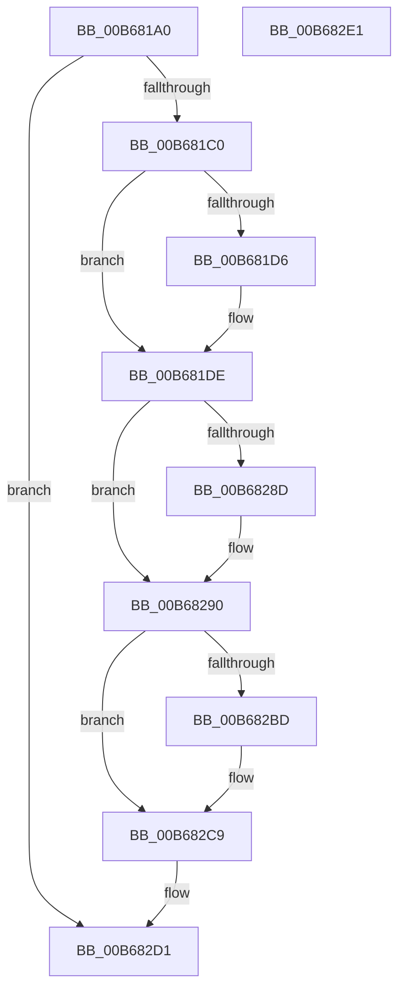

# KiCreateCpuSetForProcessor

- RVA: `0x00B681A0`–`0x00B682E2` (길이 `322` bytes)
- VA: `0x0000000140B681A0`
- 실행 섹션: `PAGELK`
- PDB 이름 있음: `예`; PDB Function 태그: `아니요`
- unwind 정보 RVA: `0x00060BC4`
- 디코드: `66`개 명령, `322/322` bytes 표시
- 미해석 바이트: `0` (있으면 어셈블리에 `.byte`로 보존)

> 이 문서는 커널 이미지의 기계어와 PDB 기호를 분석해 생성했습니다. 4번과 5번은 함수 원형과 자료형을 바이너리 사용 방식에서 추정한 C 해석이며 원본 소스 복구 결과는 아닙니다.

## 1. Dependencies

- 직접 호출 지점: **6**; 고유 호출 대상: **6**
- 직접 호출자로 확인된 함수: **2**
- RIP 상대 이미지 참조: **8**

### Outgoing calls
- `0x00B681D9` → [KiRaiseIrqlProcessIrqlFlags](../../text/4F/KiRaiseIrqlProcessIrqlFlags_function_004F56FC.md) (function, `0x004F56FC`)
- `0x00B681EC` → [KeAcquireSpinLockAtDpcLevel](../../text/20/KeAcquireSpinLockAtDpcLevel_function_00208430.md) (function, `0x00208430`)
- `0x00B681F8` → [RtlWriteAcquireTickLock](../../text/39/RtlWriteAcquireTickLock_function_0039D3B4.md) (function, `0x0039D3B4`)
- `0x00B682A3` → [RtlWriteReleaseTickLock](../../text/45/RtlWriteReleaseTickLock_function_0045C50C.md) (function, `0x0045C50C`)
- `0x00B682AF` → [KxReleaseSpinLock](../../text/20/KxReleaseSpinLock_function_00206670.md) (function, `0x00206670`)
- `0x00B682C4` → [KiLowerIrqlProcessIrqlFlags](../../text/4F/KiLowerIrqlProcessIrqlFlags_function_004F5698.md) (function, `0x004F5698`)

### Direct callers
- [KiCompleteKernelInit](KiCompleteKernelInit_function_00B66090.md) at `0x00B663B4`
- [KeStartAllProcessors](../../init/C3/KeStartAllProcessors_function_00C36F78.md) at `0x00C37116`

### Static image references
- `0x00B681AF` → RVA `0x00FC6E18` (`ALMOSTRO`; read)
- `0x00B681CD` → RVA `0x00FC6D20` (`ALMOSTRO`; read)
- `0x00B681E5` → RVA `0x00F23440` (`.data`; read)
- `0x00B681F1` → RVA `0x00FC6BF8` (`ALMOSTRO`; read)
- `0x00B68205` → RVA `0x00000000` (`image boundary/outside`; read)
- `0x00B68225` → RVA `0x00FC6FD0` (`ALMOSTRO`; read/write)
- `0x00B6823C` → RVA `0x00FC6E20` (`ALMOSTRO`; read)
- `0x00B68275` → RVA `0x00FC6AB0` (`ALMOSTRO`; read)

## 2. Other-region calls and transfers

- 다른 실행 섹션으로 향하는 call: **6**
  - `0x00B681D9` → [KiRaiseIrqlProcessIrqlFlags](../../text/4F/KiRaiseIrqlProcessIrqlFlags_function_004F56FC.md) (`PAGELK` → `.text`)
  - `0x00B681EC` → [KeAcquireSpinLockAtDpcLevel](../../text/20/KeAcquireSpinLockAtDpcLevel_function_00208430.md) (`PAGELK` → `.text`)
  - `0x00B681F8` → [RtlWriteAcquireTickLock](../../text/39/RtlWriteAcquireTickLock_function_0039D3B4.md) (`PAGELK` → `.text`)
  - `0x00B682A3` → [RtlWriteReleaseTickLock](../../text/45/RtlWriteReleaseTickLock_function_0045C50C.md) (`PAGELK` → `.text`)
  - `0x00B682AF` → [KxReleaseSpinLock](../../text/20/KxReleaseSpinLock_function_00206670.md) (`PAGELK` → `.text`)
  - `0x00B682C4` → [KiLowerIrqlProcessIrqlFlags](../../text/4F/KiLowerIrqlProcessIrqlFlags_function_004F5698.md) (`PAGELK` → `.text`)
- 별도 외부 분기/꼬리 이동을 확인하지 못했습니다.

## 3. Assembly (complete function range)

```asm
00B681A0  48 89 5C 24 08                  mov qword ptr [rsp + 8], rbx
00B681A5  48 89 74 24 10                  mov qword ptr [rsp + 0x10], rsi
00B681AA  57                              push rdi
00B681AB  48 83 EC 20                     sub rsp, 0x20
00B681AF  48 83 3D 61 EC 45 00 00         cmp qword ptr [rip + 0x45ec61], 0
00B681B7  48 8B F1                        mov rsi, rcx
00B681BA  0F 84 11 01 00 00               je 0x140b682d1
00B681C0  44 0F 20 C7                     mov rdi, cr8
00B681C4  BA 02 00 00 00                  mov edx, 2
00B681C9  44 0F 22 C2                     mov cr8, rdx
00B681CD  83 3D 4C EB 45 00 00            cmp dword ptr [rip + 0x45eb4c], 0
00B681D4  74 08                           je 0x140b681de
00B681D6  40 8A CF                        mov cl, dil
00B681D9  E8 1E D5 98 FF                  call 0x1404f56fc
00B681DE  0F B6 9E D0 00 00 00            movzx ebx, byte ptr [rsi + 0xd0]
00B681E5  48 8D 0D 54 B2 3B 00            lea rcx, [rip + 0x3bb254]
00B681EC  E8 3F 02 6A FF                  call 0x140208430
00B681F1  48 8D 0D 00 EA 45 00            lea rcx, [rip + 0x45ea00]
00B681F8  E8 B7 51 83 FF                  call 0x14039d3b4
00B681FD  44 0F B6 86 D1 00 00 00         movzx r8d, byte ptr [rsi + 0xd1]
00B68205  4C 8D 1D F4 7D 49 FF            lea r11, [rip - 0xb6820c]
00B6820C  42 FE 84 1B 00 80 FC 00         inc byte ptr [rbx + r11 + 0xfc8000]
00B68214  44 8B CB                        mov r9d, ebx
00B68217  48 8B 8E C8 00 00 00            mov rcx, qword ptr [rsi + 0xc8]
00B6821E  48 8B 05 F3 EB 45 00            mov rax, qword ptr [rip + 0x45ebf3]
00B68225  FF 05 A5 ED 45 00               inc dword ptr [rip + 0x45eda5]
00B6822B  C1 E3 06                        shl ebx, 6
00B6822E  41 03 D8                        add ebx, r8d
00B68231  48 89 0C D8                     mov qword ptr [rax + rbx*8], rcx
00B68235  48 8B 8E C8 00 00 00            mov rcx, qword ptr [rsi + 0xc8]
00B6823C  48 8B 05 DD EB 45 00            mov rax, qword ptr [rip + 0x45ebdd]
00B68243  48 89 0C D8                     mov qword ptr [rax + rbx*8], rcx
00B68247  41 8B C9                        mov ecx, r9d
00B6824A  48 03 C9                        add rcx, rcx
00B6824D  49 8B 84 CB 20 83 FC 00         mov rax, qword ptr [r11 + rcx*8 + 0xfc8320]
00B68255  4C 0F AB C0                     bts rax, r8
00B68259  49 89 84 CB 20 83 FC 00         mov qword ptr [r11 + rcx*8 + 0xfc8320], rax
00B68261  4B 8B 84 CB C0 81 FC 00         mov rax, qword ptr [r11 + r9*8 + 0xfc81c0]
00B68269  4C 0F AB C0                     bts rax, r8
00B6826D  4B 89 84 CB C0 81 FC 00         mov qword ptr [r11 + r9*8 + 0xfc81c0], rax
00B68275  48 8B 05 34 E8 45 00            mov rax, qword ptr [rip + 0x45e834]
00B6827C  48 8D 90 C8 06 00 00            lea rdx, [rax + 0x6c8]
00B68283  8B 80 FC 05 00 00               mov eax, dword ptr [rax + 0x5fc]
00B68289  84 C0                           test al, al
00B6828B  79 03                           jns 0x140b68290
00B6828D  48 8B 12                        mov rdx, qword ptr [rdx]
00B68290  4A 8B 04 CA                     mov rax, qword ptr [rdx + r9*8]
00B68294  48 8D 0D 5D E9 45 00            lea rcx, [rip + 0x45e95d]
00B6829B  4C 0F AB C0                     bts rax, r8
00B6829F  4A 89 04 CA                     mov qword ptr [rdx + r9*8], rax
00B682A3  E8 64 42 8F FF                  call 0x14045c50c
00B682A8  48 8D 0D 91 B1 3B 00            lea rcx, [rip + 0x3bb191]
00B682AF  E8 BC E3 69 FF                  call 0x140206670
00B682B4  83 3D 65 EA 45 00 00            cmp dword ptr [rip + 0x45ea65], 0
00B682BB  74 0C                           je 0x140b682c9
00B682BD  44 0F 20 C1                     mov rcx, cr8
00B682C1  40 8A D7                        mov dl, dil
00B682C4  E8 CF D3 98 FF                  call 0x1404f5698
00B682C9  40 0F B6 C7                     movzx eax, dil
00B682CD  44 0F 22 C0                     mov cr8, rax
00B682D1  48 8B 5C 24 30                  mov rbx, qword ptr [rsp + 0x30]
00B682D6  48 8B 74 24 38                  mov rsi, qword ptr [rsp + 0x38]
00B682DB  48 83 C4 20                     add rsp, 0x20
00B682DF  5F                              pop rdi
00B682E0  C3                              ret
00B682E1  CC                              int3
```

## 4. C-style interpretation (structured pseudocode)

```c
__int64 __fastcall KiCreateCpuSetForProcessor(__int64 a1)
{
    __int64 result;
    __int64 v_rbx;
    __int64 v_rsp;
    unsigned __int64 v_stack_p10;
    unsigned __int64 v_stack_p8;

    v_stack_p8 = v_rbx;
    v_stack_p10 = v_rsi;
    v_rsp = (v_rsp) - (32);
    if ((*(unsigned __int64 *)(v_rip + 4582497)) == 0) goto loc_00B682D1;
    if ((*(unsigned int *)(v_rip + 4582220)) != 0) {
        a1 = (unsigned __int8)(v_cr8);
        result = KiRaiseIrqlProcessIrqlFlags(a1, 2, a3, a4);
    }
    result = KeAcquireSpinLockAtDpcLevel(v_rip + 3912276, 2, a3, a4);
    result = RtlWriteAcquireTickLock(v_rip + 4581888, 2, a3, a4);
    v_rbx = (unsigned int)((*(unsigned __int8 *)(a1 + 208)) << (6));
    v_rbx = (unsigned int)((v_rbx) + ((unsigned int)(*(unsigned __int8 *)(a1 + 209))));
    *(unsigned __int64 *)(*(unsigned __int64 *)(v_rip + 4582387) + v_rbx * 8) = *(unsigned __int64 *)(a1 + 200);
    *(unsigned __int64 *)(*(unsigned __int64 *)(v_rip + 4582365) + v_rbx * 8) = *(unsigned __int64 *)(a1 + 200);
    a1 = ((unsigned int)((unsigned int)((unsigned int)((unsigned int)(*(unsigned __int8 *)(a1 + 208)))))) + ((unsigned int)((unsigned int)((unsigned int)((unsigned int)(*(unsigned __int8 *)(a1 + 208))))));
    *(unsigned __int64 *)(v_rip - 11960844 + a1 * 8 + 16548640) = *(unsigned __int64 *)(v_rip - 11960844 + a1 * 8 + 16548640);
    *(unsigned __int64 *)(v_rip - 11960844 + (unsigned int)((unsigned int)(*(unsigned __int8 *)(a1 + 208))) * 8 + 16548288) = *(unsigned __int64 *)(v_rip - 11960844 + (unsigned int)((unsigned int)(*(unsigned __int8 *)(a1 + 208))) * 8 + 16548288);
    if (sign_flag) {
        a2 = *(unsigned __int64 *)(*(unsigned __int64 *)(v_rip + 4581428) + 1736);
    }
    *(unsigned __int64 *)(a2 + (unsigned int)((unsigned int)(*(unsigned __int8 *)(a1 + 208))) * 8) = *(unsigned __int64 *)(a2 + (unsigned int)((unsigned int)(*(unsigned __int8 *)(a1 + 208))) * 8);
    result = RtlWriteReleaseTickLock(v_rip + 4581725, a2, *(unsigned __int8 *)(a1 + 209), (unsigned int)((unsigned int)(*(unsigned __int8 *)(a1 + 208))));
    result = KxReleaseSpinLock(v_rip + 3912081, a2, *(unsigned __int8 *)(a1 + 209), (unsigned int)((unsigned int)(*(unsigned __int8 *)(a1 + 208))));
    if ((*(unsigned int *)(v_rip + 4581989)) != 0) {
        a1 = 2;
        a2 = (unsigned __int8)(v_cr8);
        result = KiLowerIrqlProcessIrqlFlags(a1, a2, *(unsigned __int8 *)(a1 + 209), (unsigned int)((unsigned int)(*(unsigned __int8 *)(a1 + 208))));
    }
loc_00B682D1:
    v_rsp = (v_rsp) + (32);
    return (unsigned __int8)(v_cr8);
}
```

## 5. (Beta) C Style

```c
int64_t KiCreateCpuSetForProcessor(void *Arg1)
{
    uint8_t *arg1 = (uint8_t *)Arg1;

    int64_t result;
    int64_t local_rbx;
    int64_t local_rsp;
    uint64_t v_stack_p10;
    uint64_t v_stack_p8;

    v_stack_p8 = local_rbx;
    v_stack_p10 = local_rsi;
    local_rsp = (local_rsp) - (32);
    if ((*(uint64_t *)(v_rip + 0x45EC61)) == 0) goto loc_00B682D1;
    if ((*(uint32_t *)(v_rip + 0x45EB4C)) != 0) {
        Arg1 = (uint8_t)(v_cr8);
        result = KiRaiseIrqlProcessIrqlFlags(Arg1, 2, a3, a4);
    }
    result = KeAcquireSpinLockAtDpcLevel(v_rip + 3912276, 2, a3, a4);
    result = RtlWriteAcquireTickLock(v_rip + 4581888, 2, a3, a4);
    local_rbx = (uint32_t)((*(uint8_t *)(arg1 + 0xD0)) << (6));
    local_rbx = (uint32_t)((local_rbx) + ((uint32_t)(*(uint8_t *)(arg1 + 0xD1))));
    *(uint64_t *)(*(uint64_t *)(v_rip + 0x45EBF3) + local_rbx * 8) = *(uint64_t *)(arg1 + 0xC8);
    *(uint64_t *)(*(uint64_t *)(v_rip + 0x45EBDD) + local_rbx * 8) = *(uint64_t *)(arg1 + 0xC8);
    Arg1 = ((uint32_t)((uint32_t)((uint32_t)((uint32_t)(*(uint8_t *)(arg1 + 0xD0)))))) + ((uint32_t)((uint32_t)((uint32_t)((uint32_t)(*(uint8_t *)(arg1 + 0xD0))))));
    *(uint64_t *)(v_rip - 0xB6820C + arg1 * 8 + 0xFC8320) = *(uint64_t *)(v_rip - 0xB6820C + arg1 * 8 + 0xFC8320);
    *(uint64_t *)(v_rip - 0xB6820C + (uint32_t)((uint32_t)(*(uint8_t *)(arg1 + 0xD0))) * 8 + 0xFC81C0) = *(uint64_t *)(v_rip - 0xB6820C + (uint32_t)((uint32_t)(*(uint8_t *)(arg1 + 0xD0))) * 8 + 0xFC81C0);
    if (sign_flag) {
        a2 = *(uint64_t *)(*(uint64_t *)(v_rip + 0x45E834) + 0x6C8);
    }
    *(uint64_t *)(a2 + (uint32_t)((uint32_t)(*(uint8_t *)(arg1 + 0xD0))) * 8) = *(uint64_t *)(a2 + (uint32_t)((uint32_t)(*(uint8_t *)(arg1 + 0xD0))) * 8);
    result = RtlWriteReleaseTickLock(v_rip + 4581725, a2, *(uint8_t *)(arg1 + 0xD1), (uint32_t)((uint32_t)(*(uint8_t *)(arg1 + 0xD0))));
    result = KxReleaseSpinLock(v_rip + 3912081, a2, *(uint8_t *)(arg1 + 0xD1), (uint32_t)((uint32_t)(*(uint8_t *)(arg1 + 0xD0))));
    if ((*(uint32_t *)(v_rip + 0x45EA65)) != 0) {
        Arg1 = 2;
        a2 = (uint8_t)(v_cr8);
        result = KiLowerIrqlProcessIrqlFlags(Arg1, a2, *(uint8_t *)(arg1 + 0xD1), (uint32_t)((uint32_t)(*(uint8_t *)(arg1 + 0xD0))));
    }
loc_00B682D1:
    local_rsp = (local_rsp) + (32);
    return (uint8_t)(v_cr8);
}
```

### 관측된 메모리 오프셋

구조체 형식이 확인되지 않은 접근은 인자 기준의 오프셋으로만 기록했습니다.

| 기준 인자 | 오프셋 표현 | 폭 (bit) | 접근 |
|---|---:|---:|---|
| `Arg1` | `+ 0xC8` | `64` | `R` |
| `Arg1` | `+ 0xD0` | `8` | `R` |
| `Arg1` | `+ 0xD1` | `8` | `R` |

## 6. Execution-region graph

[열기: 2D/3D 그래프와 함수 탐색 컨트롤 패널](../../../control-panel.html?section=pagelk&rva=0x00B681A0&view=graph)

- 2D 그래프는 위에서 아래로 흐르고, 3D 그래프는 빈 공간을 드래그해 회전합니다. Shift+드래그는 이동, 휠은 확대·축소, 함수 노드 선택은 대상 보고서 이동입니다.

### Static fallback


