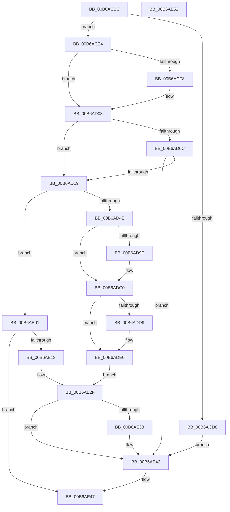

# KiEnableKvaShadowing

- RVA: `0x00B6ACBC`–`0x00B6AE53` (길이 `407` bytes)
- VA: `0x0000000140B6ACBC`
- 실행 섹션: `PAGELK`
- PDB 이름 있음: `예`; PDB Function 태그: `아니요`
- unwind 정보 RVA: `0x0005CAAC`
- 디코드: `86`개 명령, `407/407` bytes 표시
- 미해석 바이트: `0` (있으면 어셈블리에 `.byte`로 보존)

> 이 문서는 커널 이미지의 기계어와 PDB 기호를 분석해 생성했습니다. 4번과 5번은 함수 원형과 자료형을 바이너리 사용 방식에서 추정한 C 해석이며 원본 소스 복구 결과는 아닙니다.

## 1. Dependencies

- 직접 호출 지점: **9**; 고유 호출 대상: **9**
- 직접 호출자로 확인된 함수: **2**
- RIP 상대 이미지 참조: **8**

### Outgoing calls
- `0x00B6ACCF` → [KiIsKvaShadowDisabled](../../text/5B/KiIsKvaShadowDisabled_function_005BF334.md) (function, `0x005BF334`)
- `0x00B6AD03` → [SpcQueryKvaLeakagePresent](../../text/6A/SpcQueryKvaLeakagePresent_function_006A7948.md) (function, `0x006A7948`)
- `0x00B6AD0C` → [SpcIsKvaLeakageSimulated](../../text/6A/SpcIsKvaLeakageSimulated_function_006A7938.md) (function, `0x006A7938`)
- `0x00B6AD31` → [KiInitializeDescriptorIst](../../text/5C/KiInitializeDescriptorIst_function_005C4E38.md) (function, `0x005C4E38`)
- `0x00B6AD53` → [KiInitializeIdt](KiInitializeIdt_function_00B68B50.md) (function, `0x00B68B50`)
- `0x00B6AD86` → [KiSetAddressPolicy](../../text/21/KiSetAddressPolicy_function_002178A0.md) (function, `0x002178A0`)
- `0x00B6ADE0` → [HvlRescindEnlightenments](../../text/58/HvlRescindEnlightenments_function_0058CC7C.md) (function, `0x0058CC7C`)
- `0x00B6AE0A` → [KiShadowProcessorAllocation](KiShadowProcessorAllocation_function_00B6AE5C.md) (function, `0x00B6AE5C`)
- `0x00B6AE15` → [KeGetPrcb](../../text/2D/KeGetPrcb_function_002D85D0.md) (function, `0x002D85D0`)

### Direct callers
- [KiInitializeProcessorState](../../page/74/KiInitializeProcessorState_function_00747390.md) at `0x007475D2`
- [KiInitializeBootStructures](KiInitializeBootStructures_function_00B68530.md) at `0x00B688DC`

### Static image references
- `0x00B6ACD8` → RVA `0x00FC6BD5` (`ALMOSTRO`; write)
- `0x00B6ACE4` → RVA `0x00FC6B60` (`ALMOSTRO`; read)
- `0x00B6AD6F` → RVA `0x00FD0060` (`CACHEALI`; write)
- `0x00B6AD76` → RVA `0x00FD04FC` (`CACHEALI`; read/write)
- `0x00B6ADB9` → RVA `0x00FC6A87` (`ALMOSTRO`; read/write)
- `0x00B6ADE5` → RVA `0x00FC6A87` (`ALMOSTRO`; read)
- `0x00B6ADED` → RVA `0x01201840` (`CFGRO`; write)
- `0x00B6ADF9` → RVA `0x00FC6E54` (`ALMOSTRO`; write)

## 2. Other-region calls and transfers

- 다른 실행 섹션으로 향하는 call: **7**
  - `0x00B6ACCF` → [KiIsKvaShadowDisabled](../../text/5B/KiIsKvaShadowDisabled_function_005BF334.md) (`PAGELK` → `.text`)
  - `0x00B6AD03` → [SpcQueryKvaLeakagePresent](../../text/6A/SpcQueryKvaLeakagePresent_function_006A7948.md) (`PAGELK` → `.text`)
  - `0x00B6AD0C` → [SpcIsKvaLeakageSimulated](../../text/6A/SpcIsKvaLeakageSimulated_function_006A7938.md) (`PAGELK` → `.text`)
  - `0x00B6AD31` → [KiInitializeDescriptorIst](../../text/5C/KiInitializeDescriptorIst_function_005C4E38.md) (`PAGELK` → `.text`)
  - `0x00B6AD86` → [KiSetAddressPolicy](../../text/21/KiSetAddressPolicy_function_002178A0.md) (`PAGELK` → `.text`)
  - `0x00B6ADE0` → [HvlRescindEnlightenments](../../text/58/HvlRescindEnlightenments_function_0058CC7C.md) (`PAGELK` → `.text`)
  - `0x00B6AE15` → [KeGetPrcb](../../text/2D/KeGetPrcb_function_002D85D0.md) (`PAGELK` → `.text`)
- 별도 외부 분기/꼬리 이동을 확인하지 못했습니다.

## 3. Assembly (complete function range)

```asm
00B6ACBC  48 89 5C 24 08                  mov qword ptr [rsp + 8], rbx
00B6ACC1  57                              push rdi
00B6ACC2  48 83 EC 20                     sub rsp, 0x20
00B6ACC6  49 8B F8                        mov rdi, r8
00B6ACC9  4C 8B DA                        mov r11, rdx
00B6ACCC  48 8B D9                        mov rbx, rcx
00B6ACCF  E8 60 46 A5 FF                  call 0x1405bf334
00B6ACD4  84 C0                           test al, al
00B6ACD6  74 0C                           je 0x140b6ace4
00B6ACD8  C6 05 F6 BE 45 00 01            mov byte ptr [rip + 0x45bef6], 1
00B6ACDF  E9 5E 01 00 00                  jmp 0x140b6ae42
00B6ACE4  48 8B 05 75 BE 45 00            mov rax, qword ptr [rip + 0x45be75]
00B6ACEB  25 00 80 01 00                  and eax, 0x18000
00B6ACF0  48 3D 00 80 00 00               cmp rax, 0x8000
00B6ACF6  75 0B                           jne 0x140b6ad03
00B6ACF8  48 C7 81 00 2D 00 00 03 00 00 00  mov qword ptr [rcx + 0x2d00], 3
00B6AD03  E8 40 CC B3 FF                  call 0x1406a7948
00B6AD08  85 C0                           test eax, eax
00B6AD0A  75 0D                           jne 0x140b6ad19
00B6AD0C  E8 27 CC B3 FF                  call 0x1406a7938
00B6AD11  84 C0                           test al, al
00B6AD13  0F 84 29 01 00 00               je 0x140b6ae42
00B6AD19  0F 20 D8                        mov rax, cr3
00B6AD1C  48 89 81 80 AE 00 00            mov qword ptr [rcx + 0xae80], rax
00B6AD23  48 8B 82 04 10 00 00            mov rax, qword ptr [rdx + 0x1004]
00B6AD2A  48 89 82 78 10 00 00            mov qword ptr [rdx + 0x1078], rax
00B6AD31  E8 02 A1 A5 FF                  call 0x1405c4e38
00B6AD36  49 8D 8B 00 42 00 00            lea rcx, [r11 + 0x4200]
00B6AD3D  49 89 8B 04 10 00 00            mov qword ptr [r11 + 0x1004], rcx
00B6AD44  83 7B 24 00                     cmp dword ptr [rbx + 0x24], 0
00B6AD48  0F 85 B3 00 00 00               jne 0x140b6ae01
00B6AD4E  B2 01                           mov dl, 1
00B6AD50  49 8B CB                        mov rcx, r11
00B6AD53  E8 F8 DD FF FF                  call 0x140b68b50
00B6AD58  65 48 8B 04 25 88 01 00 00      mov rax, qword ptr gs:[0x188]
00B6AD61  48 8B 88 B8 00 00 00            mov rcx, qword ptr [rax + 0xb8]
00B6AD68  C6 81 60 01 00 00 01            mov byte ptr [rcx + 0x160], 1
00B6AD6F  C6 05 EA 52 46 00 01            mov byte ptr [rip + 0x4652ea], 1
00B6AD76  F0 81 0D 7B 57 46 00 00 40 00 00  lock or dword ptr [rip + 0x46577b], 0x4000
00B6AD81  B9 01 00 00 00                  mov ecx, 1
00B6AD86  E8 15 CB 6A FF                  call 0x1402178a0
00B6AD8B  48 0F BA A3 A0 8F 00 00 2A      bt qword ptr [rbx + 0x8fa0], 0x2a
00B6AD94  66 C7 83 AA AE 00 00 18 00      mov word ptr [rbx + 0xaeaa], 0x18
00B6AD9D  73 21                           jae 0x140b6adc0
00B6AD9F  0F 20 E0                        mov rax, cr4
00B6ADA2  48 0F BA F0 07                  btr rax, 7
00B6ADA7  48 0F BA E8 11                  bts rax, 0x11
00B6ADAC  0F 22 E0                        mov cr4, rax
00B6ADAF  0F 20 D8                        mov rax, cr3
00B6ADB2  48 83 C8 02                     or rax, 2
00B6ADB6  0F 22 D8                        mov cr3, rax
00B6ADB9  80 0D C7 BC 45 00 01            or byte ptr [rip + 0x45bcc7], 1
00B6ADC0  48 8B 83 A0 8F 00 00            mov rax, qword ptr [rbx + 0x8fa0]
00B6ADC7  48 B9 00 00 00 00 00 24 00 00   movabs rcx, 0x240000000000
00B6ADD1  48 23 C1                        and rax, rcx
00B6ADD4  48 3B C1                        cmp rax, rcx
00B6ADD7  75 07                           jne 0x140b6ade0
00B6ADD9  80 0D A7 BC 45 00 02            or byte ptr [rip + 0x45bca7], 2
00B6ADE0  E8 97 1E A2 FF                  call 0x14058cc7c
00B6ADE5  8A 05 9C BC 45 00               mov al, byte ptr [rip + 0x45bc9c]
00B6ADEB  F6 D8                           neg al
00B6ADED  C6 05 4C 6A 69 00 01            mov byte ptr [rip + 0x696a4c], 1
00B6ADF4  1B C9                           sbb ecx, ecx
00B6ADF6  83 C1 02                        add ecx, 2
00B6ADF9  89 0D 55 C0 45 00               mov dword ptr [rip + 0x45c055], ecx
00B6ADFF  EB 2E                           jmp 0x140b6ae2f
00B6AE01  4C 8B C7                        mov r8, rdi
00B6AE04  49 8B D3                        mov rdx, r11
00B6AE07  48 8B CB                        mov rcx, rbx
00B6AE0A  E8 4D 00 00 00                  call 0x140b6ae5c
00B6AE0F  85 C0                           test eax, eax
00B6AE11  74 34                           je 0x140b6ae47
00B6AE13  33 C9                           xor ecx, ecx
00B6AE15  E8 B6 D7 76 FF                  call 0x1402d85d0
00B6AE1A  0F B7 88 AA AE 00 00            movzx ecx, word ptr [rax + 0xaeaa]
00B6AE21  83 8B 98 AE 00 00 02            or dword ptr [rbx + 0xae98], 2
00B6AE28  66 89 8B AA AE 00 00            mov word ptr [rbx + 0xaeaa], cx
00B6AE2F  80 3D 51 BC 45 00 00            cmp byte ptr [rip + 0x45bc51], 0
00B6AE36  74 0A                           je 0x140b6ae42
00B6AE38  F0 48 0F BA AB 80 AE 00 00 3F   lock bts qword ptr [rbx + 0xae80], 0x3f
00B6AE42  B8 01 00 00 00                  mov eax, 1
00B6AE47  48 8B 5C 24 30                  mov rbx, qword ptr [rsp + 0x30]
00B6AE4C  48 83 C4 20                     add rsp, 0x20
00B6AE50  5F                              pop rdi
00B6AE51  C3                              ret
00B6AE52  CC                              int3
```

## 4. C-style interpretation (structured pseudocode)

```c
__int64 __fastcall KiEnableKvaShadowing(__int64 a1, __int64 a2, __int64 a3)
{
    __int64 result;
    __int64 v_cr3;
    __int64 v_cr4;
    __int64 v_rsp;
    unsigned __int64 v_stack_p8;

    v_stack_p8 = v_rbx;
    v_rsp = (v_rsp) - (32);
    result = KiIsKvaShadowDisabled(a1, a2, a3, a4);
    if ((unsigned __int8)(result) == 0) goto loc_00B6ACE4;
    *(unsigned __int8 *)(v_rip + 4570870) = 1;
    goto loc_00B6AE42;
loc_00B6ACE4:
    result = (unsigned int)((*(unsigned __int64 *)(v_rip + 4570741)) & (0x18000ULL));
    if (result == 0x8000ULL) {
        *(unsigned __int64 *)(a1 + 11520) = 3;
    }
    result = SpcQueryKvaLeakagePresent(a1, a2, a3, a4);
    if ((unsigned int)(result) != 0) goto loc_00B6AD19;
    result = SpcIsKvaLeakageSimulated(a1, a2, a3, a4);
    if ((unsigned __int8)(result) == 0) goto loc_00B6AE42;
loc_00B6AD19:
    *(unsigned __int64 *)(a1 + 44672) = v_cr3;
    *(unsigned __int64 *)(a2 + 4216) = *(unsigned __int64 *)(a2 + 4100);
    result = KiInitializeDescriptorIst(a1, a2, a3, a4);
    *(unsigned __int64 *)(a2 + 4100) = a2 + 16896;
    if ((*(unsigned int *)(a1 + 36)) != 0) goto loc_00B6AE01;
    result = KiInitializeIdt(a2, 1, a3, a4);
    *(unsigned __int8 *)(*(unsigned __int64 *)(*(unsigned __int64 *)(gs_base + (0 + 392)) + 184) + 352) = 1;
    *(unsigned __int8 *)(v_rip + 4608746) = 1;
    result = KiSetAddressPolicy(1, 1, a3, a4);
    *(unsigned __int16 *)(a1 + 44714) = 24;
    if ((*(unsigned int *)(a1 + 36)) < 0) {
        result = v_cr4;
        v_cr4 = result;
        result = v_cr3;
        result = (result) | (2);
        v_cr3 = result;
    }
    result = (*(unsigned __int64 *)(a1 + 36768)) & (1);
    if (result == 1) {
    }
    result = HvlRescindEnlightenments(1, 1, a3, a4);
    result = (unsigned __int8)(-(*(unsigned __int8 *)(v_rip + 4570268)));
    *(unsigned __int8 *)(v_rip + 6908492) = 1;
    a1 = (unsigned int)((1) + (2));
    *(unsigned int *)(v_rip + 4571221) = (unsigned int)(a1);
    goto loc_00B6AE2F;
loc_00B6AE01:
    result = KiShadowProcessorAllocation(a1, a2, a3, a4);
    if ((unsigned int)(result) == 0) goto loc_00B6AE47;
    a1 = 0;
    result = KeGetPrcb(a1, a2, a3, a4);
    *(unsigned __int16 *)(a1 + 44714) = (unsigned __int16)(*(unsigned __int16 *)(result + 44714));
loc_00B6AE2F:
    if ((*(unsigned __int8 *)(v_rip + 4570193)) != 0) {
    }
loc_00B6AE47:
    v_rsp = (v_rsp) + (32);
    return 1;
}
```

## 5. (Beta) C Style

```c
int64_t KiEnableKvaShadowing(void *Arg1, int64_t Arg2, int64_t Arg3)
{
    uint8_t *arg1 = (uint8_t *)Arg1;

    int64_t result;
    int64_t v_cr3;
    int64_t v_cr4;
    int64_t local_rsp;
    uint64_t v_stack_p8;

    v_stack_p8 = local_rbx;
    local_rsp = (local_rsp) - (32);
    result = KiIsKvaShadowDisabled(Arg1, Arg2, Arg3, a4);
    if ((uint8_t)(result) == 0) goto loc_00B6ACE4;
    *(uint8_t *)(v_rip + 0x45BEF6) = 1;
    goto loc_00B6AE42;
loc_00B6ACE4:
    result = (uint32_t)((*(uint64_t *)(v_rip + 0x45BE75)) & (0x18000ULL));
    if (result == 0x8000ULL) {
        *(uint64_t *)(arg1 + 0x2D00) = 3;
    }
    result = SpcQueryKvaLeakagePresent(Arg1, Arg2, Arg3, a4);
    if ((uint32_t)(result) != 0) goto loc_00B6AD19;
    result = SpcIsKvaLeakageSimulated(Arg1, Arg2, Arg3, a4);
    if ((uint8_t)(result) == 0) goto loc_00B6AE42;
loc_00B6AD19:
    *(uint64_t *)(arg1 + 0xAE80) = v_cr3;
    *(uint64_t *)(Arg2 + 0x1078) = *(uint64_t *)(Arg2 + 0x1004);
    result = KiInitializeDescriptorIst(Arg1, Arg2, Arg3, a4);
    *(uint64_t *)(Arg2 + 0x1004) = Arg2 + 16896;
    if ((*(uint32_t *)(arg1 + 0x24)) != 0) goto loc_00B6AE01;
    result = KiInitializeIdt(Arg2, 1, Arg3, a4);
    *(uint8_t *)(*(uint64_t *)(*(uint64_t *)(gs_base + (0 + 0x188)) + 0xB8) + 0x160) = 1;
    *(uint8_t *)(v_rip + 0x4652EA) = 1;
    result = KiSetAddressPolicy(1, 1, Arg3, a4);
    *(uint16_t *)(arg1 + 0xAEAA) = 24;
    if ((*(uint32_t *)(arg1 + 0x24)) < 0) {
        result = v_cr4;
        v_cr4 = result;
        result = v_cr3;
        result = (result) | (2);
        v_cr3 = result;
    }
    result = (*(uint64_t *)(arg1 + 0x8FA0)) & (1);
    if (result == 1) {
    }
    result = HvlRescindEnlightenments(1, 1, Arg3, a4);
    result = (uint8_t)(-(*(uint8_t *)(v_rip + 0x45BC9C)));
    *(uint8_t *)(v_rip + 0x696A4C) = 1;
    Arg1 = (uint32_t)((1) + (2));
    *(uint32_t *)(v_rip + 0x45C055) = (uint32_t)(Arg1);
    goto loc_00B6AE2F;
loc_00B6AE01:
    result = KiShadowProcessorAllocation(Arg1, Arg2, Arg3, a4);
    if ((uint32_t)(result) == 0) goto loc_00B6AE47;
    Arg1 = 0;
    result = KeGetPrcb(Arg1, Arg2, Arg3, a4);
    *(uint16_t *)(arg1 + 0xAEAA) = (uint16_t)(*(uint16_t *)(result + 0xAEAA));
loc_00B6AE2F:
    if ((*(uint8_t *)(v_rip + 0x45BC51)) != 0) {
    }
loc_00B6AE47:
    local_rsp = (local_rsp) + (32);
    return 1;
}
```

### 관측된 메모리 오프셋

구조체 형식이 확인되지 않은 접근은 인자 기준의 오프셋으로만 기록했습니다.

| 기준 인자 | 오프셋 표현 | 폭 (bit) | 접근 |
|---|---:|---:|---|
| `Arg1` | `+ 0x24` | `32` | `R` |
| `Arg1` | `+ 0x8FA0` | `64` | `R` |
| `Arg1` | `+ 0xAE80` | `64` | `R/W` |
| `Arg1` | `+ 0xAE98` | `32` | `R/W` |
| `Arg1` | `+ 0xAEAA` | `16` | `W` |

## 6. Execution-region graph

[열기: 2D/3D 그래프와 함수 탐색 컨트롤 패널](../../../control-panel.html?section=pagelk&rva=0x00B6ACBC&view=graph)

- 2D 그래프는 위에서 아래로 흐르고, 3D 그래프는 빈 공간을 드래그해 회전합니다. Shift+드래그는 이동, 휠은 확대·축소, 함수 노드 선택은 대상 보고서 이동입니다.

### Static fallback


