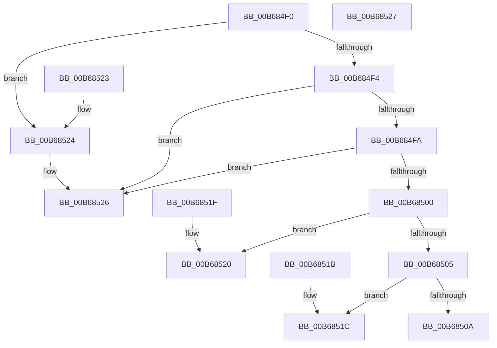

# KiGetL2L3AssociativityAmd

- RVA: `0x00B684F0`–`0x00B68528` (길이 `56` bytes)
- VA: `0x0000000140B684F0`
- 실행 섹션: `PAGELK`
- PDB 이름 있음: `예`; PDB Function 태그: `아니요`
- unwind 정보 RVA: `0x000DB714`
- 디코드: `27`개 명령, `56/56` bytes 표시
- 미해석 바이트: `0` (있으면 어셈블리에 `.byte`로 보존)

> 이 문서는 커널 이미지의 기계어와 PDB 기호를 분석해 생성했습니다. 4번과 5번은 함수 원형과 자료형을 바이너리 사용 방식에서 추정한 C 해석이며 원본 소스 복구 결과는 아닙니다.

## 1. Dependencies

- 직접 호출 지점: **0**; 고유 호출 대상: **0**
- 직접 호출자로 확인된 함수: **1**
- RIP 상대 이미지 참조: **0**

### Outgoing calls
- 직접 디코드된 call 명령이 없습니다.

### Direct callers
- [KiSetCacheInformationAmd](KiSetCacheInformationAmd_function_00B69CBC.md) at `0x00B69D79`
- [KiSetCacheInformationAmd](KiSetCacheInformationAmd_function_00B69CBC.md) at `0x00B69E76`

### Static image references
- 디코드된 RIP-relative 메모리 참조가 없습니다.

## 2. Other-region calls and transfers

- 다른 실행 섹션으로 향하는 call: **0**
- 별도 외부 분기/꼬리 이동을 확인하지 못했습니다.

## 3. Assembly (complete function range)

```asm
00B684F0  84 C9                           test cl, cl
00B684F2  74 30                           je 0x140b68524
00B684F4  B0 02                           mov al, 2
00B684F6  3A C8                           cmp cl, al
00B684F8  74 2C                           je 0x140b68526
00B684FA  B0 04                           mov al, 4
00B684FC  3A C8                           cmp cl, al
00B684FE  74 26                           je 0x140b68526
00B68500  80 F9 06                        cmp cl, 6
00B68503  74 1B                           je 0x140b68520
00B68505  80 F9 08                        cmp cl, 8
00B68508  74 12                           je 0x140b6851c
00B6850A  80 F9 0F                        cmp cl, 0xf
00B6850D  B8 FF 00 00 00                  mov eax, 0xff
00B68512  BA 01 00 00 00                  mov edx, 1
00B68517  0F 45 C2                        cmovne eax, edx
00B6851A  C3                              ret
00B6851B  CC                              int3
00B6851C  B0 10                           mov al, 0x10
00B6851E  C3                              ret
00B6851F  CC                              int3
00B68520  B0 08                           mov al, 8
00B68522  C3                              ret
00B68523  CC                              int3
00B68524  32 C0                           xor al, al
00B68526  C3                              ret
00B68527  CC                              int3
```

## 4. C-style interpretation (structured pseudocode)

```c
__int64 __fastcall KiGetL2L3AssociativityAmd(unsigned __int8 a1)
{
    __int64 result;

    if (a1 == 0) goto loc_00B68524;
    if (a1 == 2) goto loc_00B68526;
    if (a1 == 4) goto loc_00B68526;
    if (a1 == 6) goto loc_00B68520;
    if (a1 == 8) goto loc_00B6851C;
    result = 255;
    if (a1 != 15) { result = 1; }
    return result;
loc_00B6851C:
    return 16;
loc_00B68520:
    return 8;
loc_00B68524:
    result = 0;
loc_00B68526:
    return result;
}
```

## 5. (Beta) C Style

```c
int64_t KiGetL2L3AssociativityAmd(uint8_t Arg1)
{
    int64_t result;

    if (Arg1 == 0) goto loc_00B68524;
    if (Arg1 == 2) goto loc_00B68526;
    if (Arg1 == 4) goto loc_00B68526;
    if (Arg1 == 6) goto loc_00B68520;
    if (Arg1 == 8) goto loc_00B6851C;
    result = 255;
    if (Arg1 != 15) { result = 1; }
    return result;
loc_00B6851C:
    return 16;
loc_00B68520:
    return 8;
loc_00B68524:
    result = 0;
loc_00B68526:
    return result;
}
```

## 6. Execution-region graph

[열기: 2D/3D 그래프와 함수 탐색 컨트롤 패널](../../../control-panel.html?section=pagelk&rva=0x00B684F0&view=graph)

- 2D 그래프는 위에서 아래로 흐르고, 3D 그래프는 빈 공간을 드래그해 회전합니다. Shift+드래그는 이동, 휠은 확대·축소, 함수 노드 선택은 대상 보고서 이동입니다.

### Static fallback


