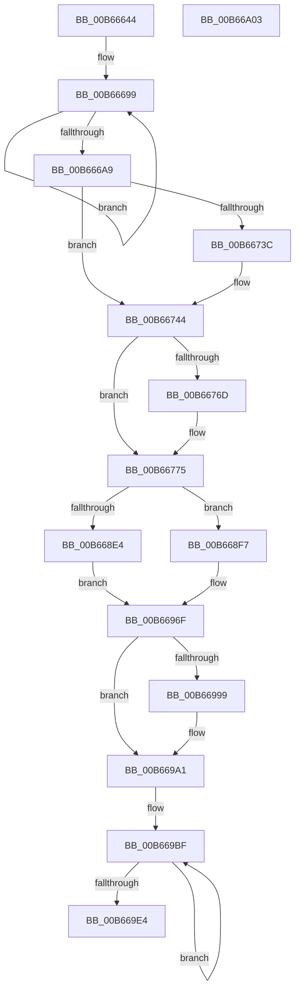

# KiInitPrcb

- RVA: `0x00B66644`–`0x00B66A04` (길이 `960` bytes)
- VA: `0x0000000140B66644`
- 실행 섹션: `PAGELK`
- PDB 이름 있음: `예`; PDB Function 태그: `아니요`
- unwind 정보 RVA: `0x0005FEF8`
- 디코드: `182`개 명령, `960/960` bytes 표시
- 미해석 바이트: `0` (있으면 어셈블리에 `.byte`로 보존)

> 이 문서는 커널 이미지의 기계어와 PDB 기호를 분석해 생성했습니다. 4번과 5번은 함수 원형과 자료형을 바이너리 사용 방식에서 추정한 C 해석이며 원본 소스 복구 결과는 아닙니다.

## 1. Dependencies

- 직접 호출 지점: **14**; 고유 호출 대상: **10**
- 직접 호출자로 확인된 함수: **1**
- RIP 상대 이미지 참조: **34**

### Outgoing calls
- `0x00B666B3` → [KiInitializeSharedReadyQueue](../../text/5B/KiInitializeSharedReadyQueue_function_005B836C.md) (function, `0x005B836C`)
- `0x00B666D0` → [KiInitializeDpcList](../../text/5C/KiInitializeDpcList_function_005C86B8.md) (function, `0x005C86B8`)
- `0x00B66728` → [KeInitializeDpc](../../text/45/KeInitializeDpc_function_0045BBD0.md) (function, `0x0045BBD0`)
- `0x00B6675F` → [KeInitializeDpc](../../text/45/KeInitializeDpc_function_0045BBD0.md) (function, `0x0045BBD0`)
- `0x00B66778` → [KiInitializeBugcheckRecoveryProcessor](../../text/5C/KiInitializeBugcheckRecoveryProcessor_function_005C7968.md) (function, `0x005C7968`)
- `0x00B6679A` → [InitializeSListHead](../../text/46/InitializeSListHead_function_00468A90.md) (function, `0x00468A90`)
- `0x00B668C5` → [KeInitializeDpc](../../text/45/KeInitializeDpc_function_0045BBD0.md) (function, `0x0045BBD0`)
- `0x00B668D4` → `symcryptk.dll!SymCryptEntropyAccumulatorInit0` (import, 간접 대상; import `symcryptk.dll!SymCryptEntropyAccumulatorInit0`)
- `0x00B668E9` → `symcryptk.dll!SymCryptEntropyAccumulatorInit1` (import, 간접 대상; import `symcryptk.dll!SymCryptEntropyAccumulatorInit1`)
- `0x00B6696A` → [memset](../../text/6C/memset_function_006C6C40.md) (function, `0x006C6C40`)
- `0x00B66972` → [KiIntSteerInitPrcb](../../text/5C/KiIntSteerInitPrcb_function_005C5AF8.md) (function, `0x005C5AF8`)
- `0x00B6698B` → [KeInitializeDpc](../../text/45/KeInitializeDpc_function_0045BBD0.md) (function, `0x0045BBD0`)
- `0x00B669A8` → [KiInitializeSoftwareInterruptBatch](../../text/5B/KiInitializeSoftwareInterruptBatch_function_005BE710.md) (function, `0x005BE710`)
- `0x00B669D3` → [memset](../../text/6C/memset_function_006C6C40.md) (function, `0x006C6C40`)

### Direct callers
- [KiInitializeBootStructures](KiInitializeBootStructures_function_00B68530.md) at `0x00B6899F`

### Static image references
- `0x00B666EA` → RVA `0x005C8490` (`KiDpcWatchdog`; read)
- `0x00B66704` → RVA `0x00FC50C0` (`ALMOSTRO`; read)
- `0x00B66710` → RVA `0x00FC50E8` (`ALMOSTRO`; read)
- `0x00B6671C` → RVA `0x00FC50C4` (`ALMOSTRO`; read)
- `0x00B66755` → RVA `0x005B23C0` (`KiSlistRollbackDpc`; read)
- `0x00B667B6` → RVA `0x00485FC0` (`KiEntropyDpcRoutine`; read)
- `0x00B667C1` → RVA `0x00FCF380` (`CACHEALI`; read)
- `0x00B667DD` → RVA `0x00FCF4C0` (`CACHEALI`; read)
- `0x00B667EB` → RVA `0x00FCF500` (`CACHEALI`; read)
- `0x00B667F9` → RVA `0x00FCF540` (`CACHEALI`; read)
- `0x00B66807` → RVA `0x00FCF580` (`CACHEALI`; read)
- `0x00B66815` → RVA `0x00FCF3C0` (`CACHEALI`; read)
- `0x00B66823` → RVA `0x00FCF400` (`CACHEALI`; read)
- `0x00B66831` → RVA `0x00FCF440` (`CACHEALI`; read)
- `0x00B6683F` → RVA `0x00FCF480` (`CACHEALI`; read)
- `0x00B6684D` → RVA `0x00FCF5C0` (`CACHEALI`; read)
- `0x00B668D4` → RVA `0x00151728` (`symcryptk.dll!SymCryptEntropyAccumulatorInit0 (IAT)`; read)
- `0x00B668E9` → RVA `0x00151720` (`symcryptk.dll!SymCryptEntropyAccumulatorInit1 (IAT)`; read)
- `0x00B668F7` → RVA `0x00FC5006` (`ALMOSTRO`; read)
- `0x00B668FD` → RVA `0x00F10F28` (`.data`; read)
- `0x00B66906` → RVA `0x00E0AC78` (`.data`; write)
- `0x00B66912` → RVA `0x00FCF340` (`CACHEALI`; write)
- `0x00B66919` → RVA `0x00FCF380` (`CACHEALI`; write)
- `0x00B66920` → RVA `0x00FCF4C0` (`CACHEALI`; write)
- `0x00B66927` → RVA `0x00FCF500` (`CACHEALI`; write)
- `0x00B6692E` → RVA `0x00FCF580` (`CACHEALI`; write)
- `0x00B66935` → RVA `0x00FCF440` (`CACHEALI`; write)
- `0x00B6693C` → RVA `0x00FCF400` (`CACHEALI`; write)
- `0x00B66943` → RVA `0x00FCF3C0` (`CACHEALI`; write)
- `0x00B6694A` → RVA `0x00FCF540` (`CACHEALI`; write)
- `0x00B66951` → RVA `0x00FCF480` (`CACHEALI`; write)
- `0x00B66958` → RVA `0x00FCF5C0` (`CACHEALI`; write)
- `0x00B6695F` → RVA `0x00F10F20` (`.data`; write)
- `0x00B66984` → RVA `0x0030DEB0` (`KiAbDeferredProcessingWorker`; read)

## 2. Other-region calls and transfers

- 다른 실행 섹션으로 향하는 call: **12**
  - `0x00B666B3` → [KiInitializeSharedReadyQueue](../../text/5B/KiInitializeSharedReadyQueue_function_005B836C.md) (`PAGELK` → `.text`)
  - `0x00B666D0` → [KiInitializeDpcList](../../text/5C/KiInitializeDpcList_function_005C86B8.md) (`PAGELK` → `.text`)
  - `0x00B66728` → [KeInitializeDpc](../../text/45/KeInitializeDpc_function_0045BBD0.md) (`PAGELK` → `.text`)
  - `0x00B6675F` → [KeInitializeDpc](../../text/45/KeInitializeDpc_function_0045BBD0.md) (`PAGELK` → `.text`)
  - `0x00B66778` → [KiInitializeBugcheckRecoveryProcessor](../../text/5C/KiInitializeBugcheckRecoveryProcessor_function_005C7968.md) (`PAGELK` → `.text`)
  - `0x00B6679A` → [InitializeSListHead](../../text/46/InitializeSListHead_function_00468A90.md) (`PAGELK` → `.text`)
  - `0x00B668C5` → [KeInitializeDpc](../../text/45/KeInitializeDpc_function_0045BBD0.md) (`PAGELK` → `.text`)
  - `0x00B6696A` → [memset](../../text/6C/memset_function_006C6C40.md) (`PAGELK` → `.text`)
  - `0x00B66972` → [KiIntSteerInitPrcb](../../text/5C/KiIntSteerInitPrcb_function_005C5AF8.md) (`PAGELK` → `.text`)
  - `0x00B6698B` → [KeInitializeDpc](../../text/45/KeInitializeDpc_function_0045BBD0.md) (`PAGELK` → `.text`)
  - `0x00B669A8` → [KiInitializeSoftwareInterruptBatch](../../text/5B/KiInitializeSoftwareInterruptBatch_function_005BE710.md) (`PAGELK` → `.text`)
  - `0x00B669D3` → [memset](../../text/6C/memset_function_006C6C40.md) (`PAGELK` → `.text`)
- 별도 외부 분기/꼬리 이동을 확인하지 못했습니다.

## 3. Assembly (complete function range)

```asm
00B66644  48 8B C4                        mov rax, rsp
00B66647  48 89 58 08                     mov qword ptr [rax + 8], rbx
00B6664B  48 89 68 10                     mov qword ptr [rax + 0x10], rbp
00B6664F  48 89 70 18                     mov qword ptr [rax + 0x18], rsi
00B66653  48 89 78 20                     mov qword ptr [rax + 0x20], rdi
00B66657  41 54                           push r12
00B66659  41 56                           push r14
00B6665B  41 57                           push r15
00B6665D  48 83 EC 20                     sub rsp, 0x20
00B66661  33 ED                           xor ebp, ebp
00B66663  48 8D 81 40 84 00 00            lea rax, [rcx + 0x8440]
00B6666A  41 BE 01 00 00 00               mov r14d, 1
00B66670  89 A9 D8 83 00 00               mov dword ptr [rcx + 0x83d8], ebp
00B66676  48 8B D9                        mov rbx, rcx
00B66679  44 89 B1 E0 83 00 00            mov dword ptr [rcx + 0x83e0], r14d
00B66680  89 A9 74 86 00 00               mov dword ptr [rcx + 0x8674], ebp
00B66686  8B FA                           mov edi, edx
00B66688  48 89 A9 78 86 00 00            mov qword ptr [rcx + 0x8678], rbp
00B6668F  48 89 A9 08 2D 00 00            mov qword ptr [rcx + 0x2d08], rbp
00B66696  8D 4D 20                        lea ecx, [rbp + 0x20]
00B66699  48 89 40 08                     mov qword ptr [rax + 8], rax
00B6669D  48 89 00                        mov qword ptr [rax], rax
00B666A0  48 83 C0 10                     add rax, 0x10
00B666A4  49 2B CE                        sub rcx, r14
00B666A7  75 F0                           jne 0x140b66699
00B666A9  48 8B 8B 48 8E 00 00            mov rcx, qword ptr [rbx + 0x8e48]
00B666B0  48 8B D3                        mov rdx, rbx
00B666B3  E8 B4 1C A5 FF                  call 0x1405b836c
00B666B8  48 8B 83 48 8E 00 00            mov rax, qword ptr [rbx + 0x8e48]
00B666BF  48 8D 8B 40 38 00 00            lea rcx, [rbx + 0x3840]
00B666C6  48 05 40 02 00 00               add rax, 0x240
00B666CC  48 89 43 38                     mov qword ptr [rbx + 0x38], rax
00B666D0  E8 E3 1F A6 FF                  call 0x1405c86b8
00B666D5  48 89 AB 50 38 00 00            mov qword ptr [rbx + 0x3850], rbp
00B666DC  48 8D B3 60 83 00 00            lea rsi, [rbx + 0x8360]
00B666E3  48 89 AB 58 38 00 00            mov qword ptr [rbx + 0x3858], rbp
00B666EA  48 8D 15 9F 1D A6 FF            lea rdx, [rip - 0x59e261]
00B666F1  89 AB BC 38 00 00               mov dword ptr [rbx + 0x38bc], ebp
00B666F7  45 33 C0                        xor r8d, r8d
00B666FA  40 88 AB BA 38 00 00            mov byte ptr [rbx + 0x38ba], bpl
00B66701  48 8B CE                        mov rcx, rsi
00B66704  8B 05 B6 E9 45 00               mov eax, dword ptr [rip + 0x45e9b6]
00B6670A  89 83 A8 38 00 00               mov dword ptr [rbx + 0x38a8], eax
00B66710  8B 05 D2 E9 45 00               mov eax, dword ptr [rip + 0x45e9d2]
00B66716  89 83 B0 38 00 00               mov dword ptr [rbx + 0x38b0], eax
00B6671C  8B 05 A2 E9 45 00               mov eax, dword ptr [rip + 0x45e9a2]
00B66722  89 83 54 86 00 00               mov dword ptr [rbx + 0x8654], eax
00B66728  E8 A3 54 8F FF                  call 0x14045bbd0
00B6672D  48 8B 46 38                     mov rax, qword ptr [rsi + 0x38]
00B66731  41 BC 00 08 00 00               mov r12d, 0x800
00B66737  48 85 C0                        test rax, rax
00B6673A  75 08                           jne 0x140b66744
00B6673C  41 8D 04 3C                     lea eax, [r12 + rdi]
00B66740  66 89 46 02                     mov word ptr [rsi + 2], ax
00B66744  48 8D B3 90 A1 00 00            lea rsi, [rbx + 0xa190]
00B6674B  C6 83 61 83 00 00 02            mov byte ptr [rbx + 0x8361], 2
00B66752  48 8B CE                        mov rcx, rsi
00B66755  48 8D 15 64 BC A4 FF            lea rdx, [rip - 0x5b439c]
00B6675C  45 33 C0                        xor r8d, r8d
00B6675F  E8 6C 54 8F FF                  call 0x14045bbd0
00B66764  48 8B 46 38                     mov rax, qword ptr [rsi + 0x38]
00B66768  48 85 C0                        test rax, rax
00B6676B  75 08                           jne 0x140b66775
00B6676D  41 8D 04 3C                     lea eax, [r12 + rdi]
00B66771  66 89 46 02                     mov word ptr [rsi + 2], ax
00B66775  48 8B CB                        mov rcx, rbx
00B66778  E8 EB 11 A6 FF                  call 0x1405c7968
00B6677D  48 83 8B 28 38 00 00 FF         or qword ptr [rbx + 0x3828], 0xffffffffffffffff
00B66785  48 8D 83 C0 83 00 00            lea rax, [rbx + 0x83c0]
00B6678C  48 8D 8B 00 38 00 00            lea rcx, [rbx + 0x3800]
00B66793  48 89 40 08                     mov qword ptr [rax + 8], rax
00B66797  48 89 00                        mov qword ptr [rax], rax
00B6679A  E8 F1 22 90 FF                  call 0x140468a90
00B6679F  65 48 8B 04 25 18 00 00 00      mov rax, qword ptr gs:[0x18]
00B667A8  48 8D 8B F0 06 00 00            lea rcx, [rbx + 0x6f0]
00B667AF  4C 8D 83 E0 8F 00 00            lea r8, [rbx + 0x8fe0]
00B667B6  48 8D 15 03 F8 91 FF            lea rdx, [rip - 0x6e07fd]
00B667BD  48 89 48 28                     mov qword ptr [rax + 0x28], rcx
00B667C1  48 8D 05 B8 8B 46 00            lea rax, [rip + 0x468bb8]
00B667C8  48 89 83 D8 07 00 00            mov qword ptr [rbx + 0x7d8], rax
00B667CF  48 8D 8B E8 90 00 00            lea rcx, [rbx + 0x90e8]
00B667D6  48 89 AB D0 07 00 00            mov qword ptr [rbx + 0x7d0], rbp
00B667DD  48 8D 05 DC 8C 46 00            lea rax, [rip + 0x468cdc]
00B667E4  48 89 83 48 07 00 00            mov qword ptr [rbx + 0x748], rax
00B667EB  48 8D 05 0E 8D 46 00            lea rax, [rip + 0x468d0e]
00B667F2  48 89 83 38 07 00 00            mov qword ptr [rbx + 0x738], rax
00B667F9  48 8D 05 40 8D 46 00            lea rax, [rip + 0x468d40]
00B66800  48 89 83 58 07 00 00            mov qword ptr [rbx + 0x758], rax
00B66807  48 8D 05 72 8D 46 00            lea rax, [rip + 0x468d72]
00B6680E  48 89 83 68 07 00 00            mov qword ptr [rbx + 0x768], rax
00B66815  48 8D 05 A4 8B 46 00            lea rax, [rip + 0x468ba4]
00B6681C  48 89 83 88 07 00 00            mov qword ptr [rbx + 0x788], rax
00B66823  48 8D 05 D6 8B 46 00            lea rax, [rip + 0x468bd6]
00B6682A  48 89 83 98 07 00 00            mov qword ptr [rbx + 0x798], rax
00B66831  48 8D 05 08 8C 46 00            lea rax, [rip + 0x468c08]
00B66838  48 89 83 A8 07 00 00            mov qword ptr [rbx + 0x7a8], rax
00B6683F  48 8D 05 3A 8C 46 00            lea rax, [rip + 0x468c3a]
00B66846  48 89 83 B8 07 00 00            mov qword ptr [rbx + 0x7b8], rax
00B6684D  48 8D 05 6C 8D 46 00            lea rax, [rip + 0x468d6c]
00B66854  48 89 83 C8 07 00 00            mov qword ptr [rbx + 0x7c8], rax
00B6685B  8D 04 7F                        lea eax, [rdi + rdi*2]
00B6685E  48 89 AB 40 07 00 00            mov qword ptr [rbx + 0x740], rbp
00B66865  25 FF 03 00 00                  and eax, 0x3ff
00B6686A  48 89 AB 30 07 00 00            mov qword ptr [rbx + 0x730], rbp
00B66871  48 89 AB 50 07 00 00            mov qword ptr [rbx + 0x750], rbp
00B66878  48 89 AB 60 07 00 00            mov qword ptr [rbx + 0x760], rbp
00B6687F  48 89 AB 80 07 00 00            mov qword ptr [rbx + 0x780], rbp
00B66886  48 89 AB 90 07 00 00            mov qword ptr [rbx + 0x790], rbp
00B6688D  48 89 AB A0 07 00 00            mov qword ptr [rbx + 0x7a0], rbp
00B66894  48 89 AB B0 07 00 00            mov qword ptr [rbx + 0x7b0], rbp
00B6689B  48 89 AB C0 07 00 00            mov qword ptr [rbx + 0x7c0], rbp
00B668A2  48 89 AB F0 07 00 00            mov qword ptr [rbx + 0x7f0], rbp
00B668A9  48 89 AB F8 07 00 00            mov qword ptr [rbx + 0x7f8], rbp
00B668B0  41 89 00                        mov dword ptr [r8], eax
00B668B3  48 89 6B 30                     mov qword ptr [rbx + 0x30], rbp
00B668B7  48 89 AB D0 83 00 00            mov qword ptr [rbx + 0x83d0], rbp
00B668BE  44 89 B3 A0 83 00 00            mov dword ptr [rbx + 0x83a0], r14d
00B668C5  E8 06 53 8F FF                  call 0x14045bbd0
00B668CA  48 8D B3 C0 91 00 00            lea rsi, [rbx + 0x91c0]
00B668D1  48 8B CE                        mov rcx, rsi
00B668D4  48 FF 15 4D AE 5E FF            call qword ptr [rip - 0xa151b3]
00B668DB  0F 1F 44 00 00                  nop dword ptr [rax + rax]
00B668E0  85 FF                           test edi, edi
00B668E2  74 13                           je 0x140b668f7
00B668E4  33 D2                           xor edx, edx
00B668E6  48 8B CE                        mov rcx, rsi
00B668E9  48 FF 15 30 AE 5E FF            call qword ptr [rip - 0xa151d0]
00B668F0  0F 1F 44 00 00                  nop dword ptr [rax + rax]
00B668F5  EB 78                           jmp 0x140b6696f
00B668F7  8A 05 09 E7 45 00               mov al, byte ptr [rip + 0x45e709]
00B668FD  48 8D 0D 24 A6 3A 00            lea rcx, [rip + 0x3aa624]
00B66904  33 D2                           xor edx, edx
00B66906  88 05 6C 43 2A 00               mov byte ptr [rip + 0x2a436c], al
00B6690C  41 B8 00 01 00 00               mov r8d, 0x100
00B66912  48 89 2D 27 8A 46 00            mov qword ptr [rip + 0x468a27], rbp
00B66919  48 89 2D 60 8A 46 00            mov qword ptr [rip + 0x468a60], rbp
00B66920  48 89 2D 99 8B 46 00            mov qword ptr [rip + 0x468b99], rbp
00B66927  48 89 2D D2 8B 46 00            mov qword ptr [rip + 0x468bd2], rbp
00B6692E  48 89 2D 4B 8C 46 00            mov qword ptr [rip + 0x468c4b], rbp
00B66935  48 89 2D 04 8B 46 00            mov qword ptr [rip + 0x468b04], rbp
00B6693C  48 89 2D BD 8A 46 00            mov qword ptr [rip + 0x468abd], rbp
00B66943  48 89 2D 76 8A 46 00            mov qword ptr [rip + 0x468a76], rbp
00B6694A  48 89 2D EF 8B 46 00            mov qword ptr [rip + 0x468bef], rbp
00B66951  48 89 2D 28 8B 46 00            mov qword ptr [rip + 0x468b28], rbp
00B66958  48 89 2D 61 8C 46 00            mov qword ptr [rip + 0x468c61], rbp
00B6695F  48 C7 05 B6 A5 3A 00 20 00 20 00  mov qword ptr [rip + 0x3aa5b6], 0x200020
00B6696A  E8 D1 02 B6 FF                  call 0x1406c6c40
00B6696F  48 8B CB                        mov rcx, rbx
00B66972  E8 81 F1 A5 FF                  call 0x1405c5af8
00B66977  48 8D B3 80 91 00 00            lea rsi, [rbx + 0x9180]
00B6697E  45 33 C0                        xor r8d, r8d
00B66981  48 8B CE                        mov rcx, rsi
00B66984  48 8D 15 25 75 7A FF            lea rdx, [rip - 0x858adb]
00B6698B  E8 40 52 8F FF                  call 0x14045bbd0
00B66990  48 8B 46 38                     mov rax, qword ptr [rsi + 0x38]
00B66994  48 85 C0                        test rax, rax
00B66997  75 08                           jne 0x140b669a1
00B66999  66 41 03 FC                     add di, r12w
00B6699D  66 89 7E 02                     mov word ptr [rsi + 2], di
00B669A1  48 8D 8B D8 35 00 00            lea rcx, [rbx + 0x35d8]
00B669A8  E8 63 7D A5 FF                  call 0x1405be710
00B669AD  89 AB 94 8B 00 00               mov dword ptr [rbx + 0x8b94], ebp
00B669B3  BF 05 00 00 00                  mov edi, 5
00B669B8  48 81 C3 04 AF 00 00            add rbx, 0xaf04
00B669BF  48 8D 4B 04                     lea rcx, [rbx + 4]
00B669C3  48 C7 43 FC 01 00 20 00         mov qword ptr [rbx - 4], 0x200001
00B669CB  33 D2                           xor edx, edx
00B669CD  41 B8 00 01 00 00               mov r8d, 0x100
00B669D3  E8 68 02 B6 FF                  call 0x1406c6c40
00B669D8  48 8D 9B 08 01 00 00            lea rbx, [rbx + 0x108]
00B669DF  49 2B FE                        sub rdi, r14
00B669E2  75 DB                           jne 0x140b669bf
00B669E4  48 8B 5C 24 40                  mov rbx, qword ptr [rsp + 0x40]
00B669E9  48 8B 6C 24 48                  mov rbp, qword ptr [rsp + 0x48]
00B669EE  48 8B 74 24 50                  mov rsi, qword ptr [rsp + 0x50]
00B669F3  48 8B 7C 24 58                  mov rdi, qword ptr [rsp + 0x58]
00B669F8  48 83 C4 20                     add rsp, 0x20
00B669FC  41 5F                           pop r15
00B669FE  41 5E                           pop r14
00B66A00  41 5C                           pop r12
00B66A02  C3                              ret
00B66A03  CC                              int3
```

## 4. C-style interpretation (structured pseudocode)

```c
__int64 __fastcall KiInitPrcb(__int64 a1, int a2, int a3)
{
    __int64 result;
    __int64 v_rbp;
    __int64 v_rbx;
    __int64 v_rdi;
    __int64 v_rsp;
    unsigned __int64 v_stack_p10;
    unsigned __int64 v_stack_p18;
    unsigned __int64 v_stack_p20;
    unsigned __int64 v_stack_p8;

    *(unsigned __int64 *)(v_rsp + 8) = v_rbx;
    *(unsigned __int64 *)(v_rsp + 16) = v_rbp;
    *(unsigned __int64 *)(v_rsp + 24) = v_rsi;
    *(unsigned __int64 *)(v_rsp + 32) = v_rdi;
    v_rsp = (v_rsp) - (32);
    v_rbp = 0;
    *(unsigned int *)(a1 + 33752) = 0;
    *(unsigned int *)(a1 + 33760) = 1;
    *(unsigned int *)(a1 + 34420) = 0;
    *(unsigned __int64 *)(a1 + 34424) = 0;
    *(unsigned __int64 *)(a1 + 11528) = 0;
loc_00B66699:
    *(unsigned __int64 *)(a1 + 33856 + 8) = a1 + 33856;
    *(unsigned __int64 *)(a1 + 33856) = a1 + 33856;
    result = (a1 + 33856) + (16);
    a1 = (v_rbp + 32) - (1);
    if (condition_is_not_equal) goto loc_00B66699;
    result = KiInitializeSharedReadyQueue(*(unsigned __int64 *)(a1 + 36424), a1, a3, a4);
    result = (*(unsigned __int64 *)(a1 + 36424)) + (576);
    *(unsigned __int64 *)(a1 + 56) = result;
    result = KiInitializeDpcList(a1 + 14400, a1, a3, a4);
    *(unsigned __int64 *)(a1 + 14416) = 0;
    *(unsigned __int64 *)(a1 + 14424) = 0;
    *(unsigned int *)(a1 + 14524) = 0;
    a3 = 0;
    *(unsigned __int8 *)(a1 + 14522) = 0;
    *(unsigned int *)(a1 + 14504) = (unsigned int)((unsigned int)(*(unsigned int *)(v_rip + 4581814)));
    *(unsigned int *)(a1 + 14512) = (unsigned int)((unsigned int)(*(unsigned int *)(v_rip + 4581842)));
    *(unsigned int *)(a1 + 34388) = (unsigned int)((unsigned int)(*(unsigned int *)(v_rip + 4581794)));
    result = KeInitializeDpc(a1 + 33632, v_rip - 5890657, a3, a4);
    result = *(unsigned __int64 *)(a1 + 33632 + 56);
    if (*(unsigned __int64 *)(a1 + 33632 + 56) == 0) {
        result = (unsigned int)(0x800ULL) + (unsigned int)(a2) * 1;
        *(unsigned __int16 *)(a1 + 33632 + 2) = (unsigned __int16)(result);
    }
    *(unsigned __int8 *)(a1 + 33633) = 2;
    a3 = 0;
    result = KeInitializeDpc(a1 + 41360, v_rip - 5981084, a3, a4);
    result = *(unsigned __int64 *)(a1 + 41360 + 56);
    if (*(unsigned __int64 *)(a1 + 41360 + 56) == 0) {
        result = (unsigned int)(0x800ULL) + (unsigned int)(a2) * 1;
        *(unsigned __int16 *)(a1 + 41360 + 2) = (unsigned __int16)(result);
    }
    result = KiInitializeBugcheckRecoveryProcessor(a1, v_rip - 5981084, a3, a4);
    *(unsigned __int64 *)(a1 + 33728 + 8) = a1 + 33728;
    *(unsigned __int64 *)(a1 + 33728) = a1 + 33728;
    result = InitializeSListHead(a1 + 14336, v_rip - 5981084, a3, a4);
    *(unsigned __int64 *)(*(unsigned __int64 *)(gs_base + (0 + 24)) + 40) = a1 + 1776;
    *(unsigned __int64 *)(a1 + 2008) = v_rip + 4623288;
    *(unsigned __int64 *)(a1 + 2000) = 0;
    *(unsigned __int64 *)(a1 + 1864) = v_rip + 4623580;
    *(unsigned __int64 *)(a1 + 1848) = v_rip + 4623630;
    *(unsigned __int64 *)(a1 + 1880) = v_rip + 4623680;
    *(unsigned __int64 *)(a1 + 1896) = v_rip + 4623730;
    *(unsigned __int64 *)(a1 + 1928) = v_rip + 4623268;
    *(unsigned __int64 *)(a1 + 1944) = v_rip + 4623318;
    *(unsigned __int64 *)(a1 + 1960) = v_rip + 4623368;
    *(unsigned __int64 *)(a1 + 1976) = v_rip + 4623418;
    *(unsigned __int64 *)(a1 + 1992) = v_rip + 4623724;
    *(unsigned __int64 *)(a1 + 1856) = 0;
    result = (unsigned int)(((unsigned int)(a2) + (unsigned int)(a2) * 2) & (0x3FFULL));
    *(unsigned __int64 *)(a1 + 1840) = 0;
    *(unsigned __int64 *)(a1 + 1872) = 0;
    *(unsigned __int64 *)(a1 + 1888) = 0;
    *(unsigned __int64 *)(a1 + 1920) = 0;
    *(unsigned __int64 *)(a1 + 1936) = 0;
    *(unsigned __int64 *)(a1 + 1952) = 0;
    *(unsigned __int64 *)(a1 + 1968) = 0;
    *(unsigned __int64 *)(a1 + 1984) = 0;
    *(unsigned __int64 *)(a1 + 2032) = 0;
    *(unsigned __int64 *)(a1 + 2040) = 0;
    *(unsigned int *)(a1 + 36832) = (unsigned int)(result);
    *(unsigned __int64 *)(a1 + 48) = 0;
    *(unsigned __int64 *)(a1 + 33744) = 0;
    *(unsigned int *)(a1 + 33696) = 1;
    result = KeInitializeDpc(a1 + 37096, v_rip - 7211005, a1 + 36832, a4);
    result = symcryptk_dll_SymCryptEntropyAccumulatorInit0(a1 + 37312, v_rip - 7211005, a1 + 36832, a4);
    if ((unsigned int)((unsigned int)(a2)) == 0) goto loc_00B668F7;
    a2 = 0;
    result = symcryptk_dll_SymCryptEntropyAccumulatorInit1(a1 + 37312, a2, a1 + 36832, a4);
    goto loc_00B6696F;
loc_00B668F7:
    a2 = 0;
    *(unsigned __int8 *)(v_rip + 2769772) = (unsigned __int8)(*(unsigned __int8 *)(v_rip + 4581129));
    *(unsigned __int64 *)(v_rip + 4622887) = 0;
    *(unsigned __int64 *)(v_rip + 4622944) = 0;
    *(unsigned __int64 *)(v_rip + 4623257) = 0;
    *(unsigned __int64 *)(v_rip + 4623314) = 0;
    *(unsigned __int64 *)(v_rip + 4623435) = 0;
    *(unsigned __int64 *)(v_rip + 4623108) = 0;
    *(unsigned __int64 *)(v_rip + 4623037) = 0;
    *(unsigned __int64 *)(v_rip + 4622966) = 0;
    *(unsigned __int64 *)(v_rip + 4623343) = 0;
    *(unsigned __int64 *)(v_rip + 4623144) = 0;
    *(unsigned __int64 *)(v_rip + 4623457) = 0;
    *(unsigned __int64 *)(v_rip + 3843510) = 0x200020ULL;
    result = memset(v_rip + 3843620, a2, 256, a4);
loc_00B6696F:
    result = KiIntSteerInitPrcb(a1, a2, 256, a4);
    a3 = 0;
    result = KeInitializeDpc(a1 + 37248, v_rip - 8751835, a3, a4);
    v_rdi = (unsigned int)(a2);
    if (*(unsigned __int64 *)(a1 + 37248 + 56) == 0) {
        v_rdi = (unsigned __int16)(((unsigned int)(a2)) + ((unsigned __int16)((unsigned int)(0x800ULL))));
        *(unsigned __int16 *)(a1 + 37248 + 2) = (unsigned __int16)(v_rdi);
    }
    result = KiInitializeSoftwareInterruptBatch(a1 + 13784, v_rip - 8751835, a3, a4);
    *(unsigned int *)(a1 + 35732) = 0;
    v_rbx = (a1) + (0xAF04ULL);
loc_00B669BF:
    *(unsigned __int64 *)(v_rbx - 4) = 0x200001ULL;
    a2 = 0;
    result = memset(v_rbx + 4, a2, 256, a4);
    v_rdi = (5) - (1);
    if (condition_is_not_equal) goto loc_00B669BF;
    v_rsp = (v_rsp) + (32);
    return result;
}
```

## 5. (Beta) C Style

```c
int64_t KiInitPrcb(void *Arg1, void *Arg2, int32_t Arg3)
{
    uint8_t *arg1 = (uint8_t *)Arg1;
    uint8_t *arg2 = (uint8_t *)Arg2;

    int64_t result;
    int64_t local_rbp;
    int64_t local_rbx;
    int64_t local_rdi;
    int64_t local_rsp;
    uint64_t v_stack_p10;
    uint64_t v_stack_p18;
    uint64_t v_stack_p20;
    uint64_t v_stack_p8;

    *(uint64_t *)(local_rsp + 0x8) = local_rbx;
    *(uint64_t *)(local_rsp + 0x10) = local_rbp;
    *(uint64_t *)(local_rsp + 0x18) = local_rsi;
    *(uint64_t *)(local_rsp + 0x20) = local_rdi;
    local_rsp = (local_rsp) - (32);
    local_rbp = 0;
    *(uint32_t *)(arg1 + 0x83D8) = 0;
    *(uint32_t *)(arg1 + 0x83E0) = 1;
    *(uint32_t *)(arg1 + 0x8674) = 0;
    *(uint64_t *)(arg1 + 0x8678) = 0;
    *(uint64_t *)(arg1 + 0x2D08) = 0;
loc_00B66699:
    *(void **)(arg1 + 0x8440 + 0x8) = Arg1 + 33856;
    *(void **)(arg1 + 0x8440) = Arg1 + 33856;
    result = (Arg1 + 33856) + (16);
    Arg1 = (local_rbp + 32) - (1);
    if (condition_is_not_equal) goto loc_00B66699;
    result = KiInitializeSharedReadyQueue(*(uint64_t *)(arg1 + 0x8E48), Arg1, Arg3, a4);
    result = (*(uint64_t *)(arg1 + 0x8E48)) + (576);
    *(uint64_t *)(arg1 + 0x38) = result;
    result = KiInitializeDpcList(Arg1 + 14400, Arg1, Arg3, a4);
    *(uint64_t *)(arg1 + 0x3850) = 0;
    *(uint64_t *)(arg1 + 0x3858) = 0;
    *(uint32_t *)(arg1 + 0x38BC) = 0;
    Arg3 = 0;
    *(uint8_t *)(arg1 + 0x38BA) = 0;
    *(uint32_t *)(arg1 + 0x38A8) = (uint32_t)((uint32_t)(*(uint32_t *)(v_rip + 0x45E9B6)));
    *(uint32_t *)(arg1 + 0x38B0) = (uint32_t)((uint32_t)(*(uint32_t *)(v_rip + 0x45E9D2)));
    *(uint32_t *)(arg1 + 0x8654) = (uint32_t)((uint32_t)(*(uint32_t *)(v_rip + 0x45E9A2)));
    result = KeInitializeDpc(Arg1 + 33632, v_rip - 5890657, Arg3, a4);
    result = *(uint64_t *)(arg1 + 0x8360 + 0x38);
    if (*(uint64_t *)(arg1 + 0x8360 + 0x38) == 0) {
        result = (uint32_t)(0x800ULL) + (uint32_t)(Arg2) * 1;
        *(uint16_t *)(arg1 + 0x8360 + 0x2) = (uint16_t)(result);
    }
    *(uint8_t *)(arg1 + 0x8361) = 2;
    Arg3 = 0;
    result = KeInitializeDpc(Arg1 + 41360, v_rip - 5981084, Arg3, a4);
    result = *(uint64_t *)(arg1 + 0xA190 + 0x38);
    if (*(uint64_t *)(arg1 + 0xA190 + 0x38) == 0) {
        result = (uint32_t)(0x800ULL) + (uint32_t)(Arg2) * 1;
        *(uint16_t *)(arg1 + 0xA190 + 0x2) = (uint16_t)(result);
    }
    result = KiInitializeBugcheckRecoveryProcessor(Arg1, v_rip - 5981084, Arg3, a4);
    *(void **)(arg1 + 0x83C0 + 0x8) = Arg1 + 33728;
    *(void **)(arg1 + 0x83C0) = Arg1 + 33728;
    result = InitializeSListHead(Arg1 + 14336, v_rip - 5981084, Arg3, a4);
    *(void **)(*(uint64_t *)(gs_base + (0 + 0x18)) + 0x28) = Arg1 + 1776;
    *(uint64_t *)(arg1 + 0x7D8) = v_rip + 4623288;
    *(uint64_t *)(arg1 + 0x7D0) = 0;
    *(uint64_t *)(arg1 + 0x748) = v_rip + 4623580;
    *(uint64_t *)(arg1 + 0x738) = v_rip + 4623630;
    *(uint64_t *)(arg1 + 0x758) = v_rip + 4623680;
    *(uint64_t *)(arg1 + 0x768) = v_rip + 4623730;
    *(uint64_t *)(arg1 + 0x788) = v_rip + 4623268;
    *(uint64_t *)(arg1 + 0x798) = v_rip + 4623318;
    *(uint64_t *)(arg1 + 0x7A8) = v_rip + 4623368;
    *(uint64_t *)(arg1 + 0x7B8) = v_rip + 4623418;
    *(uint64_t *)(arg1 + 0x7C8) = v_rip + 4623724;
    *(uint64_t *)(arg1 + 0x740) = 0;
    result = (uint32_t)(((uint32_t)(Arg2) + (uint32_t)(Arg2) * 2) & (0x3FFULL));
    *(uint64_t *)(arg1 + 0x730) = 0;
    *(uint64_t *)(arg1 + 0x750) = 0;
    *(uint64_t *)(arg1 + 0x760) = 0;
    *(uint64_t *)(arg1 + 0x780) = 0;
    *(uint64_t *)(arg1 + 0x790) = 0;
    *(uint64_t *)(arg1 + 0x7A0) = 0;
    *(uint64_t *)(arg1 + 0x7B0) = 0;
    *(uint64_t *)(arg1 + 0x7C0) = 0;
    *(uint64_t *)(arg1 + 0x7F0) = 0;
    *(uint64_t *)(arg1 + 0x7F8) = 0;
    *(uint32_t *)(arg1 + 0x8FE0) = (uint32_t)(result);
    *(uint64_t *)(arg1 + 0x30) = 0;
    *(uint64_t *)(arg1 + 0x83D0) = 0;
    *(uint32_t *)(arg1 + 0x83A0) = 1;
    result = KeInitializeDpc(Arg1 + 37096, v_rip - 7211005, Arg1 + 36832, a4);
    result = kernel_indirect_call(Arg1 + 37312, v_rip - 7211005, Arg1 + 36832, a4);
    if ((uint32_t)((uint32_t)(Arg2)) == 0) goto loc_00B668F7;
    Arg2 = 0;
    result = kernel_indirect_call(Arg1 + 37312, Arg2, Arg1 + 36832, a4);
    goto loc_00B6696F;
loc_00B668F7:
    Arg2 = 0;
    *(uint8_t *)(v_rip + 0x2A436C) = (uint8_t)(*(uint8_t *)(v_rip + 0x45E709));
    *(uint64_t *)(v_rip + 0x468A27) = 0;
    *(uint64_t *)(v_rip + 0x468A60) = 0;
    *(uint64_t *)(v_rip + 0x468B99) = 0;
    *(uint64_t *)(v_rip + 0x468BD2) = 0;
    *(uint64_t *)(v_rip + 0x468C4B) = 0;
    *(uint64_t *)(v_rip + 0x468B04) = 0;
    *(uint64_t *)(v_rip + 0x468ABD) = 0;
    *(uint64_t *)(v_rip + 0x468A76) = 0;
    *(uint64_t *)(v_rip + 0x468BEF) = 0;
    *(uint64_t *)(v_rip + 0x468B28) = 0;
    *(uint64_t *)(v_rip + 0x468C61) = 0;
    *(uint64_t *)(v_rip + 0x3AA5B6) = 0x200020ULL;
    result = memset(v_rip + 3843620, Arg2, 256, a4);
loc_00B6696F:
    result = KiIntSteerInitPrcb(Arg1, Arg2, 256, a4);
    Arg3 = 0;
    result = KeInitializeDpc(Arg1 + 37248, v_rip - 8751835, Arg3, a4);
    local_rdi = (uint32_t)(Arg2);
    if (*(uint64_t *)(arg1 + 0x9180 + 0x38) == 0) {
        local_rdi = (uint16_t)(((uint32_t)(Arg2)) + ((uint16_t)((uint32_t)(0x800ULL))));
        *(uint16_t *)(arg1 + 0x9180 + 0x2) = (uint16_t)(local_rdi);
    }
    result = KiInitializeSoftwareInterruptBatch(Arg1 + 13784, v_rip - 8751835, Arg3, a4);
    *(uint32_t *)(arg1 + 0x8B94) = 0;
    local_rbx = (Arg1) + (0xAF04ULL);
loc_00B669BF:
    *(uint64_t *)(local_rbx - 0x4) = 0x200001ULL;
    Arg2 = 0;
    result = memset(local_rbx + 4, Arg2, 256, a4);
    local_rdi = (5) - (1);
    if (condition_is_not_equal) goto loc_00B669BF;
    local_rsp = (local_rsp) + (32);
    return result;
}
```

### 관측된 메모리 오프셋

구조체 형식이 확인되지 않은 접근은 인자 기준의 오프셋으로만 기록했습니다.

| 기준 인자 | 오프셋 표현 | 폭 (bit) | 접근 |
|---|---:|---:|---|
| `Arg1` | `- 0x4` | `64` | `W` |
| `Arg1` | `+ 0x0` | `32` | `W` |
| `Arg1` | `+ 0x0` | `64` | `W` |
| `Arg1` | `+ 0x2` | `16` | `W` |
| `Arg1` | `+ 0x4` | `64` | `R` |
| `Arg1` | `+ 0x8` | `64` | `W` |
| `Arg1` | `+ 0x30` | `64` | `W` |
| `Arg1` | `+ 0x38` | `64` | `R` |
| `Arg1` | `+ 0x38` | `64` | `W` |
| `Arg1` | `+ 0x108` | `64` | `R` |
| `Arg1` | `+ 0x6F0` | `64` | `R` |
| `Arg1` | `+ 0x730` | `64` | `W` |
| `Arg1` | `+ 0x738` | `64` | `W` |
| `Arg1` | `+ 0x740` | `64` | `W` |
| `Arg1` | `+ 0x748` | `64` | `W` |
| `Arg1` | `+ 0x750` | `64` | `W` |
| `Arg1` | `+ 0x758` | `64` | `W` |
| `Arg1` | `+ 0x760` | `64` | `W` |
| `Arg1` | `+ 0x768` | `64` | `W` |
| `Arg1` | `+ 0x780` | `64` | `W` |
| `Arg1` | `+ 0x788` | `64` | `W` |
| `Arg1` | `+ 0x790` | `64` | `W` |
| `Arg1` | `+ 0x798` | `64` | `W` |
| `Arg1` | `+ 0x7A0` | `64` | `W` |
| `Arg1` | `+ 0x7A8` | `64` | `W` |
| `Arg1` | `+ 0x7B0` | `64` | `W` |
| `Arg1` | `+ 0x7B8` | `64` | `W` |
| `Arg1` | `+ 0x7C0` | `64` | `W` |
| `Arg1` | `+ 0x7C8` | `64` | `W` |
| `Arg1` | `+ 0x7D0` | `64` | `W` |
| `Arg1` | `+ 0x7D8` | `64` | `W` |
| `Arg1` | `+ 0x7F0` | `64` | `W` |

추가 오프셋 31개는 표에서 생략했습니다.

## 6. Execution-region graph

[열기: 2D/3D 그래프와 함수 탐색 컨트롤 패널](../../../control-panel.html?section=pagelk&rva=0x00B66644&view=graph)

- 2D 그래프는 위에서 아래로 흐르고, 3D 그래프는 빈 공간을 드래그해 회전합니다. Shift+드래그는 이동, 휠은 확대·축소, 함수 노드 선택은 대상 보고서 이동입니다.

### Static fallback


